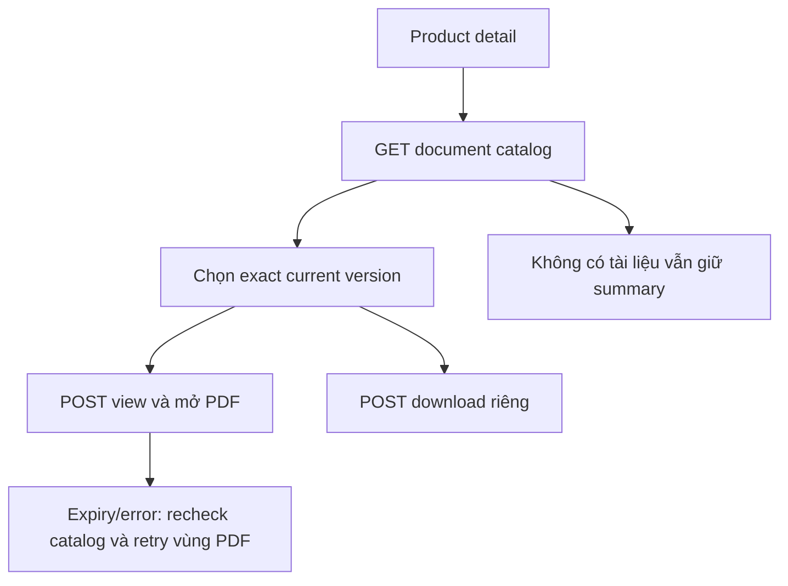

# PR02 — Tài liệu sản phẩm PUBLIC trên Customer

04/11/2026 · **Chưa triển khai** · [C03](../03-products-contract.md) · Cần PR01, [Staff P02](../../../staff/plans/products/02-document-access.md).

## 1. API và data

GET `/products/:productId/documents?limit=20&cursor=...` → safe items và pageInfo. POST `/products/:productId/documents/:documentId/versions/:versionId/view|download`, body `{}` → `{url,expiresAt}`. Đây là API **E của P02** dùng chung hai role, không API Staff riêng và không cần policyId giả; PR02 UI vẫn chưa triển khai. Chỉ title/version/public scope, không tự phân loại Document.kind không tồn tại trong DB.

## 2. File/UI

Bổ sung detail `customer-products.tsx`, client `product-api.ts`; dùng hoặc tách adapter viewer hiện có khi có nhu cầu thực, tham khảo [D02](../documents/02-pdf-viewer-ui.md). Không thêm PDF.js/dependency mặc định. List tài liệu có tải thêm bằng cursor, chọn một tài liệu hiện viewer với tên/version và nút Download PDF. Ghi **Product document**, không gọi là Your policy. Không có tài liệu vẫn xem được summary.

URL app chỉ product/document/version id nếu cần deep link; signed URL chỉ memory. Gán lại selection phải khớp currentVersion catalog mới; version đổi thông báo và yêu cầu chọn/mở bản được công bố, không âm thầm đổi file đang đọc. Refresh same exact file/valid link giữ iframe/src/focus. Access404/401 clear viewer,503 chỉ lỗi PDF; expired xin link mới có kiểm quyền. Download là request intent riêng attachment, không điều hướng cả app sang MinIO.

## 3. Test và gate

Đề xuất `apps/web/tests/browser/customer-product-documents.spec.mjs`, gateway E2E shared product access. PDF text/hash/metadata/Range, không chụp ảnh hoặc in URL ký vào log.

| ID | Case | Kỳ vọng |
| --- | --- | --- |
| PR02-T01 | Catalog nhiều batch, chọn/tải tài liệu | Không trùng, đúng product/version/hash |
| PR02-T02 | Gắn private/cross-product documentId trong URL | Core404, UI không hiện metadata/private PDF |
| PR02-T03 | Refresh same version, current đổi, link expired | Giữ đúng src hoặc clear/reselect đúng tình huống |
| PR02-T04 | Storage503/offline/logout/rapid switch | Không stale PDF, retry vùng, không F5 |
| PR02-T05 | Mobile/keyboard/native viewer unsupported | Có mở/tải bằng link được cấp đúng quyền, không nút chết |

- [ ] P02 thật + browser/E2E pass; audit không chứa URL/PDF.
- [ ] Phân biệt product PUBLIC với exact applied terms trong policy; không thay tài liệu lịch sử bằng current mới.
