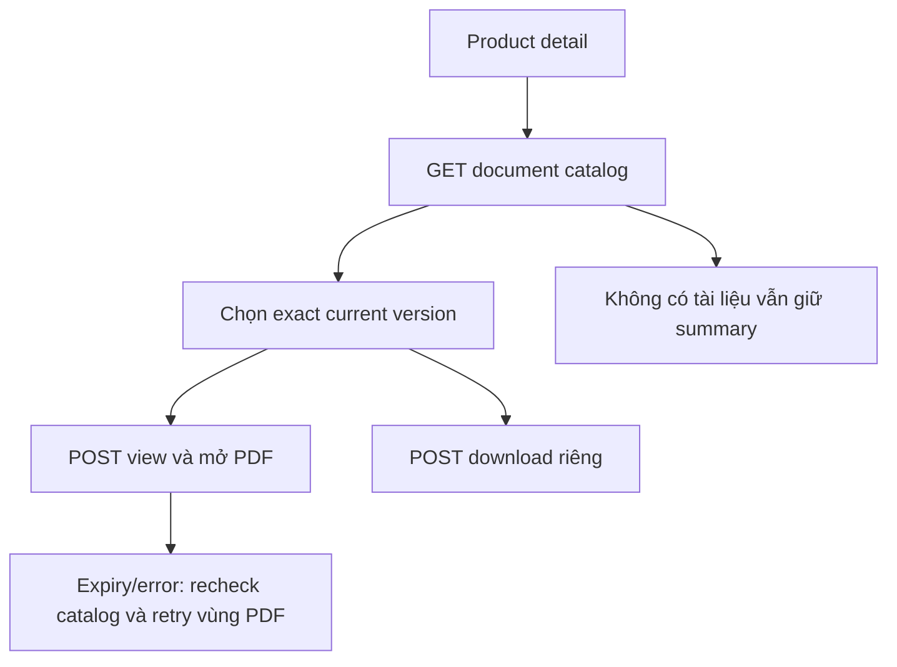
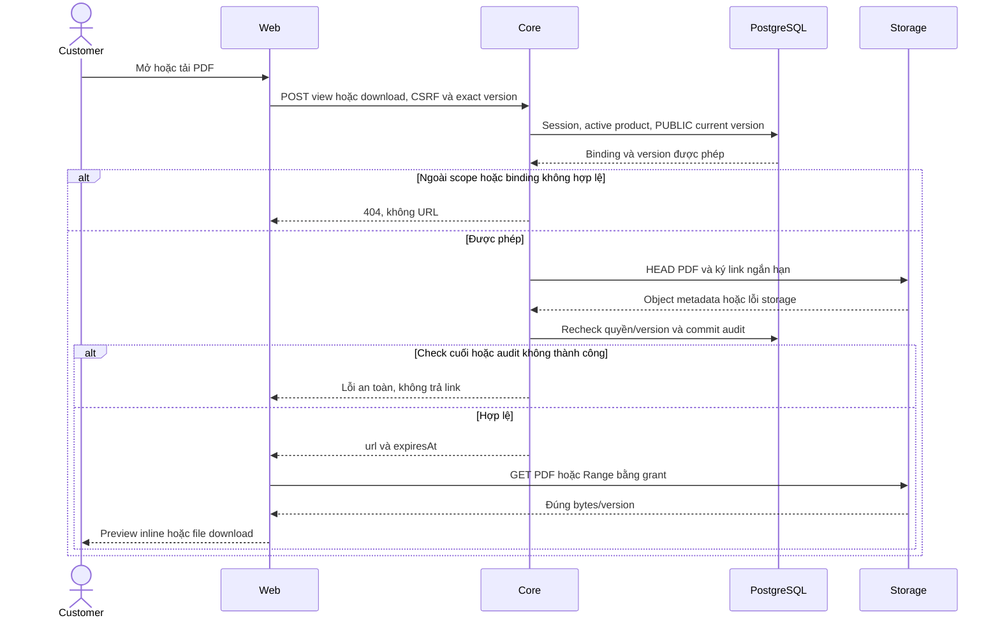

# PR02 — Tài liệu sản phẩm PUBLIC trên Customer

05/11/2026 · **Đã triển khai** · [C03](../03-products-contract.md) · Cần PR01, [Staff P02](../../../staff/plans/products/02-document-access.md).

## Data model và phạm vi ảnh hưởng

Bảng bên dưới mô tả tác động của phase, gồm cả ghi gián tiếp qua Core. Tên bảng thuộc schema `business` trừ nơi ghi rõ; cột còn đề xuất được đánh dấu **P**. Web không truy cập DB trực tiếp.

| Bảng/model | Cột hoặc dữ liệu liên quan | Thao tác của phase | Quan hệ/ràng buộc cần giữ | Mức ảnh hưởng và nơi bị tác động |
| --- | --- | --- | --- | --- |
| users + auth_sessions | users.id/role/status, auth_sessions.user_id/token_hash/expires_at/revoked_at | Đọc | AuthSession.user_id → User.id; session phải còn hạn, không bị thu hồi | Cao — mọi API dùng session; không trả token/hash trong DTO |
| insurance_products | id/product_code/name/summary/is_active | Đọc | Unique product_code; chỉ catalog active, không sửa hợp đồng đã tham gia khi sản phẩm inactive | Trung bình — catalog và tài liệu dùng chung hai role |
| documents + document_versions | product_id/access_scope/policy_id/owner_customer_id/current_version, document_id/version_number/is_active | Đọc | PUBLIC, policy_id/owner_customer_id null; current FK (id,current_version) → (document_id,version_number) | Cao — công bố nhầm Private hoặc chọn version mới nhất bằng timestamp sẽ sai quyền |
| rate_limit_buckets | client_token/endpoint_group/window_start/request_count/blocked_until | Ghi phụ trợ khi endpoint áp quota | PK (client_token,endpoint_group); tăng atomic, giới hạn theo actor/nhóm endpoint | Trung bình — quota có thể ghi dù nghiệp vụ bị từ chối; không log định danh nhạy cảm |
| audit_logs | actor_id/action/target_type/target_id/outcome/request_id/metadata/created_at | Thêm khi mutation/cấp PDF theo service | actor_id → User.id; không sửa/xóa audit cũ; chỉ metadata allowlist | Cao — phải giữ bằng chứng đúng transaction nghiệp vụ; không lưu transcript/password/signed URL |
| MinIO/S3 — ngoài PostgreSQL | PDF object exact version/checksum, HEAD/GET/Range | Đọc/ký, không upload/overwrite | DB và object store không có transaction chung; URL còn TTL sau revoke | Cao — không lưu signed URL vào DB/URL navigation/log |

**Schema/migration:** Không migration trong UI; Web chỉ gọi API Core, không có DB credentials hoặc quyền ghi trực tiếp bảng.

**Nhất quán và hồi quy:** Products chỉ PUBLIC/current, không tạo policy/quote/Ticket khi chọn tài liệu. Core P01/P02 dùng chung Staff; kiểm active/inactive, search, cursor/current version, missing PDF và không lẫn policy private.

## 1. API và data

- Tải danh sách tài liệu: `GET /products/:productId/documents?limit=20&cursor=...`
- Cấp quyền đọc/tải PDF: `POST /products/:productId/documents/:documentId/versions/:versionId/view|download` kèm CSRF token và Origin header.
- Endpoint dùng chung giữa Staff và Customer; chỉ áp dụng cho tài liệu PUBLIC thuộc sản phẩm đang hoạt động.

## 2. File và UI

Tích hợp trực tiếp vào màn hình chi tiết sản phẩm trong `apps/web/src/components/customer-products.tsx`:
- Sử dụng component `SignedPdfPreview` (`signed-pdf-preview.tsx`).
- Bộ chọn phiên bản/tài liệu: Cho phép khách hàng chọn giữa các tài liệu công bố (Quy tắc và điều khoản, Tài liệu giới thiệu sản phẩm).
- Bản xem trước PDF trực tiếp trong portal kèm nút Tải PDF riêng biệt.
- Xử lý trạng thái tài liệu chưa phát hành hoặc không khả dụng an toàn, không làm hỏng thông tin chi tiết của sản phẩm.

| Vị trí từ root repo | Hiện trạng | Trách nhiệm trong phase | Mức ảnh hưởng | Phạm vi cần kiểm lại |
| --- | --- | --- | --- | --- |
| [apps/web/src/components/customer-products.tsx](<../../../../../apps/web/src/components/customer-products.tsx>) | Hiện có | Catalog/detail và document selection Customer | Trung bình | Customer shell và tự mở PDF |
| [apps/web/src/lib/product-api.ts](<../../../../../apps/web/src/lib/product-api.ts>) | Hiện có | Dùng chung P01/P02 API client | Cao | Staff Products và publication DTO |
| [apps/web/src/components/signed-pdf-preview.tsx](<../../../../../apps/web/src/components/signed-pdf-preview.tsx>) | Hiện có | Shared preview/download, dùng khi mở tài liệu | Cao | Hai role/policy viewer |
| [apps/core/src/products/services/product-document.service.ts](<../../../../../apps/core/src/products/services/product-document.service.ts>) | Hiện có | Publication/access backend dùng lại, không clone service Customer | Cao | Current PUBLIC policy của Staff giữ nguyên |

## 3. Checklist hoàn tất

- [x] Tích hợp `readProductDocuments` và `SignedPdfPreview` vào màn hình chi tiết sản phẩm phía Customer.
- [x] Xem trực tiếp và tải về bản PDF chính thức đã được chứng thực.
- [x] Hiển thị thông báo thân thiện khi sản phẩm chưa có tài liệu đính kèm.
- [x] Kiểm tra bảo mật và quyền truy cập: không thể truy cập tài liệu Private hoặc tài liệu của sản phẩm khác.

## Test cases

Các ca dưới đây là **đặc tả kiểm thử**, không phải báo cáo kết quả. Kiểm từng lớp API/service/DB/browser đúng nhãn; mock UI không thay kiểm quyền Core hoặc E2E thật.

**Quy ước dữ liệu:** S-A/S-B là hai Staff synthetic; C-A/C-B là hai Customer synthetic khác nhau. Thay alias bằng UUID/token của fixture cô lập; các path HTTP dùng prefix /api/v1 nếu chưa ghi đầy đủ. Chỉ thay assignment, khóa account, inject lỗi hoặc migration trong harness/môi trường test, không trên tài khoản/dữ liệu đang sử dụng.

### PR02-T01 — PUBLIC current view/download

**Lớp kiểm thử:** Browser + E2E Storage.
**Điều kiện và dữ liệu:** P1 có PUBLIC D1 current v2, hash PDFv2 đã biết.

**Các bước:**

1. Mở chi tiết sản phẩm P1 và tài liệu D1.
2. View PDF rồi Download.
3. Đối chiếu version label, response intent và hash.

**Kết quả mong đợi:** Đúng current PUBLICv2; view inline/download đúng file; không dùng policy Private để cấp tài liệu sản phẩm.

### PR02-T02 — Private/cross-product không truy cập được

**Lớp kiểm thử:** API + Browser.
**Điều kiện và dữ liệu:** Có D2 của P2 và PRIVATE_POLICY D3; C-A mở P1.

**Các bước:**

1. Dùng UUID D2/D3 trong access P1.
2. Thử version cũ không còn current.
3. Kiểm UI sau404.

**Kết quả mong đợi:** Core 404, không signed URL hoặc storage key; UI không giữ preview sai hay tự fallback tài liệu khác.

### PR02-T03 — Sản phẩm chưa có tài liệu

**Lớp kiểm thử:** Browser.
**Điều kiện và dữ liệu:** P0 active có catalog documents rỗng; P1 có PDF.

**Các bước:**

1. Mở P1 rồi đổi P0.
2. Kiểm empty state và viewer.
3. Quay lại P1.

**Kết quả mong đợi:** P0 không giữ PDF/link của P1; không nút download giả, description vẫn dùng được.

### PR02-T04 — Expiry,503 và session

**Lớp kiểm thử:** Browser + API mock.
**Điều kiện và dữ liệu:** PDF grant ngắn hạn; có biến thể storage 503/401.

**Các bước:**

1. Để grant hết hạn và xin lại đúng version.
2. Mô phỏng503 rồi Retry.
3. Cho401 khi đang cấp link.

**Kết quả mong đợi:** Regrant đúng tài liệu; lỗi PDF không hỏng page;401 clear viewer/memory. Không lưu signed URL vào URL app/localStorage.

**Dọn sau kiểm thử:** xóa đúng fixture/session/object/schema theo runId; phục hồi fault injection và đóng context/socket test. Không reset DB/credential, sửa bootstrap hoặc xóa volumes. Với PDF kiểm metadata/bytes/hash; với UI kiểm DOM/focus/network, không cần screenshot.

## Sequence diagram

Luồng chính và nhánh quyền/lỗi; test case ở trên chỉ rõ dữ liệu và điểm kiểm tương ứng.

