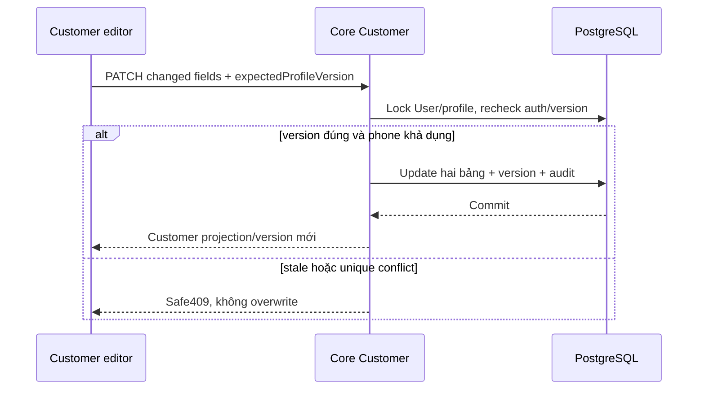

# PF01 — Customer PATCH và optimistic concurrency

04/11/2026 · **P, chưa triển khai/migration** · [C08](../08-profile-contract.md) · Tiếp: [PF02](02-profile-account-ui.md).

## Data model và phạm vi ảnh hưởng

Bảng bên dưới mô tả tác động của phase, gồm cả ghi gián tiếp qua Core. Tên bảng thuộc schema `business` trừ nơi ghi rõ; cột còn đề xuất được đánh dấu **P**. Web không truy cập DB trực tiếp.

| Bảng/model | Cột hoặc dữ liệu liên quan | Thao tác của phase | Quan hệ/ràng buộc cần giữ | Mức ảnh hưởng và nơi bị tác động |
| --- | --- | --- | --- | --- |
| users + auth_sessions | users.id/role/status, auth_sessions.user_id/token_hash/expires_at/revoked_at | Đọc | AuthSession.user_id → User.id; session phải còn hạn, không bị thu hồi | Cao — mọi API dùng session; không trả token/hash trong DTO |
| users + customer_profiles | users.phone/updated_at; customer_profiles.full_name/birth/address; profile_version — P chưa có | PATCH ghi dự kiến, profile_version DDL mới | Unique phone; owner FK; expectedProfileVersion riêng, không dùng assignment_version/User.updated_at thay | Cao — mọi writer hồ sơ/operator phải tăng cùng profile_version; Staff Customers/Home/chat labels đọc dữ liệu này |
| rate_limit_buckets | client_token/endpoint_group/window_start/request_count/blocked_until | Ghi phụ trợ khi endpoint áp quota | PK (client_token,endpoint_group); tăng atomic, giới hạn theo actor/nhóm endpoint | Trung bình — quota có thể ghi dù nghiệp vụ bị từ chối; không log định danh nhạy cảm |
| audit_logs | actor_id/action/target_type/target_id/outcome/request_id/metadata/created_at | Thêm khi mutation/cấp PDF theo service | actor_id → User.id; không sửa/xóa audit cũ; chỉ metadata allowlist | Cao — phải giữ bằng chứng đúng transaction nghiệp vụ; không lưu transcript/password/signed URL |

**Schema/migration:** P — thêm customer_profiles.profile_version default0 bằng migration mới sau chốt contract, không reset profile/assignment. Prisma hiện chưa có cột này.

**Nhất quán và hồi quy:** Lock User/profile theo thứ tự writer hiện có, compare version, update phone/profile/version/audit atomic. Unique phone race rollback; rà account-management writer và realtime fingerprint. Kiểm conflict/no-op/timeout, không đổi PDF đã phát hành.

## 1. Vị trí và model đề xuất

Sửa `apps/core/src/customers/controllers/customer.controller.ts`, `services/customer.service.ts`; DTO mới `update-customer-profile.dto.ts`, Swagger response. Migration **mới** thêm `CustomerProfile.profileVersion Int default0`; backfill0 không reset profile/assignment. Không dùng assignmentVersion để khóa hồ sơ, không suy User.updatedAt đại diện cho cả hai bảng. Chốt trường/profileVersion trước code; bổ sung [Data Model](../../../../specifications/Data_Model.md) khi migration được triển khai, chưa ghi field P thành E.

GET `/customers/me` giữ shape cũ, bổ sung `customer.profileVersion`. Core chỉ trả token, không để client tự set version. Khi fullName/phone/birth/address đổi từ tool/operator hoặc luồng khác, **mọi writer liên quan phải tăng cùng profileVersion**; rà account-management service và writer search trước apply. Nếu một writer chưa thể cập nhật, không tuyên bố chống ghi đè đầy đủ. Assignment update riêng không tăng profileVersion.

Rà projection/types của Customer Web và fingerprint/invalidation profile trong `apps/core/src/realtime/realtime.service.ts`: thay đổi field được phép phải làm phiên đang mở đồng bộ lại đúng owner, không phát PII trên socket. Nếu thêm profileVersion vào fingerprint thì chỉ báo invalidate như nền hiện có, không coi nó là controlVersion của chat. PF02 vẫn giữ bản nháp dirty khi nhận dữ liệu mới để người dùng review.

| Vị trí từ root repo | Hiện trạng | Trách nhiệm trong phase | Mức ảnh hưởng | Phạm vi cần kiểm lại |
| --- | --- | --- | --- | --- |
| [apps/core/src/customers/controllers/customer.controller.ts](<../../../../../apps/core/src/customers/controllers/customer.controller.ts>) | Hiện có | Hiện có read, PATCH còn P | Cao | Customer own projection |
| [apps/core/src/customers/services/customer.service.ts](<../../../../../apps/core/src/customers/services/customer.service.ts>) | Hiện có | P profile mutation với token riêng | Cao | Staff Customers query cùng profile |
| `apps/core/src/customers/dto/update-customer-profile.dto.ts` | Dự kiến — chưa có file | P DTO editable + expectedProfileVersion | Trung bình | Customer editor/client types |
| [apps/core/src/accounts/services/account-management.service.ts](<../../../../../apps/core/src/accounts/services/account-management.service.ts>) | Hiện có | Rà mọi writer/operator cập nhật profile version | Cao | Không bỏ sót nguồn ghi gây lost update |
| [apps/core/src/realtime/realtime.service.ts](<../../../../../apps/core/src/realtime/realtime.service.ts>) | Hiện có | Rà profile fingerprint/invalidation | Cao | Không phát PII hoặc ghi đè dirty draft |

## 2. API spec đề xuất

`PATCH /api/v1/customers/me` body `{expectedProfileVersion:integer,...changedFields}`; ít nhất một editable field, không PUT toàn bộ entity. Response `200 {customer:<GET own customer projection + profileVersion>}`; assignment/contact không cần reload từ mutation. Session CUSTOMER/CSRF/Origin/JSON, no-store. Actor tự lấy từ cookie; unknownfield400.

| Field | Validation đề xuất |
| --- | --- |
| fullName | Trim,1–255; không null/empty/control chars |
| phone | String/null, normalize và validate theo utility Staff hiện có, max20; null là xóa, không tự đổi format khác Staff |
| birth | YYYY-MM-DD hợp lệ hoặc null; ngày không tương lai theo ngày server đã thống nhất, không locale parse |
| address | Trim string1–1000 hoặc null; giới hạn1000 là contract mới cần chốt, không HTML/control chars |
| expectedProfileVersion | Integer≥0 bắt buộc, chỉ compare không gán tùy ý |

email/accountCode/status/role/citizenId/assignmentVersion/profileVersion hoặc customerId gửi body400. Phone unique conflict409 generic không nói ai đang sở hữu. Stale version 409 `PROFILE_CONFLICT` (mã P cần thêm safe allowlist), response không chèn dữ liệu mới tùy tiện. No-op cùng version trả current profile không tăng version; actualchange tăng1. 401/403/400/429/503 theo common contract; quota đề xuất10patch/phút/actor, cần chốt.

## 3. Transaction và timeout

Lock User và CustomerProfile theo thứ tự thống nhất với writer hiện có; recheck ACTIVE session/role trong transaction, compare version, normalize/compare diff, update User.phone + profile + version + audit atomic. Không log old/new PII vào audit. Audit target/action/outcome/field names đủ dùng. Unique phone race rollback cả hai bảng. Không thay session token/password/assignment hoặc policy PDF.

PATCH chưa có command receipt: timeout là **chưa rõ kết quả**. FE GET lại own profile; đối chiếu version/giá trị định gửi để giúp người dùng quyết định. Nếu cần gửi lại thì dùng expected version gốc; đã commit sẽ 409, không blindretry với token mới. Không nói giá trị khớp chứng minh lệnh của mình đã commit vì writer khác có thể giống. Nếu yêu cầu exactly-once command tracking sau này phải mở contract riêng, không giả idempotency từ version.

## 4. Test cases

Các ca dưới đây là **kịch bản dự kiến**, chỉ thực thi sau dependency/contract đã chốt trong phần phạm vi; không đánh dấu chức năng đã có.

**Quy ước dữ liệu:** S-A/S-B là hai Staff synthetic; C-A/C-B là hai Customer synthetic khác nhau. Thay alias bằng UUID/token của fixture cô lập; các path HTTP dùng prefix /api/v1 nếu chưa ghi đầy đủ. Chỉ thay assignment, khóa account, inject lỗi hoặc migration trong harness/môi trường test, không trên tài khoản/dữ liệu đang sử dụng.

### PF01-T01 — PATCH changed fields và version

**Lớp kiểm thử:** API + DB dự kiến.
**Điều kiện và dữ liệu:** Sau PF01 có migration/API, C-A đọc profileVersion=n.

**Các bước:**

1. PATCH riêng fullName, rồi riêng phone, rồi birth/address bằng token mới mỗi lần.
2. GET lại profile sau từng request.
3. Gửi no-op cùng version.

**Kết quả mong đợi:** Đúng owner/changed fields; thay đổi thật tăng1; no-op không tăng; không thay assignment/session/định danh.

### PF01-T02 — Concurrent edit và unique phone

**Lớp kiểm thử:** API + DB barrier dự kiến.
**Điều kiện và dữ liệu:** Hai context C-A cùng version n; phone synthetic trùng fixture C-B.

**Các bước:**

1. Context1 lưu, context 2 lưu bằng n.
2. Thử đổi phone trùng.
3. Inject audit failure sau update profile.

**Kết quả mong đợi:** Stale409, phone conflict không nói owner; không partial User.phone/profile hoặc version, audit failure rollback toàn bộ.

### PF01-T03 — Forbidden fields và validation

**Lớp kiểm thử:** API dự kiến.
**Điều kiện và dữ liệu:** Customer session/CSRF hợp lệ; các biến thể ngày/phone/text synthetic.

**Các bước:**

1. PATCH thêm role/email/customerId/citizenId.
2. Gửi ngày tương lai/ngày không tồn tại, control chars hoặc tên trống.
3. Gửi bằng Staff/CSRF sai.

**Kết quả mong đợi:** 400/403 đúng contract; không sửa dữ liệu hoặc tin actor/body; không tự coerce field sai.

### PF01-T04 — Timeout và migration compatibility

**Lớp kiểm thử:** API + Migration harness dự kiến.
**Điều kiện và dữ liệu:** Schema riêng có profile/credentials đã tồn tại; ACK có thể bị ngắt sau commit.

**Các bước:**

1. Apply migration và đối chiếu hash dữ liệu giữ nguyên.
2. PATCH rồi ngắt ACK; GET profile đối chiếu.
3. Retry bằng version cũ khi dữ liệu đã thay đổi.

**Kết quả mong đợi:** Migration giữ dữ liệu/credential; GET phân biệt current state, stale retry không overwrite; mọi writer được chốt phải cập nhật version.

**Checklist chức năng liên quan** (giữ trạng thái triển khai, không phải kết quả của lần sửa tài liệu):

- [ ] Không reset dữ liệu hoặc tự đổi credential/assignment; API chỉ P→E sau code.

**Dọn sau kiểm thử:** xóa đúng fixture/session/object/schema theo runId; phục hồi fault injection và đóng context/socket test. Không reset DB/credential, sửa bootstrap hoặc xóa volumes. Với PDF kiểm metadata/bytes/hash; với UI kiểm DOM/focus/network, không cần screenshot.
