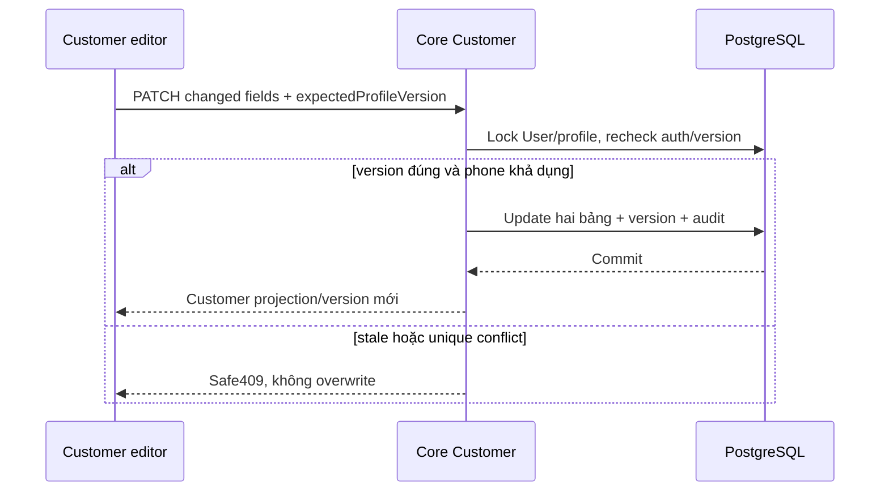

# PF01 — Customer PATCH và optimistic concurrency

04/11/2026 · **P, chưa triển khai/migration** · [C08](../08-profile-contract.md) · Tiếp: [PF02](02-profile-account-ui.md).

## 1. Vị trí và model đề xuất

Sửa `apps/core/src/customers/controllers/customer.controller.ts`, `services/customer.service.ts`; DTO mới `update-customer-profile.dto.ts`, Swagger response. Migration **mới** thêm `CustomerProfile.profileVersion Int default0`; backfill0 không reset profile/assignment. Không dùng assignmentVersion để khóa hồ sơ, không suy User.updatedAt đại diện cho cả hai bảng. Chốt trường/profileVersion trước code; bổ sung [Data Model](../../../../specifications/Data_Model.md) khi migration được triển khai, chưa ghi field P thành E.

GET `/customers/me` giữ shape cũ, bổ sung `customer.profileVersion`. Core chỉ trả token, không để client tự set version. Khi fullName/phone/birth/address đổi từ tool/operator hoặc luồng khác, **mọi writer liên quan phải tăng cùng profileVersion**; rà account-management service và writer search trước apply. Nếu một writer chưa thể cập nhật, không tuyên bố chống ghi đè đầy đủ. Assignment update riêng không tăng profileVersion.

Rà projection/types của Customer Web và fingerprint/invalidation profile trong `apps/core/src/realtime/realtime.service.ts`: thay đổi field được phép phải làm phiên đang mở đồng bộ lại đúng owner, không phát PII trên socket. Nếu thêm profileVersion vào fingerprint thì chỉ báo invalidate như nền hiện có, không coi nó là controlVersion của chat. PF02 vẫn giữ bản nháp dirty khi nhận dữ liệu mới để người dùng review.

## 2. API spec đề xuất

`PATCH /api/v1/customers/me` body `{expectedProfileVersion:integer,...changedFields}`; ít nhất một editable field, không PUT toàn bộ entity. Response `200 {customer:<GET own customer projection + profileVersion>}`; assignment/contact không cần reload từ mutation. Session CUSTOMER/CSRF/Origin/JSON, no-store. Actor tự lấy từ cookie; unknownfield400.

| Field | Validation đề xuất |
| --- | --- |
| fullName | Trim,1–255; không null/empty/control chars |
| phone | String/null, normalize và validate theo utility Staff hiện có, max20; null là xóa, không tự đổi format khác Staff |
| birth | YYYY-MM-DD hợp lệ hoặc null; ngày không tương lai theo ngày server đã thống nhất, không locale parse |
| address | Trim string1–1000 hoặc null; giới hạn1000 là contract mới cần chốt, không HTML/control chars |
| expectedProfileVersion | Integer≥0 bắt buộc, chỉ compare không gán tùy ý |

email/accountCode/status/role/citizenId/assignmentVersion/profileVersion hoặc customerId gửi body400. Phone unique conflict409 generic không nói ai đang sở hữu. Stale version409 `PROFILE_CONFLICT` (mã P cần thêm safe allowlist), response không chèn dữ liệu mới tùy tiện. No-op cùng version trả current profile không tăng version; actualchange tăng1. 401/403/400/429/503 theo common contract; quota đề xuất10patch/phút/actor, cần chốt.

## 3. Transaction và timeout

Lock User và CustomerProfile theo thứ tự thống nhất với writer hiện có; recheck ACTIVE session/role trong transaction, compare version, normalize/compare diff, update User.phone + profile + version + audit atomic. Không log old/new PII vào audit. Audit target/action/outcome/field names đủ dùng. Unique phone race rollback cả hai bảng. Không thay session token/password/assignment hoặc policy PDF.

PATCH chưa có command receipt: timeout là **chưa rõ kết quả**. FE GET lại own profile; đối chiếu version/giá trị định gửi để giúp người dùng quyết định. Nếu cần gửi lại thì dùng expected version gốc; đã commit sẽ409, không blindretry với token mới. Không nói giá trị khớp chứng minh lệnh của mình đã commit vì writer khác có thể giống. Nếu yêu cầu exactly-once command tracking sau này phải mở contract riêng, không giả idempotency từ version.

## 4. Test và hoàn tất

Đề xuất `apps/core/test/customer-profile.test.cjs`; migration/writer compatibility tests; fixtures synthetic cô lập.

| ID | Case | Kỳ vọng |
| --- | --- | --- |
| PF01-T01 | Sửa riêng profile, riêng phone, cả hai | Version bao phủ đúng, response GET tương ứng |
| PF01-T02 | Hai tab cùng version và operator edit | Một update; stale409; mọi writer tăng version |
| PF01-T03 | Uniquephone race/no-op/rollbackaudit | Không partial update, no-op không tăng |
| PF01-T04 | Forbidden fields/ngày sai/control chars/CSRF/Staff | 400/403, không side effect |
| PF01-T05 | Timeout sau commit, GET/retry version cũ | Không ghi đè lại; không false success |
| PF01-T06 | Migration dữ liệu đang có và assignment change | Bảo toàn profile/credential, version routing riêng |

- [ ] Migration mới + toàn bộ writers/model docs thống nhất, test thật pass.
- [ ] Không reset dữ liệu hoặc tự đổi credential/assignment; API chỉ P→E sau code.
