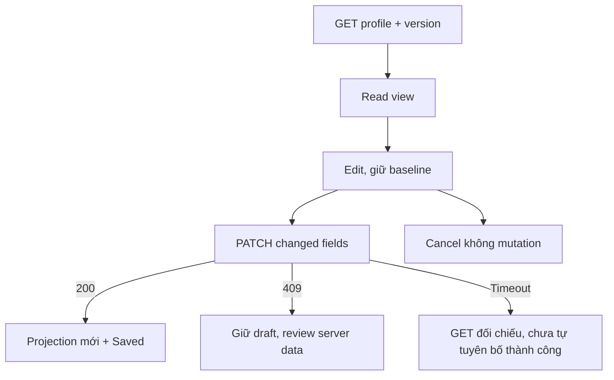

# PF02 — Profile editor và Account Customer

04/11/2026 · **Chưa triển khai phần mới** · [C08](../08-profile-contract.md) · Cần H01+[PF01](01-self-edit-core.md).

## 1. Vị trí và bố cục

Đề xuất `app/customer/profile/page.tsx`, `components/customer-profile-editor.tsx`, helper Customer trong `lib/auth-api.ts` hoặc client hiện đang sở hữu profile, không tạo API wrapper trùng. Profile card tên/avatar/chỉ dẫn ngắn; thông tin định danh readonly, các field được phép có Edit/Save/Cancel. Staff contact vùng riêng theo availability. Security/Change password dùng component/API đang chạy tại `/account`; không copy form Staff hoặc thay password policy.

## 2. API/state

GET `/customers/me` E, version mới từ PF01 P; PATCH chỉ changedFields+expectedProfileVersion, không gửi field disabled để server bỏ qua. Birth date-only, field nullable xóa bằng null, phone utility đồng nhất. Edit giữ baseline/token, dirty state, pending disable; Cancel không request và trả focus về Edit. Same-actor refresh không overwrite form dirty; có bản mới thì báo conflict cần review, không auto cập nhật token sau lưng.

200 update projection/baseline/token và thông báo thành công tại vùng, không contact-admin footer thừa.409 version giữ bản nháp, cho reload dữ liệu server rồi người dùng đối chiếu/nhập lại, không auto retry token mới; xung đột phone chỉ thông báo field không khả dụng. Timeout chưa rõ kết quả GET reconcile theo PF01, không báo saved chỉ vì HTTP timeout hoặc tự merge phiên bản mới.401/actorchange xóa dữ liệu riêng draft;429 chờ; retry mạng khôngF5. Trước nav bỏ form đang có thay đổi có cảnh báo có ý nghĩa, không chặn thao tác vô cớ.

## 3. Kiểm thử

Đề xuất `apps/web/tests/browser/customer-profile-editor.spec.mjs` và `customer-profile.integration.spec.mjs`; test HTTP không thay keyboard/focus/browserE2E.

| ID | Case | Kỳ vọng |
| --- | --- | --- |
| PF02-T01 | Keyboard Edit→đổi name/phone/birth/address→Save | Field/token/body đúng, focus/live message đúng, khôngF5 |
| PF02-T02 | Cancel/dirty refresh/Back | Không mất nháp âm thầm hoặc request Cancel |
| PF02-T03 | Hai context cùng Customer lưu lần lượt | Context sau409, không overwrite; review có thể sửa lại |
| PF02-T04 | Networkunknown/xung đột phone/429/401 | Đúng reconcile/field/state cleanup |
| PF02-T05 | Null/unassigned/375px/zoom200% | Không contact cũ/field giả, thao tác đủ |
| PF02-T06 | Account password/logout hiện có | Không hồi quy sessionrevoke/password policy/Staff account |

- [ ] PF01 thật + DOM/focus/mobile/network/E2E pass; không F5 được xác nhận bằng navigation/network.
- [ ] C08/FR-002 cập nhật phần sửa chính mình, không đánh dấu KYC/emailchange xong.
