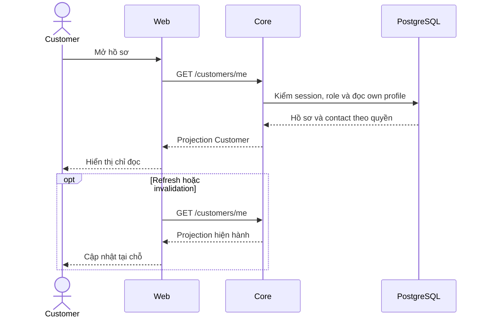

# PF02 — Hồ sơ chỉ đọc và Account Customer

**Phạm vi chốt 13/11/2026, phương án A:** Customer xem hồ sơ và Staff phụ trách, dùng chức năng đổi mật khẩu/đăng xuất hiện có. [C08](../08-profile-contract.md) · [PF01](01-owner-read-api.md).

## 1. Bố cục và dữ liệu

Customer Account hiển thị tên, mã tài khoản, email, phone, ngày sinh và địa chỉ từ GET own profile. Các giá trị thiếu hiển thị `Not provided`. Staff contact theo trạng thái availability từ Core. Thông tin hồ sơ trình bày ở chế độ chỉ đọc, không có Edit/Save/Cancel.

Đổi mật khẩu dùng vùng Security tại `/account`, logout theo Auth hiện có. Những thao tác này có API và trạng thái riêng với hồ sơ cá nhân.

| Bảng/dữ liệu | Thao tác của UI | Ảnh hưởng |
| --- | --- | --- |
| users, customer_profiles | Hiển thị projection self-read | Account, Home và customer labels |
| staff_assignments, staff_profiles | Hiển thị contact từ Core | Staff khả dụng hoặc trạng thái thiếu phân công |
| users, auth_sessions | Gọi Auth khi đổi mật khẩu/logout | Phiên và actor lifecycle |

PF02 dùng schema hiện có. Không có editor hồ sơ, PATCH self-profile hoặc dependency `profileVersion` trong phase này.

## 2. Vị trí code và API

| Vị trí từ root repo | Trách nhiệm |
| --- | --- |
| [customer-account.tsx](../../../../../apps/web/src/components/customer-account.tsx) | Thẻ thông tin chỉ đọc và vùng Account |
| [customer-api.ts](../../../../../apps/web/src/lib/customer-api.ts) | GET own profile |
| [auth-api.ts](../../../../../apps/web/src/lib/auth-api.ts) | Đổi mật khẩu, logout và phiên |
| [auth-screen.tsx](../../../../../apps/web/src/components/auth-screen.tsx) | Actor/session lifecycle |

Dùng `GET /api/v1/customers/me`, `POST /api/v1/auth/change-password` và `POST /api/v1/auth/logout` theo contract hiện có. Refresh/retry cập nhật vùng hồ sơ tại chỗ, không F5. Response cũ không ghi đè dữ liệu của actor mới; logout/401 xóa dữ liệu riêng.

Mức ảnh hưởng trung bình ở render/client types, cao khi sửa actor/session hoặc projection dùng chung.

## 3. Luồng

## 4. Bổ sung bảo vệ dữ liệu — P

Render DTO self-read do Core cấp, không ghép raw profile từ endpoint Staff. Rà label, tooltip, copy và state theo [ma trận dữ liệu Customer](../../../../configuration-and-data.md#customer-sensitive-data). Masking còn là phần chuẩn bị triển khai.

## 5. Test cases

Các ca sau là đặc tả hồi quy, chưa chạy lại trong lần sửa tài liệu.

| Mã | Lớp | Thao tác | Kết quả mong đợi |
| --- | --- | --- | --- |
| PF02-T01 | Browser/network | Mở hồ sơ và dùng bàn phím | Giá trị chỉ đọc; không có Edit/Save/Cancel hoặc request PATCH hồ sơ |
| PF02-T02 | Browser/API mock | Refresh, lỗi mạng và retry | Cập nhật đúng vùng, không F5 hoặc thông báo lưu hồ sơ |
| PF02-T03 | Browser/API mock | Response cũ tới sau logout/đổi actor | Xóa dữ liệu riêng và bỏ response cũ |
| PF02-T04 | Browser | Thiếu birth/address hoặc Staff không khả dụng | Not provided và contact state đúng; keyboard/mobile/zoom 200% sử dụng được |
| PF02-T05 | Browser/gateway | Đổi mật khẩu và logout qua Account | Auth/session theo contract hiện có; không phát sinh mutation hồ sơ |

## 6. Checklist

- [x] Phạm vi hồ sơ Customer chỉ đọc đã được duyệt.
- [x] Component Account hiển thị dữ liệu chỉ đọc đã có trong source.
- [ ] Chạy hồi quy PF02 cho read-only, refresh và actor lifecycle.
- [ ] Kiểm DOM/network cho masking khi Core triển khai projection mới.
