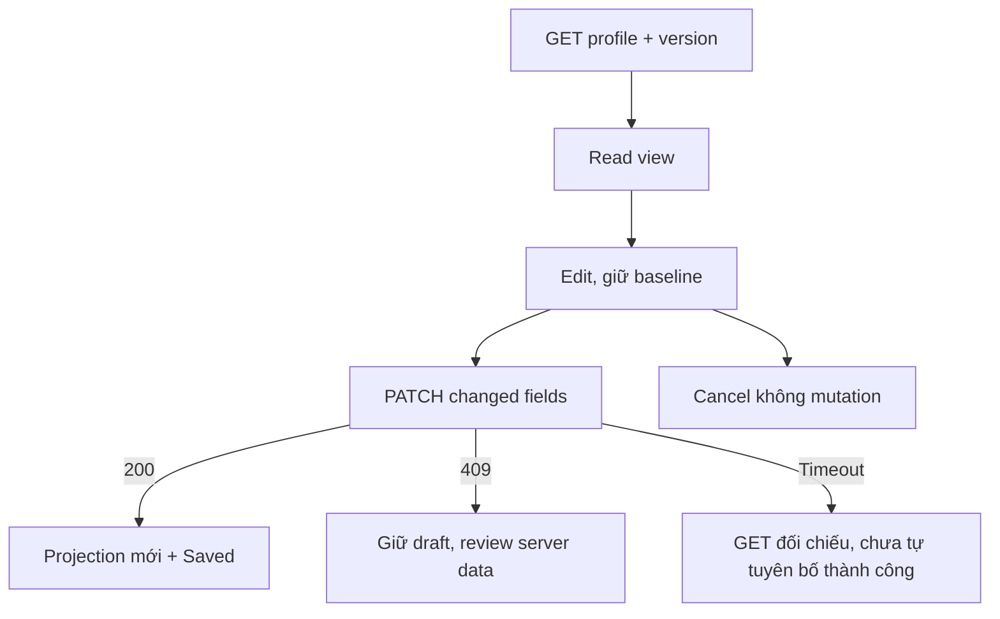
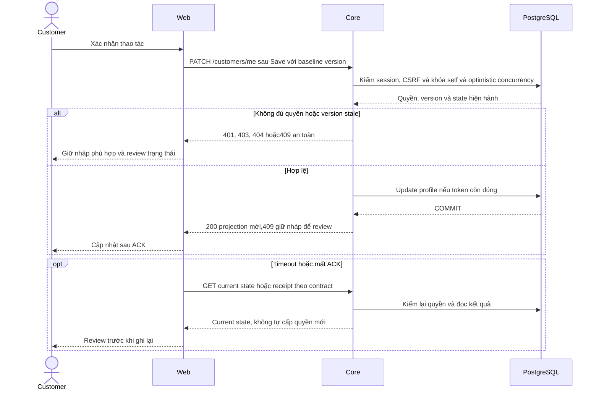

# PF02 — Profile editor và Account Customer

04/11/2026 · **Chưa triển khai phần mới** · [C08](../08-profile-contract.md) · Cần H01+[PF01](01-self-edit-core.md).

## Data model và phạm vi ảnh hưởng

Bảng bên dưới mô tả tác động của phase, gồm cả ghi gián tiếp qua Core. Tên bảng thuộc schema `business` trừ nơi ghi rõ; cột còn đề xuất được đánh dấu **P**. Web không truy cập DB trực tiếp.

| Bảng/model | Cột hoặc dữ liệu liên quan | Thao tác của phase | Quan hệ/ràng buộc cần giữ | Mức ảnh hưởng và nơi bị tác động |
| --- | --- | --- | --- | --- |
| users + auth_sessions | users.id/role/status, auth_sessions.user_id/token_hash/expires_at/revoked_at | Đọc | AuthSession.user_id → User.id; session phải còn hạn, không bị thu hồi | Cao — mọi API dùng session; không trả token/hash trong DTO |
| users + customer_profiles | users.id/account_code/email/phone/status/updated_at; customer_profiles.user_id/full_name/birth/address/assignment_version | Đọc own profile | CustomerProfile.user_id/role → User.id/role; owner actor từ session, không nhận customerId tự chọn | Cao — Customer header/Home/profile và Staff customer projection dùng chung dữ liệu |
| users + customer_profiles | users.phone/updated_at; customer_profiles.full_name/birth/address; profile_version — P chưa có | PATCH ghi dự kiến, profile_version DDL mới | Unique phone; owner FK; expectedProfileVersion riêng, không dùng assignment_version/User.updated_at thay | Cao — mọi writer hồ sơ/operator phải tăng cùng profile_version; Staff Customers/Home/chat labels đọc dữ liệu này |

**Schema/migration:** Không migration trong UI; Web chỉ gọi API Core, không có DB credentials hoặc quyền ghi trực tiếp bảng. PATCH/profile_version vẫn P theo PF01.

**Nhất quán và hồi quy:** Form giữ draft khi refetch/409/network. Change-password/logout dùng Auth E, không gộp profile PATCH với password transaction. Kiểm dirty/focus/null/unique phone và luồng read-only khi PATCH chưa có.

## 1. Vị trí và bố cục

Đề xuất `app/customer/profile/page.tsx`, `components/customer-profile-editor.tsx`, helper Customer trong `lib/auth-api.ts` hoặc client hiện đang sở hữu profile, không tạo API wrapper trùng. Profile card tên/avatar/chỉ dẫn ngắn; thông tin định danh readonly, các field được phép có Edit/Save/Cancel. Staff contact vùng riêng theo availability. Security/Change password dùng component/API đang chạy tại `/account`; không copy form Staff hoặc thay password policy.

| Vị trí từ root repo | Hiện trạng | Trách nhiệm trong phase | Mức ảnh hưởng | Phạm vi cần kiểm lại |
| --- | --- | --- | --- | --- |
| [apps/web/src/components/customer-account.tsx](<../../../../../apps/web/src/components/customer-account.tsx>) | Hiện có | Own profile/password, P editable form | Trung bình | Account và Home/sidebar labels |
| [apps/web/src/lib/customer-api.ts](<../../../../../apps/web/src/lib/customer-api.ts>) | Hiện có | Own projection, P PATCH/profile token | Cao | Staff client cùng module nếu được tái sử dụng |
| [apps/web/src/lib/auth-api.ts](<../../../../../apps/web/src/lib/auth-api.ts>) | Hiện có | Password/logout đã có, giữ contract | Cao | Cả Staff và Customer |
| [apps/web/src/components/auth-screen.tsx](<../../../../../apps/web/src/components/auth-screen.tsx>) | Hiện có | Actor/session lifecycle | Cao | Không mất draft vì focus refresh |

## 2. API/state

GET `/customers/me` E, version mới từ PF01 P; PATCH chỉ changedFields+expectedProfileVersion, không gửi field disabled để server bỏ qua. Birth date-only, field nullable xóa bằng null, phone utility đồng nhất. Edit giữ baseline/token, dirty state, pending disable; Cancel không request và trả focus về Edit. Same-actor refresh không overwrite form dirty; có bản mới thì báo conflict cần review, không auto cập nhật token sau lưng.

200 update projection/baseline/token và thông báo thành công tại vùng, không contact-admin footer thừa.409 version giữ bản nháp, cho reload dữ liệu server rồi người dùng đối chiếu/nhập lại, không auto retry token mới; xung đột phone chỉ thông báo field không khả dụng. Timeout chưa rõ kết quả GET reconcile theo PF01, không báo saved chỉ vì HTTP timeout hoặc tự merge phiên bản mới.401/actorchange xóa dữ liệu riêng draft;429 chờ; retry mạng khôngF5. Trước nav bỏ form đang có thay đổi có cảnh báo có ý nghĩa, không chặn thao tác vô cớ.

## 3. Test cases

Các ca dưới đây là **kịch bản dự kiến**, chỉ thực thi sau dependency/contract đã chốt trong phần phạm vi; không đánh dấu chức năng đã có.

**Quy ước dữ liệu:** S-A/S-B là hai Staff synthetic; C-A/C-B là hai Customer synthetic khác nhau. Thay alias bằng UUID/token của fixture cô lập; các path HTTP dùng prefix /api/v1 nếu chưa ghi đầy đủ. Chỉ thay assignment, khóa account, inject lỗi hoặc migration trong harness/môi trường test, không trên tài khoản/dữ liệu đang sử dụng.

### PF02-T01 — Edit/Save/Cancel và body tối thiểu

**Lớp kiểm thử:** Browser dự kiến.
**Điều kiện và dữ liệu:** PF01 đã có; C-A mở profile version n, tên/phone/birth/address synthetic.

**Các bước:**

1. Dùng Tab mở Edit, đổi một field rồi Cancel.
2. Mở lại, đổi name/birth và Save.
3. Kiểm PATCH body và focus.

**Kết quả mong đợi:** Cancel không mutation, trả focus; Save chỉ changed fields+version, readonly fields không gửi; không F5.

### PF02-T02 — Draft không bị refresh hoặc conflict ghi đè

**Lớp kiểm thử:** Browser + API mock dự kiến.
**Điều kiện và dữ liệu:** Hai context C-A, tab 1 có nháp chưa lưu.

**Các bước:**

1. Tab2 lưu bản mới.
2. Phát update nền tab 1 rồi Save bằng token cũ.
3. Chọn review dữ liệu server theo UI.

**Kết quả mong đợi:** Nháp giữ nguyên,409 được review rõ; không auto đổi token rồi ghi đè server hoặc tự merge PII.

### PF02-T03 — Unknown, phone conflict và 401

**Lớp kiểm thử:** Browser + API mock dự kiến.
**Điều kiện và dữ liệu:** Inject network ACK mất/phone conflict/429/401 theo từng fixture.

**Các bước:**

1. Save và ngắt ACK rồi kiểm GET reconcile.
2. Thử phone không khả dụng và 429.
3. Logout/401 khi response pending.

**Kết quả mong đợi:** Không Saved giả; field conflict không lộ người khác; cooldown theo contract; session change clear nháp/response cũ.

### PF02-T04 — Null và mobile/account regression

**Lớp kiểm thử:** Browser dự kiến.
**Điều kiện và dữ liệu:** C-A chưa có birth/address, không Staff khả dụng; viewport 375px.

**Các bước:**

1. Edit field nullable rồi xóa bằng null.
2. Dùng zoom 200% và keyboard.
3. Mở Change password/logout hiện có.

**Kết quả mong đợi:** Không dữ liệu/contact giả; controls/focus hợp lệ; password/session/logout không hồi quy.

**Checklist chức năng liên quan** (giữ trạng thái triển khai, không phải kết quả của lần sửa tài liệu):

- [ ] C08/FR-002 cập nhật phần sửa chính mình, không đánh dấu KYC/emailchange xong.

**Dọn sau kiểm thử:** xóa đúng fixture/session/object/schema theo runId; phục hồi fault injection và đóng context/socket test. Không reset DB/credential, sửa bootstrap hoặc xóa volumes. Với PDF kiểm metadata/bytes/hash; với UI kiểm DOM/focus/network, không cần screenshot.

## Sequence diagram

**Luồng dự kiến:** chỉ áp dụng sau khi các dependency và API ở phần phạm vi được chốt.

