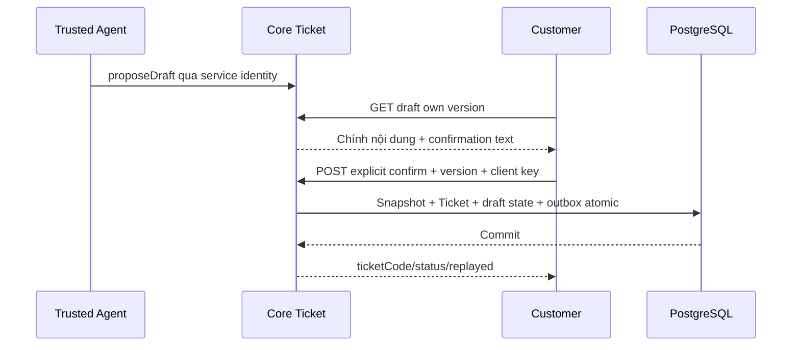

# T01 — Customer contract trong Core Ticket I07

04/11/2026 · **P, chưa triển khai** · [C07](../07-tickets-contract.md) · [I07 canonical](../../../staff/plans/tickets/06-agent-confirmation.md).

## 1. Ownership công việc

Triển khai một module `apps/core/src/tickets/` theo I07: customer controller, draft/ticket/accessservices, DTO và migration mới. Bảng TicketDraft + fields confirmed snapshot/version/hash là **đề xuất I07**, chưa schema hiện hành. Không backfill summary legacy thành nội dung Customer đã xác nhận. Các bước dưới là phần Customer trong cùng I07, không một lần implementation thứ hai.

## 2. API spec P — giữ I07 làm nguồn DTO

| API | Body/response tối thiểu |
| --- | --- |
| GET `/customers/me/conversations/:conversationId/ticket-drafts/:draftId` | `{draft:{id,version,state,confirmedTicket,title,description,policyId,sourceMessageIds,expiresAt},confirmation:{textVersion,text}}` |
| POST `/customers/me/tickets` | `{clientRequestId,draftId,expectedDraftVersion,confirmation:{confirmed:true,textVersion:'ticket-v1'}}` →201first/200 replay `{ticket:{id,ticketCode,status,confirmedAt},replayed}` |
| GET `/customers/me/tickets/by-client-request-id/:clientRequestId` | Own receipt hoặc safe 404;404 chưa chứng minh chưa commit |
| GET `/customers/me/tickets/:ticketId` | Own persisted confirmedContent/status/code và link cuộc nếu còn quyền, không ghi chú nội bộ Staff |

Prefix `/api/v1`, UUID được validate, CSRF/Origin cho POST, GET no-store. Không nhận customerId/confirmedContent/source/confirmedAt/status do browser tự khai. Draft thuộc chính Customer/đúng cuộc CUSTOMER_SUPPORT, nguồn đúng Customer-visible và policy owner; receipt chỉ actor gốc. 400 validation,401/403 auth,404 ngoài owner,409 draft stale/expired/đã xác nhận/xung đột idempotency,429 quota. Quota cụ thể theo I07 cần chốt trước code; không reuse quota gửi tin như một giả định.

Trusted `proposeDraft` chỉ gọi sau service identity CH02, không endpoint browser `{source:'AGENT'}`. **Sửa nội dung draft** cần server revision/version mới/hash và review lại; I07 chưa có revision HTTP route cụ thể. Nếu muốn bật Edit ở T02 phải cập nhật I07 với DTO/authorization/supersede semantics trước, không gửi content tùy ý trong POST confirm. Đợt đầu có thể review chỉ đọc + Cancel/yêu cầu Agent chỉnh, không nút Edit giả.

## 3. Transaction và luồng

Lock draft/routing theo I07/I01 → tra receipt cùng key → kiểm draft hiện hành/hash/expiry/xác nhận rõ ràng → cấp code unique → insert immutable confirmedContent/source version/actor xác nhận → draft CONFIRMED + Ticket outbox → commit. Staff được phân công hợp lệ thì ASSIGNED, chưa có thì OPEN theo đề xuất I07 cần review; không trả lỗi chỉ vì notification chưa tới. Retry cùng key/hash trả 200; key mới cùng draft trả 409, không tạo Ticket thứ hai. Accept Ticket/notification/link không cấp quyền lịch sử AI.

## 4. Test cases

Các ca dưới đây là **kịch bản dự kiến**, chỉ thực thi sau dependency/contract đã chốt trong phần phạm vi; không đánh dấu chức năng đã có.

**Quy ước dữ liệu:** S-A/S-B là hai Staff synthetic; C-A/C-B là hai Customer synthetic khác nhau. Thay alias bằng UUID/token của fixture cô lập; các path HTTP dùng prefix /api/v1 nếu chưa ghi đầy đủ. Chỉ thay assignment, khóa account, inject lỗi hoặc migration trong harness/môi trường test, không trên tài khoản/dữ liệu đang sử dụng.

### T01-T01 — Review draft owner và confirmation hợp lệ

**Lớp kiểm thử:** API + DB dự kiến.
**Điều kiện và dữ liệu:** I07 có trusted draft D-A của C-A version n; C-B không owner.

**Các bước:**

1. C-A GET draft rồi confirm=false/bỏ confirmation.
2. Thử C-B đọc/xác nhận D-A.
3. C-A confirm đúng version/textVersion bằng key mới.

**Kết quả mong đợi:** Chưa xác nhận không Ticket; cross-owner bị chặn; chỉ exact draft/version server có confirmation hợp lệ mới tạo business record.

### T01-T02 — Draft stale/expired và payload giả

**Lớp kiểm thử:** API dự kiến.
**Điều kiện và dữ liệu:** D-A đã được sửa lên n+1 hoặc hết hạn; browser có token n.

**Các bước:**

1. Confirm bằng n.
2. Gửi thêm customerId/status/confirmedAt/confirmedContent/source=AGENT.
3. Đối chiếu DB.

**Kết quả mong đợi:** Stale/expired conflict; field quyền/bằng chứng do client gửi bị từ chối; không Ticket hoặc snapshot giả.

### T01-T03 — Đồng thời, receipt và rollback

**Lớp kiểm thử:** API + DB barrier dự kiến.
**Điều kiện và dữ liệu:** C-A xác nhận cùng draft với key K; harness giữ insert/outbox/ACK.

**Các bước:**

1. Gửi cùng K/payload và nhiều key cho cùng draft.
2. Replay K với payload khác.
3. Inject lỗi trước commit rồi ngắt ACK sau commit ở fixture khác.

**Kết quả mong đợi:** Một Ticket mỗi draft; receipt/replay hoặc conflict đúng; rollback atomic, ACK mất tra receipt không tạo trùng.

### T01-T04 — Ticket không chia sẻ chat AI

**Lớp kiểm thử:** API + DB dự kiến.
**Điều kiện và dữ liệu:** Draft hợp lệ tạo Ticket liên kết AI_PRIVATE; chưa handoff/Accept.

**Các bước:**

1. C-A confirm để tạo Ticket.
2. Staff đúng recipient đọc Ticket.
3. Staff GET transcript AI_PRIVATE.

**Kết quả mong đợi:** Ticket scope đúng nhưng transcript vẫn deny; không tự thay trạng thái/chat grant từ confirmation Ticket.

**Checklist chức năng liên quan** (giữ trạng thái triển khai, không phải kết quả của lần sửa tài liệu):

- [ ] Policy sửa draft rõ trước T02Edit; Agent thật là gate riêng cho full E2E.

**Dọn sau kiểm thử:** xóa đúng fixture/session/object/schema theo runId; phục hồi fault injection và đóng context/socket test. Không reset DB/credential, sửa bootstrap hoặc xóa volumes. Với PDF kiểm metadata/bytes/hash; với UI kiểm DOM/focus/network, không cần screenshot.
