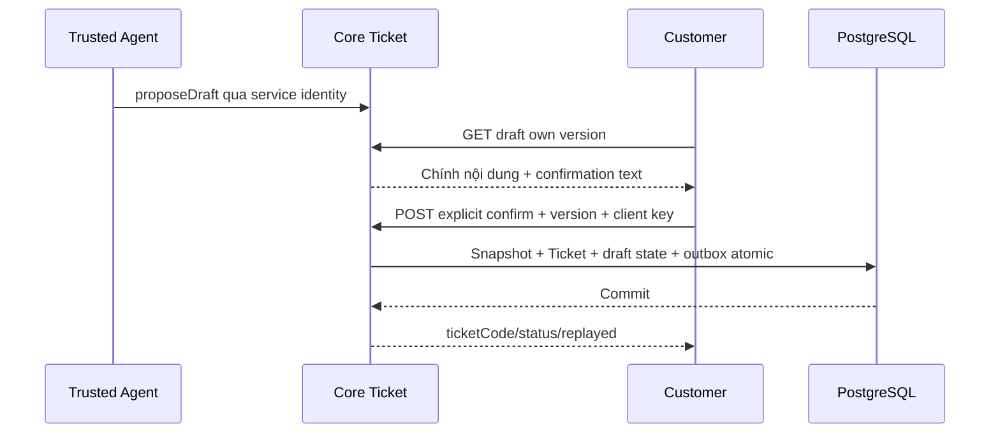

# T01 — Customer contract trong Core Ticket I07

04/11/2026 · **P, chưa triển khai** · [C07](../07-tickets-contract.md) · [I07 canonical](../../../staff/plans/tickets/06-agent-confirmation.md).

## 1. Ownership công việc

Triển khai một module `apps/core/src/tickets/` theo I07: customer controller, draft/ticket/accessservices, DTO và migration mới. Bảng TicketDraft + fields confirmed snapshot/version/hash là **đề xuất I07**, chưa schema hiện hành. Không backfill summary legacy thành nội dung Customer đã xác nhận. Các bước dưới là phần Customer trong cùng I07, không một lần implementation thứ hai.

## 2. API spec P — giữ I07 làm nguồn DTO

| API | Body/response tối thiểu |
| --- | --- |
| GET `/customers/me/conversations/:conversationId/ticket-drafts/:draftId` | `{draft:{id,version,state,confirmedTicket,title,description,policyId,sourceMessageIds,expiresAt},confirmation:{textVersion,text}}` |
| POST `/customers/me/tickets` | `{clientRequestId,draftId,expectedDraftVersion,confirmation:{confirmed:true,textVersion:'ticket-v1'}}` →201first/200 replay `{ticket:{id,ticketCode,status,confirmedAt},replayed}` |
| GET `/customers/me/tickets/by-client-request-id/:clientRequestId` | Own receipt hoặc safe404;404 chưa chứng minh chưa commit |
| GET `/customers/me/tickets/:ticketId` | Own persisted confirmedContent/status/code và link cuộc nếu còn quyền, không ghi chú nội bộ Staff |

Prefix `/api/v1`, UUID được validate, CSRF/Origin cho POST, GET no-store. Không nhận customerId/confirmedContent/source/confirmedAt/status do browser tự khai. Draft thuộc chính Customer/đúng cuộc CUSTOMER_SUPPORT, nguồn đúng Customer-visible và policy owner; receipt chỉ actor gốc. 400 validation,401/403 auth,404 ngoài owner,409 draft stale/expired/đã xác nhận/xung đột idempotency,429 quota. Quota cụ thể theo I07 cần chốt trước code; không reuse quota gửi tin như một giả định.

Trusted `proposeDraft` chỉ gọi sau service identity CH02, không endpoint browser `{source:'AGENT'}`. **Sửa nội dung draft** cần server revision/version mới/hash và review lại; I07 chưa có revision HTTP route cụ thể. Nếu muốn bật Edit ở T02 phải cập nhật I07 với DTO/authorization/supersede semantics trước, không gửi content tùy ý trong POST confirm. Đợt đầu có thể review chỉ đọc + Cancel/yêu cầu Agent chỉnh, không nút Edit giả.

## 3. Transaction và luồng

Lock draft/routing theo I07/I01 → tra receipt cùng key → kiểm draft hiện hành/hash/expiry/xác nhận rõ ràng → cấp code unique → insert immutable confirmedContent/source version/actor xác nhận → draft CONFIRMED + Ticket outbox → commit. Staff được phân công hợp lệ thì ASSIGNED, chưa có thì OPEN theo đề xuất I07 cần review; không trả lỗi chỉ vì notification chưa tới. Retry cùng key/hash trả200; key mới cùng draft trả409, không tạo Ticket thứ hai. Accept Ticket/notification/link không cấp quyền lịch sử AI.

## 4. Test/gate

Dùng `ticket-confirmation.test.cjs`/`tickets.test.cjs` của I07, không duplicate suite/schema owner. Trusted draft fixture chỉ từ harness testcontainer, không endpoint fixture production.

| ID | Case | Kỳ vọng |
| --- | --- | --- |
| T01-T01 | Chưaconfirm/false/stale/expired/crossowner | Không Ticket, safe400/404/409 |
| T01-T02 | Cùng keyretry/nhiều key đồng thời/cùng key khác payload | MộtTicket,200 replay hoặc409 đúng |
| T01-T03 | Crash giữa insert/outbox, timeout saucommit | Rollback hoặc receipt committed, không Ticket mất do delivery |
| T01-T04 | Ticket đã có nhưng chatAI chưa Accept | Staffdữ liệu Ticket đúng scope, transcript vẫn deny |
| T01-T05 | Ticket legacy/draft giả/browser source AGENT | Không bằng chứng giả/quyền mới |

- [ ] I07 updated/implemented duy nhất, mutation/security/atomic tests pass.
- [ ] Policy sửa draft rõ trước T02Edit; Agent thật là gate riêng cho full E2E.
