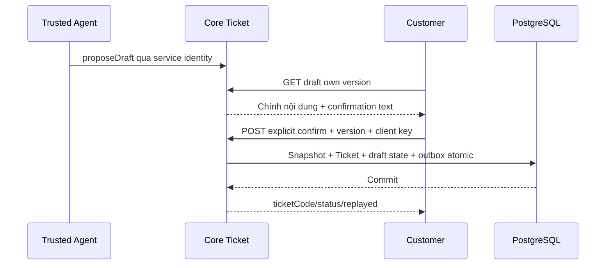

# T01 — Customer contract trong Core Ticket I07

04/11/2026 · **P, chưa triển khai** · [C07](../07-tickets-contract.md) · [I07 canonical](../../../staff/plans/tickets/06-agent-confirmation.md).

## Bổ sung bảo vệ dữ liệu Customer — 12/11/2026

**P — chưa triển khai phần bảo vệ bổ sung; giữ trạng thái baseline của phase.** Theo [ma trận dữ liệu chung](../../../../configuration-and-data.md#customer-sensitive-data); mức che/quyền xem đầy đủ còn chờ chốt. Vị trí code/API và data model của phase bên dưới là nơi rà tác động; bổ sung này không tự yêu cầu migration hoặc sửa dữ liệu gốc.

**Thay đổi của phase:** I07 sở hữu giảm PII trước phát hành draft. Nội dung/hash/version Customer duyệt phải khớp immutable confirmedContent Core commit; đổi nội dung phải review lại, legacy vẫn UNVERIFIED.

**Kiểm thử cần bổ sung, chưa chạy:** Core/DB: confirmation cũ không dùng sau đổi draft, replay không trùng; receipt/outbox/audit không chép raw ngoài contract.

## Data model và phạm vi ảnh hưởng

Bảng bên dưới mô tả tác động của phase, gồm cả ghi gián tiếp qua Core. Tên bảng thuộc schema `business` trừ nơi ghi rõ; cột còn đề xuất được đánh dấu **P**. Web không truy cập DB trực tiếp.

| Bảng/model | Cột hoặc dữ liệu liên quan | Thao tác của phase | Quan hệ/ràng buộc cần giữ | Mức ảnh hưởng và nơi bị tác động |
| --- | --- | --- | --- | --- |
| users + auth_sessions | users.id/role/status, auth_sessions.user_id/token_hash/expires_at/revoked_at | Đọc | AuthSession.user_id → User.id; session phải còn hạn, không bị thu hồi | Cao — mọi API dùng session; không trả token/hash trong DTO |
| staff_assignments + customer_profiles + staff_profiles | staff_id/customer_id/is_active/ended_at, assignment_version, user_id/full_name | Đọc | Assignment gắn đúng Customer/Staff; Inbox còn ràng buộc assignment id cụ thể | Cao — Customers, Policy Lookup, Ticket và Inbox cùng phụ thuộc phân công |
| conversations + conversation_handoffs | customer_id/channel_type/support_origin/direct_assignment_id/assigned_staff_id/status/control_version/subject, state/assignment_id/recipient_staff_id/shared_subject/shared_reason/accepted_at/revoked_at | Đọc | Direct đúng assignment lúc tạo hoặc handoff ACCEPTED còn grant; PENDING chỉ shared metadata, không AI subject/transcript | Cao — Inbox filter/deep link/REST/WS phải cùng gate; không suy grant từ status/assigned_staff_id |
| support_tickets | id/ticket_code/customer_id/assigned_staff_id/conversation_id/policy_id/status/version/title/ai_summary/extracted_details/confirmed_at | Đọc nền; P tạo Ticket và immutable confirmed snapshot qua I07 | Policy FK (policy_id,customer_id); Ticket quyền riêng, không cấp transcript grant; legacy không có confirmedContent/TicketDraft | Cao — list/detail/status và notification dùng cùng Ticket scope; confirmed_at không chứng minh AI text đã được duyệt |
| TicketDraft / confirmed snapshot — P, chưa có bảng/cột | Dự kiến owner/conversation/draftVersion/contentHash/confirmationTextVersion/expiresAt/consumedTicketId và SupportTicket sourceDraftId/confirmedContent | DDL + ghi dự kiến, chưa triển khai | Tên bảng/cột/FK/unique/retention phải chốt trong migration spec I07; không lấy ai_summary làm consent | Cao — Customer confirm, Agent draft, Ticket DTO và outbox phải cùng nội dung bất biến |
| audit_logs | actor_id/action/target_type/target_id/outcome/request_id/metadata/created_at | Thêm khi mutation/cấp PDF theo service | actor_id → User.id; không sửa/xóa audit cũ; chỉ metadata allowlist | Cao — phải giữ bằng chứng đúng transaction nghiệp vụ; không lưu transcript/password/signed URL |
| outbox_events | aggregate_type/aggregate_id/event_type/payload/status/retry_count/next_attempt_at/lease_owner/lease_expires_at/last_error | Thêm trong transaction nguồn; worker cập nhật trạng thái/lease | Index status/next_attempt_at/lease_expires_at; aggregate_id là reference kiểm bởi service, không FK đa loại | Cao — retry/reclaim/dedup, commit nghiệp vụ khác delivery; REST vẫn là nguồn dữ liệu |

**Schema/migration:** P — migration mới cho draft/snapshot/hash/unique consume, chưa tồn tại trong schema hiện hành. Không backfill confirmed content từ AI hoặc reset Ticket cũ.

**Nhất quán và hồi quy:** Dự kiến lock owner/draft/routing, compare version/hash/expiry, snapshot+Ticket+consume draft+outbox atomic. Cancel không ghi Ticket; retry cùng intent không tạo trùng, legacy giữ UNVERIFIED. Chưa coi phần P là API/schema đã chạy.

## Vị trí code và mức ảnh hưởng

| Vị trí từ root repo | Hiện trạng | Trách nhiệm trong phase | Mức ảnh hưởng | Phạm vi cần kiểm lại |
| --- | --- | --- | --- | --- |
| `apps/core/src/tickets/controllers/customer-ticket.controller.ts` | Dự kiến — chưa có file | P — owner draft/read/confirm endpoint | Cao | Customer review, service identity Agent |
| `apps/core/src/tickets/services/ticket-draft.service.ts` | Dự kiến — chưa có file | P — trusted draft/version/hash và consume once | Cao | Ticket creation/idempotency/expiry |
| [apps/core/src/tickets/services/ticket.service.ts](<../../../../../apps/core/src/tickets/services/ticket.service.ts>) | Hiện có | Hiện có Staff service; P mở rộng confirmation transaction riêng | Cao | Giữ Staff status/version TK01–TK05 |
| [apps/core/prisma/schema.prisma](<../../../../../apps/core/prisma/schema.prisma>) | Hiện có | P — chỉ thêm draft/snapshot sau chốt schema | Cao | Migrations, bootstrap compatibility và legacy Ticket |
| [apps/web/src/lib/ticket-api.ts](<../../../../../apps/web/src/lib/ticket-api.ts>) | Hiện có | Hiện có; P bổ sung Customer draft/confirm wrappers | Trung bình | Không reuse Staff accept để Customer xác nhận |

## 1. Ownership công việc

Triển khai một module `apps/core/src/tickets/` theo I07: customer controller, draft/ticket/accessservices, DTO và migration mới. Bảng TicketDraft + fields confirmed snapshot/version/hash là **đề xuất I07**, chưa schema hiện hành. Không backfill summary legacy thành nội dung Customer đã xác nhận. Các bước dưới là phần Customer trong cùng I07, không một lần implementation thứ hai.

## 2. API spec P — giữ I07 làm nguồn DTO

| API | Body/response tối thiểu |
| --- | --- |
| GET `/customers/me/conversations/:conversationId/ticket-drafts/:draftId` | `{draft:{id,version,state,confirmedTicket,title,description,policyId,sourceMessageIds,expiresAt},confirmation:{textVersion,text}}` |
| POST `/customers/me/tickets` | `{clientRequestId,draftId,expectedDraftVersion,confirmation:{confirmed:true,textVersion:'ticket-v1'}}` →201first/200 replay `{ticket:{id,ticketCode,status,confirmedAt},replayed}` |
| GET `/customers/me/tickets/by-client-request-id/:clientRequestId` | Own receipt hoặc safe 404;404 chưa chứng minh chưa commit |
| GET `/customers/me/tickets/:ticketId` | Own persisted confirmedContent/status/code và link cuộc nếu còn quyền, không ghi chú nội bộ Staff |

Prefix `/api/v1`, UUID được validate, CSRF/Origin cho POST, GET no-store. Không nhận customerId/confirmedContent/source/confirmedAt/status do browser tự khai. Draft thuộc chính Customer/đúng cuộc CUSTOMER_SUPPORT, nguồn đúng Customer-visible và policy owner; receipt chỉ actor gốc. 400 validation,401/403 auth,404 ngoài owner,409 draft stale/expired/đã xác nhận/xung đột idempotency,429 quota. Quota cụ thể theo I07 cần chốt trước code; không reuse quota gửi tin như một giả định.

Trusted `proposeDraft` chỉ gọi sau service identity CH02, không endpoint browser `{source:'AGENT'}`. **Sửa nội dung draft** cần server revision/version mới/hash và review lại; I07 chưa có revision HTTP route cụ thể. Nếu muốn bật Edit ở T02 phải cập nhật I07 với DTO/authorization/supersede semantics trước, không gửi content tùy ý trong POST confirm. Đợt đầu có thể review chỉ đọc + Cancel/yêu cầu Agent chỉnh, không nút Edit giả.

## 3. Transaction và luồng

Lock draft/routing theo I07/I01 → tra receipt cùng key → kiểm draft hiện hành/hash/expiry/xác nhận rõ ràng → cấp code unique → insert immutable confirmedContent/source version/actor xác nhận → draft CONFIRMED + Ticket outbox → commit. Staff được phân công hợp lệ thì ASSIGNED, chưa có thì OPEN theo đề xuất I07 cần review; không trả lỗi chỉ vì notification chưa tới. Retry cùng key/hash trả 200; key mới cùng draft trả 409, không tạo Ticket thứ hai. Accept Ticket/notification/link không cấp quyền lịch sử AI.

## 4. Test cases

Các ca dưới đây là **kịch bản dự kiến**, chỉ thực thi sau dependency/contract đã chốt trong phần phạm vi; không đánh dấu chức năng đã có.

**Quy ước dữ liệu:** S-A/S-B là hai Staff synthetic; C-A/C-B là hai Customer synthetic khác nhau. Thay alias bằng UUID/token của fixture cô lập; các path HTTP dùng prefix /api/v1 nếu chưa ghi đầy đủ. Chỉ thay assignment, khóa account, inject lỗi hoặc migration trong harness/môi trường test, không trên tài khoản/dữ liệu đang sử dụng.

### T01-T01 — Review draft owner và confirmation hợp lệ

**Lớp kiểm thử:** API + DB dự kiến.
**Điều kiện và dữ liệu:** I07 có trusted draft D-A của C-A version n; C-B không owner.

**Các bước:**

1. C-A GET draft rồi confirm=false/bỏ confirmation.
2. Thử C-B đọc/xác nhận D-A.
3. C-A confirm đúng version/textVersion bằng key mới.

**Kết quả mong đợi:** Chưa xác nhận không Ticket; cross-owner bị chặn; chỉ exact draft/version server có confirmation hợp lệ mới tạo business record.

### T01-T02 — Draft stale/expired và payload giả

**Lớp kiểm thử:** API dự kiến.
**Điều kiện và dữ liệu:** D-A đã được sửa lên n+1 hoặc hết hạn; browser có token n.

**Các bước:**

1. Confirm bằng n.
2. Gửi thêm customerId/status/confirmedAt/confirmedContent/source=AGENT.
3. Đối chiếu DB.

**Kết quả mong đợi:** Stale/expired conflict; field quyền/bằng chứng do client gửi bị từ chối; không Ticket hoặc snapshot giả.

### T01-T03 — Đồng thời, receipt và rollback

**Lớp kiểm thử:** API + DB barrier dự kiến.
**Điều kiện và dữ liệu:** C-A xác nhận cùng draft với key K; harness giữ insert/outbox/ACK.

**Các bước:**

1. Gửi cùng K/payload và nhiều key cho cùng draft.
2. Replay K với payload khác.
3. Inject lỗi trước commit rồi ngắt ACK sau commit ở fixture khác.

**Kết quả mong đợi:** Một Ticket mỗi draft; receipt/replay hoặc conflict đúng; rollback atomic, ACK mất tra receipt không tạo trùng.

### T01-T04 — Ticket không chia sẻ chat AI

**Lớp kiểm thử:** API + DB dự kiến.
**Điều kiện và dữ liệu:** Draft hợp lệ tạo Ticket liên kết AI_PRIVATE; chưa handoff/Accept.

**Các bước:**

1. C-A confirm để tạo Ticket.
2. Staff đúng recipient đọc Ticket.
3. Staff GET transcript AI_PRIVATE.

**Kết quả mong đợi:** Ticket scope đúng nhưng transcript vẫn deny; không tự thay trạng thái/chat grant từ confirmation Ticket.

**Checklist chức năng liên quan** (giữ trạng thái triển khai, không phải kết quả của lần sửa tài liệu):

- [ ] Policy sửa draft rõ trước T02Edit; Agent thật là gate riêng cho full E2E.

**Dọn sau kiểm thử:** xóa đúng fixture/session/object/schema theo runId; phục hồi fault injection và đóng context/socket test. Không reset DB/credential, sửa bootstrap hoặc xóa volumes. Với PDF kiểm metadata/bytes/hash; với UI kiểm DOM/focus/network, không cần screenshot.
