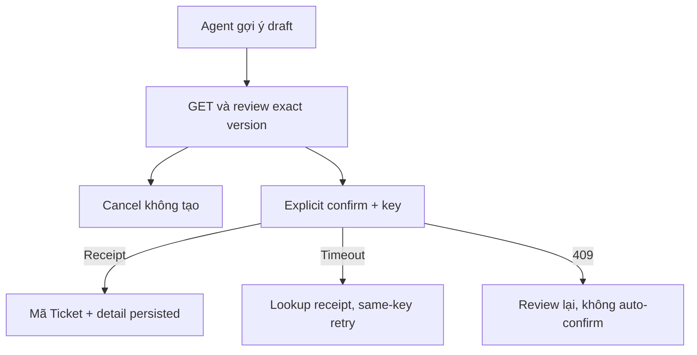

# T02 — Review Ticket và kết quả đã lưu

04/11/2026 · **Chưa triển khai** · [C07](../07-tickets-contract.md) · Cần [T01](01-confirmation-core-contract.md), draft Agent thật cho luồng đầy đủ.

## 1. Vị trí/API

Đề xuất `components/customer-ticket-confirmation.tsx`, `customer-ticket-detail.tsx`, `lib/ticket-api.ts`, route `app/customer/tickets/[ticketId]/page.tsx`. Dùng I07 GET draft/POST confirm/GET receipt/GET detail; không gọi Staff Accept hoặc ghi nghiệp vụ trực tiếp qua Agent. Customer list tổng chưa có spec nên không tạo menu dẫn tới trang trống.

## 2. Review và outcome

Review hiển thị title/description/policy nếu có/nguồn an toàn và chính confirmation text version. Chỉ khi Customer bấm xác nhận rõ mới gửi; Cancel/Escape không ghi gì và trả focus về nơi mở dialog. Không cho Edit nếu revision server chưa chốt ở I07; nếu có thì sửa → revision mới → review lại → confirm version mới. Không coi summary LLM hoặc consent handoff là xác nhận Ticket.

Giữ key UUID trong memory theo actor/draft/version cho kết quả chưa rõ. Chỉ sau receipt201/200 mới hiện ticketCode/status và link detail; chưa có Staff nhận thì không hiển thị Staff active. Timeout phải tra receipt;404 vẫn chưa rõ kết quả, retry key/payload gốc, không tạo key mới.409 draft stale/expired/đã xác nhận dẫn tới review hoặc kết quả đã lưu, không auto-confirm version mới. Refresh cùng actor không thay nội dung đang review âm thầm; phiên hết thì xóa dữ liệu riêng.

Detail lấy confirmedContent đã lưu, không sinh lại summary từ Agent; status Ticket riêng. Link chat chỉ mở route của mình hợp lệ, không tự handoff. Chưa có resolve/payment/rút Ticket. Message/thông báo hệ thống không được dùng thay bằng chứng giao dịch nghiệp vụ đã commit.

## 3. Test/gate

Đề xuất `customer-ticket-confirmation.spec.mjs`, `ticket-flow.integration.spec.mjs` theo I07; phân biệt UI mock/integration với trusted fixture/E2E với Agent thật.

| ID | Thao tác | Kỳ vọng |
| --- | --- | --- |
| T02-T01 | Open→Tab→Cancel/Escape, rồi Confirm | Không Ticket khi Cancel; request xác nhận đúng version |
| T02-T02 | Draft đổi/hết hạn/lỗi mạng/401 | Không auto-confirm hoặc PII cũ |
| T02-T03 | Double click/timeout/retry/mở lại draft confirmed | Một Ticket, mã đã lưu, key/receipt đúng |
| T02-T04 | Đọc detail người khác/deep link chat AI | Safe404; không cấp quyền lịch sử cho Staff |
| T02-T05 | 375px/zoom200%/description dài/keyboard | Review đủ nội dung, focus đúng, không F5 |

- [ ] Core I07 thật + browser tests pass; không báo thành công trước commit.
- [ ] Luồng Agent đầy đủ chỉ đánh dấu sau draft từ Agent thật; Ticket closed không đóng chat.
