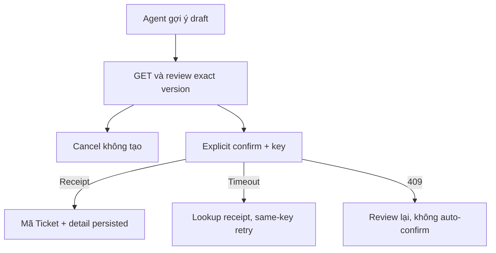
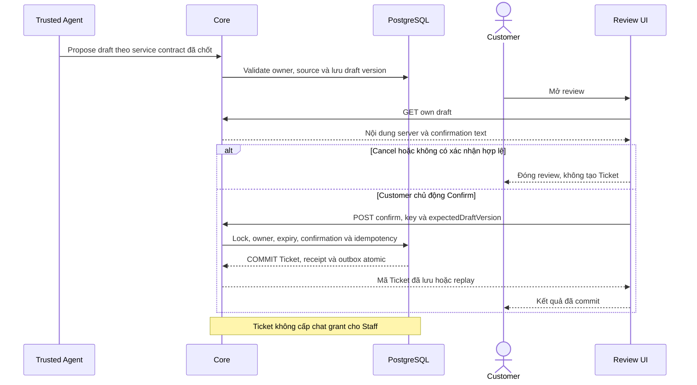

# T02 — Review Ticket và kết quả đã lưu

04/11/2026 · **Chưa triển khai** · [C07](../07-tickets-contract.md) · Cần [T01](01-confirmation-core-contract.md), draft Agent thật cho luồng đầy đủ.

## Data model và phạm vi ảnh hưởng

Bảng bên dưới mô tả tác động của phase, gồm cả ghi gián tiếp qua Core. Tên bảng thuộc schema `business` trừ nơi ghi rõ; cột còn đề xuất được đánh dấu **P**. Web không truy cập DB trực tiếp.

| Bảng/model | Cột hoặc dữ liệu liên quan | Thao tác của phase | Quan hệ/ràng buộc cần giữ | Mức ảnh hưởng và nơi bị tác động |
| --- | --- | --- | --- | --- |
| users + auth_sessions | users.id/role/status, auth_sessions.user_id/token_hash/expires_at/revoked_at | Đọc | AuthSession.user_id → User.id; session phải còn hạn, không bị thu hồi | Cao — mọi API dùng session; không trả token/hash trong DTO |
| support_tickets | id/ticket_code/customer_id/assigned_staff_id/conversation_id/policy_id/status/version/title/ai_summary/extracted_details/confirmed_at | Đọc | Policy FK (policy_id,customer_id); Ticket quyền riêng, không cấp transcript grant; legacy không có confirmedContent/TicketDraft | Cao — list/detail/status và notification dùng cùng Ticket scope; confirmed_at không chứng minh AI text đã được duyệt |
| TicketDraft / confirmed snapshot — P, chưa có bảng/cột | Dự kiến owner/conversation/draftVersion/contentHash/confirmationTextVersion/expiresAt/consumedTicketId và SupportTicket sourceDraftId/confirmedContent | DDL + ghi dự kiến, chưa triển khai | Tên bảng/cột/FK/unique/retention phải chốt trong migration spec I07; không lấy ai_summary làm consent | Cao — Customer confirm, Agent draft, Ticket DTO và outbox phải cùng nội dung bất biến |

**Schema/migration:** Không migration tại UI; dùng schema/API confirmation P tại I07/T01, không tự tạo confirmedContent từ ai_summary.

**Nhất quán và hồi quy:** Review hiển thị đúng draftVersion/contentHash; explicit confirm, cancel không Ticket. Unknown result reconcile cùng intent, không tự phát success hoặc gửi lại key mới. Kiểm expiry/stale/foreign owner/duplicate.

## 1. Vị trí/API

Đề xuất `components/customer-ticket-confirmation.tsx`, `customer-ticket-detail.tsx`, `lib/ticket-api.ts`, route `app/customer/tickets/[ticketId]/page.tsx`. Dùng I07 GET draft/POST confirm/GET receipt/GET detail; không gọi Staff Accept hoặc ghi nghiệp vụ trực tiếp qua Agent. Customer list tổng chưa có spec nên không tạo menu dẫn tới trang trống.

| Vị trí từ root repo | Hiện trạng | Trách nhiệm trong phase | Mức ảnh hưởng | Phạm vi cần kiểm lại |
| --- | --- | --- | --- | --- |
| `apps/web/src/components/customer-ticket-confirmation.tsx` | Dự kiến — chưa có file | P review/confirm/cancel đúng snapshot | Cao | Customer chat và Ticket creation |
| [apps/web/src/components/customer-tickets.tsx](<../../../../../apps/web/src/components/customer-tickets.tsx>) | Hiện có | Hiện có UI; P confirmation result integration theo T01 | Trung bình | Không tự mở Staff ticket endpoint |
| [apps/web/src/lib/ticket-api.ts](<../../../../../apps/web/src/lib/ticket-api.ts>) | Hiện có | P owner draft/confirm wrappers | Cao | Staff accept/status API giữ nguyên |

## 2. Review và outcome

Review hiển thị title/description/policy nếu có/nguồn an toàn và chính confirmation text version. Chỉ khi Customer bấm xác nhận rõ mới gửi; Cancel/Escape không ghi gì và trả focus về nơi mở dialog. Không cho Edit nếu revision server chưa chốt ở I07; nếu có thì sửa → revision mới → review lại → confirm version mới. Không coi summary LLM hoặc consent handoff là xác nhận Ticket.

Giữ key UUID trong memory theo actor/draft/version cho kết quả chưa rõ. Chỉ sau receipt201/200 mới hiện ticketCode/status và link detail; chưa có Staff nhận thì không hiển thị Staff active. Timeout phải tra receipt;404 vẫn chưa rõ kết quả, retry key/payload gốc, không tạo key mới.409 draft stale/expired/đã xác nhận dẫn tới review hoặc kết quả đã lưu, không auto-confirm version mới. Refresh cùng actor không thay nội dung đang review âm thầm; phiên hết thì xóa dữ liệu riêng.

Detail lấy confirmedContent đã lưu, không sinh lại summary từ Agent; status Ticket riêng. Link chat chỉ mở route của mình hợp lệ, không tự handoff. Chưa có resolve/payment/rút Ticket. Message/thông báo hệ thống không được dùng thay bằng chứng giao dịch nghiệp vụ đã commit.

## 3. Test cases

Các ca dưới đây là **kịch bản dự kiến**, chỉ thực thi sau dependency/contract đã chốt trong phần phạm vi; không đánh dấu chức năng đã có.

**Quy ước dữ liệu:** S-A/S-B là hai Staff synthetic; C-A/C-B là hai Customer synthetic khác nhau. Thay alias bằng UUID/token của fixture cô lập; các path HTTP dùng prefix /api/v1 nếu chưa ghi đầy đủ. Chỉ thay assignment, khóa account, inject lỗi hoặc migration trong harness/môi trường test, không trên tài khoản/dữ liệu đang sử dụng.

### T02-T01 — Review, Cancel và Confirm bằng keyboard

**Lớp kiểm thử:** Browser dự kiến.
**Điều kiện và dữ liệu:** T01/I07 có draft server hợp lệ và UI review.

**Các bước:**

1. Mở review, Tab đọc đủ nội dung, Escape/Cancel.
2. Kiểm không POST confirm.
3. Mở lại và Confirm rõ ràng.

**Kết quả mong đợi:** Cancel không tạo Ticket, focus trở lại; Confirm gửi draftId/version/key/textVersion, không raw content/actor do client tự khai.

### T02-T02 — Draft đổi và hết hạn

**Lớp kiểm thử:** Browser + API mock dự kiến.
**Điều kiện và dữ liệu:** Review đang hiển thị draft n; server chuyển n+1 hoặc expired.

**Các bước:**

1. Bấm Confirm với n.
2. Tải lại draft theo flow lỗi.
3. Kiểm không tự confirm bản mới.

**Kết quả mong đợi:** Conflict được giải thích, Customer phải review/xác nhận lại; không nội dung stale hoặc auto retry version mới.

### T02-T03 — Double click và unknown result

**Lớp kiểm thử:** Browser + API barrier dự kiến.
**Điều kiện và dữ liệu:** Giữ/ngắt ACK confirm sau commit.

**Các bước:**

1. Bấm Confirm hai lần.
2. Dùng kiểm kết quả bằng receipt key cũ.
3. Mở lại draft đã confirmed.

**Kết quả mong đợi:** Một Ticket/mã đã lưu, không Saved trước commit; không key mới hoặc tạo Ticket lần2 vì timeout.

### T02-T04 — Detail owner, mobile và chat link

**Lớp kiểm thử:** Browser dự kiến.
**Điều kiện và dữ liệu:** Có Ticket C-A/C-B, description dài; viewport 375px/zoom 200%.

**Các bước:**

1. C-A mở Ticket mình rồi deep link C-B.
2. Tab qua review/detail/back.
3. Thử mở link chat AI dưới Staff chưa grant ở context riêng.

**Kết quả mong đợi:** Owner khác safe 404 và clear detail; nội dung đọc đủ không tràn; Ticket không cấp lịch sử cho Staff.

**Checklist chức năng liên quan** (giữ trạng thái triển khai, không phải kết quả của lần sửa tài liệu):

- [ ] Luồng Agent đầy đủ chỉ đánh dấu sau draft từ Agent thật; Ticket closed không đóng chat.

**Dọn sau kiểm thử:** xóa đúng fixture/session/object/schema theo runId; phục hồi fault injection và đóng context/socket test. Không reset DB/credential, sửa bootstrap hoặc xóa volumes. Với PDF kiểm metadata/bytes/hash; với UI kiểm DOM/focus/network, không cần screenshot.

## Sequence diagram

**Luồng dự kiến:** chỉ áp dụng sau khi các dependency và API ở phần phạm vi được chốt.

