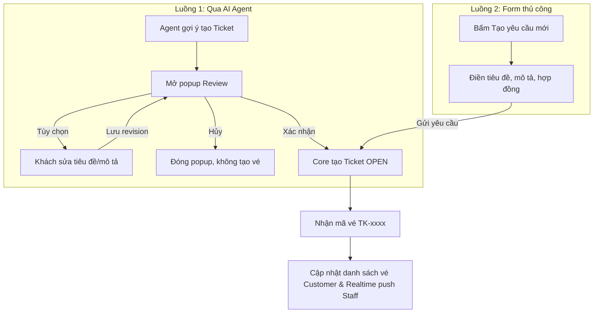
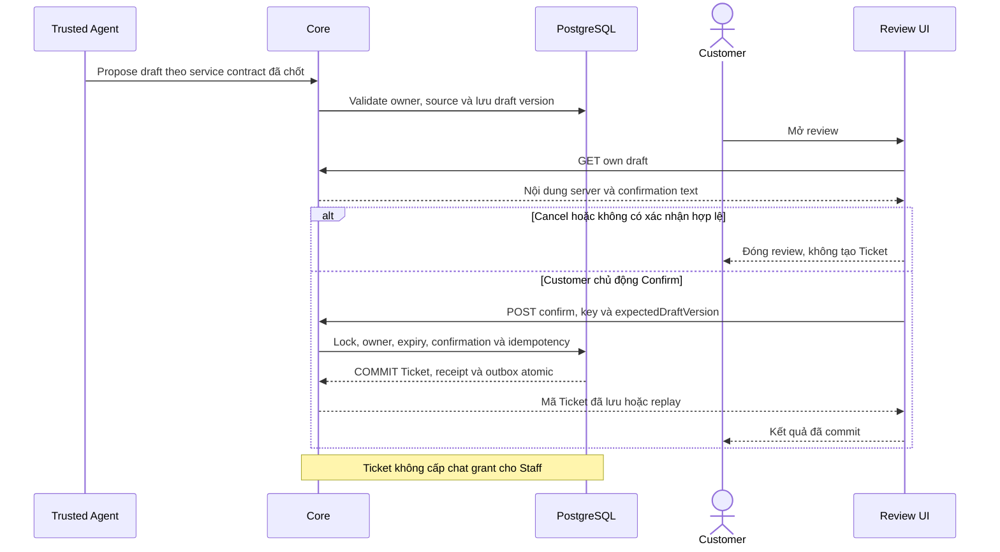

# T02 — Giao diện Ticket Customer (Review, Chỉnh sửa, Tạo thủ công & Danh sách)

04/11/2026 · **Cập nhật quyết định chốt 13/11/2026** · [C07](../07-tickets-contract.md) · Cần [T01](01-confirmation-core-contract.md).

> [!IMPORTANT]
> **Quyết định người dùng chốt (13/11/2026):**
> 1. **Giao diện hỗ trợ cả hai luồng:**
>    - Luồng qua Agent: Popup `CustomerTicketConfirmation` hiển thị khi Agent gợi ý tạo vé từ chat.
>    - Luồng thủ công: Modal tạo vé trên trang [customer-tickets.tsx](file:///e:/UET/Project/github/LifeInsuranceAIAssistant/apps/web/src/components/customer-tickets.tsx) khi khách bấm *"Tạo yêu cầu mới"*.
> 2. **Cho phép chỉnh sửa bản thảo (Draft Edit):** Popup xác nhận cho phép khách hàng sửa trực tiếp tiêu đề, mô tả trước khi bấm xác nhận.
> 3. **Trạng thái ban đầu:** Mọi vé mới tạo hiển thị badge `Open` (Màu vàng/cam `tw:bg-amber-50 tw:text-amber-700`), chờ nhân viên tư vấn tiếp nhận.

## Bổ sung bảo vệ dữ liệu Customer — 12/11/2026

**P — chưa triển khai phần bảo vệ bổ sung; giữ trạng thái baseline của phase.** Theo [ma trận dữ liệu chung](../../../../configuration-and-data.md#customer-sensitive-data); mức che/quyền xem đầy đủ còn chờ chốt. Vị trí code/API và data model của phase bên dưới là nơi rà tác động; bổ sung này không tự yêu cầu migration hoặc sửa dữ liệu gốc.

**Thay đổi của phase:** Review đúng draft Core đã xử lý, không dựng lại từ raw chat/local mock. Nếu nội dung đổi thì review lại theo T01/I07; result/detail chỉ dùng DTO có quyền.

**Kiểm thử cần bổ sung, chưa chạy:** Network/DOM: review khớp receipt/detail, stale draft không báo thành công; canary không ở hidden field/copy/URL, logout clear state.

## Data model và phạm vi ảnh hưởng

Bảng bên dưới mô tả tác động của phase. Web không truy cập DB trực tiếp, gọi thông qua API Core T01.

| Bảng/model | Cột hoặc dữ liệu liên quan | Thao tác của phase | Quan hệ/ràng buộc cần giữ | Mức ảnh hưởng và nơi bị tác động |
| --- | --- | --- | --- | --- |
| support_tickets | id/ticket_code/customer_id/status/title/confirmed_content/created_at | Đọc danh sách, chi tiết; Ghi qua API | Ticket của chính actor; status ban đầu luôn là OPEN | Cao — Customer Ticket list và Detail view |
| ticket_drafts | id/conversation_id/customer_id/version/payload/expires_at/state | Đọc, Sửa (PUT revision), Xác nhận | Quản lý draft trong phiên chat; TTL 30p; version tăng khi sửa | Cao — Review modal trong khung chat |

## 1. Vị trí UI và Thành phần

1. `apps/web/src/components/customer-ticket-confirmation.tsx`: Popup hiển thị bản nháp do Agent đề xuất:
   - Chế độ View: Xem tiêu đề, mô tả, hợp đồng liên quan.
   - Chế độ Edit: Cho phép sửa trực tiếp tiêu đề và mô tả $\rightarrow$ Lưu cập nhật draft lên Core.
   - Nút thao tác: "Hủy bỏ" (đóng popup không tạo vé) và "Xác nhận gửi yêu cầu" (tạo vé với status `OPEN`).
2. [apps/web/src/components/customer-tickets.tsx](<../../../../apps/web/src/components/customer-tickets.tsx>):
   - Thay thế mock data bằng dữ liệu thực từ `GET /api/v1/customers/me/tickets`.
   - Modal "Tạo yêu cầu mới" kết nối API `POST /api/v1/customers/me/tickets/manual`.
   - Bộ lọc trạng thái: Tất cả, Đang xử lý (`IN_PROGRESS`), Mới tạo (`OPEN`), Đã giải quyết (`RESOLVED`), Đóng (`CLOSED`).
3. `apps/web/src/lib/ticket-api.ts`: Bổ sung các client method phục vụ Customer (`getDraft`, `updateDraft`, `confirmTicket`, `createManualTicket`, `listCustomerTickets`, `getCustomerTicketDetail`).

## 2. Luồng thao tác và Trạng thái

## 3. Test cases

### T02-T01 — Khách hàng chỉnh sửa draft và xác nhận thành công
- Mở popup review từ Agent.
- Bấm nút "Chỉnh sửa", thay đổi nội dung mô tả, bấm "Lưu".
- Bấm "Xác nhận gửi yêu cầu".
- Kết quả: Nhận được thông báo thành công kèm mã vé (VD: `TK-7703`), trạng thái hiển thị là `Open`.

### T02-T02 — Khách hàng tự tạo vé thủ công từ Form
- Truy cập tab Tickets, bấm "Tạo yêu cầu mới".
- Điền tiêu đề và nội dung mô tả hợp lệ, bấm "Gửi".
- Kết quả: Modal đóng, danh sách vé tự động cập nhật thêm dòng mới với badge `Open`.

### T02-T03 — Hủy bỏ review draft không tạo vé
- Khách hàng bấm "Hủy" hoặc phím Escape trên popup xác nhận.
- Kết quả: Popup đóng, không có request tạo vé nào được gửi tới server, danh sách vé không đổi.
2. Kiểm không POST confirm.
3. Mở lại và Confirm rõ ràng.

**Kết quả mong đợi:** Cancel không tạo Ticket, focus trở lại; Confirm gửi draftId/version/key/textVersion, không raw content/actor do client tự khai.

### T02-T02 — Draft đổi và hết hạn

**Lớp kiểm thử:** Browser + API mock dự kiến.
**Điều kiện và dữ liệu:** Review đang hiển thị draft n; server chuyển n+1 hoặc expired.

**Các bước:**

1. Bấm Confirm với n.
2. Tải lại draft theo flow lỗi.
3. Kiểm không tự confirm bản mới.

**Kết quả mong đợi:** Conflict được giải thích, Customer phải review/xác nhận lại; không nội dung stale hoặc auto retry version mới.

### T02-T03 — Double click và unknown result

**Lớp kiểm thử:** Browser + API barrier dự kiến.
**Điều kiện và dữ liệu:** Giữ/ngắt ACK confirm sau commit.

**Các bước:**

1. Bấm Confirm hai lần.
2. Dùng kiểm kết quả bằng receipt key cũ.
3. Mở lại draft đã confirmed.

**Kết quả mong đợi:** Một Ticket/mã đã lưu, không Saved trước commit; không key mới hoặc tạo Ticket lần2 vì timeout.

### T02-T04 — Detail owner, mobile và chat link

**Lớp kiểm thử:** Browser dự kiến.
**Điều kiện và dữ liệu:** Có Ticket C-A/C-B, description dài; viewport 375px/zoom 200%.

**Các bước:**

1. C-A mở Ticket mình rồi deep link C-B.
2. Tab qua review/detail/back.
3. Thử mở link chat AI dưới Staff chưa grant ở context riêng.

**Kết quả mong đợi:** Owner khác safe 404 và clear detail; nội dung đọc đủ không tràn; Ticket không cấp lịch sử cho Staff.

**Checklist chức năng liên quan** (giữ trạng thái triển khai, không phải kết quả của lần sửa tài liệu):

- [ ] Luồng Agent đầy đủ chỉ đánh dấu sau draft từ Agent thật; Ticket closed không đóng chat.

**Dọn sau kiểm thử:** xóa đúng fixture/session/object/schema theo runId; phục hồi fault injection và đóng context/socket test. Không reset DB/credential, sửa bootstrap hoặc xóa volumes. Với PDF kiểm metadata/bytes/hash; với UI kiểm DOM/focus/network, không cần screenshot.

## Sequence diagram

**Luồng dự kiến:** chỉ áp dụng sau khi các dependency và API ở phần phạm vi được chốt.

