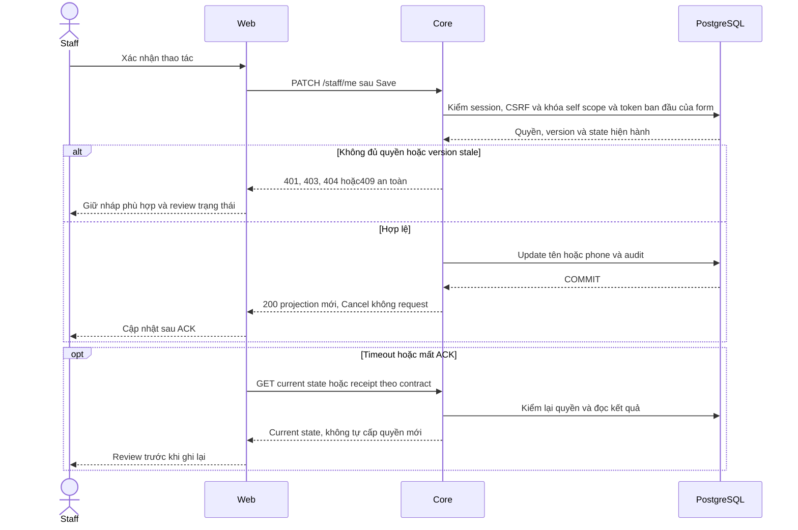

# S01 — Đăng nhập và tài khoản Staff

[Chỉ mục Staff](../README.md) · [API](00-staff-contract.md#api-theo-chức-năng) · [Routes](00-staff-contract.md#điều-hướng) · [Khoảng trống](README.md#phần-còn-lại-theo-chức-năng)

Đối chiếu **03/11/2026**. Căn cứ: FR-001, NFR-001/002 và yêu cầu Staff tự sửa hồ sơ. Đã nối Core; chưa có public registration/SSO/OTP/reset password tự phục vụ.

## Truy vết data model và vị trí code theo phase

Mỗi phase dưới đây có bảng cột/đọc–ghi/FK/version, migration, transaction và mức ảnh hưởng chi tiết; xem mục **Data model và phạm vi ảnh hưởng** và bảng **Vị trí code** trong phase. Hiện có file không đồng nghĩa mọi thay đổi dự kiến trong file đã được triển khai. Các phần P giữ P.

| Phase sở hữu | Bảng/dữ liệu chính và thao tác | Code cần rà từ root repo | Mức ảnh hưởng khi sửa |
| --- | --- | --- | --- |
| [AU01 — Auth và hồ sơ Staff Core](auth/01-session-account-api.md) | users + staff_profiles (PATCH ghi phone/full_name; đọc trường readonly) | [apps/core/src/auth/controllers/auth.controller.ts](<../../../../apps/core/src/auth/controllers/auth.controller.ts>); [apps/core/src/auth/controllers/staff-profile.controller.ts](<../../../../apps/core/src/auth/controllers/staff-profile.controller.ts>) | Cao — Staff và Customer dùng chung AuthService |
| [AU02 — Tài khoản Staff và editor](auth/02-account-ui.md) | users + staff_profiles (PATCH ghi phone/full_name; đọc trường readonly) | [apps/web/src/components/staff-personal-information.tsx](<../../../../apps/web/src/components/staff-personal-information.tsx>); [apps/web/src/components/staff-profile-editor.tsx](<../../../../apps/web/src/components/staff-profile-editor.tsx>) | Trung bình — Account và actor header/sidebar |
| [Việc 01 — Retry khôi phục phiên không tải lại trang](auth/03-session-lifecycle.md) | users/auth_sessions, quota/audit theo endpoint | [apps/web/src/components/auth-screen.tsx](<../../../../apps/web/src/components/auth-screen.tsx>); [apps/web/src/lib/auth-api.ts](<../../../../apps/web/src/lib/auth-api.ts>) | Cao — Cả hai portal, đổi tab/logout/late response |

Không tự áp dụng DDL khi triển khai UI, không biến model dự kiến thành hiện trạng, không reset seed/volume để né lỗi FK. Các dependency xuyên vai trò và operator xem [Data Model](../../../specifications/Data_Model.md#iii-bản-đồ-tác-động-khi-triển-khai-chức-năng).

## Hiện trạng

- [x] `/staff/login`: email/password, hiện/ẩn, phản hồi lỗi và điều hướng theo role.
- [x] Menu Personal information/Sign out, tên/mã từ Core; `/account` dùng bố cục Staff/Tailwind, không còn footer Contact.
- [x] GET/PATCH hồ sơ, Edit/Save/Cancel tên và phone; email/code/role/department chỉ đọc.
- [x] Security mở Change password; `/account#change-password` mở form. Lời nhắc password là khuyến nghị, đóng được trong phiên mount UI.
- [x] Session/role/CSRF/version/rate limit và audit; đổi mật khẩu thu hồi phiên cũ/cấp phiên mới.
- [x] Có 15 regression browser form hồ sơ và 22 regression phiên/retry Chromium, API giả lập.
- [x] Retry khôi phục phiên gọi lại GET auth/me tại chỗ, không F5; pending/disabled/focus, chống request trùng và abort khi rời màn hình. Đã triển khai [việc 01](auth/03-session-lifecycle.md#8-ghi-chú-triển-khai).
- [x] E2E browser → gateway/Core/DB: login, sửa hồ sơ/audit/conflict, password/logout, mất phiên; browser regression Chromium/Firefox/WebKit theo AU01–AU03.

## Thành phần và điều hướng

Footer sidebar có avatar/tên/mã Staff. Popover chỉ mở Personal information (`/account`) hoặc Sign out; Change password nằm trong Security. Escape đóng popover/trả focus về nút mở; click ngoài đóng menu.

Trang tài khoản không có chức năng operator tạo/khóa/gán tài khoản hoặc sửa KYC. Quên password hiện hướng dẫn liên hệ quản trị.

## API hiện có

Prefix `/api/v1`; mã Axx tại [API map](00-staff-contract.md#api-theo-chức-năng).

| Thao tác | Method/path | Contract |
| --- | --- | --- |
| Login A01 | POST /auth/staff/login | `{email,password}` → `{actor,csrfToken}` + cookie; Core cố định role STAFF |
| Phiên A02 | GET /auth/me | Actor `{id,accountCode,email,role,fullName,passwordChangeRecommended}` + csrfToken |
| Logout A03 | POST /auth/logout | Thu hồi phiên hiện tại/xóa cookie; `{ok:true}` |
| Password A04 | POST /auth/change-password | `{currentPassword,newPassword,confirmPassword}` → actor/csrfToken + cookie phiên mới; thu hồi mọi phiên cũ |
| Hồ sơ Staff | GET /staff/me | Chỉ Staff trong phiên; response bên dưới |
| Sửa hồ sơ | PATCH /staff/me | fullName/phone + expectedUpdatedAt; hồ sơ sau commit |

Login/request ghi cần Origin được phép, JSON, `X-Auth-Request: 1`; ghi sau login thêm `X-CSRF-Token`. Cookie session/CSRF HttpOnly; JS lấy csrfToken từ login/auth/me. Không lưu credential trong browser storage. Session/lock/rate limit auth theo [baseline](../../../architecture.md#local-api).

Password mới tối thiểu 6 ký tự/tối đa 72 byte UTF-8, không trim/cắt ngầm. Core kiểm password cũ, xác nhận và không tái dùng password cũ; chỉ báo thành công sau Core.

## Trang Personal information hiện tại

GET/PATCH thành công trả:

```text
{staff: {id, accountCode, email, role, fullName, phone, department, updatedAt}}
```

| Trường PATCH | Quy tắc |
| --- | --- |
| fullName | Bắt buộc, trim, 1–255 ký tự, không control chars |
| phone | Tùy chọn; 7–15 chữ số, có thể bắt đầu bằng `+`; bỏ qua giữ nguyên, `null` xóa |
| expectedUpdatedAt | Bắt buộc, ISO timestamp từ hồ sơ mới nhất |

Không nhận userId/email/accountCode/role/department, trường hoặc query lạ. Core khóa user, kiểm lại phiên/version, ghi StaffProfile.fullName và User.phone/updatedAt cùng audit trong một transaction. Audit không chứa giá trị hồ sơ. Phiên hiện tại giữ nguyên, auth/me trả tên mới.

| HTTP | Ý nghĩa / hành vi FE |
| --- | --- |
| 200 | Cập nhật hồ sơ, báo thành công, làm mới tên app shell |
| 400 | Input sai |
| 401 | Xóa form/dữ liệu riêng, chuyển Staff login |
| 403 | Sai role/CSRF/Origin; không tự gửi lặp vô hạn |
| 404 | Thiếu hồ sơ |
| 409 | Version cũ hoặc phone trùng; tải lại hồ sơ trước sửa/lưu tiếp, không tự ghi đè |
| 429 | Quá 30 lần sửa/15 phút/user; giữ nháp và báo lỗi |
| Mạng/5xx | Giữ nháp, cho thử lại; không báo đã lưu |

Edit mở form; Cancel/Escape bỏ nháp/trả focus về Edit. Đang gửi khóa controls và không cho Escape hủy. Lỗi validation nhận focus; Save gửi version và CSRF hiện hành. Các thao tác form phải giữ workspace, không tải lại document.

## Kiểm phiên khi quay lại tab

Tối ưu 03/11/2026: focus và visibilitychange chỉ kiểm GET auth/me khi trang visible và đã đủ **30 giây kể từ lần bắt đầu kiểm gần nhất** trong lifecycle AuthScreen. Các trigger cùng lúc dùng một request đang chạy; hai sự kiện nối tiếp sau response nhanh vẫn không tạo request thứ hai trong cửa sổ này. Không có timer polling auth mỗi 30 giây, không lưu timestamp/session qua browser storage.

- Initial load và Try again luôn kiểm ngay, không chờ 30 giây. Lỗi mạng vẫn fail-closed như trước; nút retry thủ công không bị cooldown chặn.
- Socket ready chỉ là handshake/reconnect: áp cửa sổ 30 giây cho auth, các module dữ liệu vẫn nhận tín hiệu resync như trước.
- Invalidate, session-expired và close 4001 bỏ qua cửa sổ; vẫn hỏi Core bằng cookie hiện tại. Không tự logout chỉ vì socket của phiên cũ đóng sau khi đổi password/cấp phiên mới.
- Session-expired đến khi đang kiểm phiên được gộp thành một lần kiểm tiếp ngay sau request hiện tại, không bị bỏ sót hoặc tạo nhiều request đồng thời. Nếu request hiện tại đã trả 401 thì không kiểm thừa lần nữa.
- 401 xóa dữ liệu riêng và chuyển login phù hợp. `/account` dùng role được Core xác thực gần nhất trong lifecycle để chọn Staff/Customer portal; chưa có actor thì không tự suy quyền từ URL/state chưa xác minh. Staff deep link giữ next như trước.

Đây là giảm kiểm tra nền từ FE, không thay cookie TTL, Cache-Control no-store hoặc auth/ownership/assignment ở từng Business API. Các thao tác cần CSRF như xin PDF/download vẫn có thể gọi auth/me riêng; không phải giới hạn tất cả request auth/me thành một lần/30 giây. Không hứa phát hiện thu hồi tức thì khi offline hoặc socket mất kết nối.

## Test cases

Các ca dưới đây là **đặc tả kiểm thử**, không phải báo cáo kết quả. Kiểm từng lớp API/service/DB/browser đúng nhãn; mock UI không thay kiểm quyền Core hoặc E2E thật.

**Quy ước dữ liệu:** S-A/S-B là hai Staff synthetic; C-A/C-B là hai Customer synthetic khác nhau. Thay alias bằng UUID/token của fixture cô lập; các path HTTP dùng prefix /api/v1 nếu chưa ghi đầy đủ. Chỉ thay assignment, khóa account, inject lỗi hoặc migration trong harness/môi trường test, không trên tài khoản/dữ liệu đang sử dụng.

### S01-T01 — Đăng nhập đúng cổng Staff

**Lớp kiểm thử:** API.
**Điều kiện và dữ liệu:** S-A là Staff ACTIVE có mật khẩu synthetic đã biết; C-A là Customer.

**Các bước:**

1. POST /auth/staff/login bằng S-A.
2. Dùng cookie nhận được gọi GET /auth/me và GET /staff/me.
3. Lặp đăng nhập cổng Staff bằng C-A.

**Kết quả mong đợi:** S-A nhận session và đúng hồ sơ chính mình; C-A không tạo được phiên Staff; không trả password hash/token nội bộ.

### S01-T02 — Edit, Cancel rồi Save bằng bàn phím

**Lớp kiểm thử:** Browser.
**Điều kiện và dữ liệu:** S-A mở /account; ghi lại tên/phone ban đầu.

**Các bước:**

1. Tab tới Edit personal information và mở form.
2. Đổi tên/phone rồi Cancel.
3. Mở lại, nhập giá trị synthetic khác và Save.

**Kết quả mong đợi:** Cancel không gửi PATCH và trả focus về Edit; Save gửi đúng changed fields/token, cập nhật header/hồ sơ không F5.

### S01-T03 — Giữ nháp khi refresh và xung đột

**Lớp kiểm thử:** Browser + API mock.
**Điều kiện và dữ liệu:** Hai tab S-A cùng mở form; tab 1 đang có nháp chưa lưu.

**Các bước:**

1. Tab2 lưu tên mới.
2. Kích hoạt cập nhật nền ở tab 1.
3. Save nháp tab 1 với token ban đầu.

**Kết quả mong đợi:** Nháp không bị refresh ghi đè; conflict được hiển thị để review, không tự gửi lại bằng token mới.

### S01-T04 — Response phiên cũ không khôi phục actor

**Lớp kiểm thử:** Browser + API mock.
**Điều kiện và dữ liệu:** Giữ chậm response /auth/me của S-A.

**Các bước:**

1. Chuyển portal hoặc logout trong lúc request pending.
2. Trả response S-A muộn.
3. Đăng nhập bằng actor synthetic khác.

**Kết quả mong đợi:** Request cũ bị abort hoặc bị generation guard bỏ qua; không hiện tên, role hay dữ liệu S-A trong phiên mới.

**Suite tham khảo:** [staff-account.spec.mjs](../../../../apps/web/tests/browser/staff-account.spec.mjs). Tên suite là vị trí tự động hóa, không phải chứng nhận các ca đã chạy.

**Dọn sau kiểm thử:** xóa đúng fixture/session/object/schema theo runId; phục hồi fault injection và đóng context/socket test. Không reset DB/credential, sửa bootstrap hoặc xóa volumes. Với PDF kiểm metadata/bytes/hash; với UI kiểm DOM/focus/network, không cần screenshot.

## Chạy lại regression form hồ sơ

Chuẩn bị theo [Getting Started](../../../getting-started.md); Web/Core chạy Docker qua gateway. Cài `npm ci` và `npx playwright install chromium` khi chuẩn bị công cụ, sau đó:

```powershell
npm run test:browser:account
```

Nếu source ứng dụng đổi, rebuild Docker theo Getting Started trước test; không dựng Web/Core bằng npm trên host. Mặc định `http://localhost:8080`, đổi bằng `BROWSER_TEST_BASE_URL`. Screenshot/video/trace tắt; kết quả tổng hợp `apps/web/test-results/results.json` (Git ignore), dọn artifact do lần test tạo sau khi đọc.

Tối ưu quay lại tab ngày 03/11 đã qua Web lint/typecheck/Docker và 78 ca browser: 15 Account + 22 Session + 15 Customers + 26 Policies. 9 ca Session bổ sung kiểm đúng mốc 30 giây/hidden, ready không gọi thừa, invalidate/expiry/close 4001 bypass, expiry lúc pending, retry sau lỗi và cổng login đúng role/phiên mới còn hợp lệ. Đây là regression mock, không E2E Core/DB. Bằng chứng việc 01 ban đầu tại [kế hoạch](auth/03-session-lifecycle.md#8-ghi-chú-triển-khai); không sửa credential/DB.

## Phase và ownership

| Phase | Phạm vi | Trạng thái |
| --- | --- | --- |
| [AU01](auth/01-session-account-api.md) | Login/session/password/logout, GET/PATCH self | E |
| [AU02](auth/02-account-ui.md) | Personal information/editor/account menu | E |
| [AU03](auth/03-session-lifecycle.md) | Retry/freshness/dedup/revoke | E |

AU02 còn cần bổ sung E2E thật và browser matrix, không code lại auth chỉ để đủ bộ tài liệu.

## API và routes của chức năng

Bảng truy vết Axx được chuyển từ tài liệu tổng hợp; E/P giữ theo runtime, DTO/quyền/luồng/test chi tiết do các phase của chức năng sở hữu. Không thêm endpoint từ việc gom tài liệu.

| ID | Method/path | Phạm vi |
| --- | --- | --- |
| A01 E | POST /auth/staff/login | Staff email/password → actor/csrfToken + cookie |
| A02 E | GET /auth/me | Actor/role hiện hành và csrfToken |
| A03 E | POST /auth/logout | Thu hồi phiên hiện tại; `{ok:true}` |
| A04 E | POST /auth/change-password | Kiểm password cũ/mới/xác nhận; thu hồi mọi phiên cũ, cấp phiên mới |
| — E | GET /staff/me; PATCH /staff/me | Staff đọc/sửa tên/phone chính mình, expectedUpdatedAt và CSRF; [Account](01-auth-contract.md#trang-personal-information-hiện-tại) |

| Route | Trạng thái |
| --- | --- |
| /staff | Chuyển /staff/customers |
| /staff/login | Login Staff — AU01/AU02 |
| /account và /account#change-password | Hồ sơ/password theo role — AU02 |

## Phần còn lại theo chức năng

| ID | Phần còn lại | Phase sở hữu |
| --- | --- | --- |
| G05 | Các lỗi Search/session/PDF refresh/Inbox remount đã sửa | Giữ regression AU03/PL04/I04/I06; mở lại chỉ khi có lỗi kiểm chứng, không dùng F5 |

## Sequence diagram

Luồng chính và nhánh quyền/lỗi; test case ở trên chỉ rõ dữ liệu và điểm kiểm tương ứng.


