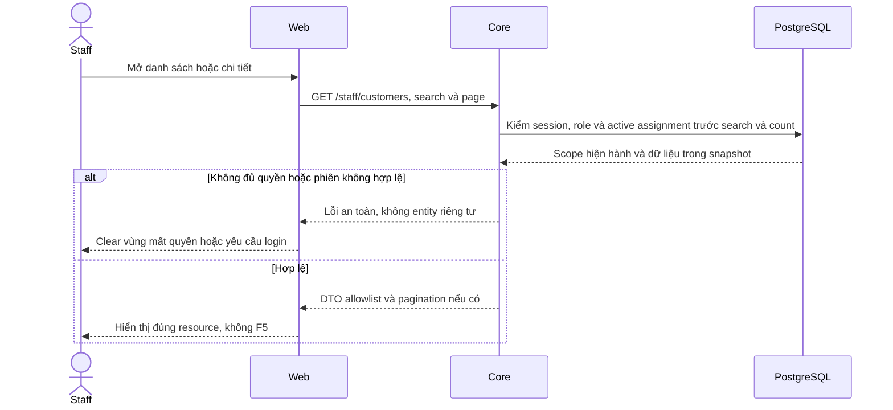

# S03 — Customers và hồ sơ khách được phân công

[Chỉ mục Staff](../README.md) · [API](00-staff-contract.md#api-theo-chức-năng) · [Policies](05-policies-contract.md) · [Khoảng trống](README.md#phần-còn-lại-theo-chức-năng)

Đối chiếu **03/11/2026**. Căn cứ: FR-002/003, UC-003, NFR-001/002. Danh sách/search/hồ sơ/hợp đồng đã nối Core; hồ sơ có liên kết Inbox/Ticket theo khách.

**Bảo vệ email/phone — đã triển khai 14/11/2026:** Staff mặc định nhận giá trị đã che ở cả danh sách và chi tiết Customer. Staff có Show/Hide từng trường để liên hệ, Core kiểm lại quyền/phân công và audit khi reveal. Core projection, Web và các caller theo [CU01/CU02](customers/01-assignment-read-api.md#customer-privacy-api) và [ma trận dữ liệu](../../../configuration-and-data.md#customer-sensitive-data); Core trả projection Staff đã che và API reveal riêng. Search đã chốt A: chỉ tên/mã Customer, bỏ email/phone; Core/Swagger/placeholder đã đồng bộ theo CU01/CU02. Ngày sinh/địa chỉ Staff detail đã chốt A: chỉ năm sinh/tỉnh-thành đã xác minh, thiếu căn cứ thì ẩn từng trường; DTO dùng birthYear/provinceCity; chưa có nguồn xác minh nên trả null. Định dạng A đã duyệt cho email giữ 1 ký tự đầu và phone giữ 2 số cuối, phần bị che dùng `***`. Core projection và Web render đã triển khai, có kiểm thử CU01-T06.

## Truy vết data model và vị trí code theo phase

Mỗi phase dưới đây có bảng cột/đọc–ghi/FK/version, migration, transaction và mức ảnh hưởng chi tiết; xem mục **Data model và phạm vi ảnh hưởng** và bảng **Vị trí code** trong phase. Hiện có file không đồng nghĩa mọi thay đổi dự kiến trong file đã được triển khai. Các phần P giữ P.

| Phase sở hữu | Bảng/dữ liệu chính và thao tác | Code cần rà từ root repo | Mức ảnh hưởng khi sửa |
| --- | --- | --- | --- |
| [CU01 — Customers API theo phân công](customers/01-assignment-read-api.md) | staff_assignments + customer_profiles + staff_profiles (Đọc); users + customer_profiles (Đọc projection) | [apps/core/src/customers/controllers/customer.controller.ts](<../../../../apps/core/src/customers/controllers/customer.controller.ts>); [apps/core/src/customers/services/customer.service.ts](<../../../../apps/core/src/customers/services/customer.service.ts>) | Cao — Customers list/detail |
| [CU02 — Danh sách, hồ sơ và vùng policies](customers/02-directory-profile-ui.md) | staff_assignments + customer_profiles + staff_profiles (Đọc); users + customer_profiles (Đọc projection) | [apps/web/src/components/staff-customer-directory.tsx](<../../../../apps/web/src/components/staff-customer-directory.tsx>); [apps/web/src/lib/customer-api.ts](<../../../../apps/web/src/lib/customer-api.ts>) | Trung bình — Back/Forward, empty/error, không F5 |

Không tự áp dụng DDL khi triển khai UI, không biến model dự kiến thành hiện trạng, không reset seed/volume để né lỗi FK. Các dependency xuyên vai trò và operator xem [Data Model](../../../specifications/Data_Model.md#iii-bản-đồ-tác-động-khi-triển-khai-chức-năng).

## Hiện trạng

- [x] `/staff/customers`: list/search/phân trang 10/trang trên toàn tập active assignment.
- [x] `/staff/customers/:customerId`: hồ sơ chỉ đọc và Insurance policies A14; mở chi tiết/catalog/PDF A16/A18/A20.
- [x] Tìm bằng Enter, không có nút Search/Clear search. Xóa nội dung rồi Enter để bỏ lọc; giữ focus. URL giữ search/page, đổi từ khóa về trang 1.
- [x] Deep link/breadcrumb/Back–Forward; tìm kiếm/phân trang/retry không F5 hoặc remount workspace.
- [x] Loading/empty/no match/error/retry; request cũ bị hủy; 401/403/404 xóa dữ liệu riêng.
- [x] Realtime refresh nền cho list/hồ sơ cùng query, giữ dữ liệu trong lúc chờ; kiểm phiên khi focus/visible vẫn có.
- [x] Có regression browser với API/WebSocket giả lập và kiểm Customers qua gateway/Core thật.
- [x] Hồ sơ khách có Conversations/Tickets mở màn nghiệp vụ với customerId; Core giữ kiểm assignment/Direct/consent, không nhúng chat vào Customers.

**Hiện liên hệ — triển khai 14/11/2026.** Email/phone mặc định che theo A ngày 13/11 và có Hiện/Ẩn để Staff liên hệ. API reveal kiểm lại quyền/phân công, ghi audit metadata và trả riêng trường cần dùng. CU01/CU02 sở hữu DTO/nút/state/revoke và tests CU01-T07/CU02-T06. [Quyết định chuẩn](../../../configuration-and-data.md#staff-contact-reveal).

## API hiện có

Prefix `/api/v1`; actor/role từ session. Session, assignment và list/count đọc cùng snapshot RepeatableRead.

| API | Input và kết quả |
| --- | --- |
| A05 GET /staff/customers | page 1–100000 (default 1), pageSize 1–50 (default 10), search tùy chọn; `{items,total,page,pageSize}` |
| A06 GET /staff/customers/:customerId | UUID; `{customer}` đúng active assignment; ngoài quyền/không tồn tại cùng 404 |
| POST /staff/customers/:customerId/contact-reveal | `{field:"email"\|"phone"}`; `{customerId,field,value}`; Staff/Origin/CSRF, no-store, audit metadata |

List item: `{id,fullName,accountCode,email,phone,status}`. Họ tên/mã Customer đã chốt A ngày 13/11, hiển thị đầy đủ cho Staff có active assignment hợp lệ, khớp source hiện tại. Detail dùng birthYear/provinceCity nullable và không có raw birth/address. Chưa có nguồn xác minh nên cả hai trả null, UI hiện “Not provided”. Không trả citizenId/KYC, password/token hoặc metadata nội bộ. status là UserStatus ACTIVE/LOCKED, không phải trạng thái hợp đồng/hội thoại.

**Contract search A ngày 13/11:** chỉ fullName/accountCode. Source hiện vẫn tìm cả email/phone; cần bỏ hai predicate này, cập nhật Swagger/placeholder và chạy CU01-T02, chưa nghiệm thu thay đổi. Search giữ trim, tối đa 100 ký tự, chuỗi con không phân biệt hoa thường; rỗng/space tương đương bỏ lọc. Không tự bỏ dấu hoặc suy diễn loại dữ liệu từ chuỗi tìm kiếm. `%`, `_`, backslash là ký tự thường. Query lạ/lặp/sai kiểu/control chars/quá dài trả 400. Scope và search áp trước count/phân trang, không tìm trên riêng trang hiện tại; thứ tự userId tăng dần. Trang vượt phạm vi có items rỗng nhưng giữ total.

Staff chưa có khách nhận list rỗng. Customer LOCKED vẫn được Staff còn assignment phục vụ; Staff bị khóa/phiên không hợp lệ không đọc được. 401 chuyển login, 403/404 xóa dữ liệu không còn quyền; lỗi mạng/5xx có Try again tại vùng lỗi. Các lần đọc mới quan sát thay đổi quyền đã commit; UI không là nguồn cấp quyền.

Hồ sơ chỉ đọc: không sửa KYC, khóa tài khoản hoặc phân công. Staff phụ trách Customer, người điều khiển chat và assignee Ticket là các quan hệ khác nhau.

## Bố cục và điều hướng

Danh sách là bảng tên/mã/email/phone/status với cuộn ngang trong vùng riêng ở màn hình nhỏ. Detail có breadcrumb Customers → Customer details, tên/avatar/mã/status; Insurance policies là vùng chính, Personal information là cột phụ; đích đã duyệt chỉ hiện năm sinh/tỉnh-thành đã xác minh, nguồn thiếu thì Not provided từng trường. Mobile xếp policies trước hồ sơ.

Hợp đồng dùng [contract Policies](05-policies-contract.md), có loading/empty/error/retry riêng; chỉ hiện chưa có hợp đồng sau phản hồi rỗng thành công. Mở policy bằng Next Link; URL gọn, ngữ cảnh search/page/policyPage quay về lưu trong sessionStorage theo tab, được kiểm customerId. Không nhúng chat/composer/takeover/Copilot hoặc list Ticket vào Customers.

List/hồ sơ không refetch theo focus/visibility; realtime ready/invalidate kích hoạt refetch nền cho cùng actor/query. Đổi khách/trang tải mới và hủy request cũ. Vòng đời preview PDF đã tách khỏi metadata refetch: giữ iframe/src khi cùng file/version, vẫn kiểm quyền/binding; xem [Policies](05-policies-contract.md#giao-diện-hiện-tại).

## Test cases

Các ca dưới đây là **đặc tả kiểm thử**, không phải báo cáo kết quả. Kiểm từng lớp API/service/DB/browser đúng nhãn; mock UI không thay kiểm quyền Core hoặc E2E thật.

**Quy ước dữ liệu:** S-A/S-B là hai Staff synthetic; C-A/C-B là hai Customer synthetic khác nhau. Thay alias bằng UUID/token của fixture cô lập; các path HTTP dùng prefix /api/v1 nếu chưa ghi đầy đủ. Chỉ thay assignment, khóa account, inject lỗi hoặc migration trong harness/môi trường test, không trên tài khoản/dữ liệu đang sử dụng.

### S03-T01 — Scope trước search và phân trang

**Lớp kiểm thử:** API + DB.
**Điều kiện và dữ liệu:** S-A được gán C-A1…C-A12; S-B được gán C-B; tên đều synthetic.

**Các bước:**

1. GET /staff/customers?page=1&pageSize=10 bằng S-A.
2. Lấy page 2 rồi search tên một khách chỉ có ở page 2.
3. GET lại bằng S-B.

**Kết quả mong đợi:** S-A có tổng12, trang10/2; search tìm trên toàn bộ scope; không có khách S-B trong items hoặc total.

### S03-T02 — Search và Back giữ context

**Lớp kiểm thử:** Browser.
**Điều kiện và dữ liệu:** S-A có hơn10 khách; biết mã một khách ở trang2.

**Các bước:**

1. Mở Customers, sang trang2.
2. Tìm mã khách bằng Enter, mở hồ sơ.
3. Bấm Back, xóa search rồi Enter.

**Kết quả mong đợi:** Search đúng toàn tập; URL/selection/page khôi phục theo thao tác; không Search/Clear buttons, không F5.

### S03-T03 — Detail và thu hồi phân công

**Lớp kiểm thử:** API + DB.
**Điều kiện và dữ liệu:** S-A được gán C-A, không được gán C-B; harness có thao tác revoke riêng.

**Các bước:**

1. GET detail C-A và C-B bằng S-A.
2. Thu hồi assignment C-A trong fixture.
3. GET lại detail C-A và list.

**Kết quả mong đợi:** C-A ban đầu có allowlist profile, không KYC/citizenId; C-B404; sau revoke C-A404 và không còn trong list.

### S03-T04 — Lỗi vùng, focus và responsive

**Lớp kiểm thử:** Browser + API mock.
**Điều kiện và dữ liệu:** Mock list 503 trước, sau đó detail 503; viewport 375px.

**Các bước:**

1. Retry list rồi mở một khách.
2. Retry detail mà không đổi trang.
3. Dùng Tab và zoom 200%.

**Kết quả mong đợi:** Lỗi được phục hồi theo vùng, không navigation document mới; tên dài/email/controls không tràn; focus vẫn thao tác được.

**Suite tham khảo:** [staff-customers.spec.mjs](../../../../apps/web/tests/browser/staff-customers.spec.mjs). Tên suite là vị trí tự động hóa, không phải chứng nhận các ca đã chạy.

**Dọn sau kiểm thử:** xóa đúng fixture/session/object/schema theo runId; phục hồi fault injection và đóng context/socket test. Không reset DB/credential, sửa bootstrap hoặc xóa volumes. Với PDF kiểm metadata/bytes/hash; với UI kiểm DOM/focus/network, không cần screenshot.

## Chạy browser regression

Theo [Getting Started](../../../getting-started.md), Web/Core chạy Docker qua gateway; source ứng dụng đổi phải rebuild Docker trước test. Chuẩn bị `npm ci` và `npx playwright install chromium` khi cần, rồi:

```powershell
npm run test:browser:customers
```

Mặc định `http://localhost:8080`, đổi bằng `BROWSER_TEST_BASE_URL`. Screenshot/video/trace tắt. Kết quả tổng hợp ở `apps/web/test-results/results.json` (Git ignore); dọn artifact do lần test tạo sau khi đọc. Chưa kiểm Firefox/WebKit.

## Phần còn lại

- [x] Liên kết từ hồ sơ bằng customerId đã kiểm quyền; Inbox tự mở nhóm đúng khách, chi tiết hỗ trợ ở đúng màn nghiệp vụ, Back giữ tìm kiếm.
- [x] E2E browser/gateway/Core/DB cho search/page/profile/support links/Back và ngoài assignment; hồi quy Chromium/Firefox/WebKit theo CU01/CU02.

Dữ liệu kiểm thử phải hoàn toàn synthetic; bộ regression tạo fixture độc lập trong bộ nhớ để chạy được trên mọi máy.

## Phase triển khai

[CU01 — Read API](customers/01-assignment-read-api.md) và [CU02 — Directory/profile UI](customers/02-directory-profile-ui.md) đều E; CU02 còn cần bổ sung E2E browser/Core/DB thật. Liên kết sang Inbox/Tickets theo customerId là UX tùy phạm vi, không nhúng chat/Ticket list vào Customers và không blocker FR-003.

## API và routes của chức năng

Bảng truy vết Axx được chuyển từ tài liệu tổng hợp; E/P giữ theo runtime, DTO/quyền/luồng/test chi tiết do các phase của chức năng sở hữu. Không thêm endpoint từ việc gom tài liệu.

| ID | Method/path | Phạm vi |
| --- | --- | --- |
| A05 E | GET /staff/customers | search/page/pageSize trong toàn tập active assignment; [Customers](02-customers-contract.md#api-hiện-có) |
| A06 E | GET /staff/customers/:customerId | Hồ sơ đúng assignment; không citizenId/KYC |
| E | POST /staff/customers/:customerId/contact-reveal | Hiện một trường email/phone sau kiểm quyền và CSRF; no-store/audit |

| Route | Trạng thái |
| --- | --- |
| /staff/customers | Search Enter/list/page — CU01/CU02 |
| /staff/customers/:customerId | Hồ sơ readonly và policies; không nhúng chat/Tickets |

## Sequence diagram

Luồng chính và nhánh quyền/lỗi; test case ở trên chỉ rõ dữ liệu và điểm kiểm tương ứng.


