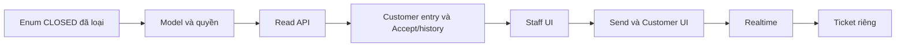

# Việc 03 — Các phase triển khai Inbox

Ngày **03/11/2026**. **I01–I06 đã triển khai/kiểm chứng 04/11/2026; I07/C01 Copilot chưa implement.** Enum chat CLOSED đã loại ở migration trước; I01 là migration foundation riêng. [Spec chính](inbox/00-inbox-spec.md) · [API](00-staff-contract.md#api-theo-chức-năng) · [Kế hoạch chung](../../../next-steps.md).

## 1. Quyết định đã chốt

- All / Requests / Active, không AI active/Closed/New trong Inbox Staff.
- Bỏ toàn bộ counts/badge/tổng số và A07 summary; lazy load bằng hasMore/nextCursor.
- Staff không thấy AI chat riêng. Pending chỉ metadata yêu cầu đã chia sẻ, không transcript/preview/summary của AI trước Accept.
- Core Accept thành công mới cho Staff đọc toàn bộ lịch sử Customer-facing trước và sau chuyển giao của chính cuộc đó. Direct là cuộc Customer thực sự gửi Staff, không phải đổi flag AI cũ để bypass Accept.
- Tên/mã khách trong accordion; tiêu đề/thời gian từng cuộc giống danh sách chat, không CHT/preview/số cuộc ở bản đầu.
- ConversationStatus đã bỏ CLOSED qua migration 202611030001_remove_conversation_closed; TicketStatus.CLOSED giữ nguyên. Legacy Customer Support về AI_ACTIVE/controller NULL, audit giữ trạng thái/controller cũ, không tạo grant; Copilot CLOSED chưa review sẽ chặn migration.
- Handoff/Direct/Accept không tự tạo Ticket; Ticket do Agent gợi ý, Customer xác nhận rồi Core tạo riêng.

## 2. Điều đã chốt khác với implementation

I01 đã có provenance/consent/acceptance schema, capability policy, sequence/receipt và revoke khi reassignment. I02 đã có public groups/lazy/metadata/cursor read API; I03 đã có Customer entry/request/Accept/transcript và command lookup; I04 Staff UI đã nối; I05 public send/Customer UI đã có; I06 realtime chat đã có. Workflow đã tạo chứng cứ thực qua session/consent/commit, không backfill grant cho legacy. AssignedStaffId/status/assignment không tự chứng minh quyền lịch sử AI.

[Inbox plan](inbox/00-inbox-spec.md) giữ nghiệp vụ/UX và spec tổng. File này là chỉ mục và contract chung; schema/API/thuật toán/test chi tiết nằm ở phase sở hữu bên dưới. Khi thay contract phải cập nhật phase sở hữu, spec tổng và API map, không giữ hai DTO khác nhau. SRS/model nguồn giữ để truy vết; [source review](../../../source-review.md#quyết-định-inbox-và-quyền-chat--03112026) ghi khác biệt.

Các thiết kế kỹ thuật mới là **phương án đề xuất để review**, chưa phải code/schema/endpoint đang chạy hoặc phê duyệt ADR Agent/cloud. Khi bắt đầu phase, rà code và migration mới kể từ mốc này, chốt gate của phase trước phần code phụ thuộc. Lượt này chỉ viết tài liệu, không seed/chạy migration/thêm dependency/đổi credential.

## 3. Chia phần triển khai theo thứ tự

| Phần | Nội dung tài liệu cần viết trước | Kết quả triển khai sau review | Gate |
| --- | --- | --- | --- |
| [I01 — Model/quyền](inbox/01-model-permissions.md) | Provenance, consent/acceptance, audience, sequence, receipt, migration | Policy/query chung và schema có constraints | Không tự grant legacy; TicketStatus giữ nguyên |
| [I02 — Read API](inbox/02-inbox-read-api.md) | A08/A09 groups/lazy/search/cursor, DTO không counts | API request metadata đúng quyền | AI riêng không lộ; pending A10 luôn deny |
| [I03 — Handoff/history](inbox/03-handoff-transcript.md) | Customer tạo AI/Direct/request, A11 Accept, A10 history, fence/reconcile | Request có nguồn thật, Accept/transcript đúng gate | Trước commit không đọc; sau commit gồm tin AI trước chuyển giao |
| [I04 — Staff UI](inbox/04-staff-inbox-ui.md) | All/Requests/Active, accordion, Accept, chat cuộn/mobile/focus/URL | UI với Core thật; composer chưa gửi | Không fixture quyền giả, không F5, không bảng metadata thay chat |
| [I05 — Send/Customer](inbox/05-messaging-customer.md) | A12/send/reconcile và UI Customer hai đầu | Chat Staff–Customer qua REST thật | Timeout không trùng, nháp/sequence/quyền đúng |
| [I06 — Realtime/routing](inbox/06-realtime-routing.md) | I06-A tin SYSTEM sau Accept; I06-B outbox local, recipient, reconnect/catch-up, notification handoff | Tin tiếp nhận bền vững và Inbox cập nhật liên tục | Retry Accept chỉ một SYSTEM; pending không lộ transcript |
| [I07 — Ticket riêng](tickets/06-agent-confirmation.md) | Draft/confirmation/create/list/accept, liên kết Inbox | Ticket độc lập, sau khi có contract Agent cần thiết | Ticket không mở quyền transcript; Copilot ngoài bộ phase |

**Đã có bảy file triển khai; I01–I06 hoàn tất; I07 và C01 Copilot còn kế hoạch.** Làm theo I01 → I02 → I03 → I04 → I05 → I06; I07 là nhánh nghiệp vụ tiếp theo, không là điều kiện để Customer nhờ Staff. Không gộp tất cả thành một thay đổi.

I01–I03 chưa phải chat UI hoàn chỉnh. I04 là mốc review bố cục/đọc/Accept. I05 chat hai đầu qua REST, cần tải lại vùng dữ liệu cho đến I06. I06 Inbox cập nhật liên tục. Agent sinh câu trả lời thật, checkpoint, attachments/typing/read receipts và Copilot cần kế hoạch riêng; không đánh dấu hoàn thành từ fixture AI hoặc GET history.

## 4. Nội dung bắt buộc của kế hoạch I01

- Enum CLOSED đã loại riêng; legacy về AI_ACTIVE/controller NULL có audit và lịch sử giữ nguyên, không có grant. I01 vẫn phải phân loại provenance/consent/acceptance; không dùng trạng thái hiện tại để cấp quyền hàng loạt.
- Thiết kế bằng chứng Customer cho phép chia sẻ toàn bộ lịch sử và Staff Accept; tách actor phụ trách khỏi actor được đọc/điều khiển.
- Provenance Direct vs AI, chặn đổi cờ Direct trên cuộc AI. Audience của Message/SYSTEM/citations và ranh giới Copilot/tool metadata.
- Quyền trước group/list/detail/messages/event và xử lý assignment đổi; không kế thừa acceptance mặc định.
- Schema/index/backfill/compatibility/migration mới và test permission âm/dương; không sửa migration đã apply hoặc xóa DB.
- Chốt thứ tự activity/sequence, không thêm conversationCode/counts chỉ để tô UI.

## 5. Nội dung bắt buộc của kế hoạch I02

- A08 group/lazy và A09 metadata đủ scope; filter all/requests/active, chỉ search tên-mã.
- Request subject/reason/time chỉ từ dữ liệu Customer đã cung cấp/xác nhận chia sẻ; không lấy title/message AI riêng.
- Cursor/hasMore/nextCursor, limit/order/stale response và error envelope; không total/count/statusCounts hoặc endpoint A07.
- Dataset synthetic tự dọn cho kiểm thử, không thêm bootstrap seed cá nhân hoặc yêu cầu người dùng reset dữ liệu.
- A10 phải có deny-before-Accept ngay từ đầu, không mở transcript tạm cho review FE.

## 6. Hành vi sau Accept

Core commit acceptance/grant/control mode trước trả thành công; FE mới gọi A10. Lịch sử trước requestedAt/acceptedAt vẫn tải bằng cursor như phần mới, đúng cuộc/Customer-facing. Không tự tải Copilot/internal/tool payload hoặc dữ liệu cuộc khác. Link Ticket/notification/UUID không vượt gate.

Yêu cầu Staff và sự kiện thông báo lưu bền vững riêng; không tạo SupportTicket. Ticket + outbox atomic chỉ áp dụng khi Customer xác nhận tạo Ticket. Tạo/nhận Ticket không tự nhận chat.

## 7. Những điểm kỹ thuật còn mở

Các file phase đã đưa ra phương án cụ thể. I03 đã áp dụng: AI dừng từ request commit; chưa có Staff/Staff khóa trả409 không tạo request vô chủ; reassignment thu hồi grant cũ và cần Customer xác nhận mới; Direct cũ ngừng gửi, có thể tạo Direct mới hoặc xin chuyển lịch sử qua request mới; legacy chưa chứng minh giữ LEGACY_REVIEW. I04 Staff UI và I05 send/Customer UI đã nối; I06 realtime đã có; Ticket TK01–TK05 read/Accept/UI/consumer đã có; I07 producer còn P.

## 8. Checklist

- [x] Ghi quyết định All/Requests/Active, không counts, không Closed cho chat đích.
- [x] Ghi gate Direct/Accept và toàn bộ lịch sử Customer-facing sau Accept.
- [x] Tách Ticket khỏi handoff, giữ đúng schema runtime/đích migration.
- [x] Đồng bộ spec chính và tài liệu liên quan; đã migration I01 và read API I02; I04 UI Inbox đã nối.
- [x] Viết bảy file phase có API/luồng/vị trí triển khai/test và checkpoint.
- [x] Review và triển khai I01, migration/policy/service tests đã pass. Các đề xuất cho endpoint/UI sau vẫn cần chốt trong phase sở hữu.
- [x] Implement/nghiệm thu I01 model/quyền/legacy/receipt/sequence/revocation.
- [x] Implement/nghiệm thu I02 groups/lazy/request metadata/search/cursor, không counts và không pending transcript.
- [x] Implement/nghiệm thu I03 Customer entry/consent/request/Accept/history/lookup, 23 ca workflow pass.
- [x] I04 Staff Inbox: search/accordion/Accept/chat cuộn, browser mock và gateway E2E thật.
- [x] I05 send/reconcile và Customer UI qua REST thật.
- [x] I06-A: tin SYSTEM tiếp nhận lưu cùng transaction Accept; retry không trùng, không báo thành công trước commit.
- [x] I06-B: realtime/outbox/notification/catch-up và thu hồi quyền.
- [ ] C01: [Copilot riêng cho Staff](08-copilot-contract.md#c01--kế-hoạch-ai-copilot-riêng-cho-staff), chốt Core–Agent/checkpoint trước triển khai panel hỏi/tóm tắt/gợi ý trả lời.
- [ ] Mở phạm vi/nghiệm thu I07 riêng, không chờ Ticket để dùng chat Staff.

## 9. Contract kỹ thuật dùng chung — đề xuất

### 9.1. HTTP và validation

Prefix `/api/v1`, session cookie và role/resource kiểm bởi Core từng request. GET/response ghi `Cache-Control: no-store`. Ghi: JSON, Origin allowlist, `X-Auth-Request: 1`, `X-CSRF-Token`; CSRF lấy từ session memory, không gọi `/auth/me` trước mỗi tin nhắn. Giữ auth refresh 30 giây đã hoàn thiện.

Dùng `AuthService.me(request,tx)`/`authorizeWrite(request,tx)` hiện có, thêm lock/recheck theo nghiệp vụ. UUID/unknown fields/limit kiểm chặt; không lấy actor/senderType/audience/staff grant từ body. Thời gian ISO UTC; sequence bigint trả chuỗi, controlVersion integer không âm. Text render an toàn, SQL bind parameter; không serialize raw Prisma entity.

### 9.2. Lỗi

Giữ `{statusCode,code,message,requestId,timestamp}`. Error code mới cần allowlist/error class tại `apps/core/src/http/http-foundation.ts`, không lộ SQL/validator value.

| HTTP/code đề xuất | Ý nghĩa và xử lý |
| --- | --- |
| 400 VALIDATION_ERROR / BAD_REQUEST / INVALID_CURSOR | DTO/cursor lỗi hoặc không khớp query; cho reset vùng danh sách |
| 401 UNAUTHORIZED | Clear Private/nháp và về đúng login |
| 403 FORBIDDEN / CSRF_INVALID | Sai role/điều kiện ghi; không tự gửi lại mutation |
| 404 NOT_FOUND | Không tồn tại/không đủ gate cùng envelope; clear vùng Private |
| 409 STALE_CONVERSATION | Revalidate metadata, giữ nháp, không tự lặp action |
| 409 IDEMPOTENCY_CONFLICT | Cùng key khác payload; không đổi key để né |
| 409 STAFF_UNAVAILABLE / ROUTING_CHANGED | Customer chưa có Staff hoặc assignment đổi; giữ nội dung |
| 409 HANDOFF_ALREADY_PENDING / ALREADY_ACCEPTED | Trùng action mới; cùng receipt hợp lệ trả replay |
| 429 RATE_LIMITED | Retry-After, không retry vòng lặp |
| 503 SERVICE_UNAVAILABLE | Retry đọc tại vùng, mutation timeout phải reconcile |

Chỉ trả conflict sau gate resource, không tiết lộ trạng thái AI riêng qua 409. Logs/audit không chứa content/query tên khách/token/tool payload/signed URL.

### 9.3. Idempotency và cursor

I01 sở hữu receipt/locks; I03 áp dụng create/request/Accept; I05 send; I07 Ticket. Unique actor+operation+UUID key; hash canonical DTO gồm expectedVersion gốc. Cùng key/payload trả resource đã commit sau recheck quyền; khác payload 409. Replay không check version gốc để chạy lại action, không lặp audit/outbox/message; mất quyền không phát lại response Private cached. Receipt chỉ resource reference/hash/minimal result. Timeout retry **cùng key và payload gốc**, không tạo action mới.

Cursor versioned base64url đề xuất, binding actor/resource/query/sort và keyset cuối, decode tối đa 2 KB và kiểm shape. Opaque không là mã hóa hoặc token cấp quyền; mọi page kiểm policy. Không cần thêm secret cursor để thay authorization. Tập tĩnh phải đủ/không trùng; tập live revalidate đầu danh sách/dedup khi thay đổi, không hứa snapshot xuyên nhiều request. Cursor/transcript/signed URL không lưu URL app/localStorage.

### 9.4. Test và vận hành

Tách unit, PostgreSQL integration, HTTP Core, browser mock network và E2E hai context thật. HTTP pass không là browser E2E; browser mock pass không chứng minh DB/outbox. Test Nest harness mới chạy trong test container, không mở Core/Web trên host theo cách một số test cũ đang dùng. Playwright/lint/typecheck/build runner được chạy host, ứng dụng ở Docker gateway.

Test fixtures synthetic gắn runId, dọn đúng ID/FK tự tạo; không seed bootstrap/personal data vào tài liệu chung, không reset DB/volume. DOM/network/log, screenshot/video/trace tắt. Nếu cần artifact kết quả chỉ một JSON tổng hợp rồi dọn sau khi báo chat, không Markdown report.

Lệnh hiện có: `npm run lint`, `npm run typecheck`, Docker build service đã đổi, browser scripts Account/Customers/Policies khi phạm vi ảnh hưởng. I01/I02/I03 tests/harness đã chạy được và có kết quả tại file phase; I04 đã có browser mock và gateway integration; I05 đã có send/browser/gateway tests; I06 đã có Core/browser/gateway tests; I07/Ticket còn cần thêm tests khi triển khai. Mỗi phase cập nhật Swagger/API map E/P và checklist đúng mức chứng minh.

### 9.5. Harness kiểm thử đã có từ I01

Đã bổ sung target `test` từ migrator trong `apps/core/Dockerfile` (dev dependencies + generated client + build), service `core-tests` chỉ thuộc Compose profile `tests`. Test harness đọc credential cần thiết từ volume readonly qua helper test trong container, không in secret hoặc xuất file host; không nhận toàn bộ `.env`/MinIO writer credentials.

HTTP test có thể khởi tạo Nest trên loopback của **test container**, requests từ cùng container và đóng app/client trong finally. PostgreSQL integration dùng actor/fixture IDs riêng, không dùng tài khoản team để đổi password/assignment. Migration test dùng schema test có prefix/ID được xác minh và cleanup riêng qua Docker PostgreSQL socket theo cách test migration hiện có, không mở HTTP server host. Tất cả helper mới phải dùng lâu dài trong test suite, không script tạm bỏ quên.

Lệnh **đã chạy được sau I01**: `docker compose --profile tests build core-tests`, rồi `docker compose --profile tests run --rm --no-deps core-tests node --test test/conversation-permissions.test.cjs` (thay đúng test file phase). Stack DB/migration cần sẵn sàng trước; test entrypoint không tự seed bootstrap hoặc rotate credentials. Playwright E2E vẫn nhắm gateway `http://localhost:8080`; test harness tạo/dọn fixtures bằng credential nội bộ, không thêm public test endpoint vào Core runtime.

Test race outbox không được claim event thật của người dùng: test worker nhận allowlist aggregate/event IDs chỉ trong harness, hoặc dùng DB test cô lập. Khác biệt test hook không đi vào public API/production routing. Cleanup chỉ ID/schema tạo trong run, dừng khi không chứng minh ownership; không xóa rộng dữ liệu/log/volumes.

**I04 đã nối** Staff Inbox/accordion/request/Accept và transcript cuộn bằng API thật. I05 public send và Customer chat UI đã nối qua REST. I06 realtime local đã hoàn tất; tiếp theo review C01 Copilot/I07 theo phạm vi người dùng chọn.

**Bổ sung 04/11 sau test tay:** người dùng xác nhận phần I04/I05 còn lại pass. I06-A SYSTEM và I06-B realtime đã triển khai; Copilot C01 là mốc riêng đã có kế hoạch trong S05, không tạo Ticket hoặc gửi trả lời khách tự động. Phạm vi Copilot chỉ Staff, chưa mở đợt sửa giao diện Customer.

## API và routes của chức năng

Bảng truy vết Axx được chuyển từ tài liệu tổng hợp; E/P giữ theo runtime, DTO/quyền/luồng/test chi tiết do các phase của chức năng sở hữu. Không thêm endpoint từ việc gom tài liệu.

| ID | Method/path | Phạm vi |
| --- | --- | --- |
| A08 E | GET /staff/inbox/customers; GET /staff/inbox/customers/:customerId/conversations | Nhóm/lazy list, filter all/requests/active, search tên-mã và cursor; không counts/total/preview AI trước Accept |
| A09 E | GET /staff/conversations/:conversationId | Pending chỉ metadata request đã chia sẻ + allowedActions.readMessages=false; Active đủ gate mới có metadata chat |
| A10 E | GET /staff/conversations/:conversationId/messages | Chỉ Direct hợp lệ hoặc Accept hiện hành; sau Accept gồm toàn bộ lịch sử Customer-facing trước chuyển giao, không Copilot/internal |
| A11 E | POST /staff/conversations/:conversationId/accept | Nhận yêu cầu Customer hợp lệ; quyền lịch sử/control commit atomic, không proactive đọc AI riêng và không tạo/accept Ticket |
| A11 E (reconcile) | GET /staff/conversations/:conversationId/commands/:clientRequestId?operation=ACCEPT_HANDOFF | Receipt chính Staff; recheck current grant, 404 không chứng minh chưa commit |
| A12 E | POST /staff/conversations/:conversationId/messages | clientMessageId/content/expectedVersion; chống trùng và ACK sau commit |
| A12 E (reconcile) | GET /staff/conversations/:conversationId/messages/by-client-id/:clientMessageId | Tra tin của chính actor sau timeout, không gửi lại bằng key mới |
| A13 P | POST /staff/conversations/:conversationId/read | Read marker transcript; chưa có schema/spec hoàn chỉnh, không thuộc notification.isRead |

| Route | Trạng thái |
| --- | --- |
| /staff/inbox | All/Requests/Active + accordion/search/lazy — I02/I04/I06 |
| /staff/inbox/:conversationId | Metadata/Accept/transcript/send đúng gate — I03–I06 |
