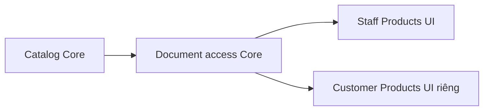

# P — Sản phẩm và tài liệu dùng chung, không phụ thuộc Agent

UI P03 cập nhật 04/11/2026: tự mở PDF đầu tiên; nhiều tài liệu dùng bộ chọn, không có View PDF/Refresh documents/Close preview. Realtime giữ bản đang đọc; phiên bản mới hiện thao tác chuyển chủ động. Tài liệu bị gỡ/mất quyền xóa preview; Core vẫn kiểm current version mỗi lần cấp link mới. Chi tiết và kiểm thử tại P03.

Cập nhật **04/11/2026** · **P01/P02 Core đã triển khai; P03 Staff UI đã triển khai** · [Staff](../README.md) · [API E/P](00-staff-contract.md#api-theo-chức-năng) · [Customer C03](../../customer/plans/03-products-contract.md).

## Truy vết data model và vị trí code theo phase

Mỗi phase dưới đây có bảng cột/đọc–ghi/FK/version, migration, transaction và mức ảnh hưởng chi tiết; xem mục **Data model và phạm vi ảnh hưởng** và bảng **Vị trí code** trong phase. Hiện có file không đồng nghĩa mọi thay đổi dự kiến trong file đã được triển khai. Các phần P giữ P.

| Phase sở hữu | Bảng/dữ liệu chính và thao tác | Code cần rà từ root repo | Mức ảnh hưởng khi sửa |
| --- | --- | --- | --- |
| [P01 — Catalog sản phẩm: Core read API](products/01-catalog-read-api.md) | insurance_products (Đọc) | [apps/core/src/products/controllers/product.controller.ts](<../../../../apps/core/src/products/controllers/product.controller.ts>); [apps/core/src/products/services/product.service.ts](<../../../../apps/core/src/products/services/product.service.ts>) | Cao — Staff/Customer Products |
| [P02 — Tài liệu sản phẩm PUBLIC và cấp quyền PDF](products/02-document-access.md) | insurance_products (Đọc); documents + document_versions (Đọc); MinIO/S3 — ngoài PostgreSQL (HEAD + ký GET/Range, không upload từ viewer) | [apps/core/src/products/controllers/product-document.controller.ts](<../../../../apps/core/src/products/controllers/product-document.controller.ts>); [apps/core/src/products/services/product-document.service.ts](<../../../../apps/core/src/products/services/product-document.service.ts>) | Cao — Hai role dùng cùng endpoint |
| [P03 — Staff Products: danh sách, chi tiết và PDF](products/03-staff-products-ui.md) | insurance_products (Đọc); documents + document_versions (Đọc); MinIO/S3 — ngoài PostgreSQL (HEAD + ký GET/Range, không upload từ viewer) | [apps/web/src/components/staff-products.tsx](<../../../../apps/web/src/components/staff-products.tsx>); [apps/web/src/lib/product-api.ts](<../../../../apps/web/src/lib/product-api.ts>) | Cao — Staff Tools và routes products |

Không tự áp dụng DDL khi triển khai UI, không biến model dự kiến thành hiện trạng, không reset seed/volume để né lỗi FK. Các dependency xuyên vai trò và operator xem [Data Model](../../../specifications/Data_Model.md#iii-bản-đồ-tác-động-khi-triển-khai-chức-năng).

## 1. Kết quả và căn cứ

Hoàn thiện phần tra cứu thủ công còn thiếu của **FR-008**, dùng cho Customer và Staff: danh sách sản phẩm, chi tiết thông tin đã có và PDF công khai đúng phiên bản. Staff Policy Lookup/PDF cá nhân đang chạy được giữ nguyên. Đây là phần Staff nên làm tiếp trước Copilot/Ticket vì không cần Agent.

Căn cứ: [Requirement](../../../specifications/Requirement.md) FR-008, NFR-001/002/007/008; [Data Model](../../../specifications/Data_Model.md), `apps/core/prisma/schema.prisma`. Không coi catalog hoàn tất là đã đạt toàn bộ FR-008 hai vai trò; Customer UI/PDF cá nhân có phase riêng.

### Quyết định nghiệp vụ đã chốt — 04/11/2026

Người dùng đã đồng ý phạm vi sau; P01–P03 triển khai theo các quyết định này, không cần chốt lại:

| Điểm | Quyết định |
| --- | --- |
| Catalog | Chỉ sản phẩm `isActive=true`; sản phẩm ngừng hoạt động vẫn được tham chiếu trong hợp đồng đã phát hành theo quyền hiện có |
| Nội dung chi tiết | Tên/mã/mô tả ngắn từ DB; quyền lợi và điều khoản đầy đủ trong PDF; chưa thêm bảng quyền lợi hoặc bảng giá |
| Quyền tài liệu chung | Staff và Customer đã đăng nhập được xem tài liệu PUBLIC hợp lệ của sản phẩm, không cần assignment; hợp đồng riêng vẫn kiểm quyền riêng |
| Phiên bản | Catalog dùng `currentVersion` đã công bố và active; hợp đồng cá nhân giữ đúng applied version, không tự thay bằng bản mới |
| Điểm vào Staff | Mục **Products** riêng trong Tools: danh sách → chi tiết → tài liệu/PDF; Policy Lookup tiếp tục cho hợp đồng cá nhân |

Đã chốt nghiệp vụ không có nghĩa API/UI đã triển khai. DTO, quota, cursor và cách tái dùng service là chi tiết kỹ thuật xử lý trong phase tương ứng; chỉ mở lại quyết định nghiệp vụ nếu phát hiện xung đột thực tế với yêu cầu/model.

## 2. Baseline và giới hạn model

| Dữ liệu hiện có | Cách dùng |
| --- | --- |
| InsuranceProduct: id/productCode/name/summary/isActive/createdAt | Catalog active; không suy ra giá, quyền lợi hoặc gói mua từ summary |
| InsuranceProduct → InsurancePolicy | Policy đã phát hành vẫn xem được theo quyền nếu product ngừng active |
| InsuranceProduct → Document → DocumentVersion | Tài liệu chung chỉ PUBLIC, đúng product, không policy/owner; currentVersion trỏ đúng version active |
| Document.currentVersion | Chọn phiên bản công bố của catalog chung; không chọn bản mới nhất theo ngày |
| InsurancePolicy.benefitsSnapshot.documents | Ràng buộc phiên bản áp dụng riêng của hợp đồng; không thay bằng currentVersion catalog |

Không có bảng quyền lợi sản phẩm, documentKind hoặc bảng giá. Cách làm đợt này: summary trên web, nội dung quyền lợi/điều khoản đầy đủ trong tài liệu. Nếu cần cấu trúc quyền lợi riêng, phải bổ sung contract/model sau; không parse PDF hoặc title để giả dữ liệu DB. Không migration trong phạm vi P01–P03 nếu schema hiện tại đủ constraints.

## 3. Chia phase

| Phase | Phạm vi | Gate |
| --- | --- | --- |
| [P01 — Catalog Core](products/01-catalog-read-api.md) | **Đã E:** A17 list/detail, DTO, search/page, auth hai role và quota | Core/gateway đã pass; không private field, chỉ active catalog |
| [P02 — Document Core](products/02-document-access.md) | **Đã E:** A19 catalog và cấp link PUBLIC exact version | Core/MinIO/gateway pass; không mở PRIVATE_POLICY |
| [P03 — Staff UI](products/03-staff-products-ui.md) | **Đã triển khai:** Products, list/detail/PDF, URL/focus/mobile | P01/P02 pass; không đổi Policy Lookup thành trang sản phẩm |

## 4. Contract chung

P01/A17 và P02/A19/access đã **E**, UI P03 chưa làm. Prefix `/api/v1`. Session hợp lệ CUSTOMER hoặc STAFF, không public anonymous chỉ vì Document.PUBLIC; PUBLIC là phạm vi tài liệu. Core tự lấy actor/role, không nhận customerId/role từ query. GET no-store; POST P02 cần Origin/JSON/X-Auth-Request và session CSRF theo foundation. Error envelope `{statusCode,code,message,requestId,timestamp}`. 401 chưa đăng nhập/phiên hết hạn;403 role/CSRF; resource thiếu/ngoài tập được phép cùng404; validation400, quota429, storage503.

P01 và P02 catalog dùng RateLimitBucket nhóm PRODUCT_READ120/phút/actor; P02 view/download dùng PRODUCT_DOCUMENT_ACCESS30/phút/actor, đã test scope/reset/Retry-After, không tuyên bố SLO. Không trả credential hoặc raw ORM entity. Catalog không trả bucket/key/checksum/URL; access trả riêng `{url,expiresAt}` sau recheck. Không log signed URL/nội dung PDF. Catalog P01 dùng page, P02 keyset riêng.

## 5. Vị trí và trách nhiệm

- Core module đề xuất `apps/core/src/products/` với controller/service/DTO; đăng ký tại `app.module.ts`, dùng AuthModule/DatabaseModule hiện có.
- P02 tái dùng `PolicyStorageService.access` qua dependency/module export rõ ràng. Không tách package/storage app mới chỉ để tái sử dụng một service.
- Web đề xuất `lib/product-api.ts`, `components/staff-products.tsx`, routes trong Staff workspace. Chỉ thêm shared viewer khi hai điểm vào có nhu cầu thực; giữ lifecycle đang có của Policies.
- Customer dùng chính A17/A19 và API cấp link sản phẩm này; [kế hoạch Customer](../../customer/plans/03-products-contract.md) chỉ sở hữu UI, không xây Core catalog lần hai.

## 6. Thứ tự kiểm chứng và hoàn tất

1. Đối chiếu P01/P02 với quyết định nghiệp vụ đã chốt; hoàn thiện DTO/quota/cursor trước phần code phụ thuộc, không yêu cầu chốt lại publication rule hoặc menu Products.
2. Core integration với PostgreSQL/MinIO Docker, fixtures synthetic cô lập; không sửa bootstrap hoặc seed riêng của người dùng.
3. Browser DOM/keyboard/network qua gateway, sau đó E2E hai role với Core thật. HTTP test không tính là browser E2E.
4. Báo kết quả kiểm thử ngắn trong trao đổi; phase giữ test case và trạng thái triển khai, không ghi nhật ký từng lượt chạy. Không tạo report/scratch file hoặc tự stage/commit.

- [x] Chốt phạm vi catalog, nội dung, quyền, phiên bản và mục Products; đây là quyết định tài liệu, chưa nghiệm thu implementation.
- [x] P01 Core/gateway/permission/quota tests pass; lint/build và78 test hồi quy pass, kết quả tại phase P01.
- [x] P02 exact version/private-deny/storage/error/quota/audit tests và gateway pass; kết quả tại phase P02.
- [x] P03 Staff UI và hồi quy Account/Customers/Policy/Inbox pass.
- [x] A17/A19/access đã E; Staff Products UI đã nối và kiểm chứng. Customer UI còn phase riêng.

## API và routes của chức năng

Bảng truy vết Axx được chuyển từ tài liệu tổng hợp; E/P giữ theo runtime, DTO/quyền/luồng/test chi tiết do các phase của chức năng sở hữu. Không thêm endpoint từ việc gom tài liệu.

| ID | Method/path | Phạm vi |
| --- | --- | --- |
| A17 E | GET /products; GET /products/:productId | Hai role đã đăng nhập; active catalog/search tên-mã/page/allowlist, PRODUCT_READ120/phút/actor; [P01](products/01-catalog-read-api.md), Staff UI đã nối |
| A19 E | GET /products/:productId/documents | PUBLIC current active version đúng product, actor/role/product/limit-bound cursor; không counts/URL; [P02](products/02-document-access.md) |
| A19 access E | POST /products/:productId/documents/:documentId/versions/:versionId/view hoặc /download | Body `{}`, hai role/session/CSRF,30grant/phút/actor, HEAD/sign ngoài DB transaction và recheck+audit trước `{url,expiresAt}`; [P02](products/02-document-access.md), Staff UI đã nối |

| Route | Trạng thái |
| --- | --- |
| /staff/products | Catalog/search/page — P01/P03 |
| /staff/products/:productId | Summary + PDF tự mở/selector/download — P02/P03 |

## Phần còn lại theo chức năng

| ID | Phần còn lại | Phase sở hữu |
| --- | --- | --- |
| G03 | Staff Policy/PDF/Products và Customer owner PDF đã E; citations Agent còn P | [PL01–04](05-policies-contract.md), [P01–03](04-products-contract.md), Customer D01/D02; Agent citations riêng |
