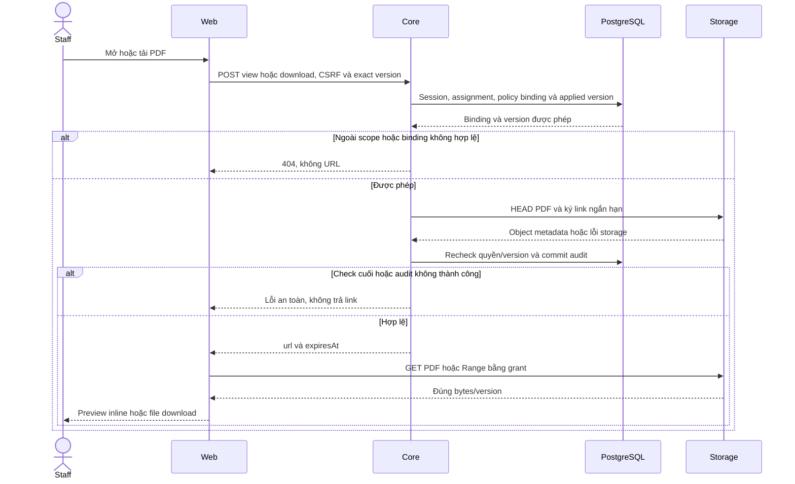

# S04 — Policy Lookup, hợp đồng và PDF

Điều chỉnh 04/11/2026: Policy Lookup tìm bằng Enter, không có nút Search/Clear search. Xóa nội dung rồi Enter để bỏ từ khóa, giữ bộ lọc trạng thái và PDF đang chọn; không tải lại document.

[Chỉ mục Staff](../README.md) · [API](00-staff-contract.md#api-theo-chức-năng) · [Customers](02-customers-contract.md) · [Khoảng trống](README.md#phần-còn-lại-theo-chức-năng)

Đối chiếu **03/11/2026**. Căn cứ: FR-008, UC-007, NFR-001/003/007/008 và Data Model bảng 7–10. **Staff A14/A15/A16/A18/A20 và FE đã triển khai.** Product A17/A19, Customer ownership API và quick lookup/context chat chưa có. Phân loại tài liệu phía Customer tại [Customer documents](../../customer/plans/05-documents-contract.md#2-nguồn-và-phân-loại); trạng thái triển khai từng vai trò được theo dõi trong kế hoạch tương ứng.

**Số hợp đồng — A đã chốt 14/11/2026.** Staff có phân công và quyền tài nguyên được xem đầy đủ policyNumber ở list/detail/Inbox lookup, khớp source hiện tại. Contact email/phone che mặc định và có Hiện/Ẩn theo cập nhật cùng ngày, triển khai còn P trong CU01/CU02. [Số hợp đồng](../../../configuration-and-data.md#staff-policy-number), [liên hệ](../../../configuration-and-data.md#staff-contact-reveal).

## Truy vết data model và vị trí code theo phase

Mỗi phase dưới đây có bảng cột/đọc–ghi/FK/version, migration, transaction và mức ảnh hưởng chi tiết; xem mục **Data model và phạm vi ảnh hưởng** và bảng **Vị trí code** trong phase. Hiện có file không đồng nghĩa mọi thay đổi dự kiến trong file đã được triển khai. Các phần P giữ P.

| Phase sở hữu | Bảng/dữ liệu chính và thao tác | Code cần rà từ root repo | Mức ảnh hưởng khi sửa |
| --- | --- | --- | --- |
| [PL01 — Policy list/detail và lookup Core](policies/01-read-lookup-api.md) | staff_assignments + customer_profiles + staff_profiles (Đọc); insurance_policies + insurance_products (Đọc) | [apps/core/src/policies/controllers/staff-policy.controller.ts](<../../../../apps/core/src/policies/controllers/staff-policy.controller.ts>); [apps/core/src/policies/services/policy.service.ts](<../../../../apps/core/src/policies/services/policy.service.ts>) | Cao — Customers policies, Policy Lookup và Inbox panel |
| [PL02 — Applied version và PDF access](policies/02-applied-documents-access.md) | staff_assignments + customer_profiles + staff_profiles (Đọc); insurance_policies + insurance_products (Đọc); documents + document_versions (Đọc); MinIO/S3 — ngoài PostgreSQL (HEAD + ký GET/Range, không upload từ viewer) | [apps/core/src/policies/services/policy.service.ts](<../../../../apps/core/src/policies/services/policy.service.ts>); [apps/core/src/policies/services/policy-storage.service.ts](<../../../../apps/core/src/policies/services/policy-storage.service.ts>) | Cao — Hai role, main policy/terms/endorsement |
| [PL03 — Lookup và dossier/PDF Staff](policies/03-lookup-dossier-ui.md) | staff_assignments + customer_profiles + staff_profiles (Đọc); insurance_policies + insurance_products (Đọc); documents + document_versions (Đọc); MinIO/S3 — ngoài PostgreSQL (HEAD + ký GET/Range, không upload từ viewer) | [apps/web/src/components/staff-policy-lookup.tsx](<../../../../apps/web/src/components/staff-policy-lookup.tsx>); [apps/web/src/components/staff-policies.tsx](<../../../../apps/web/src/components/staff-policies.tsx>) | Trung bình — URL/Back/selection |
| [Việc 02 — Refresh Policy/PDF không làm mất vùng đang đọc](policies/04-viewer-lifecycle.md) | staff_assignments + customer_profiles + staff_profiles (Đọc); insurance_policies + insurance_products (Đọc); documents + document_versions (Đọc); MinIO/S3 — ngoài PostgreSQL (HEAD + ký GET/Range, không upload từ viewer) | [apps/web/src/components/staff-policies.tsx](<../../../../apps/web/src/components/staff-policies.tsx>); [apps/web/src/components/signed-pdf-preview.tsx](<../../../../apps/web/src/components/signed-pdf-preview.tsx>) | Cao — Không mất details/selection/scroll |
| [PL05 — Quick Policy Lookup trong Inbox Staff](policies/05-inbox-customer-policy-lookup.md) | staff_assignments + customer_profiles + staff_profiles (Đọc); insurance_policies + insurance_products (Đọc); documents + document_versions (Đọc) | [apps/web/src/components/staff-inbox-policy-lookup.tsx](<../../../../apps/web/src/components/staff-inbox-policy-lookup.tsx>); [apps/web/src/components/staff-inbox.tsx](<../../../../apps/web/src/components/staff-inbox.tsx>) | Cao — Selection/paging tại Inbox |

Không tự áp dụng DDL khi triển khai UI, không biến model dự kiến thành hiện trạng, không reset seed/volume để né lỗi FK. Các dependency xuyên vai trò và operator xem [Data Model](../../../specifications/Data_Model.md#iii-bản-đồ-tác-động-khi-triển-khai-chức-năng).

## Hiện trạng

- [x] Customers → danh sách nhiều hợp đồng, phân trang/phí/kỳ đóng tiếp theo; mở chi tiết hợp đồng.
- [x] Policy Lookup toàn tập active assignment: search/status/count/phân trang, URL/deep link/Back–Forward.
- [x] PDF gốc là nội dung chính; thông tin từ DB thu gọn mặc định; điều khoản/phụ lục riêng; Download PDF.
- [x] Icon thu gọn trong đầu cột tìm kiếm, icon mở lại ở mép; giữ bản nhập/bộ lọc/trang/lựa chọn khi đóng cột.
- [x] Lookup độc lập bỏ Back to Inbox/Customer profile, CCCD/phone và filter mẫu.
- [x] Core kiểm session/role/assignment/ownership/phiên bản, cấp signed URL có hạn và audit ý định xem/tải.
- [x] Product API A17/A19 đã có; quick lookup Inbox (PL05) đã có; đổi linkedPolicy chat và citation theo trang còn P.
- [x] Customer list/detail/catalog/view/download theo ownership đã có tại PO01/D01 và UI PO02/D02; kiểm thử hai role là phạm vi riêng.
- [x] Realtime refetch giữ iframe/src cùng file/version, disclosure/focus/parent scroll; có 26 regression browser Policy/PDF.
- [x] E2E gateway/Core/DB/MinIO cho Staff và Customer owner: exact applied version, hash/Range/download, foreign owner/assignment denied và scope revoke.

## Quan hệ dữ liệu và phiên bản

| Đối tượng        | Vai trò                                                                             |
| ---------------- | ----------------------------------------------------------------------------------- |
| CustomerProfile  | Chủ sở hữu nhiều InsurancePolicy; Staff đọc qua active assignment                   |
| InsuranceProduct | Sản phẩm có nhiều policy và tài liệu chung                                          |
| InsurancePolicy  | Mã/trạng thái/phí/ngày hiệu lực và benefitsSnapshot của hợp đồng cá nhân            |
| Document         | Metadata/phạm vi PUBLIC hoặc PRIVATE_POLICY, product/policy/owner và currentVersion |
| DocumentVersion  | Version cụ thể, object bucket/key, checksum SHA-256 và isActive                     |

Một hợp đồng có thể có Document hợp đồng chính và các Document phụ lục; điều khoản chung có thể thuộc sản phẩm. Một Document có nhiều version. Số Document khác số phiên bản, không có quy tắc bắt buộc một policy chỉ có một file. UI ưu tiên một PDF chính, không trộn toàn bộ tài liệu vào dropdown mặc định.

Schema chưa có cột Document.kind hoặc quan hệ riêng ghim version áp dụng. **Mở rộng local hiện tại** nằm trong JSON `InsurancePolicy.benefitsSnapshot.documents`: slot main/terms/guide/endorsements, mỗi binding `{documentId,version,kind}`. main nhận POLICY/POLICY_DRAFT; terms là TERMS, guide là PRODUCT_GUIDE, endorsements là ENDORSEMENT. Data Dictionary nguồn chưa mô tả cấu trúc này; không coi kind là enum/cột DB đã có. Core kiểm binding lúc đọc; khóa ngoại DB chưa bảo vệ riêng cấu trúc JSON.

Catalog chỉ lấy exact version còn isActive:

- POLICY/POLICY_DRAFT/ENDORSEMENT: PRIVATE_POLICY, đúng policy và ownerCustomerId, product null hoặc khớp sản phẩm policy.
- TERMS/PRODUCT_GUIDE: PUBLIC, đúng product, không gắn owner/policy.
- Không tự dùng currentVersion thay phiên bản ghim. Liên kết sai/trùng/thiếu/inactive không làm mở rộng quyền; tối đa 50 phụ lục.

Cấu trúc trên được giữ cho implementation hiện tại; chuẩn hóa sang quan hệ/cột có migration là quyết định cần review riêng, chưa được triển khai trong đợt tài liệu.

## API đọc đã triển khai

Prefix `/api/v1`, cookie phiên; Core không nhận actor/role do client cấp. Session/trạng thái Staff/assignment/dữ liệu trong cùng transaction RepeatableRead. Request kế tiếp thấy thay đổi quyền đã commit; request đang chạy có thể hoàn tất theo snapshot cũ.

| ID / API                                      | Contract                                                                                                                    |
| --------------------------------------------- | --------------------------------------------------------------------------------------------------------------------------- |
| A14 GET /staff/customers/:customerId/policies | page/pageSize; `{items,total,page,pageSize}`. Khách hợp lệ không có policy: list rỗng; khách ngoài quyền/không tồn tại: 404 |
| A15 GET /staff/policies                       | search/status/page/pageSize; `{items,total,page,pageSize}`. Mỗi item thêm customer `{id,fullName,accountCode}`              |
| A16 GET /staff/policies/:policyId             | `{policy}` gồm summary, product.summary, customer summary, benefitsSnapshot và benefitsSnapshotStatus                       |
| A18 GET /staff/policies/:policyId/documents   | `{policyId,items,total,availability,mainDocumentStatus,issues}`; metadata đúng version, không bucket/key/checksum/URL       |

Summary: id/policyNumber/customerId, product `{id,productCode,name,isActive}`, status, premiumAmount/paymentFrequency/nextDueDate/effectiveDate/expiryDate/sumAssured/currency. Ngày `YYYY-MM-DD`; tiền decimal string hai chữ số thập phân; thiếu giữ null. Premium là phí mỗi kỳ, không tự gọi là phí năm. Sản phẩm ngừng bán vẫn xuất hiện trong hợp đồng đã có; không suy ra số dư/hạn mức đã dùng/lịch sử thanh toán.

A14/A15: page default 1, 1–100000; pageSize default 10, 1–50; sort createdAt DESC/id ASC; vượt trang trả list rỗng và giữ total. **Chỉ A15** nhận search/status; A14 không nhận hai filter này. Detail/catalog không nhận query. Query lạ/lặp/sai kiểu hoặc UUID sai: 400.

A15 search trim/tối đa 100 ký tự/không control chars, literal substring không phân biệt hoa thường: policyNumber, Customer fullName/accountCode, Product name/productCode. Không tìm CCCD/phone; %, \_ và backslash là ký tự thường. status chỉ ACTIVE/LAPSED/MATURED/PENDING; vắng là All. Scope/search/status áp trước count/phân trang.

A16 chỉ allowlist snapshot tài chính: currency/snapshotAsOf/insuranceTermYears/premiumTermYears/annualPremium và benefits `[{code,name,amount,unit,maxDays}]`. Không trả raw JSON, bindings hoặc KYC/metadata nội bộ. benefitsSnapshotStatus AVAILABLE/NOT_PROVIDED/INVALID; dữ liệu không hợp lệ không được diễn giải thành quyền lợi chắc chắn.

A18 item: documentId/title/kind/accessScope/versionId/versionNumber/versionCreatedAt. issues chỉ kind và BINDINGS_NOT_PROVIDED/INVALID_BINDING/DOCUMENT_UNAVAILABLE/DUPLICATE_BINDING, không lộ tên/ID tài liệu ngoài quyền.

| Trạng thái catalog     | Ý nghĩa                                                         |
| ---------------------- | --------------------------------------------------------------- |
| availability=AVAILABLE | Các binding cung cấp đều hợp lệ và có item                      |
| PARTIAL                | Có item nhưng có binding lỗi/không khả dụng                     |
| EMPTY                  | Bộ binding khai báo rỗng                                        |
| UNAVAILABLE            | Thiếu binding hoặc không có item khả dụng khi có lỗi            |
| mainDocumentStatus     | AVAILABLE/NOT_PROVIDED/UNAVAILABLE, độc lập việc có terms/guide |

Catalog chỉ kiểm metadata DB, không truy vấn MinIO. AVAILABLE không chứng minh object đọc được; bước cấp access bên dưới mới kiểm storage.

## API xem và tải PDF đã triển khai

A20 gồm hai path:

- `POST /api/v1/staff/documents/:documentId/versions/:versionId/view`
- `POST /api/v1/staff/documents/:documentId/versions/:versionId/download`

Body chỉ `{policyId}` UUID; không nhận query/trường lạ/bucket/key/URL tùy ý. Cần Origin hợp lệ, JSON, X-Auth-Request: 1, X-CSRF-Token hiện hành và cookie phiên/CSRF. Core kiểm lại catalog/quyền/exact version; HEAD object xác nhận tồn tại, MIME application/pdf, size > 0 rồi ký GET. Trả 200 `{url,expiresAt}`, Cache-Control no-store; mặc định TTL 900 giây, view inline/download attachment. MinIO private local, Core dùng reader, không cấp credential cho browser.

401 phiên không hợp lệ; 403 role/CSRF/Origin; 404 ngoài quyền/không có tài liệu hoặc object không phù hợp; 400 input; 503 storage/SDK lỗi an toàn. Storage lỗi không có nghĩa policy DB không tồn tại. Tất cả response lỗi không chứa storage key/credential/SDK trace.

Audit POLICY_PDF_VIEW_ISSUED/POLICY_PDF_DOWNLOAD_ISSUED ghi cấp link thành công, không ghi URL/key/credential và không chứng minh browser đã đọc/tải. Signed URL đã cấp có thể còn hiệu lực tới expiry sau logout/đổi assignment; lần cấp mới luôn kiểm lại quyền. Không hứa thu hồi file đã tải.

Checksum được lưu theo version; pipeline seed kiểm SHA-256 và upload create-only. Luồng cấp access runtime hiện kiểm MIME/size, **không tải lại/hash nội dung mỗi lần**. Chưa có ingestion/upload nghiệp vụ trong app; phải chốt kiểm toàn vẹn/bất biến cho luồng ghi mới trước khi bổ sung.

## Giao diện hiện tại

### Hợp đồng từ Customers

PDF chính ngay dưới header mã/sản phẩm/status, Download PDF; thông tin DB trong Policy information đóng mặc định. Nội dung này từ API/DB/snapshot, không OCR/trích xuất PDF. Viewer là trình đọc PDF của browser trong iframe, có mở tab riêng và Reload preview khi link hết hạn.

Supporting documents chỉ hiển thị TERMS/ENDORSEMENT. View PDF mở trong cùng viewer, có Back to main policy. PRODUCT_GUIDE không hiện trên trang hợp đồng; Products P03 riêng đã có. Thiếu PDF chính phải báo thiếu/không khả dụng, không dùng điều khoản làm hợp đồng thay thế.

URL không mang returnTo; ngữ cảnh search/page/policyPage quay về lưu theo tab trong sessionStorage, chỉ dùng nếu đường dẫn khớp customerId từ Core. Deep link/storage tắt dùng đích Customer mặc định; returnTo legacy được chuẩn hóa URL không reload.

### Policy Lookup

Trái: search Enter, xóa rồi Enter bỏ lọc, không Search/Clear buttons; status, list số policy/khách/sản phẩm/status và phân trang. Phải: tái sử dụng detail/PDF. Search/filter về trang 1; chọn policy giữ query/deep link. Có thể tiếp tục đọc policy còn quyền dù nó không nằm trong kết quả lọc hiện tại. Mobile list → detail/Back to results giữ bộ lọc.

Icon thu gọn trong đầu cột kết quả; khi đóng còn icon mở lại, không nhãn Hide results. Ẩn bằng CSS, không unmount form/viewer do thao tác thu gọn. Không có Customer profile/Back to Inbox trong Lookup. Xem policy không đổi linkedPolicy chat.

Search/Clear/filter/page/retry/chọn tài liệu/tải không reload document app. Realtime refetch cùng logical key giữ data và iframe/src, metadata detail/catalog vẫn kiểm quyền/binding. Network/5xx có cảnh báo dữ liệu có thể cũ và retry; 401/403/404 bỏ nội dung liên quan. Đổi actor reset state private, đổi binding/version thay viewer; không dùng currentVersion để phục hồi tài liệu cũ. Preview chỉ xin lại URL khi mở/đổi file hoặc Reload preview; expiry gắn grant thực đang hiển thị. Download xin grant mới và denial loại preview ngay, không chờ metadata. Bằng chứng tự động là DOM/src/parent scroll, không đo page/zoom bên trong native viewer.

## Test cases

Các ca dưới đây là **đặc tả kiểm thử**, không phải báo cáo kết quả. Kiểm từng lớp API/service/DB/browser đúng nhãn; mock UI không thay kiểm quyền Core hoặc E2E thật.

**Quy ước dữ liệu:** S-A/S-B là hai Staff synthetic; C-A/C-B là hai Customer synthetic khác nhau. Thay alias bằng UUID/token của fixture cô lập; các path HTTP dùng prefix /api/v1 nếu chưa ghi đầy đủ. Chỉ thay assignment, khóa account, inject lỗi hoặc migration trong harness/môi trường test, không trên tài khoản/dữ liệu đang sử dụng.

### S05-T01 — Danh sách theo khách và lookup toàn scope

**Lớp kiểm thử:** API.
**Điều kiện và dữ liệu:** S-A phụ trách C-A có 12 policy; C-B ngoài scope có policyB.

**Các bước:**

1. GET /staff/customers/C-A/policies hai trang.
2. GET /staff/policies?search=mã-policy-trang2.
3. Tìm policyB bằng S-A.

**Kết quả mong đợi:** Count/page và search đúng tập được gán; policyB không có trong list hoặc total.

### S05-T02 — Applied version khác product current

**Lớp kiểm thử:** API + Storage.
**Điều kiện và dữ liệu:** PolicyA bind D1/v1; product của D1 đã current v2, hai PDF hash khác nhau.

**Các bước:**

1. GET /staff/policies/PolicyA/documents.
2. POST view/download D1/v1 với body policyId=PolicyA.
3. Đối chiếu version và hash.

**Kết quả mong đợi:** Catalog/access dùng applied v1, không trôi sang current v2; view inline và download attachment đúng bản.

### S05-T03 — Refresh cùng file giữ viewer

**Lớp kiểm thử:** Browser + API mock.
**Điều kiện và dữ liệu:** PolicyA/D1/v1 đang mở; lưu tham chiếu iframe, src và scroll container ngoài PDF.

**Các bước:**

1. Cuộn dossier, mở vùng thông tin thu gọn.
2. Phát nhiều metadata invalidation cùng version.
3. So sánh iframe identity/src và vị trí đọc ngoài iframe.

**Kết quả mong đợi:** Không remount hoặc xin grant lặp vô hạn; disclosure/focus/parent scroll giữ nguyên. Không suy ra page/zoom bên trong native PDF từ assertion này.

### S05-T04 — Binding và scope không thể giả

**Lớp kiểm thử:** API.
**Điều kiện và dữ liệu:** PolicyA của C-A; PolicyB ngoài scope; D2 không bind PolicyA.

**Các bước:**

1. Gửi PolicyA với D2 hoặc version chưa bind.
2. Gửi D1/v1 nhưng policyId=PolicyB.
3. Đổi body thêm bucket/key/url.

**Kết quả mong đợi:** Ngoài binding/scope 404, trường lạ 400; không trả URL hoặc storage metadata.

**Suite tham khảo:** [staff-policies.spec.mjs](../../../../apps/web/tests/browser/staff-policies.spec.mjs). Tên suite là vị trí tự động hóa, không phải chứng nhận các ca đã chạy.

**Dọn sau kiểm thử:** xóa đúng fixture/session/object/schema theo runId; phục hồi fault injection và đóng context/socket test. Không reset DB/credential, sửa bootstrap hoặc xóa volumes. Với PDF kiểm metadata/bytes/hash; với UI kiểm DOM/focus/network, không cần screenshot.

## Phần còn lại

- [x] Refresh nền giữ iframe/src cùng file/version, loại nội dung khi mất quyền; [việc 02 đã triển khai](policies/04-viewer-lifecycle.md#9-ghi-chú-triển-khai).
- [x] Browser E2E gateway/Core/DB/MinIO cho exact file/version, tải/hash/Range, expiry/retry, missing object/mạng lỗi, assignment/phiên thay đổi; keyboard/mobile và ba browser theo PL01–PL04. Native PDF toolbar/zoom không nằm trong bằng chứng DOM.
- [x] Product A17/P01 Core catalog đã có, không phụ thuộc Agent; Staff UI đã nối.
- [x] Product A19/access P02 Core/MinIO/gateway đã có, vẫn tách product current version với policy applied version.
- [x] UI Products P03 đã có theo [contract](04-products-contract.md); citation/context Agent thuộc nhánh riêng.
- [x] Customer ownership APIs/UI đã có; dùng endpoint owner riêng, không dùng Staff API thay quyền Customer.
- [x] Quick lookup Inbox tại chỗ qua tab mới độc lập đã triển khai (PL05); xem hồ sơ không làm mất ngữ cảnh chat hoặc đổi linkedPolicy.

**Quy tắc khi bảo trì:** Khi thay schema hoặc luồng ghi tài liệu, rà mapping kind/applied version, tính bất biến/checksum và migration an toàn. Đây là yêu cầu áp dụng mỗi lần thay đổi, không phải chức năng còn thiếu.

## Phase triển khai

| Phase                                               | Scope                                          | Trạng thái |
| --------------------------------------------------- | ---------------------------------------------- | ---------- |
| [PL01](policies/01-read-lookup-api.md)              | A14/A15/A16 read và lookup                     | E          |
| [PL02](policies/02-applied-documents-access.md)     | A18/A20 applied catalog/access                 | E          |
| [PL03](policies/03-lookup-dossier-ui.md)            | Customers policies + Lookup/dossier/PDF        | E          |
| [PL04](policies/04-viewer-lifecycle.md)             | Giữ iframe/src qua refresh, expiry/revoke      | E          |
| [PL05](policies/05-inbox-customer-policy-lookup.md) | Quick Policy Lookup cho khách hàng trong Inbox | E          |

Product PUBLIC current version theo P01–P03, không gộp policy applied binding. PL02/PL03 còn cần bổ sung browser E2E policy thật; tests mock/storage riêng không thay thế.

## API và routes của chức năng

Bảng truy vết Axx được chuyển từ tài liệu tổng hợp; E/P giữ theo runtime, DTO/quyền/luồng/test chi tiết do các phase của chức năng sở hữu. Không thêm endpoint từ việc gom tài liệu.

| ID    | Method/path                                                                                                                | Phạm vi                                                                                                    |
| ----- | -------------------------------------------------------------------------------------------------------------------------- | ---------------------------------------------------------------------------------------------------------- |
| A14 E | GET /staff/customers/:customerId/policies                                                                                  | List/page/pageSize theo một khách; FE đã nối                                                               |
| A15 E | GET /staff/policies                                                                                                        | Lookup toàn tập assignment: search số policy/tên-mã khách/tên-mã sản phẩm, status/page/pageSize; FE đã nối |
| A16 E | GET /staff/policies/:policyId                                                                                              | Summary/customer/product và snapshot tài chính allowlist; không đổi context chat                           |
| A18 E | GET /staff/policies/:policyId/documents                                                                                    | Catalog exact applied version, availability/issues; không signed URL/storage key                           |
| A20 E | POST /staff/documents/:documentId/versions/:versionId/view; POST /staff/documents/:documentId/versions/:versionId/download | Body `{policyId}`, session/CSRF/assignment/exact version; signed URL/expiresAt, audit cấp link; FE đã nối  |

| Route                     | Trạng thái                                   |
| ------------------------- | -------------------------------------------- |
| /staff/policies           | Policy Lookup search/status/page — PL01/PL03 |
| /staff/policies/:policyId | Dossier/main PDF/related docs — PL02/PL03    |

## Phần còn lại theo chức năng

| ID  | Phần còn lại                              | Phase sở hữu                                                                                                    |
| --- | ----------------------------------------- | --------------------------------------------------------------------------------------------------------------- |
| G01 | Staff/Customer owner read/PDF E, có gateway/Core/DB/MinIO E2E và ba browser | PO01/PO02/D01/D02, PL01–PL04; Agent citations/context theo nhánh riêng |
| G02 | Quick Policy Lookup trong Inbox (E); context chat P | [PL05](policies/05-inbox-customer-policy-lookup.md) đã triển khai in-place modal/tab mới; liên kết context chat thuộc Copilot CP05 |

## Sequence diagram

Luồng chính và nhánh quyền/lỗi; test case ở trên chỉ rõ dữ liệu và điểm kiểm tương ứng.

