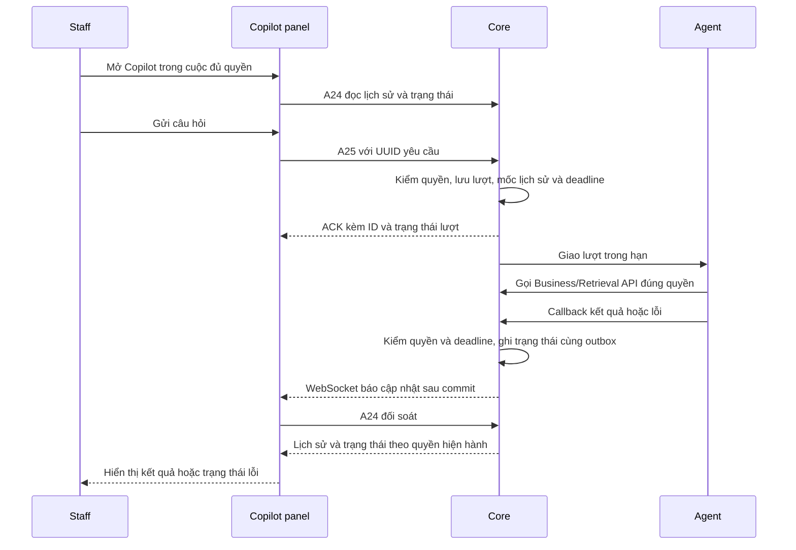

# Staff — Copilot nội bộ

23/11/2026 · **Đã có nền Core–Agent và khung panel. API và luồng Staff Copilot qua Inbox còn P.** FR-007/012, UC-006/009.

**Phạm vi đã xác nhận 06/11/2026:** Copilot MVP chỉ tra cứu, giải thích và tóm tắt. Không soạn nháp câu trả lời Customer hoặc có thao tác Use draft. Xem [Agent Design](../../../specifications/Agent_Design.md#copilot-summary-scope).

## Truy vết data model và vị trí code theo phase

Core đã có vòng đời run/attempt/event, API nội bộ `linked-history` và đường ghi kết quả Copilot với audience `INTERNAL`. Agent đã có xử lý `STAFF_COPILOT`, đồng bộ lịch sử liên kết và checkpoint. Hiện caller enqueue từ App chỉ phục vụ chat AI Customer. [Core](../../../../apps/core/src/agent/services/agent-run.service.ts), [Agent](../../../../apps/agent/src/life_agent/graph.py), [luồng gửi tin hiện tại](../../../../apps/core/src/conversations/services/conversation-message.service.ts).

| Phase sở hữu | Dữ liệu và phạm vi chính |
| --- | --- |
| [CP01 — Core–Agent, context và ownership](copilot/01-task-context-contract.md) | Quyền trên chat nguồn, ownership thread, mốc lịch sử và DTO |
| [CP02 — Lịch sử và tác vụ Copilot](copilot/02-core-agent-service.md) | `conversations`, `messages`, `agent_runs`, attempts/events và receipt |
| [CP03 — Panel Staff Copilot](copilot/03-panel-citations.md) | Chat đang mở trong [Staff Inbox](../../../../apps/web/src/components/staff-inbox.tsx), lịch sử nội bộ, tiến độ và citations |
| [CP04 — Nghiệm thu Agent/Copilot](copilot/04-agent-e2e.md) | Core–Agent thật qua gateway, quyền nguồn, retry và hồi quy Customer |

## C01 — Kế hoạch AI Copilot riêng cho Staff

**Copilot lấy cuộc chat đang mở trong Staff Inbox làm nguồn.** Staff mở panel rồi gửi câu hỏi. Web dùng ID cuộc đó trong route, Core kiểm quyền và cố định mốc lịch sử khi nhận câu hỏi. Mở panel chỉ tải lịch sử Copilot nếu có. Chuyển chat thì panel nạp ngữ cảnh của chat mới. API bên dưới còn là đề xuất.

### Giao diện và thao tác

Giữ cấu trúc mẫu UI: nút Copilot trên rail cạnh vùng chat, mở panel bên phải với header theo khách/cuộc đang chọn, lịch sử trao đổi nội bộ có vùng cuộn, ô hỏi AI và nút gửi. Panel đóng mặc định, đóng/mở không tháo transcript Customer, không mất nháp hoặc đổi URL/F5. Mobile mở panel phù hợp viewport, có focus/keyboard/Escape và quay lại chat.

Bố cục gồm rail mở panel, header ngữ cảnh, lịch sử cuộn và ô hỏi AI. Bản triển khai dùng Tailwind `tw:` và component của ứng dụng hiện tại.

Thứ tự chức năng tối thiểu:

1. **Hỏi Copilot:** Staff tự nhập câu hỏi về cuộc đang hỗ trợ hoặc điều khoản/quyền lợi. Trong lúc lượt hiện tại đang chờ hoặc đang xử lý, Staff vẫn soạn được câu tiếp theo nhưng thao tác gửi bị vô hiệu hóa. Khi lượt kết thúc, Staff có thể tự gửi nội dung đã soạn.
2. **Tóm tắt cuộc chat:** Staff nhập yêu cầu trong ô hỏi, gửi qua A25. Mặc định tóm tắt diễn biến gần. Với yêu cầu “từ đầu”, chỉ trả bản tóm tắt khi đã xử lý đủ transcript Customer-facing được phép đến mốc của lượt. Nếu chưa đủ, báo giới hạn và đề nghị thu hẹp phạm vi.
3. **Bằng chứng tài liệu:** câu trả lời dựa trên tài liệu phải có citation đúng quyền/phiên bản và link mở tài liệu qua Core. Chưa đủ dữ kiện hoặc retrieval lỗi phải nói rõ, không tạo trích dẫn/chi trả/hợp đồng giả.

Khi runtime chưa được cấu hình, báo Copilot chưa khả dụng và giữ chat Staff–Customer hoạt động bình thường.

### Quyền và dữ liệu

- **Đã chốt:** đợt đầu Copilot dùng quyền đọc transcript hiện tại của Inbox, gồm chat Direct đủ điều kiện hoặc chat đã Accept. Core lấy Staff từ session. Khi Inbox triển khai [quyền đọc theo thiết kế 23/11](inbox/00-inbox-spec.md#4-quyền-và-hành-vi-trạng-thái), Copilot kế thừa cùng chính sách, độc lập với quyền gửi/Takeover.
- Luồng nội bộ dùng `Conversation.channelType=STAFF_COPILOT` và `linkedContextConvId`. Mỗi cặp Staff và chat nguồn có một thread riêng. Staff được phân công lại xem thread của chính mình sau khi Core xác nhận quyền đọc nguồn.
- Hỏi/đáp/tóm tắt Copilot chỉ Staff được phép thấy, không trả trong Customer list/detail/A10, không phát sự kiện chat Customer hoặc lọt vào tin SYSTEM. Không cho browser tự chọn audience, sender hoặc grant.
- Ngữ cảnh chỉ gồm transcript đã được phép và catalog tài liệu Core cấp đúng scope/exact version; không đưa raw tool metadata hoặc các chat riêng khác của Customer vào prompt. Agent không đọc business DB trực tiếp, không suy quyền từ LLM.
- Recheck quyền ở lịch sử, enqueue/chạy Agent, retrieval/tool và trước trả kết quả. Revoke phải abort/clear panel và context cache; tác vụ chạy dở không được trả Private theo quyền cũ. B đã chốt ngày 14/11, task Core đã nhận tiếp tục xử lý theo quyền hiện hành sau logout/hết phiên. Panel phiên cũ clear dữ liệu, login lại đúng actor xem task/history bằng phiên mới. Tích hợp còn P, xem [chính sách chuẩn](../../../specifications/Agent_Design.md#agent-logout-session-policy).
- Lưu bền vững trạng thái Agent/checkpoint riêng với message/business write. Không lưu prompt/transcript/CSRF vào browser storage hoặc log không cần thiết. Không tự tạo/accept/close Ticket từ Copilot; Ticket vẫn theo I07 và xác nhận riêng.

### API và vị trí triển khai dự kiến

| API đề xuất | Contract cần có trước code |
| --- | --- |
| A24 `GET /api/v1/staff/conversations/:conversationId/copilot` | History nội bộ đúng Staff/cuộc nguồn, cursor và trạng thái tác vụ; không trả thread của người khác |
| A25 `POST /api/v1/staff/conversations/:conversationId/copilot/messages` | Câu hỏi và UUID intent; Core lấy nguồn từ route, tính mốc lịch sử và trả trạng thái để đối soát |

CP01 sở hữu DTO, ACK, lỗi và cách panel theo dõi kết quả. A12 thuộc luồng gửi tin Customer riêng của Staff.

**Đã chốt phương án B.** Dùng kết nối WebSocket của Inbox với sự kiện riêng cho Copilot. Sự kiện báo lượt đã hoàn tất, lỗi hoặc bị hủy sau khi Core lưu trạng thái. Panel đọc kết quả qua REST và đối soát lại khi mở panel, tải lại trang hoặc kết nối lại. [Contract CP01](copilot/01-task-context-contract.md#3-api-spec-và-quyền).

Core mở rộng module conversations và adapter Agent theo contract, tái dùng access gate và catalog Policy; không nới DTO/public send. Web dự kiến `staff-copilot-panel.tsx`, `lib/copilot-api.ts`, tích hợp tại `staff-inbox.tsx` và composer, giữ vòng đời transcript/PDF hiện có. Đây là các vị trí dự kiến, chưa tạo component/module/dependency ở lượt cập nhật tài liệu.

### Chia bước và nghiệm thu

1. **C01-A contract:** rà model STAFF_COPILOT/link/ownership, chốt Core–Agent/checkpoint, DTO/citations/reconcile và quota; cập nhật API map trước code phụ thuộc.
2. **C01-B Core/Agent:** kiểm session/scope trước và sau tác vụ, history nội bộ bền vững, retry không trùng; integration bằng dữ liệu synthetic, không fake AI thành công khi chưa runtime.
3. **C01-C Staff panel:** mở/đóng, nhập yêu cầu tra cứu/giải thích/tóm tắt và mở citations; giữ composer/chat/PDF, keyboard/mobile/no-F5.
4. **C01-D E2E:** Staff đủ quyền hỏi AI thật qua Core; kết quả chỉ xuất hiện nội bộ, không thay composer hoặc thêm tin Customer. Mất quyền khi đang chạy phải chặn kết quả.

Kiểm quyền theo gate Inbox đang chạy, gồm nguồn chỉ có metadata và Staff ngoài phân công. Khi triển khai quyền đọc 23/11, kiểm thêm Staff đọc và hỏi Copilot trong chat AI đang chạy mà chưa Takeover. Các ca cách ly Customer, snapshot, phân trang, retry và revoke nằm ở CP01–CP04.

## Các phase tích hợp Copilot

**Hợp đồng làm ngữ cảnh Copilot — B chốt ngày 14/11/2026.** MVP dùng Policy Lookup để xem hợp đồng. Staff nêu rõ hợp đồng khi hỏi hoặc chuyển sang hợp đồng khác, Copilot dùng câu hỏi và lịch sử được phép để hiểu ngữ cảnh. Khi chưa xác định được hợp đồng thì hỏi lại trước khi đọc dữ liệu riêng. Không bổ sung ô chọn hợp đồng hoặc API đổi `linkedPolicyId`. [Quyết định chuẩn](../../../specifications/Agent_Design.md#copilot-policy-selection).

| Phase | Kết quả | Trạng thái |
| --- | --- | --- |
| [CP01](copilot/01-task-context-contract.md) | Task/context/service identity/checkpoint/DTO | P, chốt trước code |
| [CP02](copilot/02-core-agent-service.md) | Internal history/Agent tools và recheck | P |
| [CP03](copilot/03-panel-citations.md) | Panel/tra cứu/giải thích/summary/citations | P |
| [CP04](copilot/04-agent-e2e.md) | Agent thật, privacy và kết quả chỉ nội bộ | P |

API A24–A25 vẫn P cho đến khi triển khai và kiểm thử.

## API và routes của chức năng

Bảng truy vết Axx được chuyển từ tài liệu tổng hợp; E/P giữ theo runtime, DTO/quyền/luồng/test chi tiết do các phase của chức năng sở hữu. Không thêm endpoint từ việc gom tài liệu.

| ID | Method/path | Phạm vi |
| --- | --- | --- |
| A24 P | GET /staff/conversations/:conversationId/copilot | Lịch sử nội bộ/thread/context; không trộn transcript Customer |
| A25 P | POST /staff/conversations/:conversationId/copilot/messages | Core kiểm actor/nguồn và tạo lượt Agent; DTO còn mở |

## Phần còn lại theo chức năng

| ID | Phần còn lại | Phase sở hữu |
| --- | --- | --- |
| G02 | Nghiệm thu hợp đồng được nêu/làm rõ trong câu hỏi Copilot theo B ngày 14/11 | [CP01](copilot/01-task-context-contract.md), [CP04](copilot/04-agent-e2e.md) |
| G06 | Nối panel và API Staff vào nền Core–Agent, kiểm history nguồn và nghiệm thu qua gateway | [CP01–04](#các-phase-tích-hợp-copilot) |
