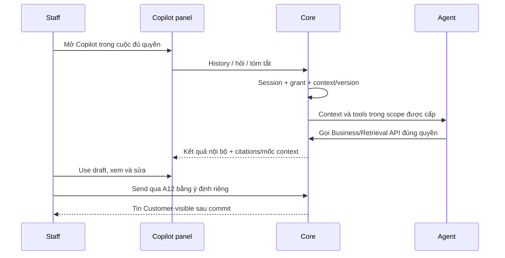

# Staff — Copilot nội bộ

04/11/2026 · **P, chờ Agent; chưa triển khai.** FR-007/012, UC-006/009.

## C01 — Kế hoạch AI Copilot riêng cho Staff

**Yêu cầu đã chốt; thiết kế kỹ thuật/API bên dưới là đề xuất cho đợt triển khai tới, chưa có runtime.** Copilot là một mốc riêng sau nền chat hiện có, không ghép vào việc thêm tin SYSTEM hoặc coi I06 hoàn tất là đã có AI. Trước khi code phải chốt contract Core–Agent, runtime/checkpoint và scope tài liệu; không tự chọn provider/cloud từ tài liệu này.

### Giao diện và thao tác

Giữ cấu trúc mẫu UI: nút Copilot trên rail cạnh vùng chat, mở panel bên phải với header theo khách/cuộc đang chọn, lịch sử trao đổi nội bộ có vùng cuộn, ô hỏi AI và nút gửi. Panel đóng mặc định, đóng/mở không tháo transcript Customer, không mất nháp hoặc đổi URL/F5. Mobile mở panel phù hợp viewport, có focus/keyboard/Escape và quay lại chat.

Bố cục gồm rail mở panel, header ngữ cảnh, quick prompts, lịch sử cuộn và ô hỏi AI; không chép dữ liệu hoặc câu trả lời minh họa vào sản phẩm. Bản triển khai dùng Tailwind `tw:` và component của ứng dụng hiện tại.

Thứ tự chức năng tối thiểu:

1. **Hỏi Copilot:** Staff tự nhập câu hỏi về cuộc đang hỗ trợ hoặc điều khoản/quyền lợi; hiển thị đang xử lý/lỗi/thử lại rõ ràng.
2. **Tóm tắt cuộc chat:** nút thao tác nhanh tạo bản tóm tắt từ transcript Customer-facing mà Staff đang có quyền đọc; kết quả nêu mốc ngữ cảnh để nhận biết khi chat đã có tin mới.
3. **Soạn gợi ý trả lời:** AI đưa bản nháp trong panel. Staff bấm “Use draft” để đưa vào composer Customer, xem/sửa rồi tự bấm Send qua A12. Không tự gửi, không ghi đè nháp đang có mà chưa xác nhận, không hiển thị gợi ý như lời Staff đã gửi.
4. **Bằng chứng tài liệu:** câu trả lời dựa trên tài liệu phải có citation đúng quyền/phiên bản và link mở tài liệu qua Core. Chưa đủ dữ kiện hoặc retrieval lỗi phải nói rõ, không tạo trích dẫn/chi trả/hợp đồng giả.

Quick prompts phải gọi các khả năng trên với context hiện hành; không dùng các chip để giả đã nối Agent. Khi runtime chưa được cấu hình, báo Copilot chưa khả dụng và giữ chat Staff–Customer hoạt động bình thường.

### Quyền và dữ liệu

- Core lấy Staff từ session; cần grant transcript hiện hành của cuộc Direct/accepted đang chọn. Pending chưa Accept, AI riêng, legacy chưa review hoặc chỉ biết Customer/conversationId không đủ để mở Copilot với nội dung cuộc đó.
- Luồng nội bộ dùng `Conversation.channelType=STAFF_COPILOT` và `linkedContextConvId` theo model hiện có, tách khỏi CUSTOMER_SUPPORT. Đề xuất thread riêng theo Staff và cuộc nguồn; ownership/unique key/checkpoint mapping phải được rà schema trước triển khai. Không kế thừa thread của Staff trước chỉ vì reassignment.
- Hỏi/đáp/tóm tắt/nháp Copilot chỉ Staff được phép thấy, không trả trong Customer list/detail/A10, không phát sự kiện chat Customer hoặc lọt vào tin SYSTEM. Không cho browser tự chọn audience, sender hoặc grant.
- Ngữ cảnh chỉ gồm transcript đã được phép và catalog tài liệu Core cấp đúng scope/exact version; không đưa raw tool metadata hoặc các chat riêng khác của Customer vào prompt. Agent không đọc business DB trực tiếp, không suy quyền từ LLM.
- Recheck quyền ở lịch sử, enqueue/chạy Agent, retrieval/tool và trước trả kết quả. Revoke/session hết hạn phải abort/clear panel, nháp gợi ý và context cache; tác vụ chạy dở không được trả Private theo quyền cũ.
- Lưu bền vững trạng thái Agent/checkpoint riêng với message/business write. Không lưu prompt/transcript/CSRF vào browser storage hoặc log không cần thiết. Không tự tạo/accept/close Ticket từ Copilot; Ticket vẫn theo I07 và xác nhận riêng.

### API và vị trí triển khai dự kiến

| API đề xuất | Contract cần có trước code |
| --- | --- |
| A24 `GET /api/v1/staff/conversations/:conversationId/copilot` | History nội bộ đúng Staff/cuộc nguồn, cursor và trạng thái tác vụ; không trả thread của người khác |
| A25 `POST /api/v1/staff/conversations/:conversationId/copilot/messages` | Câu hỏi, UUID intent và mốc context/version; session/CSRF/rate limit, chống trùng, kết quả hoặc tác vụ có reconcile |
| A26 `POST /api/v1/staff/conversations/:conversationId/copilot/summary` | Tóm tắt theo mốc transcript; request idempotent, không ghi vào chat Customer/Ticket |

Cần chốt DTO/error/async ACK/GET tra kết quả/streaming hoặc polling, timeout và giới hạn context tại bước contract; chưa công bố endpoint task mới hay response200/202 như code đã chạy. “Use draft” là thao tác FE vào composer; chỉ Send của Staff mới gọi A12, không tạo API gửi thay Staff từ Agent.

Core mở rộng module conversations và adapter Agent theo contract, tái dùng access gate và catalog Policy; không nới DTO/public send. Web dự kiến `staff-copilot-panel.tsx`, `lib/copilot-api.ts`, tích hợp tại `staff-inbox.tsx` và composer, giữ vòng đời transcript/PDF hiện có. Đây là các vị trí dự kiến, chưa tạo component/module/dependency ở lượt cập nhật tài liệu.

### Chia bước và nghiệm thu

1. **C01-A contract:** rà model STAFF_COPILOT/link/ownership, chốt Core–Agent/checkpoint, DTO/citations/reconcile và quota; cập nhật API map trước code phụ thuộc.
2. **C01-B Core/Agent:** kiểm session/scope trước và sau tác vụ, history nội bộ bền vững, retry không trùng; integration bằng dữ liệu synthetic, không fake AI thành công khi chưa runtime.
3. **C01-C Staff panel:** open/close, hỏi/tóm tắt/quick prompts/citations và Use draft; giữ composer/chat/PDF, keyboard/mobile/no-F5.
4. **C01-D E2E:** Staff đủ quyền hỏi AI thật qua Core, dùng/sửa/gửi nháp; Customer chỉ thấy tin Staff chủ động Send. Mất quyền khi đang chạy phải chặn kết quả.

Test bắt buộc: pending/private/Staff khác denied; Copilot không xuất hiện ở Customer history/list/event; task retry không trùng; citation ngoài quyền không trả; revoke giữa lượt không trả kết quả; lỗi Agent không chặn chat; tóm tắt có mốc context; Use draft bảo toàn nháp cũ và không tự gửi; đóng/mở/chuyển cuộc không lẫn context; DOM/keyboard/mobile/no-F5 và hồi quy Account/Customers/Policy/PDF.

## Các phase cần triển khai sau Agent

Đổi linkedPolicy/context nếu được chọn có [phase riêng trong Copilot](copilot/05-linked-policy-context.md); mở trang policy hiện tại vẫn chỉ đọc và không đổi context chat.

| Phase | Kết quả | Trạng thái |
| --- | --- | --- |
| [CP01](copilot/01-task-context-contract.md) | Task/context/service identity/checkpoint/DTO | P, chốt trước code |
| [CP02](copilot/02-core-agent-service.md) | Internal history/Agent tools và recheck | P |
| [CP03](copilot/03-panel-draft-citations.md) | Panel/summary/Use draft/citations | P |
| [CP04](copilot/04-agent-e2e.md) | Agent thật, privacy và publish Staff Send | P |

Không thuộc mốc Staff không Agent. Chat hai đầu/Accept/realtime đã E không bị đưa về backlog từ việc Copilot còn P. API A24–26 vẫn P cho đến code/test thật; checkpoint không đồng nghĩa Ticket business commit.

## API và routes của chức năng

Bảng truy vết Axx được chuyển từ tài liệu tổng hợp; E/P giữ theo runtime, DTO/quyền/luồng/test chi tiết do các phase của chức năng sở hữu. Không thêm endpoint từ việc gom tài liệu.

| ID | Method/path | Phạm vi |
| --- | --- | --- |
| A24 P | GET /staff/conversations/:conversationId/copilot | Lịch sử nội bộ/thread/context; không trộn transcript Customer |
| A25 P | POST /staff/conversations/:conversationId/copilot/messages | Core kiểm actor/context; contract Agent/checkpoint/async còn mở |
| A26 P | POST /staff/conversations/:conversationId/copilot/summary | Mốc transcript/nguồn/giới hạn; không sửa Ticket đã xác nhận |

## Phần còn lại theo chức năng

| ID | Phần còn lại | Phase sở hữu |
| --- | --- | --- |
| G02 | Đổi linkedPolicy/context chưa contract hoàn tất | [CX01](copilot/05-linked-policy-context.md), tùy phạm vi/Agent; không blocker manual lookup |
| G06 | Staff Copilot/AI summary/Agent chưa chạy | [CP01–04](08-copilot-contract.md), hoãn đợt Agent |
