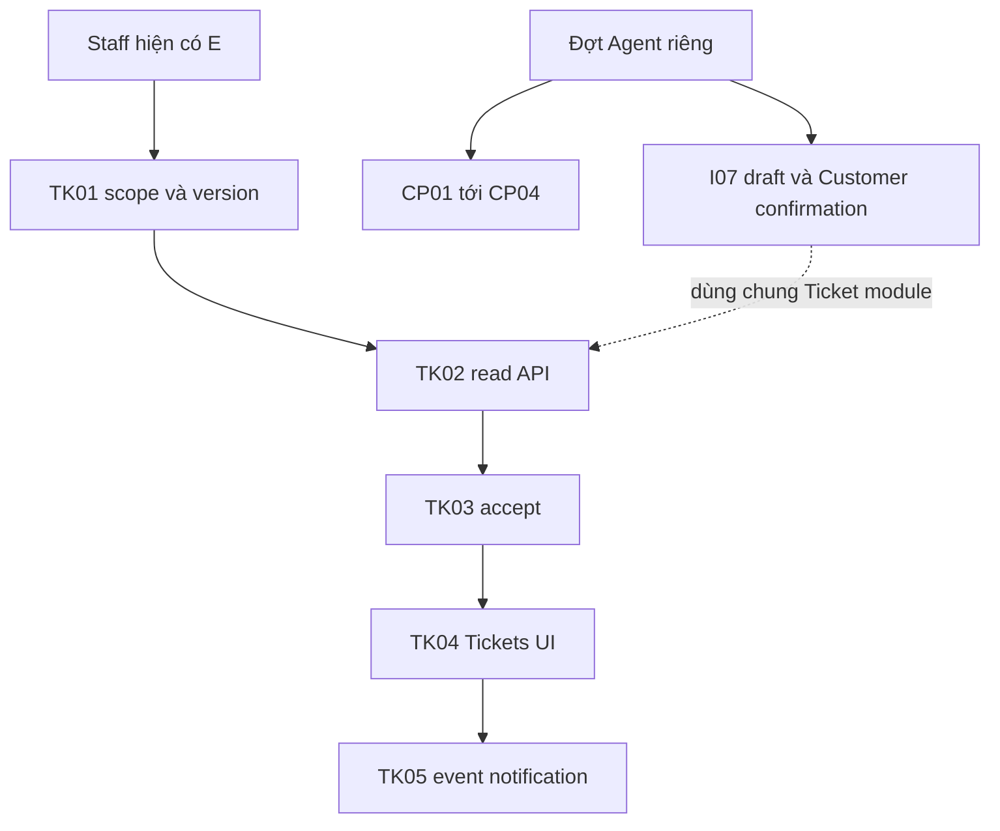

# Staff — triển khai theo chức năng và phase

04/11/2026 · [Contract chung](00-staff-contract.md) · [Staff](../README.md) · [Customer plans](../../customer/plans/README.md) · [API E/P](00-staff-contract.md#api-theo-chức-năng).

## 1. Một chức năng, một contract

Các phase có test case với dữ liệu, bước làm và kỳ vọng cụ thể, kèm sequence diagram; áp dụng [quy ước chung](../../README.md#quy-ước-test-case-và-sequence-diagram). Phần Agent/Copilot chưa làm giữ nhãn dự kiến, không biến danh sách test thành báo cáo pass.

Plans đã đủ làm đầu mối triển khai; không cần giữ bộ file màn hình cũ song song. Các phase baseline được bổ sung từ code thật cho chức năng làm trước khi có bộ plans. **Đã triển khai** không có nghĩa Agent/production hoặc toàn bộ test tích hợp đã xong.

| Nhánh | Trạng thái / căn cứ | Phase theo thứ tự |
| --- | --- | --- |
| [01 Auth/account](01-auth-contract.md) | E — FR-001 và hồ sơ Staff | [AU01 Core](auth/01-session-account-api.md) → [AU02 UI](auth/02-account-ui.md) → [AU03 phiên/retry](auth/03-session-lifecycle.md) |
| [02 Customers](02-customers-contract.md) | E — FR-002/003 | [CU01 read](customers/01-assignment-read-api.md) → [CU02 directory/profile](customers/02-directory-profile-ui.md) |
| [03 Inbox](03-inbox-contract.md) | I01–I06 E — FR-006/011 và consent local | [Spec](inbox/00-inbox-spec.md), [I01](inbox/01-model-permissions.md) → [I02](inbox/02-inbox-read-api.md) → [I03](inbox/03-handoff-transcript.md) → [I04](inbox/04-staff-inbox-ui.md) → [I05](inbox/05-messaging-customer.md) → [I06](inbox/06-realtime-routing.md); [I07 tạo Ticket](tickets/06-agent-confirmation.md) P |
| [04 Products](04-products-contract.md) | P01–P03 E — FR-008 | [P01 catalog](products/01-catalog-read-api.md) → [P02 access](products/02-document-access.md) → [P03 UI/PDF tự mở](products/03-staff-products-ui.md) |
| [05 Policies/PDF](05-policies-contract.md) | E — FR-008/UC-007/NFR-007 | [PL01 read/lookup](policies/01-read-lookup-api.md) → [PL02 access](policies/02-applied-documents-access.md) → [PL03 UI](policies/03-lookup-dossier-ui.md) → [PL04 lifecycle](policies/04-viewer-lifecycle.md) → [PL05 Inbox quick lookup](policies/05-inbox-customer-policy-lookup.md) |
| [06 Notifications](06-notifications-contract.md) | Handoff/Ticket consumer E — FR-013; producer I07 P | [NO01 recipient/API](notifications/01-recipient-read-api.md) → [NO02 UI/realtime](notifications/02-center-realtime-ui.md); Ticket do TK05 |
| [07 Tickets Staff](07-tickets-contract.md) | TK01–TK05 Core/UI/consumer đã có; I07 producer P — FR-010 | [TK01 scope/model](tickets/01-scope-model-contract.md) → [TK02 read](tickets/02-staff-read-api.md) → [TK03 accept](tickets/03-accept-command.md) → [TK04 UI](tickets/04-list-detail-ui.md) → [TK05 events](tickets/05-notification-events.md); [I07 tạo/xác nhận Ticket](tickets/06-agent-confirmation.md) chờ Agent |
| [08 Copilot](08-copilot-contract.md) | P — FR-007/012, chờ Agent | [CP01 contract](copilot/01-task-context-contract.md) → [CP02 service](copilot/02-core-agent-service.md) → [CP03 panel](copilot/03-panel-draft-citations.md) → [CP04 test code](copilot/04-agent-e2e.md); [context tùy phạm vi](copilot/05-linked-policy-context.md) |

## 2. Thứ tự làm tiếp cho mốc Staff không Agent

**TK01 đã xong nền Core và 32 tests** (3 migration +7 Ticket policy +16 Conversation +6 HTTP/WS regression). **TK02 đã có A21/A22 và 44 tests TK02+regression pass**; TK03 A23 đã có; TK04 UI đã nối; TK05 sự kiện/notification đã có; I07 producer tạo/xác nhận riêng còn P. Mỗi phase triển khai luôn tests tương ứng, không có nhánh Release riêng. Không cần dựng Agent để test Ticket read/accept bằng fixture; không được báo nguồn tạo Ticket từ AI đã có.

Nguồn Ticket hiện không có producer nghiệp vụ nên UI có thể rỗng nếu không có dữ liệu. Fixture local riêng chỉ theo yêu cầu, tuyệt đối không sửa bootstrap hoặc thêm endpoint tạo Ticket giả. TK02 dùng scope/legacy/version đã chốt TK01; không tự mở OPEN queue hoặc claim unassigned.

**Để đợt sau:** Customer shell/registration/profile/policy/PDF UI mới trong [Customer plans](../../customer/plans/README.md); Copilot/Agent service/draft I07 có gate riêng. Không làm lại Auth/Customers/Policy/Products/Inbox đã có, trừ lỗi hồi quy được kiểm chứng.

## Phần còn lại theo chức năng

Giữ ID G01–G10 để truy vết; checklist chi tiết nằm tại chức năng sở hữu. Đây chỉ là mục lục, không một gap report hoặc plan Release riêng.

| ID | Contract sở hữu |
| --- | --- |
| G01 | [Policies/Customer ownership](05-policies-contract.md#phần-còn-lại-theo-chức-năng) |
| G02 | [Copilot/context](08-copilot-contract.md#phần-còn-lại-theo-chức-năng) |
| G03 | [Products và liên quan Customer PDF](04-products-contract.md#phần-còn-lại-theo-chức-năng) |
| G04 | [Staff Tickets TK01–TK05](07-tickets-contract.md#phần-còn-lại-theo-chức-năng) |
| G05 | [Auth/session và regression](01-auth-contract.md#phần-còn-lại-theo-chức-năng) |
| G06 | [Copilot CP01–CP04](08-copilot-contract.md#phần-còn-lại-theo-chức-năng) |
| G07 | [Notifications/Ticket events](06-notifications-contract.md#phần-còn-lại-theo-chức-năng) |
| G08–G10 | [Customer phạm vi riêng, tests theo chức năng và mở rộng chưa chọn](00-staff-contract.md#phần-còn-lại-theo-chức-năng) |

## 3. Quy tắc triển khai code

Có API code/test mới đổi P→E; route/UI mock không chứng minh Core quyền hoặc Agent. Không tự chạy/migrate toàn bộ kế hoạch. Test DOM/network, PDF text/metadata/hash; không screenshot/render ảnh. Giữ secrets/dữ liệu private, Docker-only app runtime, cleanup exact fixture/artifact; không tự stage/commit.
