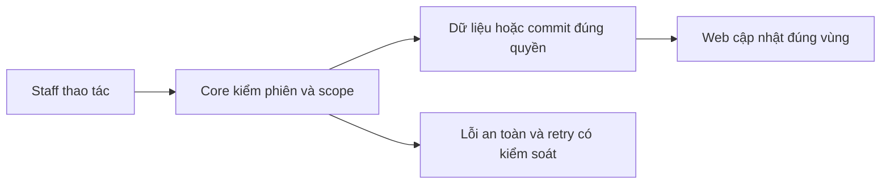

# AU01 — Auth và hồ sơ Staff Core

04/11/2026 · **Đã triển khai; tài liệu bổ sung từ code hiện tại** · [Contract](../01-auth-contract.md) · [Chung](../00-staff-contract.md).

## 1. Phạm vi và model

FR-001, NFR-001/002 và quyết định Staff tự sửa hồ sơ. User–StaffProfile 1:1, User–AuthSession 1:N; không có public Staff signup.

## 2. Vị trí code

`apps/core/src/auth/controllers/auth.controller.ts`, `staff-profile.controller.ts`, `services/auth.service.ts`, `dto/update-staff-profile.dto.ts`; account provisioning thuộc operator, không chuyển vào Staff API.

## 3. API và dữ liệu

Prefix REST `/api/v1`; `E` là runtime, không endpoint đề xuất mới.

| Method/path E | Input → output |
| --- | --- |
| POST /auth/staff/login | email/password → actor/csrfToken và cookie |
| GET /auth/me | actor hiện hành/csrfToken |
| GET /staff/me | hồ sơ của chính Staff |
| PATCH /staff/me | fullName/phone/expectedUpdatedAt → hồ sơ sau commit |
| POST /auth/change-password | currentPassword/newPassword/confirmPassword → phiên mới, thu hồi phiên cũ |
| POST /auth/logout | thu hồi phiên hiện tại → ok |

Token concurrency là User.updatedAt do Core cấp; không cho sửa email/accountCode/role/department qua PATCH. Phone nullable và unique theo contract; không tự trim/cắt password. Ghi cần Origin/JSON/X-Auth-Request/CSRF; login không yêu cầu session đã có. DTO/error/quota chi tiết trong contract AU.

## 4. Luồng và trạng thái

Staff login → Core xác thực role/lock/password → cấp cookie → GET own profile → PATCH với version → lock/recheck → update/audit → commit → UI cập nhật actor. Conflict409 không ghi đè;401/403/404 clear scope;429 giữ nháp.



## 5. Test cases

Các ca dưới đây là **đặc tả kiểm thử**, không phải báo cáo kết quả. Kiểm từng lớp API/service/DB/browser đúng nhãn; mock UI không thay kiểm quyền Core hoặc E2E thật.

**Quy ước dữ liệu:** S-A/S-B là hai Staff synthetic; C-A/C-B là hai Customer synthetic khác nhau. Thay alias bằng UUID/token của fixture cô lập; các path HTTP dùng prefix /api/v1 nếu chưa ghi đầy đủ. Chỉ thay assignment, khóa account, inject lỗi hoặc migration trong harness/môi trường test, không trên tài khoản/dữ liệu đang sử dụng.

### AU01-T01 — Đăng nhập đúng cổng Staff

**Lớp kiểm thử:** API.
**Điều kiện và dữ liệu:** S-A là Staff ACTIVE có mật khẩu synthetic đã biết; C-A là Customer.

**Các bước:**

1. POST /auth/staff/login bằng S-A.
2. Dùng cookie nhận được gọi GET /auth/me và GET /staff/me.
3. Lặp đăng nhập cổng Staff bằng C-A.

**Kết quả mong đợi:** S-A nhận session và đúng hồ sơ chính mình; C-A không tạo được phiên Staff; không trả password hash/token nội bộ.

### AU01-T02 — Chỉ sửa tên và phone của chính Staff

**Lớp kiểm thử:** API + DB.
**Điều kiện và dữ liệu:** S-A đã đăng nhập; GET /staff/me trả updatedAt=t0, dùng làm expectedUpdatedAt khi ghi.

**Các bước:**

1. PATCH /staff/me với fullName mới, phone synthetic và expectedUpdatedAt=t0 cùng CSRF hợp lệ.
2. GET lại hồ sơ.
3. Gửi PATCH chứa thêm role hoặc email.

**Kết quả mong đợi:** Lần đầu lưu đúng tên/phone và token mới; request có trường cấm bị 400, không đổi role/email.

### AU01-T03 — Hai phiên cùng sửa hồ sơ

**Lớp kiểm thử:** API + DB.
**Điều kiện và dữ liệu:** Hai context S-A cùng đọc token t0; dùng hai tên synthetic khác nhau.

**Các bước:**

1. Context1 PATCH bằng t0.
2. Context2 PATCH bằng t0.
3. GET hồ sơ sau hai request.

**Kết quả mong đợi:** Context1 thành công; context 2 nhận409; dữ liệu context 1 không bị ghi đè.

### AU01-T04 — CSRF, password và thu hồi phiên

**Lớp kiểm thử:** API.
**Điều kiện và dữ liệu:** S-A có hai phiên hợp lệ; biết mật khẩu hiện tại của fixture.

**Các bước:**

1. PATCH hồ sơ với CSRF sai.
2. Đổi mật khẩu synthetic qua POST /auth/change-password.
3. Dùng phiên cũ gọi GET /auth/me; dùng phiên mới rồi logout.

**Kết quả mong đợi:** CSRF sai trả 403 và không ghi; đổi mật khẩu thu hồi phiên cũ; logout làm phiên mới không còn truy cập được. Không ghi mật khẩu vào log.

**Suite tham khảo:** [auth.test.cjs](../../../../../apps/core/test/auth.test.cjs). Tên suite là vị trí tự động hóa, không phải chứng nhận các ca đã chạy.

**Dọn sau kiểm thử:** xóa đúng fixture/session/object/schema theo runId; phục hồi fault injection và đóng context/socket test. Không reset DB/credential, sửa bootstrap hoặc xóa volumes. Với PDF kiểm metadata/bytes/hash; với UI kiểm DOM/focus/network, không cần screenshot.

## 6. Checklist và giới hạn

- [x] Có code runtime trong phạm vi được ghi ở tiêu đề; phase này bổ sung tài liệu cho phần đã làm.
- [x] Có các lớp kiểm thử/bằng chứng được dẫn ở contract; không coi việc dọn docs là chạy lại test.
- [ ] Khi sửa code tiếp: chạy các suite bị ảnh hưởng, ghi kết quả trong phase và dọn fixture/artifact.

API đang E; bổ sung tài liệu không chứng minh vừa chạy lại suite. Đợt code tiếp theo phải kiểm auth/password/role và profile race; không thay password policy hoặc credential.

## Sequence diagram

Luồng chính và nhánh quyền/lỗi; test case ở trên chỉ rõ dữ liệu và điểm kiểm tương ứng.

```mermaid
sequenceDiagram
    actor U as Staff
    participant W as Web
    participant C as Core
    participant D as PostgreSQL
    U->>W: Xác nhận thao tác
    W->>C: PATCH /staff/me, changed fields và expectedUpdatedAt
    C->>D: Kiểm session, CSRF và khóa User và StaffProfile; self scope
    D-->>C: Quyền, version và state hiện hành
    alt Không đủ quyền hoặc version stale
        C-->>W: 401, 403, 404 hoặc409 an toàn
        W-->>U: Giữ nháp phù hợp và review trạng thái
    else Hợp lệ
        C->>D: Update profile, token và audit atomic
        D-->>C: COMMIT
        C-->>W: 200 hồ sơ mới
        W-->>U: Cập nhật sau ACK
    end
    opt Timeout hoặc mất ACK
        W->>C: GET current state hoặc receipt theo contract
        C->>D: Kiểm lại quyền và đọc kết quả
        C-->>W: Current state, không tự cấp quyền mới
        W-->>U: Review trước khi ghi lại
    end
```
