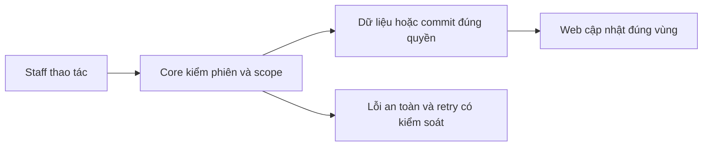

# AU01 — Auth và hồ sơ Staff Core

04/11/2026 · **Đã triển khai; tài liệu bổ sung từ code hiện tại** · [Contract](../01-auth-contract.md) · [Chung](../00-staff-contract.md).

## 1. Phạm vi và model

FR-001, NFR-001/002 và quyết định Staff tự sửa hồ sơ. User–StaffProfile 1:1, User–AuthSession 1:N; không có public Staff signup.

## 2. Vị trí code

`apps/core/src/auth/controllers/auth.controller.ts`, `staff-profile.controller.ts`, `services/auth.service.ts`, `dto/update-staff-profile.dto.ts`; account provisioning thuộc operator, không chuyển vào Staff API.

## 3. API và dữ liệu

Prefix REST `/api/v1`; `E` là runtime, không endpoint đề xuất mới.

| Method/path E | Input → output |
| --- | --- |
| POST /auth/staff/login | email/password → actor/csrfToken và cookie |
| GET /auth/me | actor hiện hành/csrfToken |
| GET /staff/me | hồ sơ của chính Staff |
| PATCH /staff/me | fullName/phone/expectedUpdatedAt → hồ sơ sau commit |
| POST /auth/change-password | currentPassword/newPassword/confirmPassword → phiên mới, thu hồi phiên cũ |
| POST /auth/logout | thu hồi phiên hiện tại → ok |

Token concurrency là User.updatedAt do Core cấp; không cho sửa email/accountCode/role/department qua PATCH. Phone nullable và unique theo contract; không tự trim/cắt password. Ghi cần Origin/JSON/X-Auth-Request/CSRF; login không yêu cầu session đã có. DTO/error/quota chi tiết trong contract AU.

## 4. Luồng và trạng thái

Staff login → Core xác thực role/lock/password → cấp cookie → GET own profile → PATCH với version → lock/recheck → update/audit → commit → UI cập nhật actor. Conflict409 không ghi đè;401/403/404 clear scope;429 giữ nháp.

## 5. Kiểm thử

`apps/core/test/auth.test.cjs`; chạy `npm run test:auth`; kiểm password/role/CSRF/profile concurrency/phone collision/thu hồi phiên. Rà suite thật bằng rg trước chạy, không tạo test chỉ lặp DTO.

## 6. Checklist và giới hạn

- [x] Có code runtime trong phạm vi được ghi ở tiêu đề; phase này bổ sung tài liệu cho phần đã làm.
- [x] Có các lớp kiểm thử/bằng chứng được dẫn ở contract; không coi việc dọn docs là chạy lại test.
- [ ] Khi sửa code tiếp: chạy các suite bị ảnh hưởng, ghi kết quả trong phase và dọn fixture/artifact.

API đang E; bổ sung tài liệu không chứng minh vừa chạy lại suite. Đợt code tiếp theo phải kiểm auth/password/role và profile race; không thay password policy hoặc credential.

