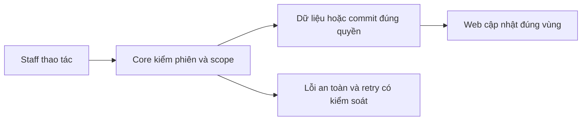
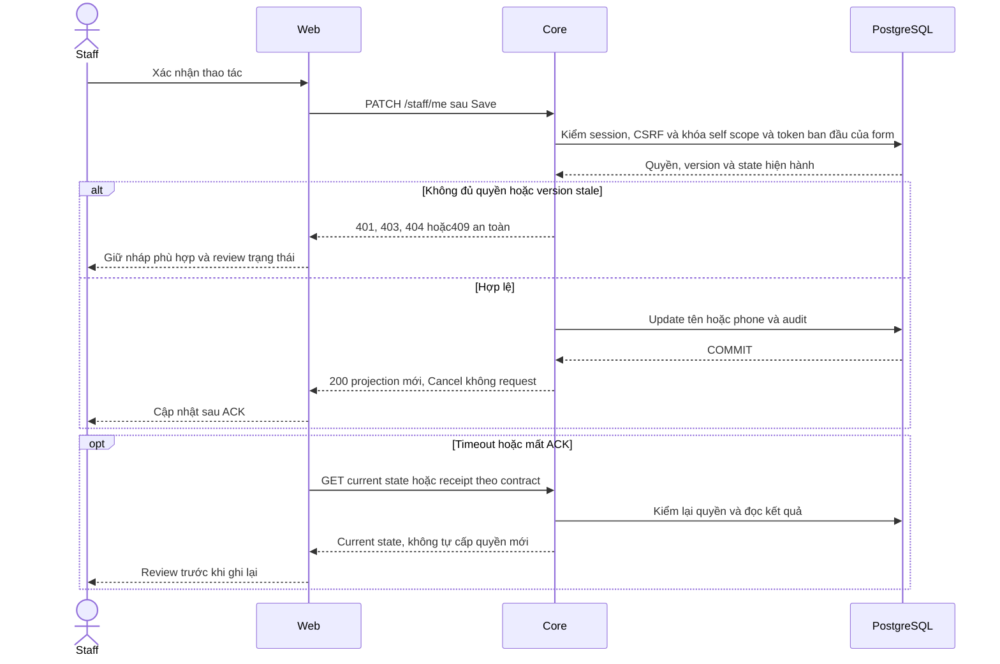

# AU02 — Tài khoản Staff và editor

04/11/2026 · **Đã triển khai; baseline UI** · [Contract](../01-auth-contract.md) · [Chung](../00-staff-contract.md).

## Data model và phạm vi ảnh hưởng

Bảng bên dưới mô tả tác động của phase, gồm cả ghi gián tiếp qua Core. Tên bảng thuộc schema `business` trừ nơi ghi rõ; cột còn đề xuất được đánh dấu **P**. Web không truy cập DB trực tiếp.

| Bảng/model | Cột hoặc dữ liệu liên quan | Thao tác của phase | Quan hệ/ràng buộc cần giữ | Mức ảnh hưởng và nơi bị tác động |
| --- | --- | --- | --- | --- |
| users + auth_sessions | users.id/role/status, auth_sessions.user_id/token_hash/expires_at/revoked_at | Đọc | AuthSession.user_id → User.id; session phải còn hạn, không bị thu hồi | Cao — mọi API dùng session; không trả token/hash trong DTO |
| users + staff_profiles | users.phone/updated_at, staff_profiles.user_id/full_name/department | PATCH ghi phone/full_name; đọc trường readonly | User–StaffProfile 1:1 theo user_id/role; phone unique, User.updated_at là token so sánh | Cao — khóa User rồi kiểm token, cập nhật tên/phone và audit atomic; không sửa department/email/role |
| users + auth_sessions | users.password_hash/password_changed_at/password_change_recommended/failed_login_attempts/locked_until, auth_sessions.token_hash/csrf_token_hash/expires_at/revoked_at | Login/password/logout ghi | Lock User serialize password/login; phiên mới và thu hồi phiên theo nghiệp vụ | Cao — đổi password ảnh hưởng mọi tab và cả hai role; không ghi hash/token vào log |

**Schema/migration:** Không migration. Web chỉ gọi Core; không ghi trực tiếp profile/session.

**Nhất quán và hồi quy:** Refetch cùng actor giữ draft/focus, 401/role change clear đúng scope. Các mutation là tác động gián tiếp qua AU01; retry auth không lặp PATCH/đổi password.

## 1. Phạm vi và model

AU01; FR-001 và quyết định hồ sơ Staff. `/staff/login`, `/account`, `/account#change-password`; giữ router theo role.

## 2. Vị trí code

`auth-screen.tsx`, `staff-personal-information.tsx`, `staff-profile-editor.tsx`, `staff-account-menu.tsx`, `lib/auth-api.ts`; tất cả dưới apps/web/src.

| Vị trí từ root repo | Hiện trạng | Trách nhiệm trong phase | Mức ảnh hưởng | Phạm vi cần kiểm lại |
| --- | --- | --- | --- | --- |
| [apps/web/src/components/staff-personal-information.tsx](<../../../../../apps/web/src/components/staff-personal-information.tsx>) | Hiện có | Hồ sơ readonly + mount editor/password | Trung bình | Account và actor header/sidebar |
| [apps/web/src/components/staff-profile-editor.tsx](<../../../../../apps/web/src/components/staff-profile-editor.tsx>) | Hiện có | Dirty draft, validation, token và conflict | Trung bình | Cancel/save/409/focus/responsive |
| [apps/web/src/lib/staff-profile-api.ts](<../../../../../apps/web/src/lib/staff-profile-api.ts>) | Hiện có | GET/PATCH DTO và CSRF | Cao | AU01 token/phone/null |
| [apps/web/src/components/auth-screen.tsx](<../../../../../apps/web/src/components/auth-screen.tsx>) | Hiện có | Actor/session/CSRF ở memory | Cao | Staff/Customer auth boundary |

## 3. API và dữ liệu

Prefix REST `/api/v1`; `E` là runtime, không endpoint đề xuất mới.

Dùng AU01, không Web proxy hoặc profile API thứ hai. Edit chỉ tên/phone, readonly email/code/role/department; PATCH có expectedUpdatedAt. Login/get-me là authority role; không lấy actor từ query.

## 4. Luồng và trạng thái

Menu → Personal information → Edit → Save/Cancel;200 cập nhật tên shell;409 chặn resubmit tới khi tải lại dữ liệu mới và review; network/5xx giữ nháp; session revoke xóa form. Change password thu hồi phiên cũ; Cancel/Escape/focus return theo component. Không footer Contact.

## 5. Test cases

Các ca dưới đây là **đặc tả kiểm thử**, không phải báo cáo kết quả. Kiểm từng lớp API/service/DB/browser đúng nhãn; mock UI không thay kiểm quyền Core hoặc E2E thật.

**Quy ước dữ liệu:** S-A/S-B là hai Staff synthetic; C-A/C-B là hai Customer synthetic khác nhau. Thay alias bằng UUID/token của fixture cô lập; các path HTTP dùng prefix /api/v1 nếu chưa ghi đầy đủ. Chỉ thay assignment, khóa account, inject lỗi hoặc migration trong harness/môi trường test, không trên tài khoản/dữ liệu đang sử dụng.

### AU02-T01 — Edit, Cancel rồi Save bằng bàn phím

**Lớp kiểm thử:** Browser.
**Điều kiện và dữ liệu:** S-A mở /account; ghi lại tên/phone ban đầu.

**Các bước:**

1. Tab tới Edit personal information và mở form.
2. Đổi tên/phone rồi Cancel.
3. Mở lại, nhập giá trị synthetic khác và Save.

**Kết quả mong đợi:** Cancel không gửi PATCH và trả focus về Edit; Save gửi đúng changed fields/token, cập nhật header/hồ sơ không F5.

### AU02-T02 — Validation và trường readonly

**Lớp kiểm thử:** Browser.
**Điều kiện và dữ liệu:** S-A ở form Edit; mở Network để quan sát request, không lưu payload riêng tư.

**Các bước:**

1. Để tên chỉ có khoảng trắng và nhập phone không hợp lệ.
2. Bấm Save.
3. Kiểm tra email, mã tài khoản, role, department.

**Kết quả mong đợi:** Lỗi nằm tại trường thích hợp; không gửi PATCH dữ liệu sai; các trường định danh không sửa được bằng UI.

### AU02-T03 — Giữ nháp khi refresh và xung đột

**Lớp kiểm thử:** Browser + API mock.
**Điều kiện và dữ liệu:** Hai tab S-A cùng mở form; tab 1 đang có nháp chưa lưu.

**Các bước:**

1. Tab2 lưu tên mới.
2. Kích hoạt cập nhật nền ở tab 1.
3. Save nháp tab 1 với token ban đầu.

**Kết quả mong đợi:** Nháp không bị refresh ghi đè; conflict được hiển thị để review, không tự gửi lại bằng token mới.

### AU02-T04 — Mạng lỗi, mobile và phiên hết hạn

**Lớp kiểm thử:** Browser + API mock.
**Điều kiện và dữ liệu:** S-A mở form tại375px; harness điều khiển PATCH503/401.

**Các bước:**

1. Cho PATCH503 rồi Save; thử lại sau khi khôi phục mạng.
2. Đặt zoom 200% và dùng Tab qua form.
3. Cho request tiếp theo trả 401.

**Kết quả mong đợi:** Lỗi retry tại chỗ, không F5; controls không tràn/focus thấy được;401 xóa nháp riêng và chuyển đăng nhập.

**Dọn sau kiểm thử:** xóa đúng fixture/session/object/schema theo runId; phục hồi fault injection và đóng context/socket test. Không reset DB/credential, sửa bootstrap hoặc xóa volumes. Với PDF kiểm metadata/bytes/hash; với UI kiểm DOM/focus/network, không cần screenshot.

## 6. Checklist và giới hạn

- [x] Có code runtime trong phạm vi được ghi ở tiêu đề; phase này bổ sung tài liệu cho phần đã làm.
- [x] Có các lớp kiểm thử/bằng chứng được dẫn ở contract; không coi việc dọn docs là chạy lại test.

**Quy tắc khi bảo trì:** Khi thay đổi code, chạy các suite bị ảnh hưởng theo test case của phase và dọn fixture/artifact do lượt kiểm thử tạo ra. Báo kết quả ngắn trong trao đổi, không ghi nhật ký kiểm thử vào phase. Đây là quy tắc áp dụng mỗi lần sửa, không phải hạng mục chức năng còn thiếu.

Giữ nháp/focus khi background refresh, không F5. Session freshness/retry chi tiết AU03; không thêm spinner che toàn workspace mỗi focus.

## Tự động hóa test case

| Suite/vị trí | Phạm vi và giới hạn |
| --- | --- |
| [staff-foundation.integration.spec.mjs](../../../../../apps/web/tests/browser/staff-foundation.integration.spec.mjs) | Keyboard/focus và editor thật, conflict giữ nháp, mobile và mất phiên; UI regression mock vẫn kiểm riêng lỗi mạng/validation/quota. |
| [browser-staff-fixture.cjs](../../../../../apps/core/test/support/browser-staff-fixture.cjs) | Dữ liệu synthetic UUID qua test Docker, session/password trong memory; finally dọn đúng fixture/object, không reset seed |
| [test-staff.mjs](../../../../../apps/web/scripts/test-staff.mjs) | Chạy Chromium/Firefox/WebKit, gom JSON tạm rồi tự dọn artifact; Web/Core chỉ chạy Docker |

Ca lỗi mạng dùng fault injection rõ ràng; native PDF toolbar/zoom không được xác minh bằng iframe DOM. Các bảng/test case là đặc tả duy trì, không ghi nhật ký từng lần chạy tại đây.

## Sequence diagram

Luồng chính và nhánh quyền/lỗi; test case ở trên chỉ rõ dữ liệu và điểm kiểm tương ứng.

