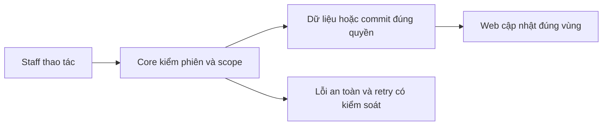

# AU02 — Tài khoản Staff và editor

04/11/2026 · **Đã triển khai; baseline UI** · [Contract](../01-auth-contract.md) · [Chung](../00-staff-contract.md).

## 1. Phạm vi và model

AU01; FR-001 và quyết định hồ sơ Staff. `/staff/login`, `/account`, `/account#change-password`; giữ router theo role.

## 2. Vị trí code

`auth-screen.tsx`, `staff-personal-information.tsx`, `staff-profile-editor.tsx`, `staff-account-menu.tsx`, `lib/auth-api.ts`; tất cả dưới apps/web/src.

## 3. API và dữ liệu

Prefix REST `/api/v1`; `E` là runtime, không endpoint đề xuất mới.

Dùng AU01, không Web proxy hoặc profile API thứ hai. Edit chỉ tên/phone, readonly email/code/role/department; PATCH có expectedUpdatedAt. Login/get-me là authority role; không lấy actor từ query.

## 4. Luồng và trạng thái

Menu → Personal information → Edit → Save/Cancel;200 cập nhật tên shell;409 chặn resubmit tới khi tải lại dữ liệu mới và review; network/5xx giữ nháp; session revoke xóa form. Change password thu hồi phiên cũ; Cancel/Escape/focus return theo component. Không footer Contact.

## 5. Kiểm thử

`staff-account.spec.mjs`15 ca + `staff-session.spec.mjs`22 ca đã có: keyboard, invalid input,401/403/409/429/5xx, focus,375/768/1600px, scope change, request cũ. Chạy `npm run test:browser:account` trên Web Docker; mock không chứng minh Core authorization.

## 6. Checklist và giới hạn

- [x] Có code runtime trong phạm vi được ghi ở tiêu đề; phase này bổ sung tài liệu cho phần đã làm.
- [x] Có các lớp kiểm thử/bằng chứng được dẫn ở contract; không coi việc dọn docs là chạy lại test.
- [ ] Khi sửa code tiếp: chạy các suite bị ảnh hưởng, ghi kết quả trong phase và dọn fixture/artifact.

Giữ nháp/focus khi background refresh, không F5. Session freshness/retry chi tiết AU03; không thêm spinner che toàn workspace mỗi focus.

