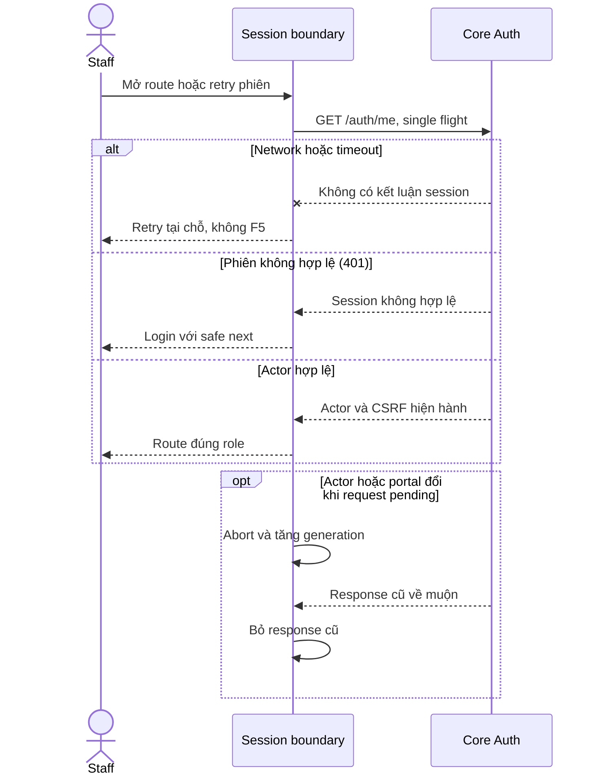

# Việc 01 — Retry khôi phục phiên không tải lại trang

Ngày **03/11/2026**. Trạng thái: **đã triển khai và kiểm chứng ngày 03/11/2026**. Thứ tự hôm nay: 01 → [02 Policy/PDF](../policies/04-viewer-lifecycle.md) → [03 chốt Inbox](../03-inbox-contract.md). Phạm vi/nghiệm thu chung tại [kế hoạch hôm nay](../../../../next-steps.md#kế-hoạch-hôm-nay--03112026).

## 1. Kết quả cần đạt

Mở Staff workspace hoặc Account khi mạng/Core lỗi → hiện Try again → kết nối phục hồi → bấm thử lại để lấy phiên và vào đúng route hiện tại. Không F5, không navigation document mới, không dùng location.href để thay state.

Đây là sửa lỗi G05, theo [Account](../01-auth-contract.md), NFR-001 và quy tắc không reload trong apps/web/AGENTS.md. Không đổi giao diện tài khoản, API auth hoặc cơ chế phân quyền.

## 2. Điểm xuất phát và file liên quan

| File | Điểm cần xử lý |
| --- | --- |
| [auth-screen.tsx](../../../../../apps/web/src/components/auth-screen.tsx) | Trước sửa: Try again gọi location.reload. Hiện dùng chung refresh qua ref, guard chống trùng, AbortController và trạng thái pending/focus |
| [auth-api.ts](../../../../../apps/web/src/lib/auth-api.ts) | me(signal?) đã nhận AbortSignal tùy chọn, giữ mặc định callers; AuthScreen kết hợp abort lifecycle và timeout 15 giây |
| [staff-account.spec.mjs](../../../../../apps/web/tests/browser/staff-account.spec.mjs) | 15 ca form giữ nguyên; bổ sung 13 ca tại staff-session.spec.mjs cho bootstrap/retry/timeout/abort/role |
| [playwright.config.mjs](../../../../../apps/web/playwright.config.mjs) | Trình duyệt chạy trên Web Docker; screenshot/video/trace tắt |

Đọc guide Next tương ứng trong node_modules/next/dist/docs trước khi sửa route/hook. Không thêm thư viện hoặc shared package chỉ để sửa retry.

## 3. Contract giữ nguyên

GET `/api/v1/auth/me`, cookie hiện tại, credentials include, cache no-store. Thành công `{actor,csrfToken}`; actor.id/role từ Core. Không tự gửi role/staffId để khôi phục quyền.

| Kết quả | Hành vi đích |
| --- | --- |
| 200 và role phù hợp | Set session, xóa lỗi, render workspace/account đúng URL |
| 200 nhưng role khác mode | Theo điều hướng role hiện có; không render nội dung role cũ |
| 401 | Xóa session/dữ liệu riêng, chuyển đúng login; Staff deep link giữ next nội bộ đã kiểm tra |
| Mạng/timeout/5xx khi chưa có phiên xác thực | Hiện lỗi và Try again; không render dữ liệu riêng hoặc báo đã login |
| 403/429 khi kiểm phiên | Lỗi an toàn, retry thủ công phù hợp; không loop hoặc cấp quyền từ state |
| Unmount/đổi mode khi request chưa xong | Bỏ phản hồi cũ; không set state hoặc redirect từ request đã lỗi thời |

Đổi password/logout/login vẫn theo code hiện có. Không giữ nội dung riêng sau 401 hoặc sau khi đổi actor. Xử lý lỗi refresh phiên nền giữ chính sách fail-closed hiện tại; việc giữ nguyên UI trên lỗi auth mạng nền cần thiết kế riêng, không mở rộng ngầm ở bản sửa này.

## 4. Các bước triển khai

1. Đưa luồng tải phiên thành một hàm có thể dùng cho initial load, focus/visibility/realtime và nút retry; chọn callback/ref hoặc cơ chế tương đương, tránh hai bản logic.
2. Chống request trùng cho cùng vòng tải. Retry liên tiếp/focus đồng thời không tạo nhiều request đang chạy; guard có vòng đời ổn định, không bị reset vì đổi render/loading.
3. Mỗi request có lifecycle token hoặc AbortController; hủy/bỏ response cũ khi unmount/mode đổi. Nếu sửa me() nhận signal, options là tùy chọn và bảo toàn các callers khác.
4. Nút type=button gọi refetch, không reload. Trong lúc chạy: aria-busy/status, disabled để tránh bấm trùng; khi lỗi lại thì bật nút, focus giữ hợp lý.
5. Giữ route/query/hash hiện tại khi retry thành công. Chỉ router.replace khi thực sự phải login/đổi role theo chính sách hiện có.
6. Giữ một bộ event listeners đúng vòng đời; không reconnect socket liên tục do tạo callback mới mỗi render. Không đưa csrfToken/session vào localStorage/sessionStorage hoặc log.
7. Cập nhật regression tập trung trong suite Account hoặc tệp test có mục đích lâu dài nếu suite hiện tại không phù hợp; không tạo script dùng một lần trong repo.

## 5. Test cases

Các ca dưới đây là **đặc tả kiểm thử**, không phải báo cáo kết quả. Kiểm từng lớp API/service/DB/browser đúng nhãn; mock UI không thay kiểm quyền Core hoặc E2E thật.

**Quy ước dữ liệu:** S-A/S-B là hai Staff synthetic; C-A/C-B là hai Customer synthetic khác nhau. Thay alias bằng UUID/token của fixture cô lập; các path HTTP dùng prefix /api/v1 nếu chưa ghi đầy đủ. Chỉ thay assignment, khóa account, inject lỗi hoặc migration trong harness/môi trường test, không trên tài khoản/dữ liệu đang sử dụng.

### AU03-T01 — Khôi phục phiên sau lỗi mạng

**Lớp kiểm thử:** Browser + API mock.
**Điều kiện và dữ liệu:** GET /auth/me bị chặn lỗi mạng lần đầu; route đích có query/hash hợp lệ.

**Các bước:**

1. Mở route Staff được bảo vệ.
2. Khôi phục GET /auth/me rồi bấm Try again.
3. Theo dõi navigation của main frame.

**Kết quả mong đợi:** Ở lỗi mạng không bị coi là logout; retry vào đúng route/query/hash; chỉ có document navigation ban đầu.

### AU03-T02 — Không gọi auth theo mỗi thao tác

**Lớp kiểm thử:** Browser + Network.
**Điều kiện và dữ liệu:** S-A có phiên mới xác thực; ghi số GET /auth/me ban đầu.

**Các bước:**

1. Đổi Customers → Products → Tickets.
2. Chuyển tab trình duyệt đi rồi quay về ngay.
3. Phát burst invalidation tài nguyên.

**Kết quả mong đợi:** Không bootstrap auth lại theo từng route/message; chỉ revalidate theo điều kiện freshness của auth boundary, không remount workspace.

### AU03-T03 — Response phiên cũ không khôi phục actor

**Lớp kiểm thử:** Browser + API mock.
**Điều kiện và dữ liệu:** Giữ chậm response /auth/me của S-A.

**Các bước:**

1. Chuyển portal hoặc logout trong lúc request pending.
2. Trả response S-A muộn.
3. Đăng nhập bằng actor synthetic khác.

**Kết quả mong đợi:** Request cũ bị abort hoặc bị generation guard bỏ qua; không hiện tên, role hay dữ liệu S-A trong phiên mới.

### AU03-T04 — Phân biệt timeout với401 và sai role

**Lớp kiểm thử:** Browser + API mock.
**Điều kiện và dữ liệu:** Route Staff và safe next đã chuẩn bị; kiểm riêng từng biến thể fixture.

**Các bước:**

1. Cho auth request timeout rồi retry.
2. Cho auth trả 401.
3. Cho auth trả actor CUSTOMER với response 200.

**Kết quả mong đợi:** Timeout cho phục hồi tại chỗ;401 về login; Customer không render Staff. Không chấp nhận next trỏ ra domain ngoài.

**Dọn sau kiểm thử:** xóa đúng fixture/session/object/schema theo runId; phục hồi fault injection và đóng context/socket test. Không reset DB/credential, sửa bootstrap hoặc xóa volumes. Với PDF kiểm metadata/bytes/hash; với UI kiểm DOM/focus/network, không cần screenshot.

## 6. Thứ tự kiểm và Docker

- Chạy Web lint/typecheck cho thay đổi; chỉ thêm kiểm khác khi có lỗi/phụ thuộc mới.
- Build Web bằng Docker Compose và chờ healthy, gateway phục vụ đúng build theo Getting Started; không chạy Web/Core dev bằng npm trên host.
- Chạy `npm run test:browser:account` trên gateway Docker; kiểm cả tests cũ và test cases mới theo phạm vi thay đổi. Test runner không được start host server.
- Đọc một kết quả tổng hợp; dọn artifact do lần chạy tạo, không tạo Markdown report, không log session/token.

## 7. Điều kiện hoàn thành

- [x] Try again không còn location.reload/location.href để retry phiên.
- [x] Mạng/500 → retry thành công và 401 → login đúng; không duplicate/stale request.
- [x] Các ca form Account cũ vẫn pass; số ca mới ghi theo kết quả thật.
- [x] Luồng auth dùng chung không đổi quyền/cookie/CSRF và không làm mất next hợp lệ.
- [x] Cập nhật Account/G05/checklist bằng bằng chứng đã chạy, không đánh dấu E2E Core từ API mock.
- [x] Dọn artifact của mình, không stage/commit nếu chưa được yêu cầu.

Ước lượng để chia buổi: **1–2 giờ**, tùy lỗi phát sinh khi kiểm tra; không phải cam kết thời gian. Nếu chưa đạt gate thì tiếp tục xử lý việc 01 trước khi chuyển việc 02.

## 8. Ghi chú triển khai

- AuthScreen dùng chung refresh cho initial/focus/visibility/realtime/retry; nút có disabled/status/focus, không reload document. Unmount/đổi mode abort request và bỏ phản hồi cũ. Role/next/cookie/CSRF giữ nguyên.
- Ca mới có timeout 15 giây thực, dedup các trigger đồng thời, abort request cũ khi đổi portal, chuyển role/401 và giữ query/hash/next. Tests dùng API/WebSocket synthetic mock; chưa phải E2E Core/DB.
- test:browser:account hiện chạy cả staff-account.spec.mjs và staff-session.spec.mjs. Artifact kiểm thử được dọn sau khi đọc kết quả; không screenshot/commit.

Tối ưu tiếp ngày 03/11: [kiểm phiên khi quay lại tab](../01-auth-contract.md#kiểm-phiên-khi-quay-lại-tab) dùng freshness 30 giây cho focus/visibility/ready, vẫn bypass initial/retry/invalidate/expiry.

Việc 01 đã đạt gate. Trạng thái các việc tiếp theo được cập nhật tại [phạm vi hôm nay](../../../../next-steps.md#kế-hoạch-hôm-nay--03112026).

## Sequence diagram

Luồng chính và nhánh quyền/lỗi; test case ở trên chỉ rõ dữ liệu và điểm kiểm tương ứng.

