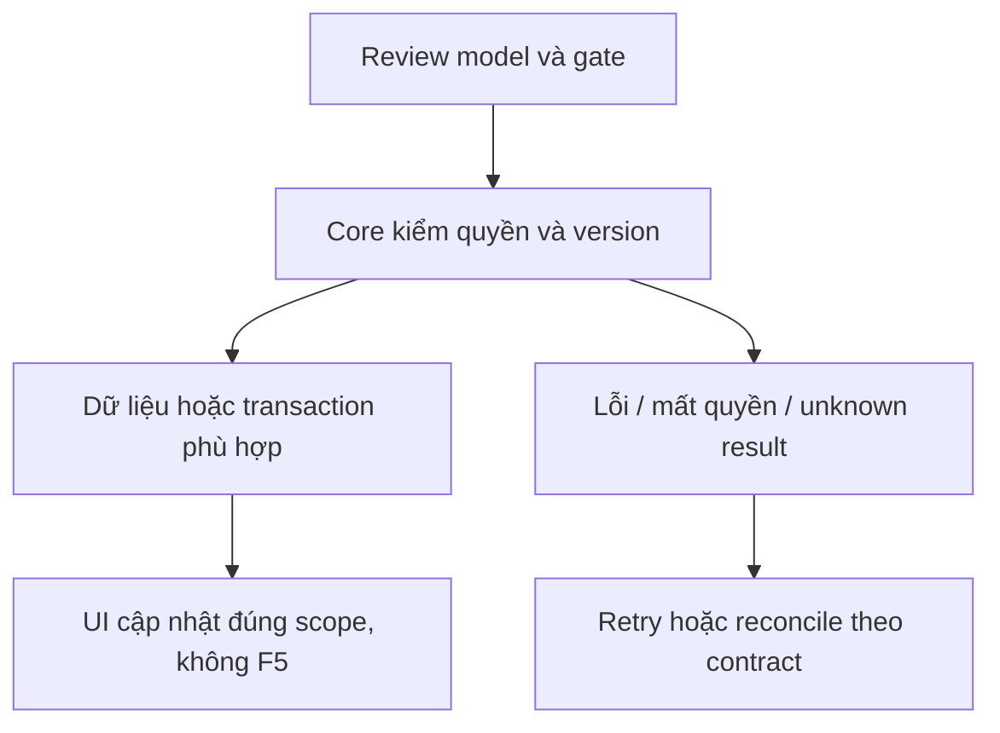

# CP01 — Core–Agent, context và ownership

04/11/2026 · **P, hoãn tới đợt Agent** · [Contract](../08-copilot-contract.md) · [Chung](../00-staff-contract.md).

## Bổ sung bảo vệ dữ liệu Customer — 12/11/2026

**P — chưa triển khai phần bảo vệ bổ sung; giữ trạng thái baseline của phase.** Theo [ma trận dữ liệu chung](../../../../configuration-and-data.md#customer-sensitive-data); mức che/quyền xem đầy đủ còn chờ chốt. Vị trí code/API và data model của phase bên dưới là nơi rà tác động; bổ sung này không tự yêu cầu migration hoặc sửa dữ liệu gốc.

**Thay đổi của phase:** Context có quyền vẫn phải giảm/che trước provider; frozen view giữ source refs và current grant. Alias scoped conversation/run, mapping/retention review cùng checkpoint, không dùng alias làm quyền.

**Kiểm thử cần bổ sung, chưa chạy:** Contract/fake: khác Customer không dùng chung mapping; canary không trong model request, processor lỗi/revoke không gửi cached raw.

## Data model và phạm vi ảnh hưởng

Bảng bên dưới mô tả tác động của phase, gồm cả ghi gián tiếp qua Core. Tên bảng thuộc schema `business` trừ nơi ghi rõ; cột còn đề xuất được đánh dấu **P**. Web không truy cập DB trực tiếp.

| Bảng/model | Cột hoặc dữ liệu liên quan | Thao tác của phase | Quan hệ/ràng buộc cần giữ | Mức ảnh hưởng và nơi bị tác động |
| --- | --- | --- | --- | --- |
| users + auth_sessions | users.id/role/status, auth_sessions.user_id/token_hash/expires_at/revoked_at | Đọc | AuthSession.user_id → User.id; session phải còn hạn, không bị thu hồi | Cao — mọi API dùng session; không trả token/hash trong DTO |
| staff_assignments + customer_profiles + staff_profiles | staff_id/customer_id/is_active/ended_at, assignment_version, user_id/full_name | Đọc | Assignment gắn đúng Customer/Staff; Inbox còn ràng buộc assignment id cụ thể | Cao — Customers, Policy Lookup, Ticket và Inbox cùng phụ thuộc phân công |
| conversations + conversation_handoffs | customer_id/channel_type/support_origin/direct_assignment_id/assigned_staff_id/status/control_version/subject, state/assignment_id/recipient_staff_id/shared_subject/shared_reason/accepted_at/revoked_at | Đọc | Direct đúng assignment lúc tạo hoặc handoff ACCEPTED còn grant; PENDING chỉ shared metadata, không AI subject/transcript | Cao — Inbox filter/deep link/REST/WS phải cùng gate; không suy grant từ status/assigned_staff_id |
| insurance_policies + insurance_products | customer_id/product_id/policy_number/status, premium_amount/payment_frequency/next_due_date, effective_date/expiry_date/sum_assured/benefits_snapshot, product_code/name | Đọc | Policy.customer_id → CustomerProfile.user_id; product_id → InsuranceProduct.id; unique policy_number | Cao — DTO tiền/ngày/snapshot dùng chung Staff/Customer; không OCR PDF để cập nhật DB |
| documents + document_versions | access_scope/policy_id/owner_customer_id/product_id/current_version, document_id/version_number/is_active/checksum_sha256/storage_bucket/storage_object_key | Đọc | FK (policy_id,owner_customer_id) → Policy(id,customer_id); unique (document_id,version_number); policy dùng exact binding trong benefits_snapshot, Products dùng current_version | Cao — đổi version/scope ảnh hưởng viewer, download và nguồn retrieval; bucket/key không ra DTO |
| conversations + messages | channel_type/assigned_staff_id/customer_id/linked_context_conv_id/linked_policy_id/control_version; messages.audience/sequence/citations/tool_calls_metadata | P — tạo/append nội bộ Copilot, nền cột đã có | STAFF_COPILOT gắn source có transcript grant; INTERNAL không xuất Customer; cần chốt uniqueness theo Staff/source trước migration | Cao — không dùng grant của Staff trước reassignment, không append trực tiếp Customer answer từ Copilot |
| Copilot task/checkpoint — P, chưa có model task app | Dự kiến task id, owner, source, context watermark, state/attempt/lease/result | DDL/storage dự kiến, chưa chọn đầy đủ | Core giữ authorization/business fence; checkpoint Agent dùng store/credential riêng, không là transaction nghiệp vụ | Cao — retry/crash/revoke giữa enqueue/tool/return; không biến ConversationStatus thành task state |

**Schema/migration:** P — không chạy migration trong phase tài liệu. Nền Conversation/Message đã có; task ownership/uniqueness/schema checkpoint chưa chốt, phải migration mới khi triển khai.

**Nhất quán và hồi quy:** Core recheck source/current grant ở enqueue/tool/return; UI không gửi draft thay Staff. Kiểm toàn bộ source lifecycle/Private citation exact version/INTERNAL isolation và stale task theo test của phase. Không mở rộng quyền từ model output.

## 1. Phạm vi và điều kiện bắt đầu

FR-007/012/UC-006/009; không chặn nghiệm thu Staff không Agent. Nội dung Copilot tuyệt đối tách Customer support.

## 2. Model và vị trí thay đổi

Model Conversation.channelType STAFF_COPILOT/linkedContextConvId; source grant I01; xem Agent_Design cho service identity/task/checkpoint thread ownership. Rà schema uniqueness Staff+source conversation trước migration mới, không thread chung giữa Staff cũ/mới.

| Vị trí từ root repo | Hiện trạng | Trách nhiệm trong phase | Mức ảnh hưởng | Phạm vi cần kiểm lại |
| --- | --- | --- | --- | --- |
| [apps/core/src/conversations/services/conversation-access.service.ts](<../../../../../apps/core/src/conversations/services/conversation-access.service.ts>) | Hiện có | Hiện có source grant; P adapter Copilot phải gọi lại | Cao | REST/WS transcript và source reassignment |
| [apps/core/src/conversations/conversations.module.ts](<../../../../../apps/core/src/conversations/conversations.module.ts>) | Hiện có | Hiện có module; Copilot controller/task adapter còn P | Cao | Không mở public endpoint giả quyền |
| [apps/agent/](<../../../../../apps/agent>) | Hiện có | Owner phần Agent/checkpoint; chỉ ranh giới cần phối hợp, không triển khai trong đợt tài liệu này | Cao | Service identity, scope tools, durable attempt |
| `apps/web/src/components/staff-copilot-panel.tsx` | Dự kiến — chưa có file | P — panel/history/task/citation theo actor/source | Trung bình | Inbox transcript và composer giữ mounted |
| `apps/web/src/lib/copilot-api.ts` | Dự kiến — chưa có file | P — task/read/cancel DTO sau chốt CP01 | Cao | Không gọi provider/Agent trực tiếp từ browser |

## 3. API spec và quyền

Prefix REST `/api/v1`; mọi API trong phase này là **P** trừ API nền được dẫn rõ là E. Quyết định kỹ thuật đề xuất phải review trước code; không sửa schema chỉ từ file plan.

A24 GET `/staff/conversations/:id/copilot`, A25 POST `.../copilot/messages`, A26 POST `.../copilot/summary` vẫn P. Trước code cần chốt request UUID/contextVersion/lastSequence, ACK200/202, task lookup/cancel/timeout/status, safe errors và transport. Không coi task endpoint/checkpoint protocol là đã có chỉ vì đặt tên.

Core cấp context/catalog exact version, Agent gọi Core Business APIs; session/CSRF cho browser, service auth cho Agent. Recheck source transcript grant trước enqueue/tool/return; pending/AI riêng denied. Chính sách summary/citation payload allowlist + retention phải được review. Copilot không soạn nháp câu trả lời Customer. Chưa chọn streaming/polling hay SLA ở phase này.

## 4. Luồng thực hiện

Staff đủ grant → Core snapshot source/context watermark → trusted Agent task → tools đúng scope → kết quả internal. Reassignment/revoke fences pending attempt; checkpoint không quyền ghi nghiệp vụ. Customer không nhận Copilot event/history/raw tools.



## 5. Test cases

Các ca dưới đây là **kịch bản dự kiến**, chỉ thực thi sau dependency/contract đã chốt trong phần phạm vi; không đánh dấu chức năng đã có.

**Quy ước dữ liệu:** S-A/S-B là hai Staff synthetic; C-A/C-B là hai Customer synthetic khác nhau. Thay alias bằng UUID/token của fixture cô lập; các path HTTP dùng prefix /api/v1 nếu chưa ghi đầy đủ. Chỉ thay assignment, khóa account, inject lỗi hoặc migration trong harness/môi trường test, không trên tài khoản/dữ liệu đang sử dụng.

### CP01-T01 — Scope nguồn không lấy từ LLM

**Lớp kiểm thử:** Contract/Service dự kiến.
**Điều kiện và dữ liệu:** S-A đã Accept cuộc C-A; AI riêng/pending của C-A và cuộc C-B là đối chứng.

**Các bước:**

1. Đề nghị context cho cuộc accepted.
2. Đổi sourceConversationId sang AI riêng/pending/C-B.
3. Chèn actor/role/customerId vào payload LLM.

**Kết quả mong đợi:** Core cấp context chỉ đúng actor/grant hiện hành; deny nguồn đối chứng trước prompt/tool; LLM không quyết quyền.

### CP01-T02 — Task identity, retry và watermark

**Lớp kiểm thử:** Contract test dự kiến.
**Điều kiện và dữ liệu:** CP01 đã chốt UUID intent, contextVersion, lastSequence và lookup semantics.

**Các bước:**

1. Gửi hai task cùng UUID/payload.
2. Replay cùng UUID với context khác.
3. Đối chiếu trusted task envelope và lookup.

**Kết quả mong đợi:** Một intent không tạo task độc lập; payload đổi conflict theo contract; result gắn đúng source/watermark, không task endpoint giả.

### CP01-T03 — Revoke giữa context và result

**Lớp kiểm thử:** Service barrier dự kiến.
**Điều kiện và dữ liệu:** Task S-A đã nhận context; result/citation đang giữ.

**Các bước:**

1. Thu hồi source grant hoặc đổi assignment.
2. Cho tool đọc tiếp và trả result cũ.
3. Kiểm task response/log.

**Kết quả mong đợi:** Recheck/fence chặn Private kết quả muộn; không prompt/checkpoint/secret vào response/log; chưa transport chốt thì chỉ review case.

**Dọn sau kiểm thử:** xóa đúng fixture/session/object/schema theo runId; phục hồi fault injection và đóng context/socket test. Không reset DB/credential, sửa bootstrap hoặc xóa volumes. Với PDF kiểm metadata/bytes/hash; với UI kiểm DOM/focus/network, không cần screenshot.

## 6. Gate hoàn tất

- [ ] Model/API/quyền/điểm còn mở đã review trước code phụ thuộc.
- [ ] Tests đúng lớp pass; HTTP/mock/browser E2E thật được phân biệt.
- [ ] Scope/phiên/late-response/concurrency/error và no-F5 được kiểm tương ứng.
- [ ] Cập nhật API map/checklist theo code thật, cleanup fixture/artifact; không tự commit.

Gate: service auth/task/version/checkpoint/retention/source DTO đã chốt. Chỉ sau CP01 mới CP02/CP03; Agent decisions còn mở giữ là P.

## Sequence diagram

**Luồng dự kiến:** chỉ áp dụng sau khi các dependency và API ở phần phạm vi được chốt.

```mermaid
sequenceDiagram
    actor U as Staff
    participant W as Web
    participant C as Core
    participant D as PostgreSQL
    participant A as Agent
    U->>W: Gửi câu hỏi theo channel
    W->>C: A25 Copilot task request, proposal CP01
    C->>D: Session, source grant và durable intent
    D-->>C: Run/attempt theo contract đã chốt
    C->>A: Trusted service envelope và context version
    A->>C: Business API hoặc retrieval scope
    C->>D: Recheck actor, owner và exact source version
    D-->>C: Dữ liệu đúng quyền
    C-->>A: Context allowlist
    A->>C: Result gắn run, attempt và watermark
    C->>D: Recheck fence và quyền trước lưu hoặc trả result
    alt Scope hoặc control version đã đổi
        C-->>W: Result không khả dụng, không Private muộn
    else Hợp lệ
        C-->>W: Kết quả tra cứu/giải thích/tóm tắt nội bộ
        W-->>U: Đọc kết quả; không sửa composer hoặc gửi Customer
    end
```
