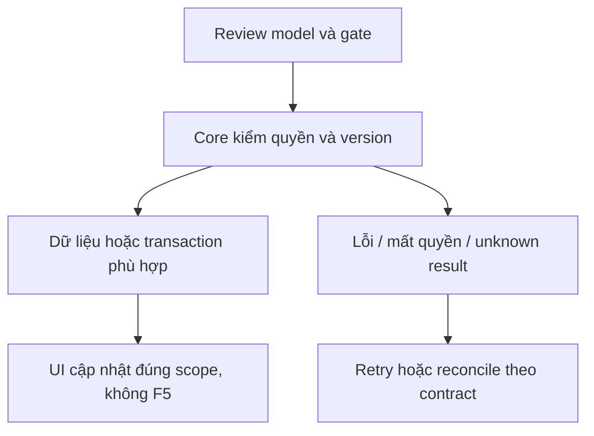
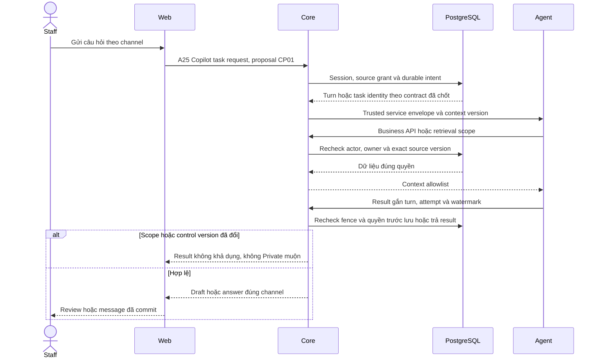

# CP01 — Core–Agent, context và ownership

04/11/2026 · **P, hoãn tới đợt Agent** · [Contract](../08-copilot-contract.md) · [Chung](../00-staff-contract.md).

## 1. Phạm vi và điều kiện bắt đầu

FR-007/012/UC-006/009; không chặn nghiệm thu Staff không Agent. Nội dung Copilot tuyệt đối tách Customer support.

## 2. Model và vị trí thay đổi

Model Conversation.channelType STAFF_COPILOT/linkedContextConvId; source grant I01; xem Agent_Design cho service identity/task/checkpoint thread ownership. Rà schema uniqueness Staff+source conversation trước migration mới, không thread chung giữa Staff cũ/mới.

## 3. API spec và quyền

Prefix REST `/api/v1`; mọi API trong phase này là **P** trừ API nền được dẫn rõ là E. Quyết định kỹ thuật đề xuất phải review trước code; không sửa schema chỉ từ file plan.

A24 GET `/staff/conversations/:id/copilot`, A25 POST `.../copilot/messages`, A26 POST `.../copilot/summary` vẫn P. Trước code cần chốt request UUID/contextVersion/lastSequence, ACK200/202, task lookup/cancel/timeout/status, safe errors và transport. Không coi task endpoint/checkpoint protocol là đã có chỉ vì đặt tên.

Core cấp context/catalog exact version, Agent gọi Core Business APIs; session/CSRF cho browser, service auth cho Agent. Recheck source transcript grant trước enqueue/tool/return; pending/AI riêng denied. Chính sách summary/draft/citation payload allowlist + retention phải được review. Chưa chọn streaming/polling hay SLA ở phase này.

## 4. Luồng thực hiện

Staff đủ grant → Core snapshot source/context watermark → trusted Agent task → tools đúng scope → kết quả internal. Reassignment/revoke fences pending attempt; checkpoint không quyền ghi nghiệp vụ. Customer không nhận Copilot event/history/raw tools.

## 5. Test cases

Các ca dưới đây là **kịch bản dự kiến**, chỉ thực thi sau dependency/contract đã chốt trong phần phạm vi; không đánh dấu chức năng đã có.

**Quy ước dữ liệu:** S-A/S-B là hai Staff synthetic; C-A/C-B là hai Customer synthetic khác nhau. Thay alias bằng UUID/token của fixture cô lập; các path HTTP dùng prefix /api/v1 nếu chưa ghi đầy đủ. Chỉ thay assignment, khóa account, inject lỗi hoặc migration trong harness/môi trường test, không trên tài khoản/dữ liệu đang sử dụng.

### CP01-T01 — Scope nguồn không lấy từ LLM

**Lớp kiểm thử:** Contract/Service dự kiến.
**Điều kiện và dữ liệu:** S-A đã Accept cuộc C-A; AI riêng/pending của C-A và cuộc C-B là đối chứng.

**Các bước:**

1. Đề nghị context cho cuộc accepted.
2. Đổi sourceConversationId sang AI riêng/pending/C-B.
3. Chèn actor/role/customerId vào payload LLM.

**Kết quả mong đợi:** Core cấp context chỉ đúng actor/grant hiện hành; deny nguồn đối chứng trước prompt/tool; LLM không quyết quyền.

### CP01-T02 — Task identity, retry và watermark

**Lớp kiểm thử:** Contract test dự kiến.
**Điều kiện và dữ liệu:** CP01 đã chốt UUID intent, contextVersion, lastSequence và lookup semantics.

**Các bước:**

1. Gửi hai task cùng UUID/payload.
2. Replay cùng UUID với context khác.
3. Đối chiếu trusted task envelope và lookup.

**Kết quả mong đợi:** Một intent không tạo task độc lập; payload đổi conflict theo contract; result gắn đúng source/watermark, không task endpoint giả.

### CP01-T03 — Revoke giữa context và result

**Lớp kiểm thử:** Service barrier dự kiến.
**Điều kiện và dữ liệu:** Task S-A đã nhận context; result/citation đang giữ.

**Các bước:**

1. Thu hồi source grant hoặc đổi assignment.
2. Cho tool đọc tiếp và trả result cũ.
3. Kiểm task response/log.

**Kết quả mong đợi:** Recheck/fence chặn Private kết quả muộn; không prompt/checkpoint/secret vào response/log; chưa transport chốt thì chỉ review case.

**Dọn sau kiểm thử:** xóa đúng fixture/session/object/schema theo runId; phục hồi fault injection và đóng context/socket test. Không reset DB/credential, sửa bootstrap hoặc xóa volumes. Với PDF kiểm metadata/bytes/hash; với UI kiểm DOM/focus/network, không cần screenshot.

## 6. Gate hoàn tất

- [ ] Model/API/quyền/điểm còn mở đã review trước code phụ thuộc.
- [ ] Tests đúng lớp pass; HTTP/mock/browser E2E thật được phân biệt.
- [ ] Scope/phiên/late-response/concurrency/error và no-F5 được kiểm tương ứng.
- [ ] Cập nhật API map/checklist theo code thật, cleanup fixture/artifact; không tự commit.

Gate: service auth/task/version/checkpoint/retention/source DTO đã chốt. Chỉ sau CP01 mới CP02/CP03; Agent decisions còn mở giữ là P.

## Sequence diagram

**Luồng dự kiến:** chỉ áp dụng sau khi các dependency và API ở phần phạm vi được chốt.

