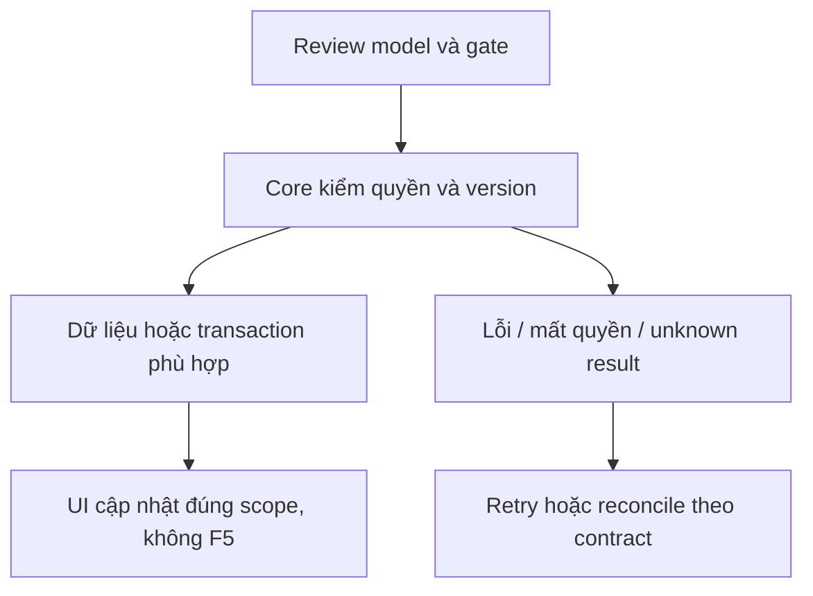

# CP01 — Core–Agent, context và ownership

04/11/2026 · **P, hoãn tới đợt Agent** · [Contract](../08-copilot-contract.md) · [Chung](../00-staff-contract.md).

## 1. Phạm vi và điều kiện bắt đầu

FR-007/012/UC-006/009; không chặn nghiệm thu Staff không Agent. Nội dung Copilot tuyệt đối tách Customer support.

## 2. Model và vị trí thay đổi

Model Conversation.channelType STAFF_COPILOT/linkedContextConvId; source grant I01; xem Agent_Design cho service identity/task/checkpoint thread ownership. Rà schema uniqueness Staff+source conversation trước migration mới, không thread chung giữa Staff cũ/mới.

## 3. API spec và quyền

Prefix REST `/api/v1`; mọi API trong phase này là **P** trừ API nền được dẫn rõ là E. Quyết định kỹ thuật đề xuất phải review trước code; không sửa schema chỉ từ file plan.

A24 GET `/staff/conversations/:id/copilot`, A25 POST `.../copilot/messages`, A26 POST `.../copilot/summary` vẫn P. Trước code cần chốt request UUID/contextVersion/lastSequence, ACK200/202, task lookup/cancel/timeout/status, safe errors và transport. Không coi task endpoint/checkpoint protocol là đã có chỉ vì đặt tên.

Core cấp context/catalog exact version, Agent gọi Core Business APIs; session/CSRF cho browser, service auth cho Agent. Recheck source transcript grant trước enqueue/tool/return; pending/AI riêng denied. Chính sách summary/draft/citation payload allowlist + retention phải được review. Chưa chọn streaming/polling hay SLA ở phase này.

## 4. Luồng thực hiện

Staff đủ grant → Core snapshot source/context watermark → trusted Agent task → tools đúng scope → kết quả internal. Reassignment/revoke fences pending attempt; checkpoint không quyền ghi nghiệp vụ. Customer không nhận Copilot event/history/raw tools.

## 5. Test cần có

Contract tests proposals: cross Staff/source/thread denied; pending metadata không đưa prompt; revoke giữa tool/result; checkpoint stale writer; task duplicate/reconcile; safe citations. Chưa LLM runtime thì không test fake trả lời để đánh dấu E.

## 6. Gate hoàn tất

- [ ] Model/API/quyền/điểm còn mở đã review trước code phụ thuộc.
- [ ] Tests đúng lớp pass; HTTP/mock/browser E2E thật được phân biệt.
- [ ] Scope/phiên/late-response/concurrency/error và no-F5 được kiểm tương ứng.
- [ ] Cập nhật API map/checklist theo code thật, cleanup fixture/artifact; không tự commit.

Gate: service auth/task/version/checkpoint/retention/source DTO đã chốt. Chỉ sau CP01 mới CP02/CP03; Agent decisions còn mở giữ là P.

