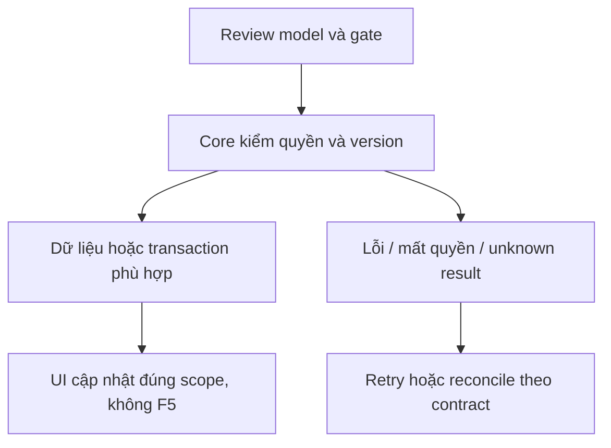

# CP01 — Core–Agent, context và ownership

24/11/2026 · **A24/A25 đã triển khai** · [Contract](../08-copilot-contract.md) · [Chung](../00-staff-contract.md).

## Bổ sung bảo vệ dữ liệu Customer — 12/11/2026

**Chính sách thông tin liên hệ:** [Ma trận dữ liệu chung](../../../../configuration-and-data.md#customer-sensitive-data) quy định che email/phone Customer mặc định và Hiện/Ẩn sau kiểm quyền Core. Phase 1 đã triển khai tại Customers; DTO Customer ở Policy/Inbox/Ticket hiện chỉ có tên/mã, không có contact card raw. Quy định này không thay quyền đọc PDF/transcript hoặc trạng thái triển khai của chức năng trong plan.

**Chat AI mới sau Staff — đã chốt 14/11/2026.** Cuộc cũ theo trạng thái/quyền hiện hành, Customer muốn hỏi AI chủ động tạo conversation mới với thread/context riêng. Grant và source view Copilot của cuộc cũ không cấp quyền cuộc AI mới. Core kiểm gate riêng của từng cuộc, revoke/reassignment theo policy hiện có. [Contract và ca hồi quy I03](../inbox/03-handoff-transcript.md#i03-t06--cuộc-ai-mới-có-quyền-độc-lập-với-cuộc-staff-cũ).

**MVP B:** sáu quy tắc system prompt và dữ liệu synthetic; quyền/scope/fence và schema theo contract. [Quyết định chuẩn](../../../../specifications/Agent_Design.md#mvp-model-data-policy).

## Data model và phạm vi ảnh hưởng

Bảng bên dưới mô tả tác động của phase, gồm cả ghi gián tiếp qua Core. Tên bảng thuộc schema `business` trừ nơi ghi rõ; cột còn đề xuất được đánh dấu **P**. Web không truy cập DB trực tiếp.

| Bảng/model | Cột hoặc dữ liệu liên quan | Thao tác của phase | Quan hệ/ràng buộc cần giữ | Mức ảnh hưởng và nơi bị tác động |
| --- | --- | --- | --- | --- |
| users + auth_sessions | users.id/role/status, auth_sessions.user_id/token_hash/expires_at/revoked_at | Đọc | AuthSession.user_id → User.id; session phải còn hạn, không bị thu hồi | Cao — mọi API dùng session; không trả token/hash trong DTO |
| staff_assignments + customer_profiles + staff_profiles | staff_id/customer_id/is_active/ended_at, assignment_version, user_id/full_name | Đọc | Assignment gắn đúng Customer/Staff; Inbox còn ràng buộc assignment id cụ thể | Cao — Customers, Policy Lookup, Ticket và Inbox cùng phụ thuộc phân công |
| conversations + conversation_handoffs | customer_id/channel_type/support_origin/direct_assignment_id/assigned_staff_id/status/control_version/subject, state/assignment_id/recipient_staff_id/shared_subject/shared_reason/accepted_at/revoked_at | Đọc | Dùng gate transcript của Inbox. Runtime mở Direct/Accepted; thiết kế 23/11 mở theo phân công hiện hành | Cao — Inbox filter/deep link/REST/WS và Copilot dùng cùng gate |
| insurance_policies + insurance_products | customer_id/product_id/policy_number/status, premium_amount/payment_frequency/next_due_date, effective_date/expiry_date/sum_assured/benefits_snapshot, product_code/name | Đọc | Policy.customer_id → CustomerProfile.user_id; product_id → InsuranceProduct.id; unique policy_number | Cao — DTO tiền/ngày/snapshot dùng chung Staff/Customer; không OCR PDF để cập nhật DB |
| documents + document_versions | access_scope/policy_id/owner_customer_id/product_id/current_version, document_id/version_number/is_active/checksum_sha256/storage_bucket/storage_object_key | Đọc | FK (policy_id,owner_customer_id) → Policy(id,customer_id); unique (document_id,version_number); policy dùng exact binding trong benefits_snapshot, Products dùng current_version | Cao — đổi version/scope ảnh hưởng viewer, download và nguồn retrieval; bucket/key không ra DTO |
| conversations + messages | channel_type/assigned_staff_id/customer_id/linked_context_conv_id/linked_policy_id/control_version; messages.audience/sequence/citations/tool_calls_metadata | Tạo thread và ghi tin nội bộ | STAFF_COPILOT gắn source có transcript grant; INTERNAL không xuất Customer; unique theo Staff và chat nguồn | Cao — không dùng grant của Staff trước reassignment, không append trực tiếp Customer answer từ Copilot |
| agent_runs + agent_attempts + agent_run_events | conversation/message, linked_history_view, status/attempt/result, event ID và sequence | Lưu lượt từ Staff | Tái dùng lifecycle hiện có. Checkpoint nằm trong store riêng của Agent | Cao — retry/crash/revoke giữa enqueue/tool/result |

**Ownership đã chốt:** một thread cho mỗi cặp Staff và chat nguồn. Khi Staff được phân công lại và có quyền đọc nguồn, Core mở lại thread của chính Staff đó. Lượt từng bị hủy giữ trạng thái `CANCELLED`. Rà dữ liệu legacy thiếu owner/source hoặc trùng cặp trước khi thêm ràng buộc DB. Kiểm hai request đầu đồng thời chỉ dùng một thread hợp lệ.

**Nhất quán và hồi quy:** Core recheck source/current grant ở enqueue/tool/return; UI không gửi draft thay Staff. Kiểm toàn bộ source lifecycle/Private citation exact version/INTERNAL isolation và stale task theo test của phase. Không mở rộng quyền từ model output.

## 1. Phạm vi và điều kiện bắt đầu

FR-007/012/UC-006/009; không chặn nghiệm thu Staff không Agent. Nội dung Copilot tuyệt đối tách Customer support.

## 2. Model và vị trí thay đổi

Model Conversation.channelType STAFF_COPILOT/linkedContextConvId; source grant I01; xem Agent_Design cho service identity/task/checkpoint thread ownership. Rà schema uniqueness Staff+source conversation trước migration mới, không thread chung giữa Staff cũ/mới.

| Vị trí từ root repo | Hiện trạng | Trách nhiệm trong phase | Mức ảnh hưởng | Phạm vi cần kiểm lại |
| --- | --- | --- | --- | --- |
| [apps/core/src/conversations/services/conversation-access.service.ts](<../../../../../apps/core/src/conversations/services/conversation-access.service.ts>) | Hiện có | Hiện có source grant; P adapter Copilot phải gọi lại | Cao | REST/WS transcript và source reassignment |
| [apps/core/src/conversations/conversations.module.ts](<../../../../../apps/core/src/conversations/conversations.module.ts>) | Hiện có | Controller A24/A25 và service Copilot | Cao | Không mở public endpoint giả quyền |
| [apps/agent/](<../../../../../apps/agent>) | Hiện có | Owner phần Agent/checkpoint; chỉ ranh giới cần phối hợp, không triển khai trong đợt tài liệu này | Cao | Service identity, scope tools, durable attempt |
| `apps/web/src/components/staff-copilot-panel.tsx` | Đã có | Hiển thị hội thoại Copilot theo Staff và chat nguồn | Trung bình | Inbox transcript và composer giữ mounted |
| `apps/web/src/lib/copilot-api.ts` | Đã có | Client A24/A25 | Cao | Không gọi provider/Agent trực tiếp từ browser |

## 3. API spec và quyền

**Hợp đồng làm ngữ cảnh Copilot — đã chọn, tích hợp P.** Theo [chính sách chuẩn](../../../../specifications/Agent_Design.md#copilot-policy-selection): số hợp đồng rõ và đúng quyền thì tra cứu không bắt chọn lại; câu nối tiếp dùng context còn rõ, mơ hồ thì hỏi lại. Không selector/API đổi linkedPolicyId, mở Lookup/PDF không đổi context.

Prefix REST `/api/v1`. A24/A25 đã triển khai theo contract CP01.

A24 GET `/staff/conversations/:id/copilot` và A25 POST `.../copilot/messages` đã triển khai. `:id` là chat Customer Support đang mở, kể cả khi chưa có thread Copilot. Core lấy Staff từ session, Customer từ nguồn và mốc lịch sử từ dữ liệu đã commit. A24 đọc lịch sử/trạng thái; A25 nhận câu hỏi và UUID chống trùng, ghi câu hỏi nội bộ và enqueue run trong cùng transaction. Theo [ánh xạ API chung](../../../../../contracts/agent-v1.md#application-conversation-api-mapping), public API ở module conversations và dùng lifecycle nội bộ hiện có.

**Giao nhận kết quả đã chốt.** Tái dùng kết nối WebSocket Inbox và cơ chế outbox hiện có. Core ghi sự kiện đổi trạng thái cuối cùng trong cùng transaction với cập nhật run, rồi phát sau commit. Sự kiện riêng cho Copilot chỉ mang định danh và tín hiệu cập nhật. Core xác minh phiên, chủ thread và quyền transcript nguồn khi phát. Panel dùng A24 để đọc trạng thái/kết quả bền vững và đối soát khi kết nối lại. API đọc kiểm lại quyền ở từng yêu cầu.

**Đối soát đã chốt.** A24 trả lịch sử và trạng thái lượt từ Core khi mở panel, nhận sự kiện hoặc kết nối lại. Nếu chưa xác nhận được A25 đã tiếp nhận, Web có thể gửi lại cùng UUID, chat nguồn và nội dung. Core trả đúng lượt đã tiếp nhận nếu có. Khi sự kiện đến trước ACK, Web đối soát qua A24 và giữ trạng thái mới nhất của cùng lượt. Phạm vi panel dùng A24 và A25.

**Mỗi thread Copilot chỉ nhận một lượt chưa kết thúc.** A25 kiểm điều kiện trong cùng transaction với ghi câu hỏi và tạo run để các tab hoặc request đồng thời không tạo thêm lượt mới. Sau khi kiểm quyền, replay cùng UUID và nội dung trả về lượt đã nhận. Trong lúc lượt còn `QUEUED` hoặc `RUNNING`, A25 từ chối UUID mới và panel vẫn cho sửa nội dung đang soạn.

**Kết quả API đã chốt.** A24 trả lịch sử rỗng và không có lượt đang chạy nếu Staff có quyền đọc nguồn và chưa có thread. Thread được tạo khi A25 tiếp nhận câu hỏi đầu tiên. Sau khi kiểm quyền, A25 tra UUID trước khi kiểm thread đang bận. Cùng UUID và payload trả ID và trạng thái hiện tại của đúng lượt cũ, kể cả khi một lượt mới đang chạy. Cùng UUID nhưng khác payload trả lỗi xung đột. UUID mới trong lúc có lượt chưa kết thúc trả lỗi đang bận để panel giữ nội dung đang soạn. A24 cung cấp nội dung kết quả và lịch sử.

Staff gửi yêu cầu tóm tắt qua ô hỏi và A25 theo UC-006. A24 trả `items`, `beforeCursor` và `activeRun`. A25 nhận `clientMessageId` và `content`, trả `id`, `status` và `replayed` (201 cho lượt mới, 200 khi replay). Xung đột và đang bận trả 409 với mã `IDEMPOTENCY_CONFLICT` và `COPILOT_BUSY`. Quyền nguồn và ownership phải được kiểm ở API Staff, khi Agent chạy/gọi tool và lúc commit/trả kết quả. Kiểm lại các đường cấp scope và callback hiện có vì kiểm active assignment ở nhánh Copilot chưa thay được gate transcript của chat nguồn.

Citation của A24 trả `documentId`, `versionId` và `sourceLocation` (trang, điều khoản hoặc anchor từ tài liệu retrieval). Citation cũ chỉ lưu số trang có `sourceLocation: null` và vẫn có thể mở phiên bản được cấp quyền.

## 4. Luồng thực hiện

Staff đủ grant → Core chốt mốc lịch sử nguồn → Agent xử lý trong phạm vi được cấp → Core lưu kết quả nội bộ.

**Thu hồi quyền nguồn — đã chốt:** Khi Core thu hồi quyền hoặc đổi phân công làm chủ thread mất quyền xem chat nguồn, Core chặn kết quả và chuyển các lượt Copilot chưa kết thúc bị ảnh hưởng sang `CANCELLED` trong cùng giao dịch. Sau commit, Core gửi yêu cầu dừng attempt đã chạy qua cơ chế revoke hiện có. Core vẫn kiểm quyền hiện hành khi cấp scope, gọi tool, nhận callback, đọc kết quả và phát sự kiện. Panel xóa dữ liệu của cuộc chat đã mất quyền.

**Cấp lại quyền khi còn chờ xác nhận dừng — đã chốt.** Nếu thread chưa có lượt chưa kết thúc, A25 tiếp nhận câu hỏi mới ở trạng thái `QUEUED`. Panel hiện “Đang chờ”. Core chỉ chạy lượt mới sau khi Agent xác nhận dừng attempt cũ, lượt mới còn trong hạn và Staff vẫn có quyền. Nếu hết hạn chờ, Core lưu `FAILED` và phát tín hiệu cập nhật theo cơ chế chung. Staff có thể chủ động gửi lại thành lượt mới. Lượt cũ giữ `CANCELLED`.

**Thời hạn Copilot — đã chốt.** Core lưu một deadline khi A25 tiếp nhận câu hỏi, dùng chung cho thời gian chờ và xử lý. Claim, retry giao nhận và khởi động lại giữ nguyên deadline. Core đối soát lượt hết hạn ở cả `QUEUED` và `RUNNING`, kể cả khi còn chờ xác nhận dừng lượt cũ. Core kiểm deadline trong giao dịch claim và khi xử lý callback kết quả. Lượt đã hết hạn chuyển `FAILED` và phát tín hiệu cập nhật. Kết quả đến sau hạn không thể chuyển lượt sang thành công.

Khi khôi phục hàng đợi, Core lọc các thread đang chạy hoặc đang chờ thu hồi trước khi lấy batch. Mỗi thread chỉ xét lượt đầu hàng đợi và claim kiểm lại điều kiện trong transaction.

Khi giao lượt hoặc gửi yêu cầu thu hồi gặp lỗi sau commit, Core giữ trạng thái bền vững để bộ đối soát thử lại.



## 5. Test cases

Các ca dưới đây là **kịch bản dự kiến**, chỉ thực thi sau dependency/contract đã chốt trong phần phạm vi; không đánh dấu chức năng đã có.

**Quy ước dữ liệu:** S-A/S-B là hai Staff synthetic; C-A/C-B là hai Customer synthetic khác nhau. Thay alias bằng UUID/token của fixture cô lập; các path HTTP dùng prefix /api/v1 nếu chưa ghi đầy đủ. Chỉ thay assignment, khóa account, inject lỗi hoặc migration trong harness/môi trường test, không trên tài khoản/dữ liệu đang sử dụng.

### CP01-T01 — Scope nguồn không lấy từ LLM

**Lớp kiểm thử:** Contract/Service dự kiến.
**Điều kiện và dữ liệu:** S-A có quyền transcript cuộc A theo gate Inbox; cuộc chỉ có metadata hoặc cuộc khác ngoài phân công là đối chứng.

**Các bước:**

1. Mở A và gửi câu hỏi. Sau khi áp dụng quyền đọc 23/11, chạy lại với A là chat AI đang xử lý và Staff chưa Takeover.
2. Đổi ID trên route sang cuộc ngoài quyền, ID thread Copilot hoặc chat chỉ có metadata theo gate đang kiểm.
3. Chèn actor/role/customerId vào payload LLM.

**Kết quả mong đợi:** Core cấp context chỉ đúng actor/grant hiện hành; deny nguồn đối chứng trước prompt/tool; LLM không quyết quyền.

### CP01-T02 — Task identity, retry và watermark

**Lớp kiểm thử:** Contract test dự kiến.
**Điều kiện và dữ liệu:** Có UUID intent và hai chat cùng Customer; thread của Staff chưa tồn tại.

**Các bước:**

1. Gửi đồng thời hai request cùng UUID/payload, sau đó replay khi chat nguồn đã có tin mới.
2. Replay cùng UUID với nội dung hoặc ID chat nguồn khác.
3. Gửi câu hỏi mới và đối chiếu run/thread/mốc lịch sử qua discovery.

**Kết quả mong đợi:** Một intent không tạo task độc lập; payload đổi conflict theo contract; result gắn đúng source/watermark, không task endpoint giả.

### CP01-T03 — Revoke giữa context và result

**Lớp kiểm thử:** Service barrier dự kiến.
**Điều kiện và dữ liệu:** Task S-A đã nhận context; result/citation đang giữ.

**Các bước:**

1. Thu hồi source grant hoặc đổi assignment.
2. Cho tool đọc tiếp và trả result cũ.
3. Kiểm task response/log.

**Kết quả mong đợi:** Recheck/fence chặn Private kết quả muộn; không prompt/checkpoint/secret vào response/log; chưa transport chốt thì chỉ review case.

**Dọn sau kiểm thử:** xóa đúng fixture/session/object/schema theo runId; phục hồi fault injection và đóng context/socket test. Không reset DB/credential, sửa bootstrap hoặc xóa volumes. Với PDF kiểm metadata/bytes/hash; với UI kiểm DOM/focus/network, không cần screenshot.

## 6. Gate hoàn tất

- [ ] Model/API/quyền/điểm còn mở đã review trước code phụ thuộc.
- [ ] Tests đúng lớp pass; HTTP/mock/browser E2E thật được phân biệt.
- [ ] Scope/phiên/late-response/concurrency/error và no-F5 được kiểm tương ứng.
- [ ] Cập nhật API map/checklist theo code thật, cleanup fixture/artifact; không tự commit.

Gate: service auth/task/version/checkpoint/retention/source DTO đã chốt. Chỉ sau CP01 mới CP02/CP03; Agent decisions còn mở giữ là P.

## Sequence diagram

**Luồng dự kiến:** chỉ áp dụng sau khi các dependency và API ở phần phạm vi được chốt.

```mermaid
sequenceDiagram
    actor U as Staff
    participant W as Web
    participant C as Core
    participant D as PostgreSQL
    participant A as Agent
    U->>W: Gửi câu hỏi theo channel
    W->>C: A25 Copilot task request, proposal CP01
    C->>D: Session, source grant và durable intent
    D-->>C: Run/attempt theo contract đã chốt
    C->>A: Trusted service envelope và context version
    A->>C: Business API hoặc retrieval scope
    C->>D: Recheck actor, owner và exact source version
    D-->>C: Dữ liệu đúng quyền
    C-->>A: Context allowlist
    A->>C: Result gắn run, attempt và watermark
    C->>D: Recheck fence và quyền trước lưu hoặc trả result
    alt Scope hoặc control version đã đổi
        C-->>W: Result không khả dụng, không Private muộn
    else Hợp lệ
        C-->>W: Kết quả tra cứu/giải thích/tóm tắt nội bộ
        W-->>U: Đọc kết quả; không sửa composer hoặc gửi Customer
    end
```
