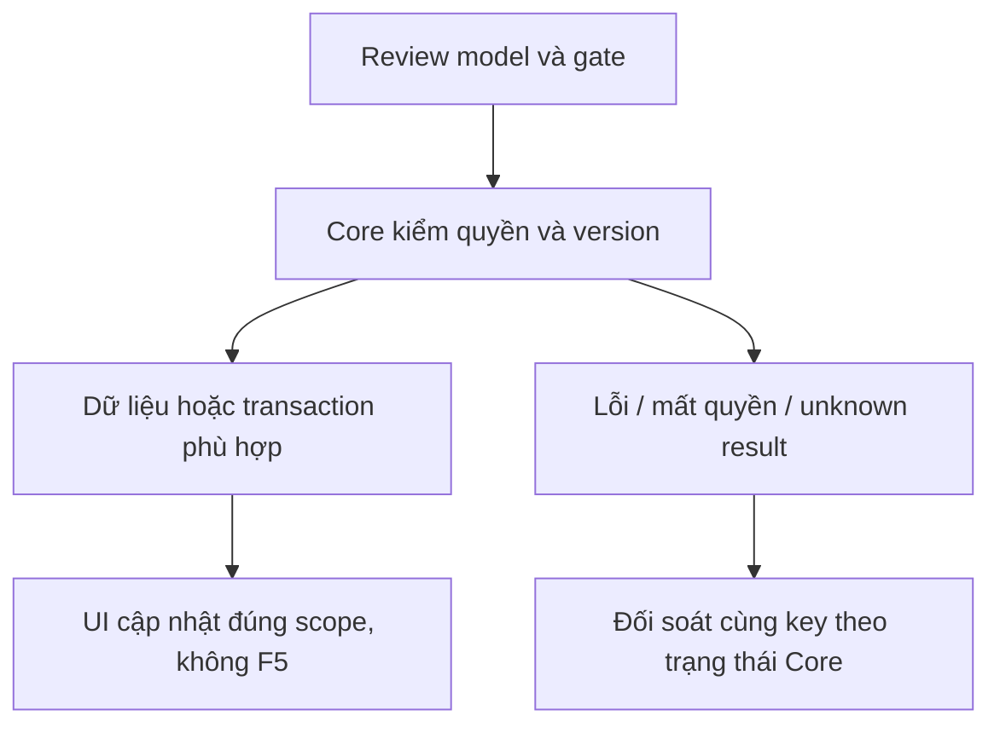

# CP02 — Lịch sử và tác vụ Copilot

04/11/2026 · **P, cần CP01 và Agent thật** · [Contract](../08-copilot-contract.md) · [Chung](../00-staff-contract.md).

## Bổ sung bảo vệ dữ liệu Customer — 12/11/2026

**P — chưa triển khai phần bảo vệ bổ sung; giữ trạng thái baseline của phase.** Theo [ma trận dữ liệu chung](../../../../configuration-and-data.md#customer-sensitive-data); email/phone Customer được che mặc định theo định dạng A ngày 13/11, Staff có Hiện/Ẩn để liên hệ theo cập nhật 14/11. Core kiểm lại quyền khi reveal, phần triển khai và các quyết định còn mở theo ma trận chung. Vị trí code/API và data model của phase bên dưới là nơi rà tác động; bổ sung này không tự yêu cầu migration hoặc sửa dữ liệu gốc.

**MVP B:** sáu quy tắc system prompt và dữ liệu synthetic; quyền/scope/fence và schema theo contract. [Quyết định chuẩn](../../../../specifications/Agent_Design.md#mvp-model-data-policy).

## Data model và phạm vi ảnh hưởng

Bảng bên dưới mô tả tác động của phase, gồm cả ghi gián tiếp qua Core. Tên bảng thuộc schema `business` trừ nơi ghi rõ; cột còn đề xuất được đánh dấu **P**. Web không truy cập DB trực tiếp.

| Bảng/model | Cột hoặc dữ liệu liên quan | Thao tác của phase | Quan hệ/ràng buộc cần giữ | Mức ảnh hưởng và nơi bị tác động |
| --- | --- | --- | --- | --- |
| users + auth_sessions | users.id/role/status, auth_sessions.user_id/token_hash/expires_at/revoked_at | Đọc | AuthSession.user_id → User.id; session phải còn hạn, không bị thu hồi | Cao — mọi API dùng session; không trả token/hash trong DTO |
| staff_assignments + customer_profiles + staff_profiles | staff_id/customer_id/is_active/ended_at, assignment_version, user_id/full_name | Đọc | Assignment gắn đúng Customer/Staff; Inbox còn ràng buộc assignment id cụ thể | Cao — Customers, Policy Lookup, Ticket và Inbox cùng phụ thuộc phân công |
| conversations + conversation_handoffs | customer_id/channel_type/support_origin/direct_assignment_id/assigned_staff_id/status/control_version/subject, state/assignment_id/recipient_staff_id/shared_subject/shared_reason/accepted_at/revoked_at | Đọc | Direct đúng assignment lúc tạo hoặc handoff ACCEPTED còn grant; PENDING chỉ shared metadata, không AI subject/transcript | Cao — Inbox filter/deep link/REST/WS phải cùng gate; không suy grant từ status/assigned_staff_id |
| insurance_policies + insurance_products | customer_id/product_id/policy_number/status, premium_amount/payment_frequency/next_due_date, effective_date/expiry_date/sum_assured/benefits_snapshot, product_code/name | Đọc | Policy.customer_id → CustomerProfile.user_id; product_id → InsuranceProduct.id; unique policy_number | Cao — DTO tiền/ngày/snapshot dùng chung Staff/Customer; không OCR PDF để cập nhật DB |
| documents + document_versions | access_scope/policy_id/owner_customer_id/product_id/current_version, document_id/version_number/is_active/checksum_sha256/storage_bucket/storage_object_key | Đọc | FK (policy_id,owner_customer_id) → Policy(id,customer_id); unique (document_id,version_number); policy dùng exact binding trong benefits_snapshot, Products dùng current_version | Cao — đổi version/scope ảnh hưởng viewer, download và nguồn retrieval; bucket/key không ra DTO |
| conversations + messages | channel_type/assigned_staff_id/customer_id/linked_context_conv_id/linked_policy_id/control_version; messages.audience/sequence/citations/tool_calls_metadata | P — tạo/append nội bộ Copilot, nền cột đã có | STAFF_COPILOT gắn source có transcript grant; INTERNAL không xuất Customer; cần chốt uniqueness theo Staff/source trước migration | Cao — không dùng grant của Staff trước reassignment, không append trực tiếp Customer answer từ Copilot |
| Copilot task/checkpoint — P, chưa có model task app | Dự kiến task id, owner, source, context watermark, state/attempt/lease/result | DDL/storage dự kiến, chưa chọn đầy đủ | Core giữ authorization/business fence; checkpoint Agent dùng store/credential riêng, không là transaction nghiệp vụ | Cao — retry/crash/revoke giữa enqueue/tool/return; không biến ConversationStatus thành task state |

**Schema/migration:** P — không chạy migration trong phase tài liệu. Nền Conversation/Message đã có; task ownership/uniqueness/schema checkpoint chưa chốt, phải migration mới khi triển khai.

**Nhất quán và hồi quy:** Core recheck source/current grant ở enqueue/tool/return; UI không gửi draft thay Staff. Kiểm toàn bộ source lifecycle/Private citation exact version/INTERNAL isolation và stale task theo test của phase. Không mở rộng quyền từ model output.

## 1. Phạm vi và điều kiện bắt đầu

Triển khai A24–26 theo CP01; không API Agent ghi trực tiếp Business DB.

## 2. Model và vị trí thay đổi

Conversations/Copilot module Core, Agent adapter, read policy I01, Policy document catalog, task receipts và audit; không public sender SYSTEM/AI hoặc client-chosen role/audience.

| Vị trí từ root repo | Hiện trạng | Trách nhiệm trong phase | Mức ảnh hưởng | Phạm vi cần kiểm lại |
| --- | --- | --- | --- | --- |
| [apps/core/src/conversations/services/conversation-access.service.ts](<../../../../../apps/core/src/conversations/services/conversation-access.service.ts>) | Hiện có | Hiện có source grant; P adapter Copilot phải gọi lại | Cao | REST/WS transcript và source reassignment |
| [apps/core/src/conversations/conversations.module.ts](<../../../../../apps/core/src/conversations/conversations.module.ts>) | Hiện có | Hiện có module; Copilot controller/task adapter còn P | Cao | Không mở public endpoint giả quyền |
| [apps/agent/](<../../../../../apps/agent>) | Hiện có | Owner phần Agent/checkpoint; chỉ ranh giới cần phối hợp, không triển khai trong đợt tài liệu này | Cao | Service identity, scope tools, durable attempt |
| `apps/web/src/components/staff-copilot-panel.tsx` | Dự kiến — chưa có file | P — panel/history/task/citation theo actor/source | Trung bình | Inbox transcript và composer giữ mounted |
| `apps/web/src/lib/copilot-api.ts` | Dự kiến — chưa có file | P — task/read DTO sau chốt CP01 | Cao | Không gọi provider/Agent trực tiếp từ browser |

## 3. API spec và quyền

Prefix REST `/api/v1`; mọi API trong phase này là **P** trừ API nền được dẫn rõ là E. Quyết định kỹ thuật đề xuất phải review trước code; không sửa schema chỉ từ file plan.

Request/response đúng CP01 đã chốt; history cursor bound Staff+source+scope, UUID intent chống trùng, watermark/expectedVersion cho context. Tool calls qua Core tự xác minh identity/quyền, không nhận quyền suy ra từ LLM. A12 gửi Customer không thuộc API Copilot.

## 4. Luồng thực hiện

**Logout/hết phiên — B đã chốt 14/11/2026, tích hợp P.** Task Core đã nhận tiếp tục chạy bằng service/run authorization theo actor/resource/grant hiện hành. HTTP/WS/UI của phiên cũ bị chặn/clear dữ liệu, cùng actor login lại fetch kết quả bằng phiên mới. Tài khoản/quyền nguồn bị thu hồi vẫn theo fence/revoke. [Chính sách chuẩn](../../../../specifications/Agent_Design.md#agent-logout-session-policy).

Enqueue durable task → Agent checkpoint → Core checks/tools → persist internal result → approved invalidation/task completion → UI fetch. Unknown ACK lookup same key; Agent lỗi hoặc bị Core hủy lượt không chặn chat hai đầu. Source thay đổi kết quả hiển thị watermark cũ, không tự sửa Ticket đã confirmed.



Retry/resume của giao nhận dùng cùng key và trạng thái Core. Task còn hiệu lực mới được tiếp tục theo protocol, task FAILED giữ kết quả lỗi khi đối soát và không tự chạy lại. [Chính sách lượt lỗi A ngày 14/11](../../../../specifications/Agent_Design.md#failed-turn-policy).

## 5. Test cases

Các ca dưới đây là **kịch bản dự kiến**, chỉ thực thi sau dependency/contract đã chốt trong phần phạm vi; không đánh dấu chức năng đã có.

**Quy ước dữ liệu:** S-A/S-B là hai Staff synthetic; C-A/C-B là hai Customer synthetic khác nhau. Thay alias bằng UUID/token của fixture cô lập; các path HTTP dùng prefix /api/v1 nếu chưa ghi đầy đủ. Chỉ thay assignment, khóa account, inject lỗi hoặc migration trong harness/môi trường test, không trên tài khoản/dữ liệu đang sử dụng.

### CP02-T01 — History/task không lẫn Staff hoặc source

**Lớp kiểm thử:** API/Service dự kiến.
**Điều kiện và dữ liệu:** CP01 APIs đã ổn định; S-A có task ở cuộcA, S-B có task riêng.

**Các bước:**

1. S-A đọc history và lookup task mình.
2. Thử task/source của S-B và cursor đổi source.
3. Revoke source grant rồi lookup lại.

**Kết quả mong đợi:** Không metadata/history ngoài scope; cursor/lookup không cấp quyền; no-store và safe errors theo contract đã duyệt.

### CP02-T02 — Timeout/crash/replay cùng intent

**Lớp kiểm thử:** Worker + DB dự kiến.
**Điều kiện và dữ liệu:** Task UUID K đã accepted; barrier điều khiển Agent completion.

**Các bước:**

1. Làm timeout sau durable acceptance.
2. Lookup/retry cùng K rồi restart worker.
3. Cho callback completion trùng.

**Kết quả mong đợi:** Một task/result cho intent, durable resume và sequence đúng; không trả success chỉ vì enqueue hoặc tạo task mới do timeout.

### CP02-T03 — Provider/storage lỗi và citations

**Lớp kiểm thử:** Agent integration dự kiến.
**Điều kiện và dữ liệu:** Task có source catalog exact version; inject provider/retrieval/storage lỗi.

**Các bước:**

1. Hỏi dữ liệu cần source hợp lệ.
2. Gây lỗi một dependency rồi phục hồi.
3. Kiểm result/citations và Customer transcript.

**Kết quả mong đợi:** Lỗi an toàn/thiếu căn cứ rõ; không citation giả hoặc auto-send A12; Customer không thấy Copilot internal.

**Dọn sau kiểm thử:** xóa đúng fixture/session/object/schema theo runId; phục hồi fault injection và đóng context/socket test. Không reset DB/credential, sửa bootstrap hoặc xóa volumes. Với PDF kiểm metadata/bytes/hash; với UI kiểm DOM/focus/network, không cần screenshot.

## 6. Gate hoàn tất

- [ ] Model/API/quyền/điểm còn mở đã review trước code phụ thuộc.
- [ ] Tests đúng lớp pass; HTTP/mock/browser E2E thật được phân biệt.
- [ ] Scope/phiên/late-response/concurrency/error và no-F5 được kiểm tương ứng.
- [ ] Cập nhật API map/checklist theo code thật, cleanup fixture/artifact; không tự commit.

Gate CP02: nội dung internal không xuất hiện Customer A10/API/events; chính sách retention/audit và checkpoint fence được kiểm. Không báo FR-007/012 hoàn tất từ backend mock.

## Sequence diagram

**Luồng dự kiến:** chỉ áp dụng sau khi các dependency và API ở phần phạm vi được chốt.

```mermaid
sequenceDiagram
    actor U as Staff
    participant W as Web
    participant C as Core
    participant D as PostgreSQL
    participant A as Agent
    U->>W: Gửi câu hỏi theo channel
    W->>C: Copilot request và task lookup theo CP01
    C->>D: Session, source grant và durable intent
    D-->>C: Run/attempt theo contract đã chốt
    C->>A: Trusted service envelope và context version
    A->>C: Business API hoặc retrieval scope
    C->>D: Recheck actor, owner và exact source version
    D-->>C: Dữ liệu đúng quyền
    C-->>A: Context allowlist
    A->>C: Result gắn run, attempt và watermark
    C->>D: Recheck fence và quyền trước lưu hoặc trả result
    alt Scope hoặc control version đã đổi
        C-->>W: Result không khả dụng, không Private muộn
    else Hợp lệ
        C-->>W: Kết quả tra cứu/giải thích/tóm tắt nội bộ
        W-->>U: Đọc kết quả; không sửa composer hoặc gửi Customer
    end
```
