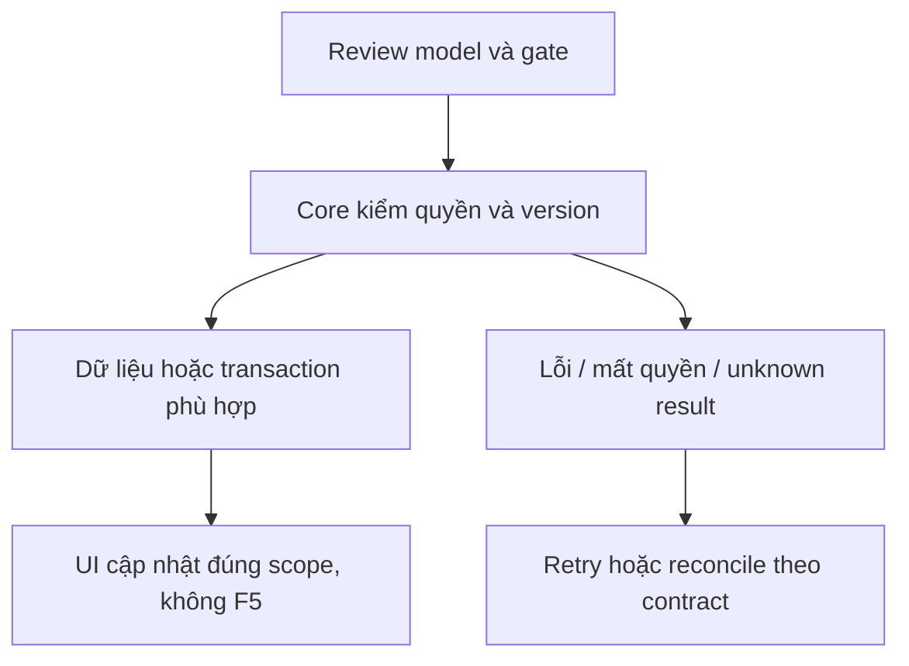

# CP02 — Lịch sử và tác vụ Copilot

04/11/2026 · **P, cần CP01 và Agent thật** · [Contract](../08-copilot-contract.md) · [Chung](../00-staff-contract.md).

## 1. Phạm vi và điều kiện bắt đầu

Triển khai A24–26 theo CP01; không API Agent ghi trực tiếp Business DB.

## 2. Model và vị trí thay đổi

Conversations/Copilot module Core, Agent adapter, read policy I01, Policy document catalog, task receipts và audit; không public sender SYSTEM/AI hoặc client-chosen role/audience.

## 3. API spec và quyền

Prefix REST `/api/v1`; mọi API trong phase này là **P** trừ API nền được dẫn rõ là E. Quyết định kỹ thuật đề xuất phải review trước code; không sửa schema chỉ từ file plan.

Request/response đúng CP01 đã chốt; history cursor bound Staff+source+scope, UUID intent chống trùng, watermark/expectedVersion cho context. Tool calls qua Core tự xác minh identity/quyền, không nhận quyền suy ra từ LLM. A12 gửi Customer không thuộc API Copilot.

## 4. Luồng thực hiện

Enqueue durable task → Agent checkpoint → Core checks/tools → persist internal result → approved invalidation/task completion → UI fetch. Unknown ACK lookup same key; Agent fail/circuit/cancel không chặn chat hai đầu. Source thay đổi kết quả hiển thị watermark cũ, không tự sửa Ticket đã confirmed.

## 5. Test cần có

HTTP/DB tests permission/thread ownership/duplicates/timeout/revoke/citations; Agent integration cần provider/runtime thật cấu hình ngoài Git. Không log prompt/transcript/secrets không cần thiết. Tool/storage outage trả hạn chế, không citation giả.

## 6. Gate hoàn tất

- [ ] Model/API/quyền/điểm còn mở đã review trước code phụ thuộc.
- [ ] Tests đúng lớp pass; HTTP/mock/browser E2E thật được phân biệt.
- [ ] Scope/phiên/late-response/concurrency/error và no-F5 được kiểm tương ứng.
- [ ] Cập nhật API map/checklist theo code thật, cleanup fixture/artifact; không tự commit.

Gate CP02: nội dung internal không xuất hiện Customer A10/API/events; chính sách retention/audit và checkpoint fence được kiểm. Không báo FR-007/012 hoàn tất từ backend mock.

