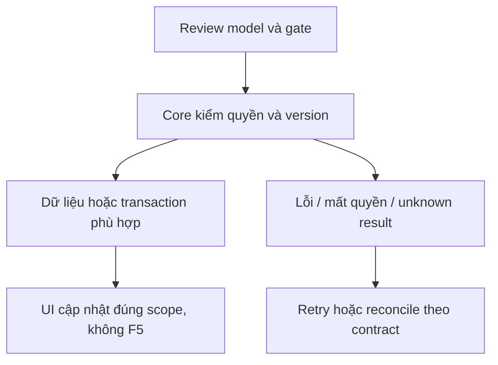

# CP03 — Panel Staff Copilot

04/11/2026 · **P, sau CP02** · [Contract](../08-copilot-contract.md) · [Chung](../00-staff-contract.md).

## Bổ sung bảo vệ dữ liệu Customer — 12/11/2026

**Chính sách thông tin liên hệ:** [Ma trận dữ liệu chung](../../../../configuration-and-data.md#customer-sensitive-data) quy định che email/phone Customer mặc định và Hiện/Ẩn sau kiểm quyền Core. Phase 1 đã triển khai tại Customers; DTO Customer ở Policy/Inbox/Ticket hiện chỉ có tên/mã, không có contact card raw. Quy định này không thay quyền đọc PDF/transcript hoặc trạng thái triển khai của chức năng trong plan.

**MVP B:** sáu quy tắc system prompt và dữ liệu synthetic; quyền/scope/fence và schema theo contract. [Quyết định chuẩn](../../../../specifications/Agent_Design.md#mvp-model-data-policy).

## Data model và phạm vi ảnh hưởng

Bảng bên dưới mô tả tác động của phase, gồm cả ghi gián tiếp qua Core. Tên bảng thuộc schema `business` trừ nơi ghi rõ; cột còn đề xuất được đánh dấu **P**. Web không truy cập DB trực tiếp.

| Bảng/model | Cột hoặc dữ liệu liên quan | Thao tác của phase | Quan hệ/ràng buộc cần giữ | Mức ảnh hưởng và nơi bị tác động |
| --- | --- | --- | --- | --- |
| users + auth_sessions | users.id/role/status, auth_sessions.user_id/token_hash/expires_at/revoked_at | Đọc | AuthSession.user_id → User.id; session phải còn hạn, không bị thu hồi | Cao — mọi API dùng session; không trả token/hash trong DTO |
| staff_assignments + customer_profiles + staff_profiles | staff_id/customer_id/is_active/ended_at, assignment_version, user_id/full_name | Đọc | Assignment gắn đúng Customer/Staff; Inbox còn ràng buộc assignment id cụ thể | Cao — Customers, Policy Lookup, Ticket và Inbox cùng phụ thuộc phân công |
| conversations + conversation_handoffs | customer_id/channel_type/support_origin/direct_assignment_id/assigned_staff_id/status/control_version/subject, state/assignment_id/recipient_staff_id/shared_subject/shared_reason/accepted_at/revoked_at | Đọc | Direct đúng assignment lúc tạo hoặc handoff ACCEPTED còn grant; PENDING chỉ shared metadata, không AI subject/transcript | Cao — Inbox filter/deep link/REST/WS phải cùng gate; không suy grant từ status/assigned_staff_id |
| insurance_policies + insurance_products | customer_id/product_id/policy_number/status, premium_amount/payment_frequency/next_due_date, effective_date/expiry_date/sum_assured/benefits_snapshot, product_code/name | Đọc | Policy.customer_id → CustomerProfile.user_id; product_id → InsuranceProduct.id; unique policy_number | Cao — DTO tiền/ngày/snapshot dùng chung Staff/Customer; không OCR PDF để cập nhật DB |
| documents + document_versions | access_scope/policy_id/owner_customer_id/product_id/current_version, document_id/version_number/is_active/checksum_sha256/storage_bucket/storage_object_key | Đọc | FK (policy_id,owner_customer_id) → Policy(id,customer_id); unique (document_id,version_number); policy dùng exact binding trong benefits_snapshot, Products dùng current_version | Cao — đổi version/scope ảnh hưởng viewer, download và nguồn retrieval; bucket/key không ra DTO |
| conversations + messages | channel_type/assigned_staff_id/customer_id/linked_context_conv_id/linked_policy_id/control_version; messages.audience/sequence/citations/tool_calls_metadata | P — tạo/append nội bộ Copilot, nền cột đã có | STAFF_COPILOT gắn source có transcript grant; INTERNAL không xuất Customer; cần chốt uniqueness theo Staff/source trước migration | Cao — không dùng grant của Staff trước reassignment, không append trực tiếp Customer answer từ Copilot |
| Copilot task/checkpoint — P, chưa có model task app | Dự kiến task id, owner, source, context watermark, state/attempt/lease/result | DDL/storage dự kiến, chưa chọn đầy đủ | Core giữ authorization/business fence; checkpoint Agent dùng store/credential riêng, không là transaction nghiệp vụ | Cao — retry/crash/revoke giữa enqueue/tool/return; không biến ConversationStatus thành task state |

**Schema/migration:** P — không chạy migration trong phase tài liệu. Nền Conversation/Message đã có; task ownership/uniqueness/schema checkpoint chưa chốt, phải migration mới khi triển khai.

**Nhất quán và hồi quy:** Core recheck source/current grant ở enqueue/tool/return; UI không gửi draft thay Staff. Kiểm toàn bộ source lifecycle/Private citation exact version/INTERNAL isolation và stale task theo test của phase. Không mở rộng quyền từ model output.

## 1. Phạm vi và điều kiện bắt đầu

Panel bên chat đúng mẫu repo UI; tra cứu/giải thích/tóm tắt/citations. Phạm vi xác nhận 06/11/2026 không có soạn nháp câu trả lời hoặc Use draft.

## 2. Model và vị trí thay đổi

`staff-copilot-panel.tsx`, `lib/copilot-api.ts`, rail trong `staff-inbox.tsx`, composer; giữ mounted transcript/PDF và per-source memory scoped actor.

| Vị trí từ root repo | Hiện trạng | Trách nhiệm trong phase | Mức ảnh hưởng | Phạm vi cần kiểm lại |
| --- | --- | --- | --- | --- |
| [apps/core/src/conversations/services/conversation-access.service.ts](<../../../../../apps/core/src/conversations/services/conversation-access.service.ts>) | Hiện có | Hiện có source grant; P adapter Copilot phải gọi lại | Cao | REST/WS transcript và source reassignment |
| `apps/web/src/components/staff-copilot-panel.tsx` | Dự kiến — chưa có file | P — panel/history/task/citation theo actor/source | Trung bình | Inbox transcript và composer giữ mounted |
| `apps/web/src/lib/copilot-api.ts` | Dự kiến — chưa có file | P — task/read DTO sau chốt CP01 | Cao | Không gọi provider/Agent trực tiếp từ browser |

## 3. API spec và quyền

Prefix REST `/api/v1`; mọi API trong phase này là **P** trừ API nền được dẫn rõ là E. Quyết định kỹ thuật đề xuất phải review trước code; không sửa schema chỉ từ file plan.

Dùng A24–26/task lookup sau khi CP01 chốt contract. Mở citations qua Core exact version, không URL do LLM tự cấp. Kết quả chỉ ở panel nội bộ; không đưa vào composer hoặc gọi A12.

## 4. Luồng thực hiện

Rail mở panel → source header → history/quick prompts/task state → answer+watermark+citation. Pending source không enable. Đóng/mở/chuyển cuộc giữ đúng scope, không lẫn context; loading/Agent outage/retry/quota và trạng thái Core hủy lượt có UI. Revoke xóa nội dung ngoài quyền; không tự gửi Customer. B đã chốt 14/11, task đã nhận tiếp tục xử lý nền theo quyền hiện hành. Panel xóa nội dung khi phiên hết hiệu lực, login lại cùng actor fetch task/history bằng phiên mới. [Chính sách chuẩn](../../../../specifications/Agent_Design.md#agent-logout-session-policy).



## 5. Test cases

Browser DOM tests keyboard/Escape/focus375px/200%, no-F5, không có Use draft, composer giữ nguyên, stale source/late task, citations denied. E2E thật đủ grant hỏi AI → đọc kết quả nội bộ; assert không thêm tin vào chat Customer. Không screenshot.

Các ca dưới đây là **kịch bản dự kiến**, chỉ thực thi sau dependency/contract đã chốt trong phần phạm vi; không đánh dấu chức năng đã có.

**Quy ước dữ liệu:** S-A/S-B là hai Staff synthetic; C-A/C-B là hai Customer synthetic khác nhau. Thay alias bằng UUID/token của fixture cô lập; các path HTTP dùng prefix /api/v1 nếu chưa ghi đầy đủ. Chỉ thay assignment, khóa account, inject lỗi hoặc migration trong harness/môi trường test, không trên tài khoản/dữ liệu đang sử dụng.

### CP03-T01 — Kết quả nội bộ không sửa composer hoặc gửi Customer

**Lớp kiểm thử:** Browser dự kiến.
**Điều kiện và dữ liệu:** CP02 trả kết quả tra cứu/giải thích/tóm tắt hợp lệ; composer Staff đang có nháp D0.

**Các bước:**

1. Mở Copilot và gửi câu hỏi, nhận kết quả nội bộ.
2. Kiểm panel không có chức năng soạn nháp Customer hoặc Use draft.
3. Đóng/mở panel, kiểm composer và lịch sử Customer.

**Kết quả mong đợi:** D0 giữ nguyên, không gọi A12, không thêm tin Customer-facing. Kết quả chỉ nằm trong Copilot; yêu cầu soạn nháp Customer được xử lý theo giới hạn MVP.

### CP03-T02 — Citations đúng version và scope

**Lớp kiểm thử:** Browser + API dự kiến.
**Điều kiện và dữ liệu:** Kết quả có citation applied v1 và fixture forged/out-of-scope.

**Các bước:**

1. Bấm citation hợp lệ qua Core.
2. Bấm citation ngoài quyền hoặc revoke source.
3. Đổi cuộc chat trong khi request citation pending.

**Kết quả mong đợi:** Chỉ exact version được cấp; denied không mở file; response nguồn cũ không ghi đè source mới.

### CP03-T03 — Keyboard/mobile và late task

**Lớp kiểm thử:** Browser dự kiến.
**Điều kiện và dữ liệu:** Panel mở tại375px/zoom 200%, task A đang pending.

**Các bước:**

1. Tab qua prompt/kết quả/citations, Escape đóng rồi mở lại.
2. Đổi source sangB.
3. Trả taskA muộn hoặc401.

**Kết quả mong đợi:** Focus trở về control mở, không tràn; kết quả/taskA không lẫnB;401 clear Private, không F5.

**Dọn sau kiểm thử:** xóa đúng fixture/session/object/schema theo runId; phục hồi fault injection và đóng context/socket test. Không reset DB/credential, sửa bootstrap hoặc xóa volumes. Với PDF kiểm metadata/bytes/hash; với UI kiểm DOM/focus/network, không cần screenshot.

## 6. Gate hoàn tất

- [ ] Model/API/quyền/điểm còn mở đã review trước code phụ thuộc.
- [ ] Tests đúng lớp pass; HTTP/mock/browser E2E thật được phân biệt.
- [ ] Scope/phiên/late-response/concurrency/error và no-F5 được kiểm tương ứng.
- [ ] Cập nhật API map/checklist theo code thật, cleanup fixture/artifact; không tự commit.

CP03 không làm trong đợt Staff trước Agent. Sau CP03 mới nghiệm thu CP04/Agent E2E; mock UI không thay chứng cứ AI.

## Sequence diagram

**Luồng dự kiến:** chỉ áp dụng sau khi các dependency và API ở phần phạm vi được chốt.

```mermaid
sequenceDiagram
    actor U as Staff
    participant W as Web
    participant C as Core
    participant D as PostgreSQL
    participant A as Agent
    U->>W: Gửi câu hỏi theo channel
    W->>C: Copilot prompt theo source context
    C->>D: Session, source grant và durable intent
    D-->>C: Run/attempt theo contract đã chốt
    C->>A: Trusted service envelope và context version
    A->>C: Business API hoặc retrieval scope
    C->>D: Recheck actor, owner và exact source version
    D-->>C: Dữ liệu đúng quyền
    C-->>A: Context allowlist
    A->>C: Result gắn run, attempt và watermark
    C->>D: Recheck fence và quyền trước lưu hoặc trả result
    alt Scope hoặc control version đã đổi
        C-->>W: Result không khả dụng, không Private muộn
    else Hợp lệ
        C-->>W: Kết quả tra cứu/giải thích/tóm tắt nội bộ
        W-->>U: Đọc kết quả; không sửa composer hoặc gửi Customer
    end
```
