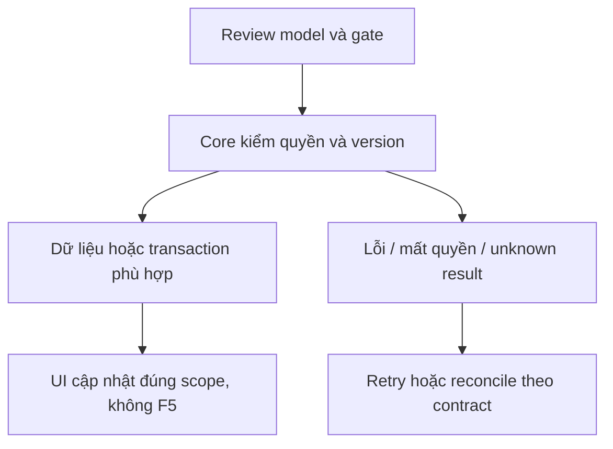

# CP03 — Panel Staff Copilot

24/11/2026 · **Panel Copilot đã triển khai** · [Contract](../08-copilot-contract.md) · [Chung](../00-staff-contract.md).

## Bổ sung bảo vệ dữ liệu Customer — 12/11/2026

**Chính sách thông tin liên hệ:** [Ma trận dữ liệu chung](../../../../configuration-and-data.md#customer-sensitive-data) quy định che email/phone Customer mặc định và Hiện/Ẩn sau kiểm quyền Core. Phase 1 đã triển khai tại Customers; DTO Customer ở Policy/Inbox/Ticket hiện chỉ có tên/mã, không có contact card raw. Quy định này không thay quyền đọc PDF/transcript hoặc trạng thái triển khai của chức năng trong plan.

**MVP B:** sáu quy tắc system prompt và dữ liệu synthetic; quyền/scope/fence và schema theo contract. [Quyết định chuẩn](../../../../specifications/Agent_Design.md#mvp-model-data-policy).

## Data model và phạm vi ảnh hưởng

Bảng bên dưới mô tả tác động của phase, gồm cả ghi gián tiếp qua Core. Tên bảng thuộc schema `business` trừ nơi ghi rõ; cột còn đề xuất được đánh dấu **P**. Web không truy cập DB trực tiếp.

| Bảng/model | Cột hoặc dữ liệu liên quan | Thao tác của phase | Quan hệ/ràng buộc cần giữ | Mức ảnh hưởng và nơi bị tác động |
| --- | --- | --- | --- | --- |
| users + auth_sessions | users.id/role/status, auth_sessions.user_id/token_hash/expires_at/revoked_at | Đọc | AuthSession.user_id → User.id; session phải còn hạn, không bị thu hồi | Cao — mọi API dùng session; không trả token/hash trong DTO |
| staff_assignments + customer_profiles + staff_profiles | staff_id/customer_id/is_active/ended_at, assignment_version, user_id/full_name | Đọc | Assignment gắn đúng Customer/Staff; Inbox còn ràng buộc assignment id cụ thể | Cao — Customers, Policy Lookup, Ticket và Inbox cùng phụ thuộc phân công |
| conversations + conversation_handoffs | customer_id/channel_type/support_origin/direct_assignment_id/assigned_staff_id/status/control_version/subject, state/assignment_id/recipient_staff_id/shared_subject/shared_reason/accepted_at/revoked_at | Đọc | Gate transcript chung theo CP01. Runtime mở Direct/Accepted; thiết kế 23/11 mở theo phân công hiện hành | Cao — Inbox filter/deep link/REST/WS phải cùng gate; không suy grant từ status/assigned_staff_id |
| insurance_policies + insurance_products | customer_id/product_id/policy_number/status, premium_amount/payment_frequency/next_due_date, effective_date/expiry_date/sum_assured/benefits_snapshot, product_code/name | Đọc | Policy.customer_id → CustomerProfile.user_id; product_id → InsuranceProduct.id; unique policy_number | Cao — DTO tiền/ngày/snapshot dùng chung Staff/Customer; không OCR PDF để cập nhật DB |
| documents + document_versions | access_scope/policy_id/owner_customer_id/product_id/current_version, document_id/version_number/is_active/checksum_sha256/storage_bucket/storage_object_key | Đọc | FK (policy_id,owner_customer_id) → Policy(id,customer_id); unique (document_id,version_number); policy dùng exact binding trong benefits_snapshot, Products dùng current_version | Cao — đổi version/scope ảnh hưởng viewer, download và nguồn retrieval; bucket/key không ra DTO |
| conversations + messages | channel_type/assigned_staff_id/customer_id/linked_context_conv_id/linked_policy_id/control_version; messages.audience/sequence/citations/tool_calls_metadata | Tạo thread và ghi tin nội bộ | STAFF_COPILOT gắn source có transcript grant; INTERNAL không xuất Customer; unique theo Staff và chat nguồn | Cao — không dùng grant của Staff trước reassignment, không append trực tiếp Customer answer từ Copilot |
| agent_runs + agent_attempts + agent_run_events | run/attempt, linked_history_view, status/result, event receipt | Lưu lượt từ Staff | Dùng lifecycle hiện có và checkpoint riêng của Agent | Cao — retry/revoke/late callback |

**Schema/migration:** rà ràng buộc owner/chat nguồn và dữ liệu legacy theo CP01. Run/attempt/event và checkpoint đã có.

**Nhất quán và hồi quy:** Core recheck source/current grant ở enqueue/tool/return; UI không gửi draft thay Staff. Kiểm toàn bộ source lifecycle/Private citation exact version/INTERNAL isolation và stale task theo test của phase. Không mở rộng quyền từ model output.

## 1. Phạm vi và điều kiện bắt đầu

Panel bên chat đúng mẫu repo UI; tra cứu/giải thích/tóm tắt/citations. Phạm vi xác nhận 06/11/2026 không có soạn nháp câu trả lời hoặc Use draft.

## 2. Model và vị trí thay đổi

`staff-copilot-panel.tsx`, `lib/copilot-api.ts`, rail trong `staff-inbox.tsx`, composer; giữ mounted transcript/PDF và per-source memory scoped actor.

| Vị trí từ root repo | Hiện trạng | Trách nhiệm trong phase | Mức ảnh hưởng | Phạm vi cần kiểm lại |
| --- | --- | --- | --- | --- |
| [apps/core/src/conversations/services/conversation-access.service.ts](<../../../../../apps/core/src/conversations/services/conversation-access.service.ts>) | Hiện có | Hiện có source grant; P adapter Copilot phải gọi lại | Cao | REST/WS transcript và source reassignment |
| `apps/web/src/components/staff-copilot-panel.tsx` | Đã có | Hiển thị hội thoại Copilot theo Staff và chat nguồn | Trung bình | Inbox transcript và composer giữ mounted |
| `apps/web/src/lib/copilot-api.ts` | Đã có | Client A24/A25 | Cao | Không gọi provider/Agent trực tiếp từ browser |

## 3. API spec và quyền

Prefix REST `/api/v1`. A24/A25 đã triển khai theo contract CP01.

Dùng API theo CP01. ID trên route luôn lấy từ chat đang mở trong Inbox. Mở panel tải lịch sử Copilot, gửi câu hỏi mới tạo lượt. Khi đổi chat, tải lịch sử theo ID mới và bỏ response đến muộn của chat trước. Citation mở qua Core theo đúng phiên bản. Kết quả hiển thị trong panel nội bộ.

Sự kiện WebSocket yêu cầu panel tải lại dữ liệu qua A24. Panel đang mở đọc A24 mỗi 5 giây khi có lượt chạy và mỗi 10 giây khi không có lượt chạy để kiểm lại quyền nguồn. Khi quay lại tab, panel xác minh lại quyền trước khi hiện nội dung. Dừng đọc định kỳ khi panel đóng hoặc Core xác nhận mất quyền.

**Đổi quyền nguồn — đã chốt.** Panel ẩn dữ liệu khi Inbox báo đổi quyền hoặc A24 chưa xác minh được quyền, hủy yêu cầu đang chờ và bỏ qua phản hồi cũ. Bản nháp và câu hỏi chưa xác nhận được giữ trong bộ nhớ của phiên theo Staff và chat nguồn. Khi A24 xác nhận còn quyền, panel khôi phục bản nháp và dùng cùng UUID để retry câu hỏi chưa được Core xác nhận. Khi Core từ chối quyền đọc nguồn hoặc phiên hết hiệu lực, panel xóa bản nháp và câu hỏi chờ.

Ô hỏi vẫn cho nhập và sửa trong lúc đang gửi hoặc khi lượt hiện tại chưa kết thúc. Panel dùng trạng thái từ ACK của A25 trong lúc chờ đối soát A24, kể cả khi realtime yêu cầu đọc lại. Nút gửi và phím tắt gửi chỉ hoạt động lại khi Core xác nhận lượt đã kết thúc và Staff vẫn có quyền. Nội dung mới soạn chờ Staff chủ động gửi.

## 4. Luồng thực hiện

Rail mở panel → source header → history/ô hỏi/task state → answer+watermark+citation. Pending source không enable. Đóng/mở/chuyển cuộc giữ đúng scope, không lẫn context; loading/Agent outage/retry/quota và trạng thái Core hủy lượt có UI. Revoke xóa nội dung ngoài quyền; không tự gửi Customer. B đã chốt 14/11, task đã nhận tiếp tục xử lý nền theo quyền hiện hành. Panel xóa nội dung khi phiên hết hiệu lực, login lại cùng actor fetch task/history bằng phiên mới. [Chính sách chuẩn](../../../../specifications/Agent_Design.md#agent-logout-session-policy).



## 5. Test cases

Browser DOM tests keyboard/Escape/focus375px/200%, no-F5, không có Use draft, composer giữ nguyên, stale source/late task, citations denied. E2E thật đủ grant hỏi AI → đọc kết quả nội bộ; assert không thêm tin vào chat Customer. Không screenshot.

Các ca dưới đây là **kịch bản dự kiến**, chỉ thực thi sau dependency/contract đã chốt trong phần phạm vi; không đánh dấu chức năng đã có.

**Quy ước dữ liệu:** S-A/S-B là hai Staff synthetic; C-A/C-B là hai Customer synthetic khác nhau. Thay alias bằng UUID/token của fixture cô lập; các path HTTP dùng prefix /api/v1 nếu chưa ghi đầy đủ. Chỉ thay assignment, khóa account, inject lỗi hoặc migration trong harness/môi trường test, không trên tài khoản/dữ liệu đang sử dụng.

### CP03-T01 — Kết quả nội bộ không sửa composer hoặc gửi Customer

**Lớp kiểm thử:** Browser dự kiến.
**Điều kiện và dữ liệu:** CP02 trả kết quả tra cứu/giải thích/tóm tắt hợp lệ; composer Staff đang có nháp D0.

**Các bước:**

1. Mở Copilot và gửi câu hỏi, nhận kết quả nội bộ.
2. Kiểm panel không có chức năng soạn nháp Customer hoặc Use draft.
3. Đóng/mở panel, kiểm composer và lịch sử Customer.

**Kết quả mong đợi:** D0 giữ nguyên, không gọi A12, không thêm tin Customer-facing. Kết quả chỉ nằm trong Copilot; yêu cầu soạn nháp Customer được xử lý theo giới hạn MVP.

### CP03-T02 — Citations đúng version và scope

**Lớp kiểm thử:** Browser + API dự kiến.
**Điều kiện và dữ liệu:** Kết quả có citation applied v1 và fixture forged/out-of-scope.

**Các bước:**

1. Bấm citation hợp lệ qua Core.
2. Bấm citation ngoài quyền hoặc revoke source.
3. Đổi cuộc chat trong khi request citation pending.

**Kết quả mong đợi:** Core cấp đúng phiên bản. Panel hiển thị vị trí trích dẫn trong tài liệu nguồn và mở PDF theo URL được cấp. Cần ánh xạ theo phiên bản để điều hướng tới một trang PDF cụ thể. Khi bị từ chối quyền hoặc đổi chat giữa yêu cầu, panel bỏ phản hồi cũ.

### CP03-T03 — Keyboard/mobile và late task

**Lớp kiểm thử:** Browser dự kiến.
**Điều kiện và dữ liệu:** Panel mở tại375px/zoom 200%, task A đang pending.

**Các bước:**

1. Tab qua prompt/kết quả/citations, Escape đóng rồi mở lại.
2. Đổi source sangB.
3. Trả taskA muộn hoặc401.

**Kết quả mong đợi:** Focus trở về control mở, không tràn; kết quả/taskA không lẫnB;401 clear Private, không F5.

**Dọn sau kiểm thử:** xóa đúng fixture/session/object/schema theo runId; phục hồi fault injection và đóng context/socket test. Không reset DB/credential, sửa bootstrap hoặc xóa volumes. Với PDF kiểm metadata/bytes/hash; với UI kiểm DOM/focus/network, không cần screenshot.

## 6. Gate hoàn tất

- [ ] Model/API/quyền/điểm còn mở đã review trước code phụ thuộc.
- [ ] Tests đúng lớp pass; HTTP/mock/browser E2E thật được phân biệt.
- [ ] Scope/phiên/late-response/concurrency/error và no-F5 được kiểm tương ứng.
- [ ] Cập nhật API map/checklist theo code thật, cleanup fixture/artifact; không tự commit.

CP03 không làm trong đợt Staff trước Agent. Sau CP03 mới nghiệm thu CP04/Agent E2E; mock UI không thay chứng cứ AI.

## Sequence diagram

**Luồng dự kiến:** chỉ áp dụng sau khi các dependency và API ở phần phạm vi được chốt.

```mermaid
sequenceDiagram
    actor U as Staff
    participant W as Web
    participant C as Core
    participant D as PostgreSQL
    participant A as Agent
    U->>W: Gửi câu hỏi theo channel
    W->>C: Copilot prompt theo source context
    C->>D: Session, source grant và durable intent
    D-->>C: Run/attempt theo contract đã chốt
    C->>A: Trusted service envelope và context version
    A->>C: Business API hoặc retrieval scope
    C->>D: Recheck actor, owner và exact source version
    D-->>C: Dữ liệu đúng quyền
    C-->>A: Context allowlist
    A->>C: Result gắn run, attempt và watermark
    C->>D: Recheck fence và quyền trước lưu hoặc trả result
    alt Scope hoặc control version đã đổi
        C-->>W: Result không khả dụng, không Private muộn
    else Hợp lệ
        C-->>W: Kết quả tra cứu/giải thích/tóm tắt nội bộ
        W-->>U: Đọc kết quả; không sửa composer hoặc gửi Customer
    end
```
