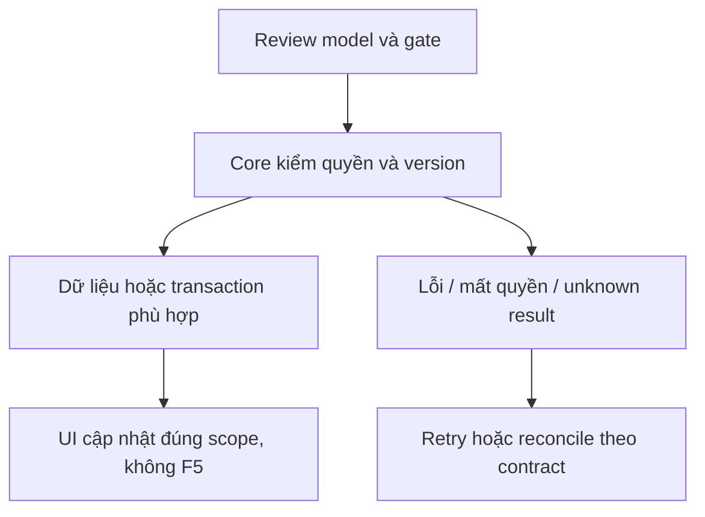

# CP03 — Panel Staff Copilot

04/11/2026 · **P, sau CP02** · [Contract](../08-copilot-contract.md) · [Chung](../00-staff-contract.md).

## 1. Phạm vi và điều kiện bắt đầu

Panel bên chat đúng mẫu repo UI; tra cứu/giải thích/tóm tắt/citations. Phạm vi xác nhận 06/11/2026 không có soạn nháp câu trả lời hoặc Use draft.

## 2. Model và vị trí thay đổi

`staff-copilot-panel.tsx`, `lib/copilot-api.ts`, rail trong `staff-inbox.tsx`, composer; giữ mounted transcript/PDF và per-source memory scoped actor.

## 3. API spec và quyền

Prefix REST `/api/v1`; mọi API trong phase này là **P** trừ API nền được dẫn rõ là E. Quyết định kỹ thuật đề xuất phải review trước code; không sửa schema chỉ từ file plan.

Dùng A24–26/task lookup sau khi CP01 chốt contract. Mở citations qua Core exact version, không URL do LLM tự cấp. Kết quả chỉ ở panel nội bộ; không đưa vào composer hoặc gọi A12.

## 4. Luồng thực hiện

Rail mở panel → source header → history/quick prompts/task state → answer+watermark+citation. Pending source không enable. Đóng/mở/chuyển cuộc giữ đúng scope, không lẫn context; loading/Agent outage/retry/quota/cancel có UI. Revoke xóa nội dung ngoài quyền; không tự gửi Customer. Chính sách task khi logout/hết phiên chờ G3.

## 5. Test cần có

Browser DOM tests keyboard/Escape/focus375px/200%, no-F5, không có Use draft, composer giữ nguyên, stale source/late task, citations denied. E2E thật đủ grant hỏi AI → đọc kết quả nội bộ; assert không thêm tin vào chat Customer. Không screenshot.

## 6. Gate hoàn tất

- [ ] Model/API/quyền/điểm còn mở đã review trước code phụ thuộc.
- [ ] Tests đúng lớp pass; HTTP/mock/browser E2E thật được phân biệt.
- [ ] Scope/phiên/late-response/concurrency/error và no-F5 được kiểm tương ứng.
- [ ] Cập nhật API map/checklist theo code thật, cleanup fixture/artifact; không tự commit.

CP03 không làm trong đợt Staff trước Agent. Sau CP03 mới nghiệm thu CP04/Agent E2E; mock UI không thay chứng cứ AI.
