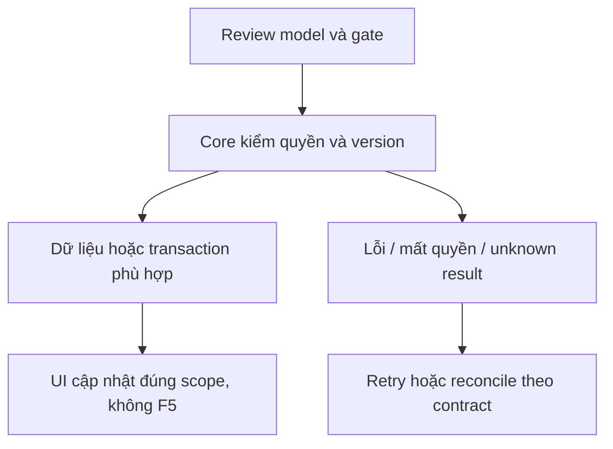
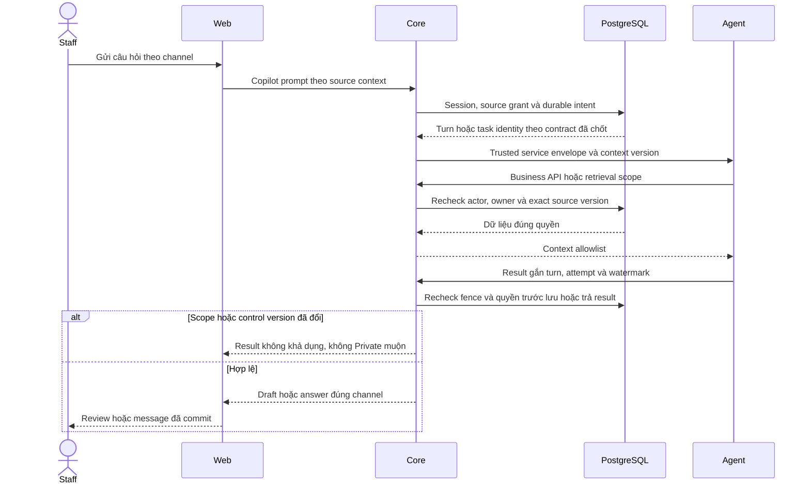

# CP03 — Panel Staff Copilot

04/11/2026 · **P, sau CP02** · [Contract](../08-copilot-contract.md) · [Chung](../00-staff-contract.md).

## 1. Phạm vi và điều kiện bắt đầu

Panel bên chat đúng mẫu repo UI; hỏi/tóm tắt/Use draft/citations, không độc lập thay Inbox.

## 2. Model và vị trí thay đổi

`staff-copilot-panel.tsx`, `lib/copilot-api.ts`, rail trong `staff-inbox.tsx`, composer; giữ mounted transcript/PDF và per-source memory scoped actor.

## 3. API spec và quyền

Prefix REST `/api/v1`; mọi API trong phase này là **P** trừ API nền được dẫn rõ là E. Quyết định kỹ thuật đề xuất phải review trước code; không sửa schema chỉ từ file plan.

Dùng A24–26/task lookup đã chốt. Mở citations qua Core exact version, không URL do LLM tự cấp. Use draft là FE action, không A12; Staff tự Send sau review. Có nháp cũ phải confirm overwrite hoặc append lựa chọn rõ.

## 4. Luồng thực hiện

Rail mở panel → source header → history/quick prompts/task state → answer+watermark+citation. Pending source không enable. Đóng/mở/chuyển cuộc giữ đúng scope, không lẫn context; loading/Agent outage/retry/quota/expired/cancel có UI. Revoke xóa panel và draft gợi ý, không tự gửi Customer.

## 5. Test cases

Các ca dưới đây là **kịch bản dự kiến**, chỉ thực thi sau dependency/contract đã chốt trong phần phạm vi; không đánh dấu chức năng đã có.

**Quy ước dữ liệu:** S-A/S-B là hai Staff synthetic; C-A/C-B là hai Customer synthetic khác nhau. Thay alias bằng UUID/token của fixture cô lập; các path HTTP dùng prefix /api/v1 nếu chưa ghi đầy đủ. Chỉ thay assignment, khóa account, inject lỗi hoặc migration trong harness/môi trường test, không trên tài khoản/dữ liệu đang sử dụng.

### CP03-T01 — Use draft không tự Send

**Lớp kiểm thử:** Browser dự kiến.
**Điều kiện và dữ liệu:** CP02 result hợp lệ; composer Staff đang có nháp D0.

**Các bước:**

1. Mở Copilot, lấy draft D1.
2. Chọn Use draft và review lựa chọn overwrite/append nếu có.
3. Chỉnh văn bản rồi chủ động Send.

**Kết quả mong đợi:** Không mất D0 âm thầm; Use draft không gọi A12; Customer chỉ nhận văn bản Staff thực sự Send.

### CP03-T02 — Citations đúng version và scope

**Lớp kiểm thử:** Browser + API dự kiến.
**Điều kiện và dữ liệu:** Draft có citation applied v1 và fixture forged/out-of-scope.

**Các bước:**

1. Bấm citation hợp lệ qua Core.
2. Bấm citation ngoài quyền hoặc revoke source.
3. Đổi cuộc chat trong khi request citation pending.

**Kết quả mong đợi:** Chỉ exact version được cấp; denied không mở file; response nguồn cũ không ghi đè source mới.

### CP03-T03 — Keyboard/mobile và late task

**Lớp kiểm thử:** Browser dự kiến.
**Điều kiện và dữ liệu:** Panel mở tại375px/zoom 200%, task A đang pending.

**Các bước:**

1. Tab qua prompt/draft/citations, Escape đóng rồi mở lại.
2. Đổi source sangB.
3. Trả taskA muộn hoặc401.

**Kết quả mong đợi:** Focus trở về control mở, không tràn; draft/taskA không lẫnB;401 clear Private, không F5.

**Dọn sau kiểm thử:** xóa đúng fixture/session/object/schema theo runId; phục hồi fault injection và đóng context/socket test. Không reset DB/credential, sửa bootstrap hoặc xóa volumes. Với PDF kiểm metadata/bytes/hash; với UI kiểm DOM/focus/network, không cần screenshot.

## 6. Gate hoàn tất

- [ ] Model/API/quyền/điểm còn mở đã review trước code phụ thuộc.
- [ ] Tests đúng lớp pass; HTTP/mock/browser E2E thật được phân biệt.
- [ ] Scope/phiên/late-response/concurrency/error và no-F5 được kiểm tương ứng.
- [ ] Cập nhật API map/checklist theo code thật, cleanup fixture/artifact; không tự commit.

CP03 không làm trong đợt Staff trước Agent. Sau CP03 mới nghiệm thu CP04/Agent E2E; mock UI không thay chứng cứ AI.

## Sequence diagram

**Luồng dự kiến:** chỉ áp dụng sau khi các dependency và API ở phần phạm vi được chốt.

