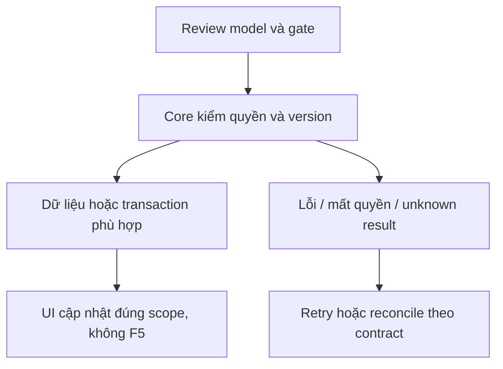

# CP04 — Nghiệm thu Agent/Copilot

04/11/2026 · **P, đợt Agent sau** · [Contract](../08-copilot-contract.md) · [Chung](../00-staff-contract.md).

## 1. Phạm vi và điều kiện bắt đầu

CP01–03 + I07 nếu kiểm Ticket; không chặn phần Staff không Agent.

## 2. Model và vị trí thay đổi

Test harness provider/Agent/Core/Web qua Docker; fixtures synthetic approved, traces tối thiểu an toàn; provider credentials ngoài source/log.

## 3. API spec và quyền

Prefix REST `/api/v1`; mọi API trong phase này là **P** trừ API nền được dẫn rõ là E. Quyết định kỹ thuật đề xuất phải review trước code; không sửa schema chỉ từ file plan.

Dùng APIs thật và trusted task identity. Case hỏi kiến thức PUBLIC, policy PRIVATE đúng quyền, thiếu bằng chứng, summary watermark, Use draft, revoke giữa execution, provider timeout. Ticket draft/confirmation theo I07 và Customer T01/T02, không tự tạo từ Copilot.

## 4. Luồng thực hiện

Staff → Core → Agent → scoped tools/retrieval → internal answer → Staff review/send. Customer AI transcript/citation boundary độc lập; aiSummary không tự thành confirmedContent.

## 5. Test cần có

Đề xuất copilot-flow.integration.spec.mjs; assert source/version/citation IDs, task replay không duplicate, Customer không thấy internal, revoke không trả Private. Báo runtime/provider/model used không secret, phân biệt benchmark transport/LLM/storage. Không ảnh/report.md tự tạo.

## 6. Gate hoàn tất

- [ ] Model/API/quyền/điểm còn mở đã review trước code phụ thuộc.
- [ ] Tests đúng lớp pass; HTTP/mock/browser E2E thật được phân biệt.
- [ ] Scope/phiên/late-response/concurrency/error và no-F5 được kiểm tương ứng.
- [ ] Cập nhật API map/checklist theo code thật, cleanup fixture/artifact; không tự commit.

Chỉ đánh dấu FR-007/012/Agent boundary sau E2E thật có scope. Không gộp checkpoint write và Ticket commit.

