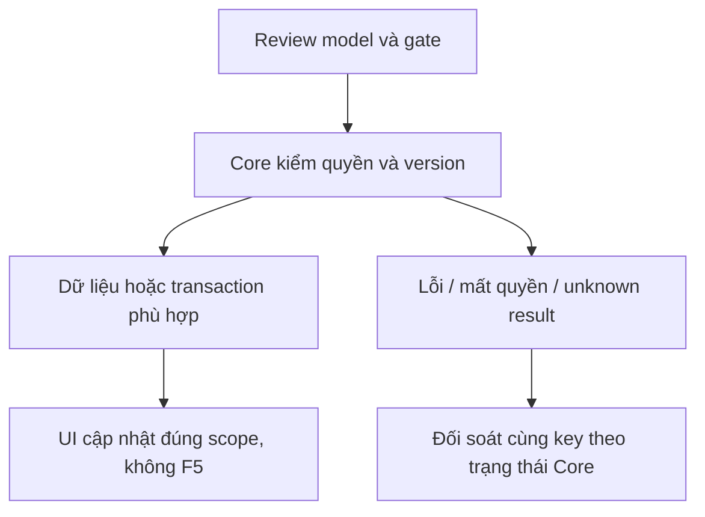
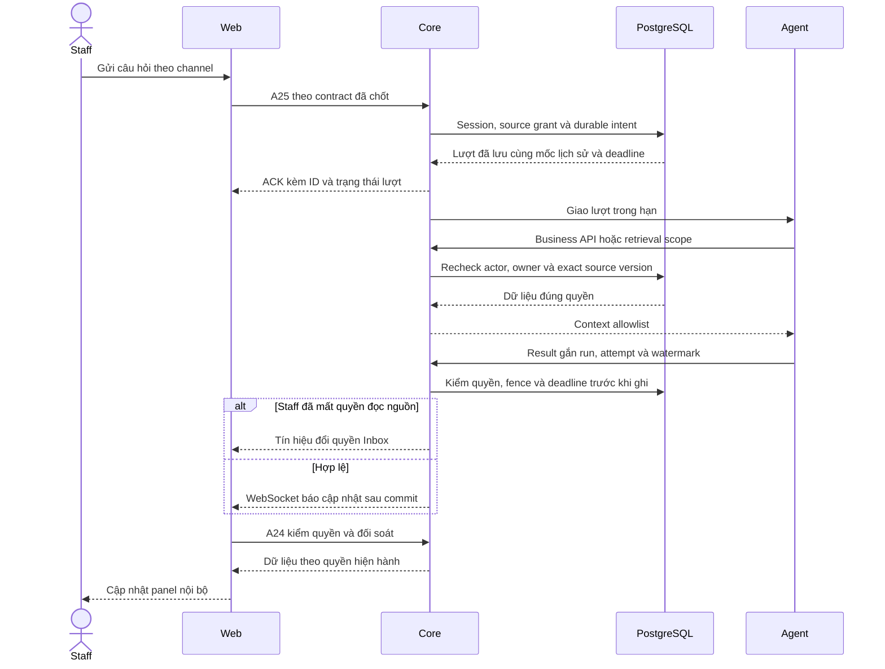

# CP04 — Nghiệm thu Agent/Copilot

23/11/2026 · **P, nghiệm thu Staff Inbox qua Core–Agent thật** · [Contract](../08-copilot-contract.md) · [Chung](../00-staff-contract.md).

**Phạm vi bàn giao:** kiểm Copilot độc lập qua gateway với Core và Agent thật. Chạy hồi quy chat Customer theo [CH02](../../../customer/plans/chat/02-agent-boundary.md#quyết-định-triển-khai-đã-chốt) nếu thay history builder, dispatcher, callback hoặc gate dùng chung.

## Bổ sung bảo vệ dữ liệu Customer — 12/11/2026

**Chính sách thông tin liên hệ:** [Ma trận dữ liệu chung](../../../../configuration-and-data.md#customer-sensitive-data) quy định che email/phone Customer mặc định và Hiện/Ẩn sau kiểm quyền Core. Phase 1 đã triển khai tại Customers; DTO Customer ở Policy/Inbox/Ticket hiện chỉ có tên/mã, không có contact card raw. Quy định này không thay quyền đọc PDF/transcript hoặc trạng thái triển khai của chức năng trong plan.

**MVP B:** sáu quy tắc system prompt và dữ liệu synthetic; quyền/scope/fence và schema theo contract. [Quyết định chuẩn](../../../../specifications/Agent_Design.md#mvp-model-data-policy).

## Data model và phạm vi ảnh hưởng

Bảng bên dưới mô tả tác động của phase, gồm cả ghi gián tiếp qua Core. Tên bảng thuộc schema `business` trừ nơi ghi rõ; cột còn đề xuất được đánh dấu **P**. Web không truy cập DB trực tiếp.

| Bảng/model | Cột hoặc dữ liệu liên quan | Thao tác của phase | Quan hệ/ràng buộc cần giữ | Mức ảnh hưởng và nơi bị tác động |
| --- | --- | --- | --- | --- |
| users + auth_sessions | users.id/role/status, auth_sessions.user_id/token_hash/expires_at/revoked_at | Đọc | AuthSession.user_id → User.id; session phải còn hạn, không bị thu hồi | Cao — mọi API dùng session; không trả token/hash trong DTO |
| staff_assignments + customer_profiles + staff_profiles | staff_id/customer_id/is_active/ended_at, assignment_version, user_id/full_name | Đọc | Assignment gắn đúng Customer/Staff; Inbox còn ràng buộc assignment id cụ thể | Cao — Customers, Policy Lookup, Ticket và Inbox cùng phụ thuộc phân công |
| conversations + conversation_handoffs | customer_id/channel_type/support_origin/direct_assignment_id/assigned_staff_id/status/control_version/subject, state/assignment_id/recipient_staff_id/shared_subject/shared_reason/accepted_at/revoked_at | Đọc | Gate transcript chung theo CP01. Runtime mở Direct/Accepted; thiết kế 23/11 mở theo phân công hiện hành | Cao — Inbox filter/deep link/REST/WS phải cùng gate; không suy grant từ status/assigned_staff_id |
| insurance_policies + insurance_products | customer_id/product_id/policy_number/status, premium_amount/payment_frequency/next_due_date, effective_date/expiry_date/sum_assured/benefits_snapshot, product_code/name | Đọc | Policy.customer_id → CustomerProfile.user_id; product_id → InsuranceProduct.id; unique policy_number | Cao — DTO tiền/ngày/snapshot dùng chung Staff/Customer; không OCR PDF để cập nhật DB |
| documents + document_versions | access_scope/policy_id/owner_customer_id/product_id/current_version, document_id/version_number/is_active/checksum_sha256/storage_bucket/storage_object_key | Đọc | FK (policy_id,owner_customer_id) → Policy(id,customer_id); unique (document_id,version_number); policy dùng exact binding trong benefits_snapshot, Products dùng current_version | Cao — đổi version/scope ảnh hưởng viewer, download và nguồn retrieval; bucket/key không ra DTO |
| conversations + messages | channel_type/assigned_staff_id/customer_id/linked_context_conv_id/linked_policy_id/control_version; messages.audience/sequence/citations/tool_calls_metadata | P — tạo/append nội bộ Copilot, nền cột đã có | STAFF_COPILOT gắn source có transcript grant; INTERNAL không xuất Customer; cần chốt uniqueness theo Staff/source trước migration | Cao — không dùng grant của Staff trước reassignment, không append trực tiếp Customer answer từ Copilot |
| agent_runs + agent_attempts + agent_run_events | run/attempt, linked_history_view, status/result, event receipt | Có nền Core; P nối từ Staff | Dùng lifecycle hiện có và checkpoint riêng của Agent | Cao — retry/revoke/late callback |

**Schema/migration:** rà ràng buộc owner/chat nguồn và dữ liệu legacy theo CP01. Run/attempt/event và checkpoint đã có.

**Nhất quán và hồi quy:** Core recheck source/current grant ở enqueue/tool/return; UI không gửi draft thay Staff. Kiểm toàn bộ source lifecycle/Private citation exact version/INTERNAL isolation và stale task theo test của phase. Không mở rộng quyền từ model output.

## 1. Phạm vi và điều kiện bắt đầu

CP01–03 + I07 nếu kiểm Ticket; không chặn phần Staff không Agent.

## 2. Model và vị trí thay đổi

Test harness provider/Agent/Core/Web qua Docker; fixtures synthetic approved, traces tối thiểu an toàn; provider credentials ngoài source/log.

| Vị trí từ root repo | Hiện trạng | Trách nhiệm trong phase | Mức ảnh hưởng | Phạm vi cần kiểm lại |
| --- | --- | --- | --- | --- |
| [apps/core/src/conversations/services/conversation-access.service.ts](<../../../../../apps/core/src/conversations/services/conversation-access.service.ts>) | Hiện có | Hiện có source grant; P adapter Copilot phải gọi lại | Cao | REST/WS transcript và source reassignment |
| [apps/core/src/conversations/conversations.module.ts](<../../../../../apps/core/src/conversations/conversations.module.ts>) | Hiện có | Hiện có module; Copilot controller/task adapter còn P | Cao | Không mở public endpoint giả quyền |
| [apps/agent/](<../../../../../apps/agent>) | Hiện có | Owner phần Agent/checkpoint; chỉ ranh giới cần phối hợp, không triển khai trong đợt tài liệu này | Cao | Service identity, scope tools, durable attempt |
| `apps/web/src/components/staff-copilot-panel.tsx` | Dự kiến — chưa có file | P — panel/history/task/citation theo actor/source | Trung bình | Inbox transcript và composer giữ mounted |
| `apps/web/src/lib/copilot-api.ts` | Dự kiến — chưa có file | P — task/read DTO sau chốt CP01 | Cao | Không gọi provider/Agent trực tiếp từ browser |

## 3. API spec và quyền

Prefix REST `/api/v1`; mọi API trong phase này là **P** trừ API nền được dẫn rõ là E. Quyết định kỹ thuật đề xuất phải review trước code; không sửa schema chỉ từ file plan.

Dùng APIs thật và trusted task identity. Case hỏi kiến thức PUBLIC, policy PRIVATE đúng quyền, thiếu bằng chứng, summary watermark, từ chối yêu cầu soạn nháp Customer, revoke giữa execution, provider timeout. Ticket draft/confirmation theo I07 và Customer T01/T02, không tự tạo từ Copilot.

## 4. Luồng thực hiện

Staff → Core → Agent → scoped tools/retrieval → internal answer → Staff đọc kết quả. Không thay composer hoặc thêm tin Customer. Customer AI transcript/citation boundary độc lập; aiSummary không tự thành confirmedContent.

## 5. Test cases

Các ca dưới đây là **kịch bản dự kiến**, chỉ thực thi sau dependency/contract đã chốt trong phần phạm vi; không đánh dấu chức năng đã có.

**Quy ước dữ liệu:** S-A/S-B là hai Staff synthetic; C-A/C-B là hai Customer synthetic khác nhau. Thay alias bằng UUID/token của fixture cô lập; các path HTTP dùng prefix /api/v1 nếu chưa ghi đầy đủ. Chỉ thay assignment, khóa account, inject lỗi hoặc migration trong harness/môi trường test, không trên tài khoản/dữ liệu đang sử dụng.

### CP04-T01 — PUBLIC, PRIVATE và thiếu bằng chứng

**Lớp kiểm thử:** Agent E2E dự kiến.
**Điều kiện và dữ liệu:** Agent thật đã cấu hình theo contract; corpus synthetic Public và policyA applied v1; S-A đủ grant.

**Các bước:**

1. Hỏi câu Public rồi câu chỉ có trong policyA.
2. Hỏi dữ liệu policyB ngoài quyền.
3. Hỏi một dữ kiện không có trong corpus.

**Kết quả mong đợi:** Source/version đúng, deny Private khác; thiếu căn cứ được thừa nhận, không bịa citation/Claim/payment.

### CP04-T02 — Kết quả Copilot chỉ nội bộ

**Lớp kiểm thử:** Browser + Agent E2E dự kiến.
**Điều kiện và dữ liệu:** S-A có quyền transcript của cuộc C-A đã Accept; Agent thật trả kết quả tra cứu/giải thích/tóm tắt. Composer Staff có nháp D0.

**Các bước:**

1. Staff hỏi Copilot và nhận kết quả nội bộ.
2. Kiểm panel không có Use draft, composer vẫn là D0.
3. Gửi lại callback cùng event và quan sát lịch sử/event hai phía.

**Kết quả mong đợi:** Customer không thấy nội dung/tác vụ Copilot; không gọi A12 hoặc thêm tin Customer-facing. D0 giữ nguyên, callback không tạo kết quả trùng; không có luồng soạn nháp Customer trong MVP.

### CP04-T03 — Revoke và provider outage

**Lớp kiểm thử:** Agent E2E barrier dự kiến.
**Điều kiện và dữ liệu:** Agent task đang chạy, result được giữ; có fixture provider timeout.

**Các bước:**

1. Revoke source trong lúc inference.
2. Cho result/tool callback tiếp tục.
3. Ở task khác mô phỏng timeout giao nhận rồi đối soát/gửi lại cùng key. Với lỗi provider/hết deadline đã kết thúc FAILED, kiểm reload/reconcile không tự chạy lại task.

**Kết quả mong đợi:** Không trả result Private muộn; durable task không mất/trùng; kết quả test thật phân biệt adapter giả, không ghi prompt/secret.

**Dọn sau kiểm thử:** xóa đúng fixture/session/object/schema theo runId; phục hồi fault injection và đóng context/socket test. Không reset DB/credential, sửa bootstrap hoặc xóa volumes. Với PDF kiểm metadata/bytes/hash; với UI kiểm DOM/focus/network, không cần screenshot.

## 6. Gate hoàn tất

- [ ] Model/API/quyền/điểm còn mở đã review trước code phụ thuộc.
- [ ] Tests đúng lớp pass; HTTP/mock/browser E2E thật được phân biệt.
- [ ] Scope/phiên/late-response/concurrency/error và no-F5 được kiểm tương ứng.
- [ ] Cập nhật API map/checklist theo code thật, cleanup fixture/artifact; không tự commit.

Chỉ đánh dấu FR-007/012/Agent boundary sau E2E thật có scope. Không gộp checkpoint write và Ticket commit.

### CP04-T04 — Copilot tiếp tục sau logout/hết phiên

**P — chưa chạy.** Staff gửi câu hỏi Copilot rồi logout hoặc hết phiên. Cho task tiếp tục và lưu kết quả, login lại cùng Staff và biến thể Staff khác, revoke assignment/source trong lúc đang xử lý.

**Kết quả mong đợi.** Task đã nhận tiếp tục theo quyền nguồn hiện hành, panel/WS/API phiên cũ không nhận Private. Login lại đúng Staff đọc task/history sau reauthorize, không tạo task trùng. Staff khác hoặc source đã revoke không được xem kết quả, callback cũ không mở lại dữ liệu ngoài quyền. Kiểm cùng CH02-T08/AU03-T05.

### CP04-T05 — Làm rõ hợp đồng theo câu hỏi Staff

**P — chưa chạy.** Fixture synthetic có hai hợp đồng P1/P2 cùng Customer và một hợp đồng khác Customer. Mở PDF P2, gửi câu hỏi mơ hồ trong ngữ cảnh chưa xác định hợp đồng, rồi hỏi rõ P2. Giữ task P1 đến sau lượt P2 và thử mã hợp đồng ngoài scope.

**Kết quả mong đợi.** Mở PDF không đổi linkedPolicy/controlVersion hoặc tự cấp scope. Câu mơ hồ được hỏi lại, câu rõ P2 chỉ đọc nguồn Core cho phép. Task/citation cũ giữ view P1, không bị gắn thành P2. Hợp đồng ngoài Customer/grant bị chặn.

### CP04-T06 — Nguồn đang mở và lịch sử cố định theo lượt

**Điều kiện:** một Customer có hai chat đủ quyền với dữ kiện phân biệt được, chat A có nhiều trang tin và xen dữ liệu legacy/nội bộ. Có thể giữ callback của một câu AI cũ chưa commit.

1. Mở A, bật Copilot và hỏi điều đã nói trong A. Sau khi Core nhận yêu cầu, thêm tin mới rồi cho callback AI cũ commit. Đọc tiếp các trang và mô phỏng resume cùng run.
2. Hỏi lại bằng lượt mới. Chuyển sang B khi response A còn pending, rồi thử Staff ngoài quyền nguồn.

**Kỳ vọng:** lần đầu dùng nội dung Customer-facing đã commit ở mốc nhận câu hỏi, gồm câu AI đã hiển thị; bỏ nội bộ/legacy chưa phân loại và phần commit muộn. Lượt sau thấy nội dung mới. Response A không xuất hiện ở B. Staff ngoài quyền không đọc được history hoặc kết quả.

### CP04-T07 — Giao nhận trạng thái Copilot

Kiểm hoàn tất, lỗi và hủy lượt qua WebSocket sau commit. Mô phỏng mất ACK sau khi Core nhận A25, sự kiện hoàn tất đến trước ACK, mất kết nối lúc lưu kết quả, thông báo trùng hoặc sai thứ tự và Staff đổi chat. Retry A25 cùng UUID trả đúng lượt. A24 sau reconnect trả trạng thái đã lưu cho đúng chat và ACK đến muộn không đưa panel về trạng thái đang xử lý. Customer, Staff khác và Staff đã mất quyền nguồn không nhận sự kiện Copilot hoặc đọc được kết quả. Rollback không phát sự kiện.

### CP04-T08 — Soạn câu tiếp theo khi đang xử lý

Giữ lượt A ở trạng thái chờ rồi đang chạy. Kiểm ô hỏi cho nhập, còn nút gửi và phím tắt gửi bị khóa. Hai tab gửi UUID khác nhau đồng thời chỉ tạo một lượt; replay UUID đã nhận trả cùng lượt. Khi A kết thúc và A24 xác nhận, Staff vẫn thấy nội dung đã soạn và có thể chủ động gửi.

### CP04-T09 — Tóm tắt từ đầu với chat dài

Tạo chat nhiều trang có dữ kiện riêng ở đầu, giữa và cuối trước mốc của lượt. Kiểm bản tóm tắt phản ánh cả ba đoạn khi Agent xử lý đủ. Chạy lại với giới hạn xử lý hoặc lỗi đọc làm thiếu một đoạn. Copilot báo chưa thể tóm tắt từ đầu và đề nghị thu hẹp phạm vi. Kiểm yêu cầu tóm tắt mặc định vẫn dùng diễn biến gần.

### CP04-T10 — Đổi quyền khi panel đang đọc kết quả

Giữ phản hồi A24 cũ rồi đổi Staff phụ trách. Khi nhận tín hiệu đổi quyền của Inbox, panel ẩn dữ liệu và bỏ qua phản hồi cũ. A24 mới bị từ chối với chat đã mất quyền. Lặp lại khi đổi quyền ở chat khác và xác nhận panel hiện lại dữ liệu sau khi A24 kiểm quyền thành công.

### CP04-T11 — Đồng bộ lại checkpoint dùng mốc cũ

Khôi phục checkpoint thiếu phiên bản hoặc dùng phiên bản mốc cũ. Kiểm Agent đọc lại theo trang đến đúng mốc của lượt, không bỏ sót hoặc lặp tin. Mô phỏng lỗi giữa các trang và kiểm checkpoint chưa đánh dấu đồng bộ hoàn tất. Sau khi đồng bộ thành công, lượt kế tiếp chỉ đọc phần mới. Kiểm cả trường hợp lượt đã tiếp nhận trước khi nâng cấp để cursor mới không diễn giải lại mốc cũ.

### CP04-T12 — Mở lần đầu, gửi đồng thời và được phân công lại

A24 trả lịch sử rỗng cho Staff có quyền và chưa tạo thread. Hai tab gửi đồng thời chỉ tạo một thread và một lượt. Kiểm ba kết quả của A25 cho replay đúng payload, UUID cũ với payload khác và UUID mới khi lượt đang chạy. Đổi phân công từ Staff A sang B rồi về A. Khi quyền đọc được cấp lại, A xem thread cũ của mình với lượt đã hủy giữ nguyên trạng thái. B giữ thread riêng.

### CP04-T13 — Cấp lại quyền khi Agent chưa xác nhận dừng

Hủy lượt A khi thu hồi quyền, giữ phản hồi xác nhận dừng của Agent, rồi cấp lại quyền đọc cho cùng Staff. Gửi lượt B và kiểm Core lưu `QUEUED` cùng deadline, panel hiện “Đang chờ” và B chưa được gọi tới Agent. Khi xác nhận dừng đến trong hạn, B chỉ dùng thời gian còn lại sau khi Core kiểm quyền. Khởi động lại Core trong lúc chờ và kiểm deadline giữ nguyên. Nếu hết hạn trước, B chuyển `FAILED`, panel nhận tín hiệu cập nhật và xác nhận đến muộn không khởi chạy B. A giữ `CANCELLED` ở cả hai nhánh.

Kiểm claim cạnh deadline và callback đến sau deadline nhưng trước khi bộ đối soát quét lượt. Kết quả đến muộn không thể chuyển B sang thành công. Chạy hồi quy luồng Customer khi sửa dispatcher hoặc bộ đối soát dùng chung.

### CP04-T14 — Gửi lại câu cũ khi có lượt mới đang chạy

Cho lượt A hoàn tất và lượt B đang chạy. Gửi lại A qua A25 với cùng UUID và payload. Kiểm phản hồi trả ID và trạng thái hiện tại của A. Gửi lại UUID của A với payload khác thì nhận lỗi xung đột. B tiếp tục xử lý và chỉ có hai lượt trong lịch sử.

## Sequence diagram

**Luồng dự kiến:** chỉ áp dụng sau khi các dependency và API ở phần phạm vi được chốt.

