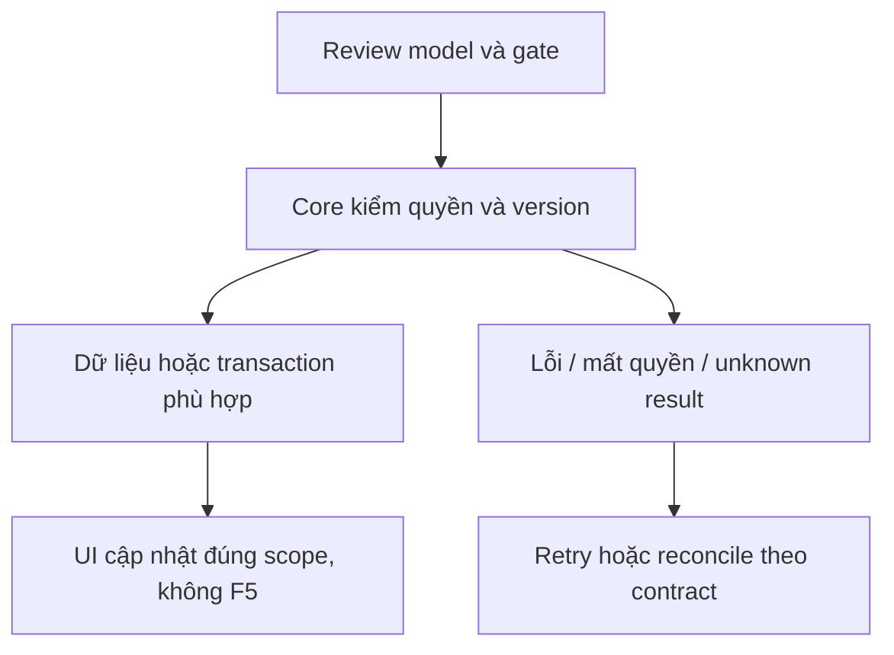

# CP04 — Nghiệm thu Agent/Copilot

04/11/2026 · **P, đợt Agent sau** · [Contract](../08-copilot-contract.md) · [Chung](../00-staff-contract.md).

## 1. Phạm vi và điều kiện bắt đầu

CP01–03 + I07 nếu kiểm Ticket; không chặn phần Staff không Agent.

## 2. Model và vị trí thay đổi

Test harness provider/Agent/Core/Web qua Docker; fixtures synthetic approved, traces tối thiểu an toàn; provider credentials ngoài source/log.

## 3. API spec và quyền

Prefix REST `/api/v1`; mọi API trong phase này là **P** trừ API nền được dẫn rõ là E. Quyết định kỹ thuật đề xuất phải review trước code; không sửa schema chỉ từ file plan.

Dùng APIs thật và trusted task identity. Case hỏi kiến thức PUBLIC, policy PRIVATE đúng quyền, thiếu bằng chứng, summary watermark, từ chối yêu cầu soạn nháp Customer, revoke giữa execution, provider timeout. Ticket draft/confirmation theo I07 và Customer T01/T02, không tự tạo từ Copilot.

## 4. Luồng thực hiện

Staff → Core → Agent → scoped tools/retrieval → internal answer → Staff đọc kết quả. Không thay composer hoặc thêm tin Customer. Customer AI transcript/citation boundary độc lập; aiSummary không tự thành confirmedContent.



## 5. Test cases

Các ca dưới đây là **kịch bản dự kiến**, chỉ thực thi sau dependency/contract đã chốt trong phần phạm vi; không đánh dấu chức năng đã có.

**Quy ước dữ liệu:** S-A/S-B là hai Staff synthetic; C-A/C-B là hai Customer synthetic khác nhau. Thay alias bằng UUID/token của fixture cô lập; các path HTTP dùng prefix /api/v1 nếu chưa ghi đầy đủ. Chỉ thay assignment, khóa account, inject lỗi hoặc migration trong harness/môi trường test, không trên tài khoản/dữ liệu đang sử dụng.

### CP04-T01 — PUBLIC, PRIVATE và thiếu bằng chứng

**Lớp kiểm thử:** Agent E2E dự kiến.
**Điều kiện và dữ liệu:** Agent thật đã cấu hình theo contract; corpus synthetic Public và policyA applied v1; S-A đủ grant.

**Các bước:**

1. Hỏi câu Public rồi câu chỉ có trong policyA.
2. Hỏi dữ liệu policyB ngoài quyền.
3. Hỏi một dữ kiện không có trong corpus.

**Kết quả mong đợi:** Source/version đúng, deny Private khác; thiếu căn cứ được thừa nhận, không bịa citation/Claim/payment.

### CP04-T02 — Kết quả Copilot chỉ nội bộ

**Lớp kiểm thử:** Browser + Agent E2E dự kiến.
**Điều kiện và dữ liệu:** S-A có quyền transcript của cuộc C-A đã Accept; Agent thật trả kết quả tra cứu/giải thích/tóm tắt. Composer Staff có nháp D0.

**Các bước:**

1. Staff hỏi Copilot và nhận kết quả nội bộ.
2. Kiểm panel không có Use draft, composer vẫn là D0.
3. Gửi lại callback cùng event và quan sát lịch sử/event hai phía.

**Kết quả mong đợi:** Customer không thấy nội dung/tác vụ Copilot; không gọi A12 hoặc thêm tin Customer-facing. D0 giữ nguyên, callback không tạo kết quả trùng; không có luồng soạn nháp Customer trong MVP.

### CP04-T03 — Revoke và provider outage

**Lớp kiểm thử:** Agent E2E barrier dự kiến.
**Điều kiện và dữ liệu:** Agent task đang chạy, result được giữ; có fixture provider timeout.

**Các bước:**

1. Revoke source trong lúc inference.
2. Cho result/tool callback tiếp tục.
3. Ở task khác mô phỏng timeout rồi reconcile/retry.

**Kết quả mong đợi:** Không trả result Private muộn; durable task không mất/trùng; kết quả test thật phân biệt adapter giả, không ghi prompt/secret.

**Dọn sau kiểm thử:** xóa đúng fixture/session/object/schema theo runId; phục hồi fault injection và đóng context/socket test. Không reset DB/credential, sửa bootstrap hoặc xóa volumes. Với PDF kiểm metadata/bytes/hash; với UI kiểm DOM/focus/network, không cần screenshot.

## 6. Gate hoàn tất

- [ ] Model/API/quyền/điểm còn mở đã review trước code phụ thuộc.
- [ ] Tests đúng lớp pass; HTTP/mock/browser E2E thật được phân biệt.
- [ ] Scope/phiên/late-response/concurrency/error và no-F5 được kiểm tương ứng.
- [ ] Cập nhật API map/checklist theo code thật, cleanup fixture/artifact; không tự commit.

Chỉ đánh dấu FR-007/012/Agent boundary sau E2E thật có scope. Không gộp checkpoint write và Ticket commit.

## Sequence diagram

**Luồng dự kiến:** chỉ áp dụng sau khi các dependency và API ở phần phạm vi được chốt.

```mermaid
sequenceDiagram
    actor U as Staff
    participant W as Web
    participant C as Core
    participant D as PostgreSQL
    participant A as Agent
    U->>W: Gửi câu hỏi theo channel
    W->>C: A25 theo contract đã chốt
    C->>D: Session, source grant và durable intent
    D-->>C: Run/attempt theo contract đã chốt
    C->>A: Trusted service envelope và context version
    A->>C: Business API hoặc retrieval scope
    C->>D: Recheck actor, owner và exact source version
    D-->>C: Dữ liệu đúng quyền
    C-->>A: Context allowlist
    A->>C: Result gắn run, attempt và watermark
    C->>D: Recheck fence và quyền trước lưu hoặc trả result
    alt Scope hoặc control version đã đổi
        C-->>W: Result không khả dụng, không Private muộn
    else Hợp lệ
        C-->>W: Kết quả tra cứu/giải thích/tóm tắt nội bộ
        W-->>U: Đọc kết quả; không sửa composer hoặc gửi Customer
    end
```
