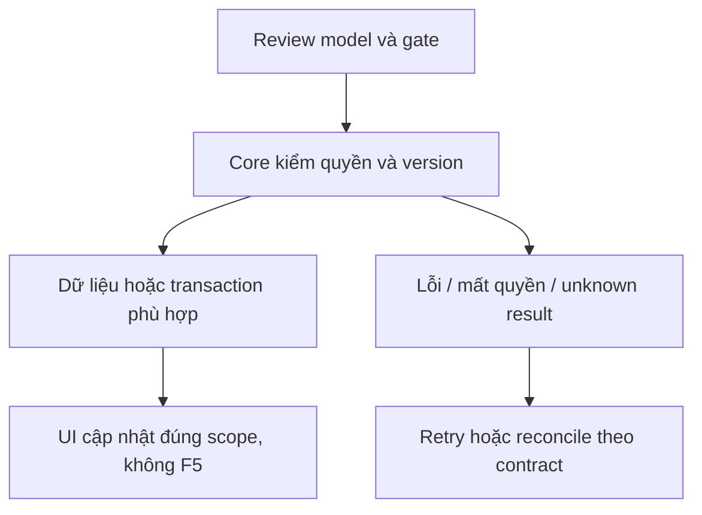
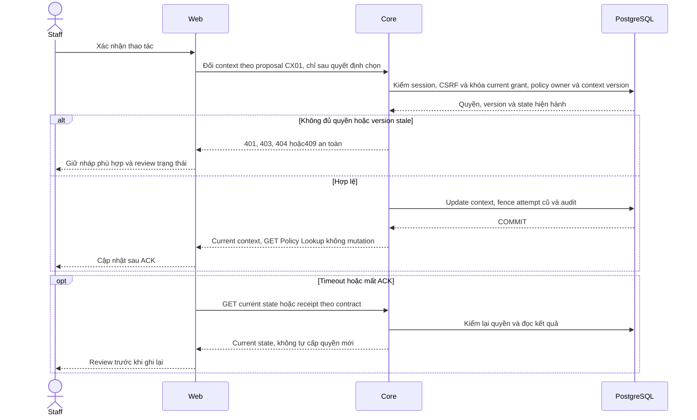

# CX01 — Đổi linkedPolicy/context chat nếu được chọn

04/11/2026 · **P, mở rộng chưa được chọn; hoãn Agent** · [Contract](../08-copilot-contract.md) · [Chung](../00-staff-contract.md).

## Bổ sung bảo vệ dữ liệu Customer — 12/11/2026

**P — chưa triển khai phần bảo vệ bổ sung; giữ trạng thái baseline của phase.** Theo [ma trận dữ liệu chung](../../../../configuration-and-data.md#customer-sensitive-data); mức che/quyền xem đầy đủ còn chờ chốt. Vị trí code/API và data model của phase bên dưới là nơi rà tác động; bổ sung này không tự yêu cầu migration hoặc sửa dữ liệu gốc.

**Thay đổi của phase:** Nếu chọn CX01, chuyển context/alias theo source mới và recheck owner/grant; không mang mapping/raw của Customer cũ. Không tự mở endpoint/migration từ yêu cầu masking.

**Kiểm thử cần bổ sung, chưa chạy:** Core/fake: đổi source khi task chạy không phát cached PII/output cũ, provenance đúng policy/version; CX01 vẫn chưa được chọn.

## Data model và phạm vi ảnh hưởng

Bảng bên dưới mô tả tác động của phase, gồm cả ghi gián tiếp qua Core. Tên bảng thuộc schema `business` trừ nơi ghi rõ; cột còn đề xuất được đánh dấu **P**. Web không truy cập DB trực tiếp.

| Bảng/model | Cột hoặc dữ liệu liên quan | Thao tác của phase | Quan hệ/ràng buộc cần giữ | Mức ảnh hưởng và nơi bị tác động |
| --- | --- | --- | --- | --- |
| users + auth_sessions | users.id/role/status, auth_sessions.user_id/token_hash/expires_at/revoked_at | Đọc | AuthSession.user_id → User.id; session phải còn hạn, không bị thu hồi | Cao — mọi API dùng session; không trả token/hash trong DTO |
| staff_assignments + customer_profiles + staff_profiles | staff_id/customer_id/is_active/ended_at, assignment_version, user_id/full_name | Đọc | Assignment gắn đúng Customer/Staff; Inbox còn ràng buộc assignment id cụ thể | Cao — Customers, Policy Lookup, Ticket và Inbox cùng phụ thuộc phân công |
| conversations + conversation_handoffs | customer_id/channel_type/support_origin/direct_assignment_id/assigned_staff_id/status/control_version/subject, state/assignment_id/recipient_staff_id/shared_subject/shared_reason/accepted_at/revoked_at | Đọc | Direct đúng assignment lúc tạo hoặc handoff ACCEPTED còn grant; PENDING chỉ shared metadata, không AI subject/transcript | Cao — Inbox filter/deep link/REST/WS phải cùng gate; không suy grant từ status/assigned_staff_id |
| insurance_policies + insurance_products | customer_id/product_id/policy_number/status, premium_amount/payment_frequency/next_due_date, effective_date/expiry_date/sum_assured/benefits_snapshot, product_code/name | Đọc | Policy.customer_id → CustomerProfile.user_id; product_id → InsuranceProduct.id; unique policy_number | Cao — DTO tiền/ngày/snapshot dùng chung Staff/Customer; không OCR PDF để cập nhật DB |
| conversations | linked_policy_id/customer_id/control_version | P — context mutation, chọn xem policy hiện tại chỉ đọc | Composite FK (linked_policy_id,customer_id) → Policy(id,customer_id), expected control version và transcript grant | Cao — đổi context fence mọi task cũ; không xóa nội dung/draft Ticket đã xác nhận |
| Copilot task/checkpoint — P, chưa có model task app | Dự kiến task id, owner, source, context watermark, state/attempt/lease/result | DDL/storage dự kiến, chưa chọn đầy đủ | Core giữ authorization/business fence; checkpoint Agent dùng store/credential riêng, không là transaction nghiệp vụ | Cao — retry/crash/revoke giữa enqueue/tool/return; không biến ConversationStatus thành task state |

**Schema/migration:** P — không thêm cột context chỉ vì mở Lookup; nếu cần command receipt/task fence mới phải đặc tả migration riêng.

**Nhất quán và hồi quy:** Mutation explicit theo actor/current owner/grant/version, không side effect từ GET. Kiểm foreign policy, stale context/attempt và không gắn lại Ticket snapshot.

## 1. Phạm vi và điều kiện bắt đầu

G02, liên quan UC-006/context Agent; mở trang policy đã có FR-008 không cần mutate context. Không blocker Staff không Agent.

## 2. Model và vị trí thay đổi

Conversation.linkedPolicyId/controlVersion, InsurancePolicy owner, access I01. Model/DTO/mutation contract chưa có endpoint, không suy từ action mở PDF.

| Vị trí từ root repo | Hiện trạng | Trách nhiệm trong phase | Mức ảnh hưởng | Phạm vi cần kiểm lại |
| --- | --- | --- | --- | --- |
| [apps/core/src/conversations/services/conversation-access.service.ts](<../../../../../apps/core/src/conversations/services/conversation-access.service.ts>) | Hiện có | Source grant trước đổi context | Cao | Staff/Customer source scope |
| [apps/core/src/policies/services/policy.service.ts](<../../../../../apps/core/src/policies/services/policy.service.ts>) | Hiện có | Policy ownership/assignment lookup | Cao | Xem policy hiện có vẫn readonly |
| `apps/web/src/components/staff-copilot-panel.tsx` | Dự kiến — chưa có file | P — panel/history/task/citation theo actor/source | Trung bình | Inbox transcript và composer giữ mounted |
| `apps/web/src/lib/copilot-api.ts` | Dự kiến — chưa có file | P — task/read/cancel DTO sau chốt CP01 | Cao | Không gọi provider/Agent trực tiếp từ browser |

## 3. API spec và quyền

Prefix REST `/api/v1`; mọi API trong phase này là **P** trừ API nền được dẫn rõ là E. Quyết định kỹ thuật đề xuất phải review trước code; không sửa schema chỉ từ file plan.

Chưa xuất bản API E. Nếu làm: đề xuất PATCH context ở Core với policyId nullable/expectedVersion/UUID intent; review operation receipt/Agent fence/role/ownership/linked source trước chốt path/DTO. GET policy A16 vẫn readonly. Policy phải đúng Customer cuộc và quyền actor; aiSummary/Ticket snapshot cũ không được rewrite.

## 4. Luồng thực hiện

User chủ động chọn đổi context → confirm nếu có task/nháp liên quan → Core current grant+version → mutation/fence+audit → Agent attempt context mới. Late result context cũ gắn watermark/loại theo contract. Không auto đổi chỉ vì click Policy Lookup.

## 5. Test cases

Các ca dưới đây là **kịch bản dự kiến**, chỉ thực thi sau dependency/contract đã chốt trong phần phạm vi; không đánh dấu chức năng đã có.

**Quy ước dữ liệu:** S-A/S-B là hai Staff synthetic; C-A/C-B là hai Customer synthetic khác nhau. Thay alias bằng UUID/token của fixture cô lập; các path HTTP dùng prefix /api/v1 nếu chưa ghi đầy đủ. Chỉ thay assignment, khóa account, inject lỗi hoặc migration trong harness/môi trường test, không trên tài khoản/dữ liệu đang sử dụng.

### CX01-T01 — Xem policy không tự đổi context

**Lớp kiểm thử:** Contract/Browser dự kiến.
**Điều kiện và dữ liệu:** Chỉ thực hiện phần mutation sau khi CX01 được chọn; cuộcA đang linkedPolicy=P1.

**Các bước:**

1. Mở Policy Lookup/PDF P2.
2. Đọc lại context cuộcA.
3. Chỉ khi có action đổi context rõ ràng mới xác nhận P2.

**Kết quả mong đợi:** Đọc PDF không mutation/context bump; chưa contract được duyệt thì không dựng endpoint/client flag để giả đã đổi.

### CX01-T02 — Owner, grant và expectedVersion

**Lớp kiểm thử:** API + DB dự kiến.
**Điều kiện và dữ liệu:** Mutation spec đã chốt; S-A có cuộc C-A, P2 cùng owner; P-B khác owner.

**Các bước:**

1. Đổi sangP2 bằng version hiện hành.
2. Thử P-B, Staff không grant và version cũ.
3. Thử clear policy=null nếu contract cho phép.

**Kết quả mong đợi:** Chỉ context cùng owner/current grant được đổi; foreign/stale bị chặn; null không mở rộng scope hoặc xóa Ticket snapshot.

### CX01-T03 — Fence task cũ và idempotency

**Lớp kiểm thử:** Agent/DB barrier dự kiến.
**Điều kiện và dữ liệu:** Task dùng contextP1 còn pending, UUID intent K cho đổi P2.

**Các bước:**

1. Đổi P2, retry cùngK.
2. Trả result taskP1 muộn.
3. Kiểm contextVersion/audit và citations.

**Kết quả mong đợi:** Một mutation đúng version; result cũ bị đánh dấu/bỏ theo contract, không gán nhầm citationP1 vàoP2 hoặc rewrite history.

**Dọn sau kiểm thử:** xóa đúng fixture/session/object/schema theo runId; phục hồi fault injection và đóng context/socket test. Không reset DB/credential, sửa bootstrap hoặc xóa volumes. Với PDF kiểm metadata/bytes/hash; với UI kiểm DOM/focus/network, không cần screenshot.

## 6. Gate hoàn tất

- [ ] Model/API/quyền/điểm còn mở đã review trước code phụ thuộc.
- [ ] Tests đúng lớp pass; HTTP/mock/browser E2E thật được phân biệt.
- [ ] Scope/phiên/late-response/concurrency/error và no-F5 được kiểm tương ứng.
- [ ] Cập nhật API map/checklist theo code thật, cleanup fixture/artifact; không tự commit.

CX01 chỉ triển khai sau yêu cầu chọn scope và CP01/Customer CH02 đồng bộ; không ghi là gap Must FR-008.

## Sequence diagram

**Luồng dự kiến:** chỉ áp dụng sau khi các dependency và API ở phần phạm vi được chốt.

