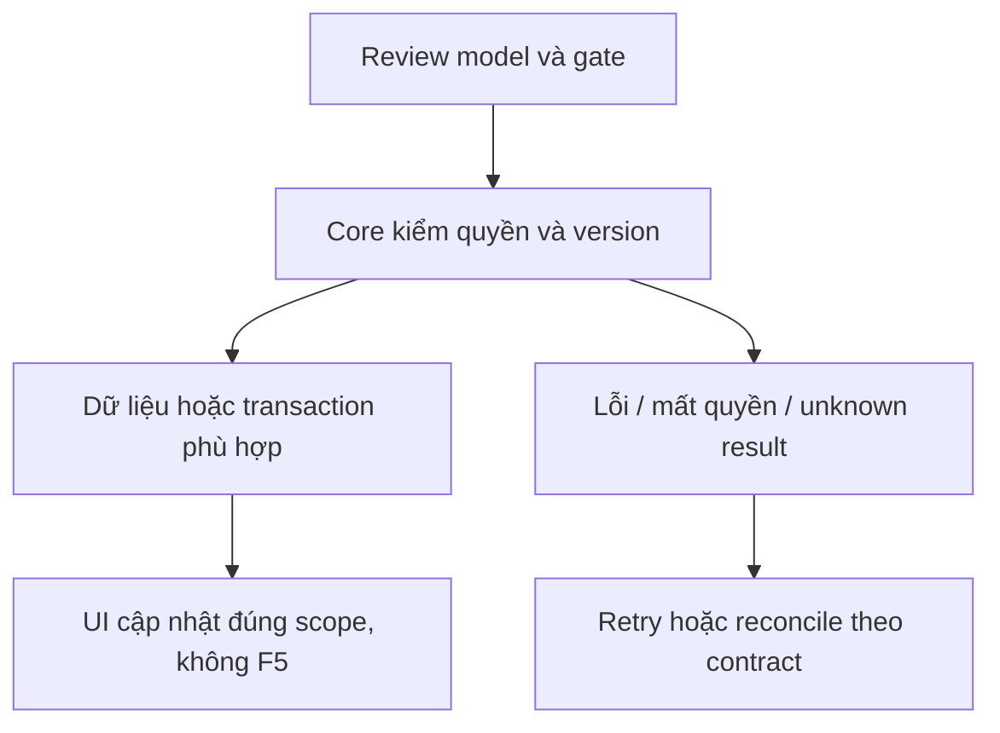

# CX01 — Đổi linkedPolicy/context chat nếu được chọn

04/11/2026 · **P, mở rộng chưa được chọn; hoãn Agent** · [Contract](../08-copilot-contract.md) · [Chung](../00-staff-contract.md).

## 1. Phạm vi và điều kiện bắt đầu

G02, liên quan UC-006/context Agent; mở trang policy đã có FR-008 không cần mutate context. Không blocker Staff không Agent.

## 2. Model và vị trí thay đổi

Conversation.linkedPolicyId/controlVersion, InsurancePolicy owner, access I01. Model/DTO/mutation contract chưa có endpoint, không suy từ action mở PDF.

## 3. API spec và quyền

Prefix REST `/api/v1`; mọi API trong phase này là **P** trừ API nền được dẫn rõ là E. Quyết định kỹ thuật đề xuất phải review trước code; không sửa schema chỉ từ file plan.

Chưa xuất bản API E. Nếu làm: đề xuất PATCH context ở Core với policyId nullable/expectedVersion/UUID intent; review operation receipt/Agent fence/role/ownership/linked source trước chốt path/DTO. GET policy A16 vẫn readonly. Policy phải đúng Customer cuộc và quyền actor; aiSummary/Ticket snapshot cũ không được rewrite.

## 4. Luồng thực hiện

User chủ động chọn đổi context → confirm nếu có task/nháp liên quan → Core current grant+version → mutation/fence+audit → Agent attempt context mới. Late result context cũ gắn watermark/loại theo contract. Không auto đổi chỉ vì click Policy Lookup.



## 5. Test cases

Các ca dưới đây là **kịch bản dự kiến**, chỉ thực thi sau dependency/contract đã chốt trong phần phạm vi; không đánh dấu chức năng đã có.

**Quy ước dữ liệu:** S-A/S-B là hai Staff synthetic; C-A/C-B là hai Customer synthetic khác nhau. Thay alias bằng UUID/token của fixture cô lập; các path HTTP dùng prefix /api/v1 nếu chưa ghi đầy đủ. Chỉ thay assignment, khóa account, inject lỗi hoặc migration trong harness/môi trường test, không trên tài khoản/dữ liệu đang sử dụng.

### CX01-T01 — Xem policy không tự đổi context

**Lớp kiểm thử:** Contract/Browser dự kiến.
**Điều kiện và dữ liệu:** Chỉ thực hiện phần mutation sau khi CX01 được chọn; cuộcA đang linkedPolicy=P1.

**Các bước:**

1. Mở Policy Lookup/PDF P2.
2. Đọc lại context cuộcA.
3. Chỉ khi có action đổi context rõ ràng mới xác nhận P2.

**Kết quả mong đợi:** Đọc PDF không mutation/context bump; chưa contract được duyệt thì không dựng endpoint/client flag để giả đã đổi.

### CX01-T02 — Owner, grant và expectedVersion

**Lớp kiểm thử:** API + DB dự kiến.
**Điều kiện và dữ liệu:** Mutation spec đã chốt; S-A có cuộc C-A, P2 cùng owner; P-B khác owner.

**Các bước:**

1. Đổi sangP2 bằng version hiện hành.
2. Thử P-B, Staff không grant và version cũ.
3. Thử clear policy=null nếu contract cho phép.

**Kết quả mong đợi:** Chỉ context cùng owner/current grant được đổi; foreign/stale bị chặn; null không mở rộng scope hoặc xóa Ticket snapshot.

### CX01-T03 — Fence task cũ và idempotency

**Lớp kiểm thử:** Agent/DB barrier dự kiến.
**Điều kiện và dữ liệu:** Task dùng contextP1 còn pending, UUID intent K cho đổi P2.

**Các bước:**

1. Đổi P2, retry cùngK.
2. Trả result taskP1 muộn.
3. Kiểm contextVersion/audit và citations.

**Kết quả mong đợi:** Một mutation đúng version; result cũ bị đánh dấu/bỏ theo contract, không gán nhầm citationP1 vàoP2 hoặc rewrite history.

**Dọn sau kiểm thử:** xóa đúng fixture/session/object/schema theo runId; phục hồi fault injection và đóng context/socket test. Không reset DB/credential, sửa bootstrap hoặc xóa volumes. Với PDF kiểm metadata/bytes/hash; với UI kiểm DOM/focus/network, không cần screenshot.

## 6. Gate hoàn tất

- [ ] Model/API/quyền/điểm còn mở đã review trước code phụ thuộc.
- [ ] Tests đúng lớp pass; HTTP/mock/browser E2E thật được phân biệt.
- [ ] Scope/phiên/late-response/concurrency/error và no-F5 được kiểm tương ứng.
- [ ] Cập nhật API map/checklist theo code thật, cleanup fixture/artifact; không tự commit.

CX01 chỉ triển khai sau yêu cầu chọn scope và CP01/Customer CH02 đồng bộ; không ghi là gap Must FR-008.

## Sequence diagram

**Luồng dự kiến:** chỉ áp dụng sau khi các dependency và API ở phần phạm vi được chốt.

```mermaid
sequenceDiagram
    actor U as Staff
    participant W as Web
    participant C as Core
    participant D as PostgreSQL
    U->>W: Xác nhận thao tác
    W->>C: Đổi context theo proposal CX01, chỉ sau quyết định chọn
    C->>D: Kiểm session, CSRF và khóa current grant, policy owner và context version
    D-->>C: Quyền, version và state hiện hành
    alt Không đủ quyền hoặc version stale
        C-->>W: 401, 403, 404 hoặc409 an toàn
        W-->>U: Giữ nháp phù hợp và review trạng thái
    else Hợp lệ
        C->>D: Update context, fence attempt cũ và audit
        D-->>C: COMMIT
        C-->>W: Current context; GET Policy Lookup không mutation
        W-->>U: Cập nhật sau ACK
    end
    opt Timeout hoặc mất ACK
        W->>C: GET current state hoặc receipt theo contract
        C->>D: Kiểm lại quyền và đọc kết quả
        C-->>W: Current state, không tự cấp quyền mới
        W-->>U: Review trước khi ghi lại
    end
```
