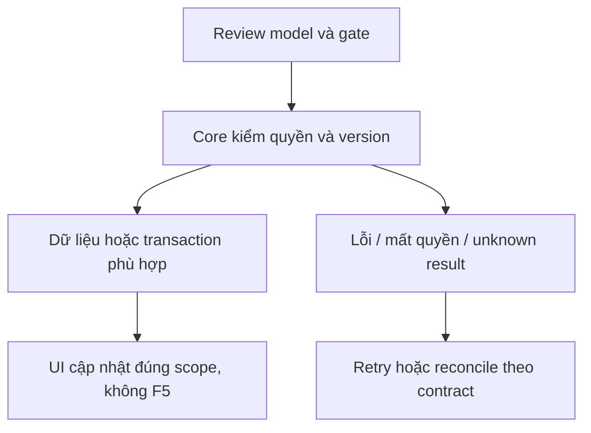

# CX01 — Đổi linkedPolicy/context chat nếu được chọn

04/11/2026 · **P, mở rộng chưa được chọn; hoãn Agent** · [Contract](../08-copilot-contract.md) · [Chung](../00-staff-contract.md).

## 1. Phạm vi và điều kiện bắt đầu

G02, liên quan UC-006/context Agent; mở trang policy đã có FR-008 không cần mutate context. Không blocker Staff không Agent.

## 2. Model và vị trí thay đổi

Conversation.linkedPolicyId/controlVersion, InsurancePolicy owner, access I01. Model/DTO/mutation contract chưa có endpoint, không suy từ action mở PDF.

## 3. API spec và quyền

Prefix REST `/api/v1`; mọi API trong phase này là **P** trừ API nền được dẫn rõ là E. Quyết định kỹ thuật đề xuất phải review trước code; không sửa schema chỉ từ file plan.

Chưa xuất bản API E. Nếu làm: đề xuất PATCH context ở Core với policyId nullable/expectedVersion/UUID intent; review operation receipt/Agent fence/role/ownership/linked source trước chốt path/DTO. GET policy A16 vẫn readonly. Policy phải đúng Customer cuộc và quyền actor; aiSummary/Ticket snapshot cũ không được rewrite.

## 4. Luồng thực hiện

User chủ động chọn đổi context → confirm nếu có task/nháp liên quan → Core current grant+version → mutation/fence+audit → Agent attempt context mới. Late result context cũ gắn watermark/loại theo contract. Không auto đổi chỉ vì click Policy Lookup.

## 5. Test cần có

Contract tests old task/new context, foreign policy/Customer/Staff denied, concurrent same key, null context, citations exact version. Chưa Agent/task contract thì không implement mutation bằng client state giả.

## 6. Gate hoàn tất

- [ ] Model/API/quyền/điểm còn mở đã review trước code phụ thuộc.
- [ ] Tests đúng lớp pass; HTTP/mock/browser E2E thật được phân biệt.
- [ ] Scope/phiên/late-response/concurrency/error và no-F5 được kiểm tương ứng.
- [ ] Cập nhật API map/checklist theo code thật, cleanup fixture/artifact; không tự commit.

CX01 chỉ triển khai sau yêu cầu chọn scope và CP01/Customer CH02 đồng bộ; không ghi là gap Must FR-008.

