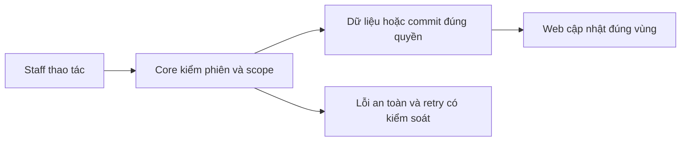
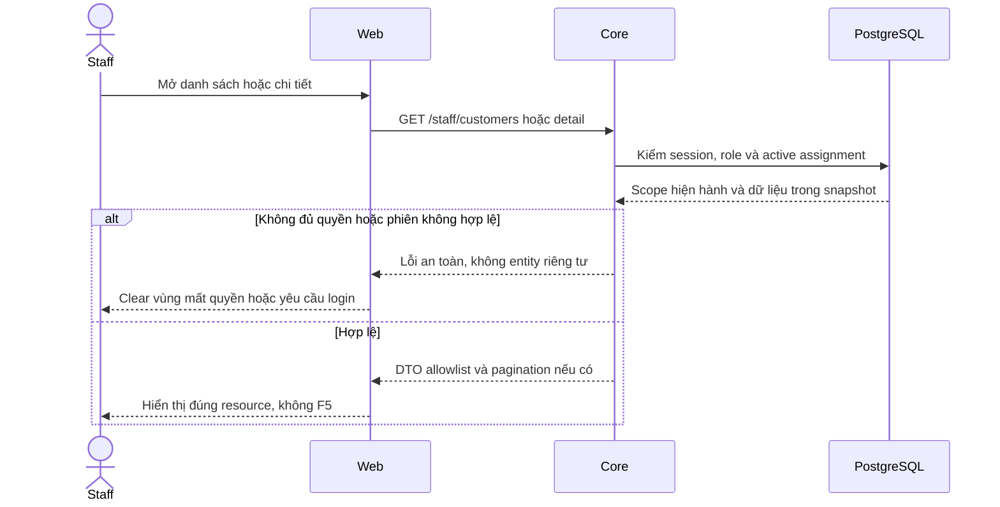

# CU01 — Customers API theo phân công

04/11/2026 · **Đã triển khai; baseline Core** · [Contract](../02-customers-contract.md) · [Chung](../00-staff-contract.md).

## 1. Phạm vi và model

FR-002/003, NFR-001/002. StaffAssignment active mới cấp quyền customer read; không cấp chat AI transcript.

## 2. Vị trí code

`apps/core/src/customers/controllers/customer.controller.ts`, `services/customer.service.ts`, `dto/customer-query.dto.ts`; model User/CustomerProfile/StaffAssignment.

## 3. API và dữ liệu

Prefix REST `/api/v1`; `E` là runtime, không endpoint đề xuất mới.

`GET /staff/customers?search=&page=1&pageSize=10` → `{items,total,page,pageSize}`. search0–100 literal case-insensitive tên/mã/email/phone; page 1–100000, pageSize1–50; query lạ 400. Scope+search trước total/page, snapshot RepeatableRead, sort userId tăng dần.

`GET /staff/customers/:customerId` → `{customer}` allowlist id/fullName/accountCode/email/phone/status/birth/address; không citizenId/KYC. Customer ngoài quyền/không tồn tại cùng404; UserStatus LOCKED của khách không tự bỏ active assignment. Staff lock/session invalid vẫn bị chặn.

## 4. Luồng và trạng thái

Cookie Staff → auth/assignment cùng snapshot → filter/count/page hoặc detail → safe DTO. Assignment đổi commit thì request mới recheck; UI không là authority và không đổi phân công.

## 5. Test cases

Các ca dưới đây là **đặc tả kiểm thử**, không phải báo cáo kết quả. Kiểm từng lớp API/service/DB/browser đúng nhãn; mock UI không thay kiểm quyền Core hoặc E2E thật.

**Quy ước dữ liệu:** S-A/S-B là hai Staff synthetic; C-A/C-B là hai Customer synthetic khác nhau. Thay alias bằng UUID/token của fixture cô lập; các path HTTP dùng prefix /api/v1 nếu chưa ghi đầy đủ. Chỉ thay assignment, khóa account, inject lỗi hoặc migration trong harness/môi trường test, không trên tài khoản/dữ liệu đang sử dụng.

### CU01-T01 — Scope trước search và phân trang

**Lớp kiểm thử:** API + DB.
**Điều kiện và dữ liệu:** S-A được gán C-A1…C-A12; S-B được gán C-B; tên đều synthetic.

**Các bước:**

1. GET /staff/customers?page=1&pageSize=10 bằng S-A.
2. Lấy page 2 rồi search tên một khách chỉ có ở page 2.
3. GET lại bằng S-B.

**Kết quả mong đợi:** S-A có tổng12, trang10/2; search tìm trên toàn bộ scope; không có khách S-B trong items hoặc total.

### CU01-T02 — Search literal đúng các trường

**Lớp kiểm thử:** API.
**Điều kiện và dữ liệu:** C-A có tên, mã, email và phone synthetic biết trước; một tên chứa ký tự % hoặc _.

**Các bước:**

1. Lần lượt search tên, mã, email, phone.
2. Search ký tự %/_ và biến thể hoa thường có khoảng trắng đầu/cuối.
3. Search từ không tồn tại.

**Kết quả mong đợi:** Chỉ khớp literal theo contract, trim/case đúng; wildcard không mở rộng tập; không có kết quả trả items rỗng.

### CU01-T03 — Detail và thu hồi phân công

**Lớp kiểm thử:** API + DB.
**Điều kiện và dữ liệu:** S-A được gán C-A, không được gán C-B; harness có thao tác revoke riêng.

**Các bước:**

1. GET detail C-A và C-B bằng S-A.
2. Thu hồi assignment C-A trong fixture.
3. GET lại detail C-A và list.

**Kết quả mong đợi:** C-A ban đầu có allowlist profile, không KYC/citizenId; C-B404; sau revoke C-A404 và không còn trong list.

### CU01-T04 — Input, role và khóa tài khoản

**Lớp kiểm thử:** API.
**Điều kiện và dữ liệu:** Fixture S-A, C-A; kiểm từng request độc lập.

**Các bước:**

1. Gửi page=0, pageSize=51, search quá 100 ký tự và query lạ.
2. Gọi list bằng Customer và không session.
3. Khóa Customer fixture rồi đọc bằng Staff còn assignment.

**Kết quả mong đợi:** Input400, Customer 403, thiếu session 401; khóa Customer không tự xóa scope Staff. Staff bị khóa không giữ quyền đọc.

**Dọn sau kiểm thử:** xóa đúng fixture/session/object/schema theo runId; phục hồi fault injection và đóng context/socket test. Không reset DB/credential, sửa bootstrap hoặc xóa volumes. Với PDF kiểm metadata/bytes/hash; với UI kiểm DOM/focus/network, không cần screenshot.

## 6. Checklist và giới hạn

- [x] Có code runtime trong phạm vi được ghi ở tiêu đề; phase này bổ sung tài liệu cho phần đã làm.
- [x] Có các lớp kiểm thử/bằng chứng được dẫn ở contract; không coi việc dọn docs là chạy lại test.
- [ ] Khi sửa code tiếp: chạy các suite bị ảnh hưởng, ghi kết quả trong phase và dọn fixture/artifact.

API E; không mở thêm status/cursor/CCCD chỉ vì có placeholder. Không thêm write Customer hoặc Ticket/Claim vào phase đọc.

## Sequence diagram

Luồng chính và nhánh quyền/lỗi; test case ở trên chỉ rõ dữ liệu và điểm kiểm tương ứng.

