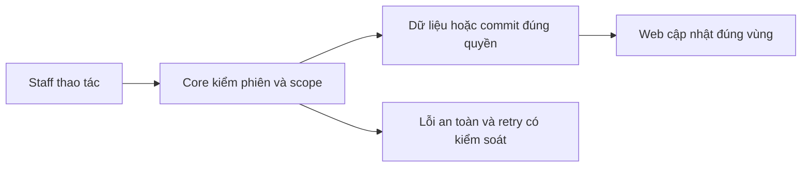

# CU01 — Customers API theo phân công

04/11/2026 · **Đã triển khai; baseline Core** · [Contract](../02-customers-contract.md) · [Chung](../00-staff-contract.md).

## 1. Phạm vi và model

FR-002/003, NFR-001/002. StaffAssignment active mới cấp quyền customer read; không cấp chat AI transcript.

## 2. Vị trí code

`apps/core/src/customers/controllers/customer.controller.ts`, `services/customer.service.ts`, `dto/customer-query.dto.ts`; model User/CustomerProfile/StaffAssignment.

## 3. API và dữ liệu

Prefix REST `/api/v1`; `E` là runtime, không endpoint đề xuất mới.

`GET /staff/customers?search=&page=1&pageSize=10` → `{items,total,page,pageSize}`. search0–100 literal case-insensitive tên/mã/email/phone; page1–100000, pageSize1–50; query lạ400. Scope+search trước total/page, snapshot RepeatableRead, sort userId tăng dần.

`GET /staff/customers/:customerId` → `{customer}` allowlist id/fullName/accountCode/email/phone/status/birth/address; không citizenId/KYC. Customer ngoài quyền/không tồn tại cùng404; UserStatus LOCKED của khách không tự bỏ active assignment. Staff lock/session invalid vẫn bị chặn.

## 4. Luồng và trạng thái

Cookie Staff → auth/assignment cùng snapshot → filter/count/page hoặc detail → safe DTO. Assignment đổi commit thì request mới recheck; UI không là authority và không đổi phân công.

## 5. Kiểm thử

`npm run test:customers` với PostgreSQL Docker: hai Staff/hai Customer,0/1/nhiều trang, search ngoài trang đầu, literal %_\\, unknown/repeated query,404 parity và reassignment. Dữ liệu riêng runId; không seed cá nhân vào bootstrap.

## 6. Checklist và giới hạn

- [x] Có code runtime trong phạm vi được ghi ở tiêu đề; phase này bổ sung tài liệu cho phần đã làm.
- [x] Có các lớp kiểm thử/bằng chứng được dẫn ở contract; không coi việc dọn docs là chạy lại test.
- [ ] Khi sửa code tiếp: chạy các suite bị ảnh hưởng, ghi kết quả trong phase và dọn fixture/artifact.

API E; không mở thêm status/cursor/CCCD chỉ vì có placeholder. Không thêm write Customer hoặc Ticket/Claim vào phase đọc.

