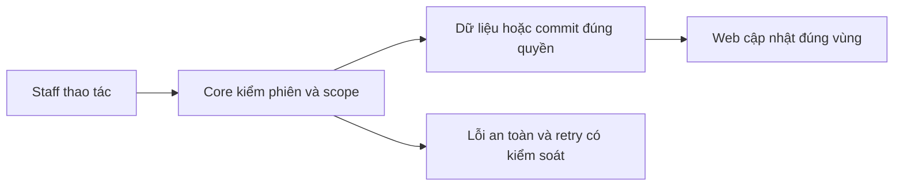
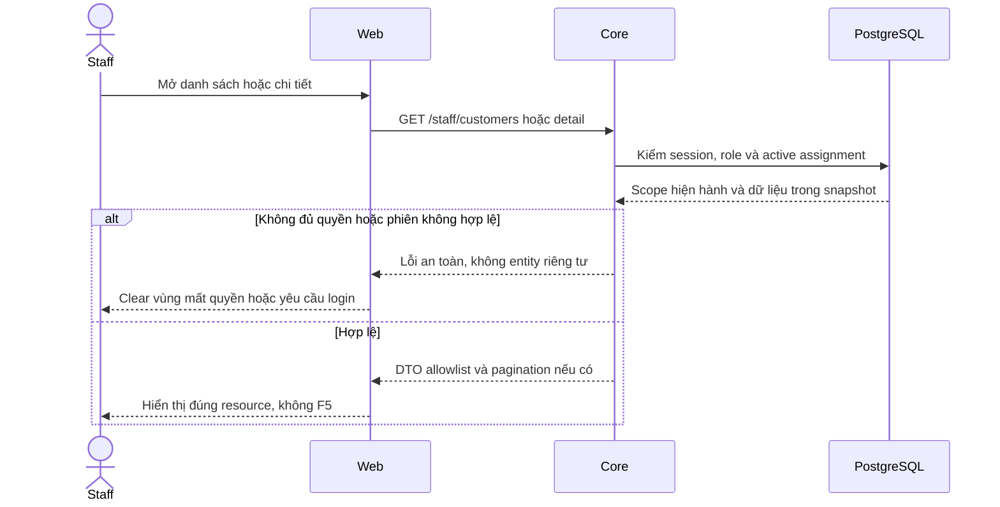

# CU01 — Customers API theo phân công

04/11/2026 · **Đã triển khai; baseline Core** · [Contract](../02-customers-contract.md) · [Chung](../00-staff-contract.md).

## Data model và phạm vi ảnh hưởng

Bảng bên dưới mô tả tác động của phase, gồm cả ghi gián tiếp qua Core. Tên bảng thuộc schema `business` trừ nơi ghi rõ; cột còn đề xuất được đánh dấu **P**. Web không truy cập DB trực tiếp.

| Bảng/model | Cột hoặc dữ liệu liên quan | Thao tác của phase | Quan hệ/ràng buộc cần giữ | Mức ảnh hưởng và nơi bị tác động |
| --- | --- | --- | --- | --- |
| users + auth_sessions | users.id/role/status, auth_sessions.user_id/token_hash/expires_at/revoked_at | Đọc | AuthSession.user_id → User.id; session phải còn hạn, không bị thu hồi | Cao — mọi API dùng session; không trả token/hash trong DTO |
| staff_assignments + customer_profiles + staff_profiles | staff_id/customer_id/is_active/ended_at, assignment_version, user_id/full_name | Đọc | Assignment gắn đúng Customer/Staff; Inbox còn ràng buộc assignment id cụ thể | Cao — Customers, Policy Lookup, Ticket và Inbox cùng phụ thuộc phân công |
| users + customer_profiles | users.id/account_code/email/phone/status, customer_profiles.user_id/full_name/birth/address/assignment_version | Đọc projection | CustomerProfile.user_id/role → User.id/role; assignment filter trước total/page | Cao — tên/phone hiển thị ở Customers, Policy, Inbox và Ticket; không trả citizen_id/password |

**Schema/migration:** Không migration; không cấp/sửa assignment hoặc profile từ trang Customers.

**Nhất quán và hồi quy:** Lọc quyền và search trước count/page trong read transaction; API không cập nhật hồ sơ khách. Kiểm khách ngoài assignment, search trang sau và Back giữ query.

## 1. Phạm vi và model

FR-002/003, NFR-001/002. StaffAssignment active mới cấp quyền customer read; không cấp chat AI transcript.

## 2. Vị trí code

`apps/core/src/customers/controllers/customer.controller.ts`, `services/customer.service.ts`, `dto/customer-query.dto.ts`; model User/CustomerProfile/StaffAssignment.

| Vị trí từ root repo | Hiện trạng | Trách nhiệm trong phase | Mức ảnh hưởng | Phạm vi cần kiểm lại |
| --- | --- | --- | --- | --- |
| [apps/core/src/customers/controllers/customer.controller.ts](<../../../../../apps/core/src/customers/controllers/customer.controller.ts>) | Hiện có | Staff list/detail endpoint | Cao | Customers list/detail |
| [apps/core/src/customers/services/customer.service.ts](<../../../../../apps/core/src/customers/services/customer.service.ts>) | Hiện có | Scope active assignment và allowlist projection | Cao | Customer self read và Staff callers |
| [apps/core/src/customers/dto/customer-query.dto.ts](<../../../../../apps/core/src/customers/dto/customer-query.dto.ts>) | Hiện có | Search/page validation | Trung bình | customer-api.ts và tests |

## 3. API và dữ liệu

Prefix REST `/api/v1`; `E` là runtime, không endpoint đề xuất mới.

`GET /staff/customers?search=&page=1&pageSize=10` → `{items,total,page,pageSize}`. search0–100 literal case-insensitive chỉ tên/mã Customer; page 1–100000, pageSize1–50; query lạ 400. Scope+search trước total/page, snapshot RepeatableRead, sort userId tăng dần.

`GET /staff/customers/:customerId` → `{customer}` allowlist id/fullName/accountCode/email/phone/status/birthYear/provinceCity; không citizenId/KYC. Customer ngoài quyền/không tồn tại cùng404; UserStatus LOCKED của khách không tự bỏ active assignment. Staff lock/session invalid vẫn bị chặn.

### Projection và Hiện/Ẩn liên hệ — 14/11/2026, E

Theo [ma trận Customer](../../../../configuration-and-data.md#customer-sensitive-data), Core tách self-read và Staff DTO. List/detail Staff chỉ nhận email giữ ký tự Unicode đầu + `***`, phone `***` + hai chữ số cuối; thiếu null, chuỗi quá ngắn `***`. Không gửi kèm raw. Họ tên/mã Customer giữ đầy đủ trong active assignment.

Detail dùng birthYear/provinceCity nullable, không birth/address. Hiện chưa có metadata xác minh nên từng trường trả null; không suy năm sinh từ birth hoặc parse address tự do. Không migration, không sửa dữ liệu gốc; Customer self-read giữ nguyên.

`POST /staff/customers/:customerId/contact-reveal` nhận duy nhất `{field:"email"|"phone"}`, trả `{customerId,field,value:string|null}`, no-store. Kiểm session Staff/Origin/JSON/CSRF, khóa users → Customer → assignment và recheck quyền trong transaction. Ngoài scope/không tồn tại cùng 404. Audit action CUSTOMER_CONTACT_REVEALED chứa actor/Customer/requestId/field, outcome SUCCESS/FAILURE; không giá trị liên hệ. Scope thất bại vẫn commit audit trước khi trả 404.

Quota kỹ thuật theo actor: CUSTOMER_READ 240/phút; CUSTOMER_CONTACT_REVEAL 30/phút. Bucket atomic, riêng transaction tài nguyên; vượt trả safe429 và Retry-After. Request bị từ chối quyền không trả contact. Schema dùng bảng rate_limit_buckets/audit_logs hiện có.

Search chỉ fullName/accountCode: trim, literal case-insensitive, lọc assignment trước count/page. DTO/Swagger/Web thống nhất; token chỉ nằm trong email/phone không tạo kết quả. Policy/Inbox/Ticket hiện chỉ nhận tên/mã trong DTO Customer, không có contact card raw cần chuyển đổi.

API từ chối ký tự điều khiển trước bước trim, kể cả tab/xuống dòng ở đầu hoặc cuối search; không dùng trim để bỏ qua validation. Khoảng trắng thông thường vẫn được chuẩn hóa như contract.

Core/API/DB kiểm tại `apps/core/test/customers.test.cjs`; browser Customers và gateway thật tại `staff-customers.spec.mjs`, `staff-foundation.integration.spec.mjs`. CU01-T05/T06/T07 mô tả contract cần giữ khi bảo trì.

## 4. Luồng và trạng thái

Cookie Staff → auth/assignment cùng snapshot → filter/count/page hoặc detail → safe DTO. Assignment đổi commit thì request mới recheck; UI không là authority và không đổi phân công.

## 5. Test cases

Các ca dưới đây là **đặc tả kiểm thử**, không phải báo cáo kết quả. Kiểm từng lớp API/service/DB/browser đúng nhãn; mock UI không thay kiểm quyền Core hoặc E2E thật.

**Quy ước dữ liệu:** S-A/S-B là hai Staff synthetic; C-A/C-B là hai Customer synthetic khác nhau. Thay alias bằng UUID/token của fixture cô lập; các path HTTP dùng prefix /api/v1 nếu chưa ghi đầy đủ. Chỉ thay assignment, khóa account, inject lỗi hoặc migration trong harness/môi trường test, không trên tài khoản/dữ liệu đang sử dụng.

### CU01-T01 — Scope trước search và phân trang

**Lớp kiểm thử:** API + DB.
**Điều kiện và dữ liệu:** S-A được gán C-A1…C-A12; S-B được gán C-B; tên đều synthetic.

**Các bước:**

1. GET /staff/customers?page=1&pageSize=10 bằng S-A.
2. Lấy page 2 rồi search tên một khách chỉ có ở page 2.
3. GET lại bằng S-B.

**Kết quả mong đợi:** S-A có tổng12, trang10/2; search tìm trên toàn bộ scope; không có khách S-B trong items hoặc total.

### CU01-T02 — Search chỉ theo tên/mã Customer

**Đã kiểm Phase 1:** `customers.test.cjs` kiểm tên/mã, token chỉ có trong email/phone, literal wildcard, scope/count/page và ký tự điều khiển; browser kiểm query/Back và phân trang. Không dùng kết quả baseline search email/phone để nghiệm thu policy mới.

**Lớp kiểm thử:** API.
**Điều kiện và dữ liệu:** fixture synthetic cô lập có token chỉ xuất hiện trong email/phone, không có trong bất kỳ tên/mã nào; thêm ca token trùng tên/mã hợp lệ, tên chứa % hoặc _, khách khác assignment và hơn một trang.

**Các bước:**

1. Search tên/mã, gồm khách không ở trang đầu; kiểm trim/case/literal và ký tự %/_.
2. Search toàn bộ và một phần token chỉ có trong email/phone, cả query từ URL cũ.
3. Search token đồng thời khớp tên/mã hợp lệ, token ngoài assignment và từ không tồn tại.

**Kết quả mong đợi:** Chỉ tên/mã trong scope quyết định items/total; email/phone không match riêng hoặc góp vào count. Token hợp lệ trong tên/mã vẫn tìm được; wildcard không mở rộng tập. Giữ page/total đúng trên toàn tập assignment, query validation hiện có; không log search raw.

### CU01-T03 — Detail và thu hồi phân công

**Lớp kiểm thử:** API + DB.
**Điều kiện và dữ liệu:** S-A được gán C-A, không được gán C-B; harness có thao tác revoke riêng.

**Các bước:**

1. GET detail C-A và C-B bằng S-A.
2. Thu hồi assignment C-A trong fixture.
3. GET lại detail C-A và list.

**Kết quả mong đợi:** C-A ban đầu có allowlist profile, không KYC/citizenId; C-B404; sau revoke C-A404 và không còn trong list.

### CU01-T04 — Input, role và khóa tài khoản

**Lớp kiểm thử:** API.
**Điều kiện và dữ liệu:** Fixture S-A, C-A; kiểm từng request độc lập.

**Các bước:**

1. Gửi page=0, pageSize=51, search quá 100 ký tự và query lạ.
2. Gọi list bằng Customer và không session.
3. Khóa Customer fixture rồi đọc bằng Staff còn assignment.

**Kết quả mong đợi:** Input400, Customer 403, thiếu session 401; khóa Customer không tự xóa scope Staff. Staff bị khóa không giữ quyền đọc.

**Dọn sau kiểm thử:** xóa đúng fixture/session/object/schema theo runId; phục hồi fault injection và đóng context/socket test. Không reset DB/credential, sửa bootstrap hoặc xóa volumes. Với PDF kiểm metadata/bytes/hash; với UI kiểm DOM/focus/network, không cần screenshot.

### CU01-T05 — Năm sinh/tỉnh-thành trong projection Staff

**Đã kiểm Phase 1.** Nguồn hiện chưa có metadata xác minh; fixture có birth/address vẫn trả null cho birthYear/provinceCity. Kiểm Staff có/ngoài assignment, revoke và Customer self-read. Nguồn xác minh mới cần đặc tả và kiểm riêng trước khi trả giá trị khác null.

**Kết quả mong đợi:** Staff detail chỉ nhận birthYear/provinceCity đúng nguồn; thiếu căn cứ thì null riêng trường đó. Không raw ngày sinh/địa chỉ hoặc metadata nguồn chứa raw trong response, list không được thêm các trường này; không đoán tỉnh/thành hoặc lệch năm do timezone. Customer self-read giữ contract riêng, dữ liệu DB/PDF không đổi.

### CU01-T06 — Định dạng che email/phone đã duyệt

**Đã có kiểm thử Phase 1.** Core kiểm null, chuỗi ngắn, Unicode và phone có dấu phân cách; API kiểm Staff list/detail và Customer self-read với actor đúng/sai scope. Browser kiểm projection mặc định và reveal.

**Kết quả mong đợi.** Staff nhận `m***` và `***12` từ Core. Null giữ trạng thái thiếu dữ liệu. Chuỗi quá ngắn để che phần còn lại hiển thị `***`, gồm phone tối đa 2 chữ số. Kiểm đúng 1 ký tự email/2 số cuối phone, ba dấu sao cố định và cùng giá trị giữa list/detail. Kiểm canary ở JSON/DOM/copy/tooltip và contract self-read theo ma trận chung.

### CU01-T07 — Reveal liên hệ theo quyền hiện hành

**Đã có kiểm thử Phase 1.** Fixture synthetic kiểm scope, null, field lạ, Origin/CSRF, quota, audit metadata và assignment bị thu hồi khi request đang chờ khóa. Browser kiểm response muộn sau Ẩn/đổi khách/revoke/logout. Duplicate reveal vẫn là request đọc có audit, không cache raw hoặc tạo nghiệp vụ.

**Kết quả mong đợi.** GET list/detail chỉ có bản che. Reveal kiểm lại quyền dưới lock, chỉ trả trường yêu cầu khi hợp lệ, no-store. Ngoài scope bị chặn theo lỗi an toàn hiện hành, audit thành công có actor/Customer/trường/requestId nhưng không có giá trị raw. Search vẫn chỉ tên/mã Customer. Quyền contact không cấp transcript, PDF hoặc model context.

## 6. Checklist và giới hạn

- [x] Họ tên/mã Customer đầy đủ cho Staff có active assignment đã duyệt, khớp source hiện tại.
- [x] Định dạng che A đã duyệt cho email/phone tại Staff list/detail.
- [x] Core projection, DTO/caller và kiểm CU01-T06.
- [x] Đã chốt chỉ tìm theo tên/mã Customer; bỏ search email/phone trong MVP.
- [x] OR filter/Swagger chỉ tên/mã; kiểm scope/count/page theo CU01-T02.
- [x] Từ chối tab/xuống dòng trước trim, kể cả ở đầu/cuối search; khoảng trắng thông thường vẫn được chuẩn hóa.
- [x] Staff detail chỉ hiện năm sinh/tỉnh-thành đã xác minh, thiếu thì ẩn đã duyệt.
- [x] DTO Staff riêng và CU01-T05: null từng trường vì chưa có nguồn xác minh, không raw birth/address.

- [x] Có code runtime trong phạm vi được ghi ở tiêu đề; phase này bổ sung tài liệu cho phần đã làm.
- [x] Có các lớp kiểm thử/bằng chứng được dẫn ở contract; không coi việc dọn docs là chạy lại test.

**Quy tắc khi bảo trì:** Khi thay đổi code, chạy các suite bị ảnh hưởng theo test case của phase và dọn fixture/artifact do lượt kiểm thử tạo ra. Báo kết quả ngắn trong trao đổi, không ghi nhật ký kiểm thử vào phase. Đây là quy tắc áp dụng mỗi lần sửa, không phải hạng mục chức năng còn thiếu.

API E; không mở thêm status/cursor/CCCD chỉ vì có placeholder. Không thêm write Customer hoặc Ticket/Claim vào phase đọc.

## Tự động hóa test case

| Suite/vị trí | Phạm vi và giới hạn |
| --- | --- |
| [staff-foundation.integration.spec.mjs](../../../../../apps/web/tests/browser/staff-foundation.integration.spec.mjs) | API read/assignment được đối chứng từ browser directory, search/page và foreign/revoked assignment qua Core thật. |
| [browser-staff-fixture.cjs](../../../../../apps/core/test/support/browser-staff-fixture.cjs) | Dữ liệu synthetic UUID qua test Docker, session/password trong memory; finally dọn đúng fixture/object, không reset seed |
| [test-staff.mjs](../../../../../apps/web/scripts/test-staff.mjs) | Chạy Chromium/Firefox/WebKit, gom JSON tạm rồi tự dọn artifact; Web/Core chỉ chạy Docker |

Ca lỗi mạng dùng fault injection rõ ràng; native PDF toolbar/zoom không được xác minh bằng iframe DOM. Các bảng/test case là đặc tả duy trì, không ghi nhật ký từng lần chạy tại đây.

## Sequence diagram

Luồng chính và nhánh quyền/lỗi; test case ở trên chỉ rõ dữ liệu và điểm kiểm tương ứng.

