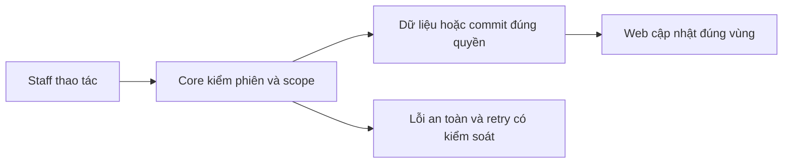
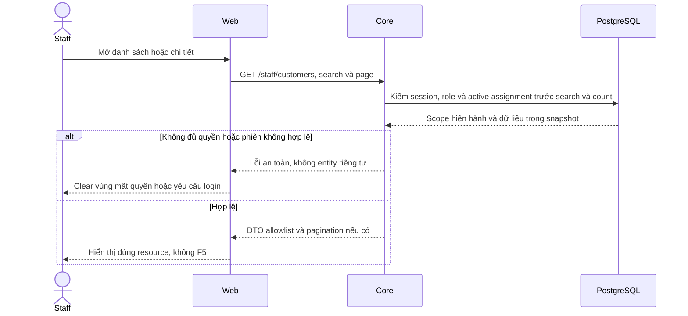

# CU02 — Danh sách, hồ sơ và vùng policies

04/11/2026 · **Đã triển khai; baseline FE** · [Contract](../02-customers-contract.md) · [Chung](../00-staff-contract.md).

## 1. Phạm vi và model

CU01 + PL01–PL03. Staff Customers độc lập Inbox/Tickets, không nhúng chat composer vào hồ sơ.

## 2. Vị trí code

`staff-customer-directory.tsx`, `staff-reference-workspace.tsx`, `lib/customer-api.ts` nếu runtime còn dùng auth-api thì giữ client thật; `staff-policies.tsx`. Không tạo module mới chỉ theo tên đề xuất.

## 3. API và dữ liệu

Prefix REST `/api/v1`; `E` là runtime, không endpoint đề xuất mới.

Dùng A05/A06 và A14 policies theo một khách. Enter gửi search; xóa text rồi Enter bỏ lọc; không Search/Clear buttons. Search/page/policyPage giữ theo tab/URL; onSelect Next Link/router, query History API. Không tự gọi auth/me mỗi tìm kiếm.

## 4. Luồng và trạng thái

Bảng khách → profile readonly/breadcrumb → Insurance policies → policy/PDF. Mobile policies trước personal info; null Not provided. Refresh nền giữ bảng/nháp/focus;401/403/404 xóa dữ liệu ngoài quyền, network retry tại vùng. Response cũ không ghi đè lựa chọn mới.

## 5. Test cases

Các ca dưới đây là **đặc tả kiểm thử**, không phải báo cáo kết quả. Kiểm từng lớp API/service/DB/browser đúng nhãn; mock UI không thay kiểm quyền Core hoặc E2E thật.

**Quy ước dữ liệu:** S-A/S-B là hai Staff synthetic; C-A/C-B là hai Customer synthetic khác nhau. Thay alias bằng UUID/token của fixture cô lập; các path HTTP dùng prefix /api/v1 nếu chưa ghi đầy đủ. Chỉ thay assignment, khóa account, inject lỗi hoặc migration trong harness/môi trường test, không trên tài khoản/dữ liệu đang sử dụng.

### CU02-T01 — Search và Back giữ context

**Lớp kiểm thử:** Browser.
**Điều kiện và dữ liệu:** S-A có hơn10 khách; biết mã một khách ở trang2.

**Các bước:**

1. Mở Customers, sang trang2.
2. Tìm mã khách bằng Enter, mở hồ sơ.
3. Bấm Back, xóa search rồi Enter.

**Kết quả mong đợi:** Search đúng toàn tập; URL/selection/page khôi phục theo thao tác; không Search/Clear buttons, không F5.

### CU02-T02 — Hồ sơ và vùng hợp đồng

**Lớp kiểm thử:** Browser.
**Điều kiện và dữ liệu:** C-A có nhiều policy; C-Z không có policy, đều thuộc S-A.

**Các bước:**

1. Mở C-A và chuyển trang Insurance policies nếu có.
2. Chọn policy rồi quay lại.
3. Mở C-Z.

**Kết quả mong đợi:** Thông tin/mã khách và policy khớp cùng Customer; quay lại giữ context; C-Z có empty state, không hợp đồng giả.

### CU02-T03 — Response chậm và mất quyền

**Lớp kiểm thử:** Browser + API mock.
**Điều kiện và dữ liệu:** Giữ response detail C-A; C-B cũng thuộc S-A trong biến thể đổi selection.

**Các bước:**

1. Mở C-A rồi nhanh chóng mở C-B.
2. Trả response C-A muộn.
3. Cho request C-B tiếp theo trả 404 sau revoke.

**Kết quả mong đợi:** Không hiện lẫn hồ sơ A/B; sau404 xóa detail và hành động cũ, không chỉ hiện lỗi bên trên dữ liệu riêng.

### CU02-T04 — Lỗi vùng, focus và responsive

**Lớp kiểm thử:** Browser + API mock.
**Điều kiện và dữ liệu:** Mock list 503 trước, sau đó detail 503; viewport 375px.

**Các bước:**

1. Retry list rồi mở một khách.
2. Retry detail mà không đổi trang.
3. Dùng Tab và zoom 200%.

**Kết quả mong đợi:** Lỗi được phục hồi theo vùng, không navigation document mới; tên dài/email/controls không tràn; focus vẫn thao tác được.

**Dọn sau kiểm thử:** xóa đúng fixture/session/object/schema theo runId; phục hồi fault injection và đóng context/socket test. Không reset DB/credential, sửa bootstrap hoặc xóa volumes. Với PDF kiểm metadata/bytes/hash; với UI kiểm DOM/focus/network, không cần screenshot.

## 6. Checklist và giới hạn

- [x] Có code runtime trong phạm vi được ghi ở tiêu đề; phase này bổ sung tài liệu cho phần đã làm.
- [x] Có các lớp kiểm thử/bằng chứng được dẫn ở contract; không coi việc dọn docs là chạy lại test.
- [ ] Khi sửa code tiếp: chạy các suite bị ảnh hưởng, ghi kết quả trong phase và dọn fixture/artifact.

Account/Policy/Inbox không hồi quy. Link từ customer sang Inbox có thể bổ sung UX sau, không bắt buộc FR-003; không tự đưa pending transcript vào trang này.

## Sequence diagram

Luồng chính và nhánh quyền/lỗi; test case ở trên chỉ rõ dữ liệu và điểm kiểm tương ứng.

