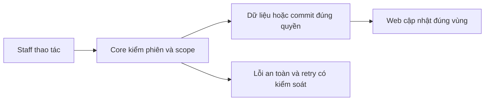
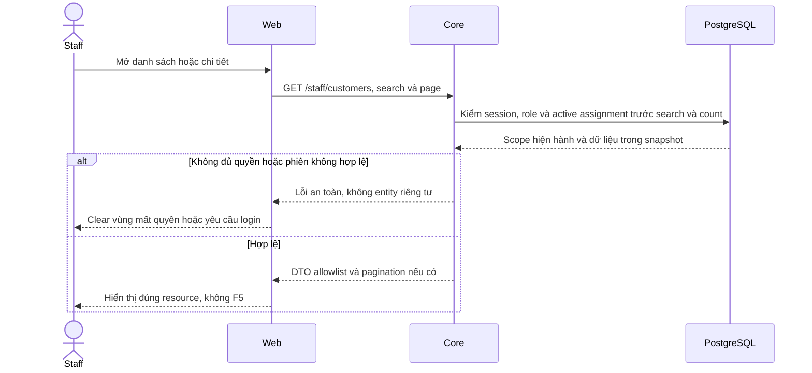

# CU02 — Danh sách, hồ sơ và vùng policies

04/11/2026 · **Đã triển khai; baseline FE** · [Contract](../02-customers-contract.md) · [Chung](../00-staff-contract.md).

## Data model và phạm vi ảnh hưởng

Bảng bên dưới mô tả tác động của phase, gồm cả ghi gián tiếp qua Core. Tên bảng thuộc schema `business` trừ nơi ghi rõ; cột còn đề xuất được đánh dấu **P**. Web không truy cập DB trực tiếp.

| Bảng/model | Cột hoặc dữ liệu liên quan | Thao tác của phase | Quan hệ/ràng buộc cần giữ | Mức ảnh hưởng và nơi bị tác động |
| --- | --- | --- | --- | --- |
| users + auth_sessions | users.id/role/status, auth_sessions.user_id/token_hash/expires_at/revoked_at | Đọc | AuthSession.user_id → User.id; session phải còn hạn, không bị thu hồi | Cao — mọi API dùng session; không trả token/hash trong DTO |
| staff_assignments + customer_profiles + staff_profiles | staff_id/customer_id/is_active/ended_at, assignment_version, user_id/full_name | Đọc | Assignment gắn đúng Customer/Staff; Inbox còn ràng buộc assignment id cụ thể | Cao — Customers, Policy Lookup, Ticket và Inbox cùng phụ thuộc phân công |
| users + customer_profiles | users.id/account_code/email/phone/status, customer_profiles.user_id/full_name/birth/address/assignment_version | Đọc projection | CustomerProfile.user_id/role → User.id/role; assignment filter trước total/page | Cao — tên/phone hiển thị ở Customers, Policy, Inbox và Ticket; không trả citizen_id/password |

**Schema/migration:** Không migration; không cấp/sửa assignment hoặc profile từ trang Customers.

**Nhất quán và hồi quy:** Lọc quyền và search trước count/page trong read transaction; API không cập nhật hồ sơ khách. Kiểm khách ngoài assignment, search trang sau và Back giữ query.

## 1. Phạm vi và model

CU01 + PL01–PL03. Staff Customers độc lập Inbox/Tickets, không nhúng chat composer vào hồ sơ.

## 2. Vị trí code

`staff-customer-directory.tsx`, `staff-reference-workspace.tsx`, `lib/customer-api.ts` nếu runtime còn dùng auth-api thì giữ client thật; `staff-policies.tsx`. Không tạo module mới chỉ theo tên đề xuất.

| Vị trí từ root repo | Hiện trạng | Trách nhiệm trong phase | Mức ảnh hưởng | Phạm vi cần kiểm lại |
| --- | --- | --- | --- | --- |
| [apps/web/src/components/staff-customer-directory.tsx](<../../../../../apps/web/src/components/staff-customer-directory.tsx>) | Hiện có | Directory/profile và URL search/page | Trung bình | Back/Forward, empty/error, không F5 |
| [apps/web/src/lib/customer-api.ts](<../../../../../apps/web/src/lib/customer-api.ts>) | Hiện có | List/detail wrappers, AbortSignal | Trung bình | Staff directory và selection |
| [apps/web/src/components/staff-policies.tsx](<../../../../../apps/web/src/components/staff-policies.tsx>) | Hiện có | Danh sách policy của khách được chọn | Trung bình | Không trộn list khách với policy toàn tập |
| [apps/web/src/components/staff-inbox-directory.tsx](../../../../../apps/web/src/components/staff-inbox-directory.tsx) | Hiện có | Tự mở nhóm trùng customerId khi đi từ hồ sơ | Trung bình | Accordion/search/deep link và không lộ AI riêng |
| [apps/web/tests/browser/staff-foundation.integration.spec.mjs](../../../../../apps/web/tests/browser/staff-foundation.integration.spec.mjs) | Hiện có | E2E qua gateway/Core/DB/MinIO và quyền khi đi qua support links | Trung bình | Ba browser, Back, assignment revoke và no-F5 |
| [apps/core/test/support/browser-staff-fixture.cjs](../../../../../apps/core/test/support/browser-staff-fixture.cjs) | Hiện có — chỉ test Docker | Fixture UUID + fault/cleanup cô lập | Cao | Không thay bootstrap, dữ liệu đang dùng hoặc quyền runtime Core |

## 3. API và dữ liệu

Prefix REST `/api/v1`; `E` là runtime, không endpoint đề xuất mới.

Dùng A05/A06 và A14 policies theo một khách. Enter gửi search; xóa text rồi Enter bỏ lọc; không Search/Clear buttons. Search/page/policyPage giữ theo tab/URL; onSelect Next Link/router, query History API. Không tự gọi auth/me mỗi tìm kiếm.

### Bổ sung hiển thị dữ liệu đã che — 12/11/2026, P

Hiện bảng render email/phone đầy đủ, detail có ngày sinh/địa chỉ đầy đủ. Theo [ma trận Customer](../../../../configuration-and-data.md#customer-sensitive-data), Core phải loại/che trước response; Web không nhận raw để che bằng CSS/React. Chờ contract CU01 trước đổi client types/render hoặc thêm thao tác xem đầy đủ.

Rà `staff-customer-directory.tsx` và `customer-api.ts`: cell, title/aria-label, copy, search/URL/history, cache/state và response đến muộn. Giữ null/empty riêng với giá trị đã che, Back/no-F5 và clear dữ liệu khi revoke/logout/đổi khách. Liên kết Policy/Inbox/Ticket không tự cấp quyền xem raw.

Kiểm bằng network JSON + DOM/accessibility assertions trên fixture synthetic; raw canary không ở hidden field/tooltip/copy/state ngoài contract. Hồi quy `staff-customers.spec.mjs` và `staff-foundation.integration.spec.mjs` qua gateway khi API được triển khai; không dùng ảnh chụp hoặc chỉ test chuỗi mask để nghiệm thu. Đây là phần P bổ sung, không phủ nhận CU02 baseline đã chạy.

## 4. Luồng và trạng thái

Bảng khách → profile readonly/breadcrumb → Insurance policies → policy/PDF. Mobile policies trước personal info; null Not provided. Refresh nền giữ bảng/nháp/focus;401/403/404 xóa dữ liệu ngoài quyền, network retry tại vùng. Response cũ không ghi đè lựa chọn mới.

## 5. Test cases

Các ca dưới đây là **đặc tả kiểm thử**, không phải báo cáo kết quả. Kiểm từng lớp API/service/DB/browser đúng nhãn; mock UI không thay kiểm quyền Core hoặc E2E thật.

**Quy ước dữ liệu:** S-A/S-B là hai Staff synthetic; C-A/C-B là hai Customer synthetic khác nhau. Thay alias bằng UUID/token của fixture cô lập; các path HTTP dùng prefix /api/v1 nếu chưa ghi đầy đủ. Chỉ thay assignment, khóa account, inject lỗi hoặc migration trong harness/môi trường test, không trên tài khoản/dữ liệu đang sử dụng.

### CU02-T01 — Search và Back giữ context

**Lớp kiểm thử:** Browser.
**Điều kiện và dữ liệu:** S-A có hơn10 khách; biết mã một khách ở trang2.

**Các bước:**

1. Mở Customers, sang trang2.
2. Tìm mã khách bằng Enter, mở hồ sơ.
3. Bấm Back, xóa search rồi Enter.

**Kết quả mong đợi:** Search đúng toàn tập; URL/selection/page khôi phục theo thao tác; không Search/Clear buttons, không F5.

### CU02-T02 — Hồ sơ và vùng hợp đồng

**Lớp kiểm thử:** Browser.
**Điều kiện và dữ liệu:** C-A có nhiều policy; C-Z không có policy, đều thuộc S-A.

**Các bước:**

1. Mở C-A và chuyển trang Insurance policies nếu có.
2. Chọn policy rồi quay lại.
3. Mở C-Z.

**Kết quả mong đợi:** Thông tin/mã khách và policy khớp cùng Customer; quay lại giữ context; C-Z có empty state, không hợp đồng giả.

### CU02-T03 — Response chậm và mất quyền

**Lớp kiểm thử:** Browser + API mock.
**Điều kiện và dữ liệu:** Giữ response detail C-A; C-B cũng thuộc S-A trong biến thể đổi selection.

**Các bước:**

1. Mở C-A rồi nhanh chóng mở C-B.
2. Trả response C-A muộn.
3. Cho request C-B tiếp theo trả 404 sau revoke.

**Kết quả mong đợi:** Không hiện lẫn hồ sơ A/B; sau404 xóa detail và hành động cũ, không chỉ hiện lỗi bên trên dữ liệu riêng.

### CU02-T04 — Lỗi vùng, focus và responsive

**Lớp kiểm thử:** Browser + API mock.
**Điều kiện và dữ liệu:** Mock list 503 trước, sau đó detail 503; viewport 375px.

**Các bước:**

1. Retry list rồi mở một khách.
2. Retry detail mà không đổi trang.
3. Dùng Tab và zoom 200%.

**Kết quả mong đợi:** Lỗi được phục hồi theo vùng, không navigation document mới; tên dài/email/controls không tràn; focus vẫn thao tác được.

**Dọn sau kiểm thử:** xóa đúng fixture/session/object/schema theo runId; phục hồi fault injection và đóng context/socket test. Không reset DB/credential, sửa bootstrap hoặc xóa volumes. Với PDF kiểm metadata/bytes/hash; với UI kiểm DOM/focus/network, không cần screenshot.

## 6. Checklist và giới hạn

- [x] Có code runtime trong phạm vi được ghi ở tiêu đề; phase này bổ sung tài liệu cho phần đã làm.
- [x] Có các lớp kiểm thử/bằng chứng được dẫn ở contract; không coi việc dọn docs là chạy lại test.

**Quy tắc khi bảo trì:** Khi thay đổi code, chạy các suite bị ảnh hưởng theo test case của phase và dọn fixture/artifact do lượt kiểm thử tạo ra. Báo kết quả ngắn trong trao đổi, không ghi nhật ký kiểm thử vào phase. Đây là quy tắc áp dụng mỗi lần sửa, không phải hạng mục chức năng còn thiếu.

Account/Policy/Inbox không hồi quy. Hồ sơ đã có nav **Customer support** với Conversations và Tickets: điều hướng client-side tới `/staff/inbox?customerId=<id>` hoặc `/staff/tickets?customerId=<id>`, không nhúng composer/Ticket detail trong Customers. Inbox tự mở nhóm của khách được lọc; query chỉ thu hẹp tập dữ liệu, không cấp quyền. Pending vẫn chỉ shared metadata; AI riêng không xuất hiện. Back trở về hồ sơ/list giữ query hiện có.

## CU02-T05 — Từ hồ sơ mở hỗ trợ đúng khách, không mở rộng quyền

**Lớp kiểm thử:** Browser → gateway/Core/DB thật; API đối chứng ngoài scope. Fixture synthetic cô lập, không sửa bootstrap.

**Điều kiện và dữ liệu:** S-A phụ trách C-A cùng hơn 10 khách; C-A có Direct chat, một cuộc AI riêng và Ticket. S-B phụ trách khách khác, không có grant của C-A.

**Các bước:**

1. S-A tìm khách, chuyển trang 2 rồi quay lại; tìm mã C-A và mở hồ sơ.
2. Dùng bàn phím chọn Conversations trong Customer support; kiểm URL customerId, nhóm tự mở và cuộc hiển thị.
3. Back về hồ sơ, mở Tickets, chọn Ticket; Back và breadcrumb trở về bộ lọc khách.
4. S-B gọi URL/API hồ sơ, conversation và Tickets với customerId C-A; thử list Inbox cùng customerId.
5. Trong harness thu hồi assignment S-A/C-A, mở lại hồ sơ và kiểm nav hỗ trợ đã biến mất.

**Kết quả mong đợi:** Điều hướng không reload document, Back giữ tìm kiếm. Chỉ Direct/handoff đã đủ grant hiển thị, không AI riêng. CustomerId không vượt assignment: resource/Ticket-filter ngoài quyền trả safe404, Inbox groups trả tập rỗng. Sau revoke không còn profile/nav/private data. Core không ghi handoff, Ticket hoặc linked_policy_id khi bấm các link.

**Vị trí kiểm thử:** `apps/web/tests/browser/staff-foundation.integration.spec.mjs`, fixture `apps/core/test/support/browser-staff-fixture.cjs`; regression state/DOM tại `staff-customers.spec.mjs`. Chạy bằng `node apps/web/scripts/test-staff.mjs`, gồm Chromium/Firefox/WebKit; không screenshot hoặc kiểm native PDF zoom bằng DOM.

## Sequence diagram

Luồng chính và nhánh quyền/lỗi; test case ở trên chỉ rõ dữ liệu và điểm kiểm tương ứng.

