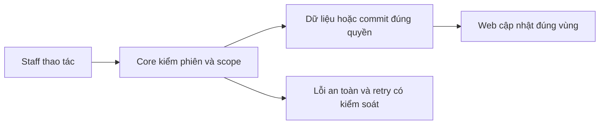

# CU02 — Danh sách, hồ sơ và vùng policies

04/11/2026 · **Đã triển khai; baseline FE** · [Contract](../02-customers-contract.md) · [Chung](../00-staff-contract.md).

## 1. Phạm vi và model

CU01 + PL01–PL03. Staff Customers độc lập Inbox/Tickets, không nhúng chat composer vào hồ sơ.

## 2. Vị trí code

`staff-customer-directory.tsx`, `staff-reference-workspace.tsx`, `lib/customer-api.ts` nếu runtime còn dùng auth-api thì giữ client thật; `staff-policies.tsx`. Không tạo module mới chỉ theo tên đề xuất.

## 3. API và dữ liệu

Prefix REST `/api/v1`; `E` là runtime, không endpoint đề xuất mới.

Dùng A05/A06 và A14 policies theo một khách. Enter gửi search; xóa text rồi Enter bỏ lọc; không Search/Clear buttons. Search/page/policyPage giữ theo tab/URL; onSelect Next Link/router, query History API. Không tự gọi auth/me mỗi tìm kiếm.

## 4. Luồng và trạng thái

Bảng khách → profile readonly/breadcrumb → Insurance policies → policy/PDF. Mobile policies trước personal info; null Not provided. Refresh nền giữ bảng/nháp/focus;401/403/404 xóa dữ liệu ngoài quyền, network retry tại vùng. Response cũ không ghi đè lựa chọn mới.

## 5. Kiểm thử

`staff-customers.spec.mjs`15 mock browser: outside-page search, Back/Forward, no-F5, draft/realtime, late response,401/403/404,375/768/1600px. API quyền kiểm CU01 riêng; Cần bổ sung E2E thật cho CU02 bằng fixture riêng qua gateway/Core/DB; không thay mock suite hiện có.

## 6. Checklist và giới hạn

- [x] Có code runtime trong phạm vi được ghi ở tiêu đề; phase này bổ sung tài liệu cho phần đã làm.
- [x] Có các lớp kiểm thử/bằng chứng được dẫn ở contract; không coi việc dọn docs là chạy lại test.
- [ ] Khi sửa code tiếp: chạy các suite bị ảnh hưởng, ghi kết quả trong phase và dọn fixture/artifact.

Account/Policy/Inbox không hồi quy. Link từ customer sang Inbox có thể bổ sung UX sau, không bắt buộc FR-003; không tự đưa pending transcript vào trang này.

