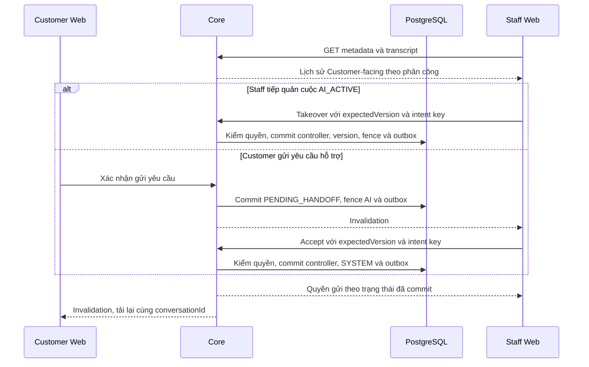

# Kế hoạch làm lại Inbox và chat Staff

**Thiết kế đích cập nhật 23/11/2026.** Staff phụ trách được đọc lịch sử khi AI đang hỗ trợ và chủ động Takeover. Thay đổi này chưa triển khai. I01–I06 trên nhánh nền vẫn dùng gate Direct hoặc Customer request + Staff Accept cho transcript.

[Chỉ mục Staff](../../README.md) · [API E/P](../00-staff-contract.md#api-theo-chức-năng) · [Checkpoint 03](../03-inbox-contract.md) · [Model nguồn](../../../../specifications/Data_Model.md)

## 1. Mục tiêu và ranh giới

Customer có thể chat với AI, nhắn trực tiếp Staff hoặc gửi yêu cầu Staff hỗ trợ. Staff phụ trách có thể theo dõi và tiếp quản cuộc AI đang mở. Request chuyển giao khác SupportTicket.

Các quyết định đã chốt:

- Inbox Staff chỉ có **All / Requests / Active**. Không có AI active, Closed hoặc New trong filter đích.
- Staff đang phụ trách đọc **toàn bộ lịch sử Customer-facing từ tin đầu tiên của chính cuộc chat**, kể cả khi Agent đang xử lý hoặc yêu cầu đang chờ Accept.
- Transcript và quyền gửi được kiểm riêng. Staff có thể Takeover cuộc AI; với yêu cầu Customer đã gửi, Staff bấm Accept để bắt đầu trả lời.
- Accordion theo khách, tên/mã khách; từng cuộc ưu tiên tiêu đề và thời gian, giống danh sách chat. Không cần mã CHT hoặc preview tin cuối ở bản đầu.
- **Bỏ counts hoàn toàn khỏi Inbox**: không badge số, tổng số cuộc/khách hoặc counts theo status, không API summary dự phòng. Lazy load dùng hasMore/nextCursor.
- Search tên/mã, tự động và Enter, không nút Search/Clear. Chat cuộn riêng, không Page/Previous/Next cho transcript; panel phụ đóng mặc định.
- Chat mới không có nghiệp vụ đóng/Closed. Ticket giữ miền trạng thái riêng; nút resolve/close Ticket vẫn chưa thuộc implementation hiện có.
- Yêu cầu Staff/Accept không tự tạo hoặc nhận Ticket. Ticket có luồng draft Agent được Customer xem/sửa/xác nhận và form thủ công của Customer; Core tạo OPEN + outbox theo I07.

Account/Customers/Policy đã chạy giữ nguyên. Bỏ counts chỉ áp dụng Inbox, không xóa total/phân trang của Customers/Policy hoặc tự đổi notification unread ở module riêng.

**Chat AI mới sau Staff — đã chốt 14/11/2026.** Cuộc cũ theo trạng thái/quyền hiện hành, Customer muốn hỏi AI chủ động tạo conversation mới với thread/context riêng. Grant và source view Copilot của cuộc cũ không cấp quyền cuộc AI mới. Core kiểm gate riêng của từng cuộc, revoke/reassignment theo policy hiện có. [Contract và ca hồi quy I03](03-handoff-transcript.md#i03-t06--cuộc-ai-mới-có-quyền-độc-lập-với-cuộc-staff-cũ).

## 2. Data model hiện có và đích thay đổi

Nguồn runtime là `apps/core/prisma/schema.prisma`. I01–I06 đã có luồng Direct và Customer request/Accept. Cách lưu người tiếp quản, assignment và bằng chứng takeover sẽ được chốt trước khi viết migration.

| Đối tượng | Schema hiện tại | Nghiệp vụ đích đã chốt |
| --- | --- | --- |
| ConversationStatus | AI_ACTIVE / PENDING_HANDOFF / STAFF_ACTIVE | Yêu cầu Customer đi qua PENDING_HANDOFF. Takeover chuyển AI_ACTIVE → STAFF_ACTIVE trong cùng cuộc |
| TicketStatus | OPEN / ASSIGNED / IN_PROGRESS / RESOLVED / CLOSED | Giữ riêng; không dùng làm status chat hoặc tự bật workflow đóng Ticket |
| ConversationChannel | CUSTOMER_SUPPORT / STAFF_COPILOT | Không dùng channel hiện tại để suy chat trực tiếp hay chuyển AI; cần provenance/quyền riêng |
| Message | senderType/senderId/content/citations/toolCallsMetadata/createdAt, sequence/clientMessageId/internalMessageId/audience/readAt | SenderType xác định người gửi, readAt do Core cập nhật qua API read. Phân trang theo sequence và chống trùng theo key hiện có, WS chỉ invalidation |
| Assignment/controller | StaffAssignment active; Conversation.assignedStaffId | Đọc theo phân công hiện hành và loại cuộc. Gửi cần quyền điều khiển đã commit; chỉ đổi cờ trạng thái không đủ để cấp quyền |

### 2.1. Xử lý CLOSED và dữ liệu cũ

Đã bỏ CLOSED khỏi ConversationStatus qua migration 202611030001_remove_conversation_closed; TicketStatus.CLOSED giữ nguyên. Customer Support CLOSED cũ chuyển AI_ACTIVE và assignedStaffId NULL, giữ tin nhắn, liên kết và timestamps. Audit CONVERSATION_STATUS_MIGRATED lưu migration, trạng thái và controller trước đổi; không sao chép nội dung chat vào audit. Nếu gặp Copilot CLOSED chưa review quyền sở hữu, migration báo lỗi và rollback toàn bộ.

Chuyển legacy về AI_ACTIVE không tạo consent/acceptance/Direct provenance hoặc Staff grant. Cuộc thiếu bằng chứng không được đưa vào Inbox/transcript Staff khi triển khai sau này. Core/operator đã cập nhật compatibility, migration lịch sử được bảo toàn. Luồng sau hỗ trợ Staff dùng New AI chat theo [quyết định ngày 14/11](../../../../specifications/Agent_Design.md#new-ai-chat-after-staff).

### 2.2. Một cuộc chat là gì?

Một Conversation là một luồng nhiều tin như một cuộc ChatGPT; tiêu đề chỉ giúp nhận biết, đổi chủ đề trong nội dung không tự tạo cuộc mới. UUID dùng nội bộ/route; không yêu cầu conversationCode/CHT trong schema/UI đợt đầu.

## 3. Bố cục Inbox đích

### 3.1. Filter Staff

| Nhãn | Query đề xuất | Tập dữ liệu đúng quyền |
| --- | --- | --- |
| All | Không filter hoặc filter=all | Chat AI_ACTIVE, cuộc đang chờ Staff mới tiếp quản, cùng các mục Requests và Active đủ quyền |
| Requests | filter=requests | Yêu cầu chuyển từ AI đã được Customer xác nhận, gửi tới Staff hợp lệ, đang chờ Accept |
| Active | filter=active | Cuộc STAFF_ACTIVE do Staff hiện tại điều khiển qua Direct, Accept hoặc Takeover hợp lệ |

AI_ACTIVE xuất hiện trong All với nhãn đang được AI hỗ trợ. Ticket và notification kiểm quyền chat lại khi mở liên kết. Không có filter CLOSED hay số trên menu.

### 3.2. Accordion theo khách

Dòng khách: tên + mã, mở/đóng nhiều nhóm, lazy load các cuộc phù hợp. Không có số cuộc cạnh tên hoặc tổng phía trên. Bàn phím Enter/Space, aria-expanded/controls; cuộc là Link có aria-current. Deep link mở đúng nhóm sau khi Core cho phép, không tự tải transcript mọi khách.

### 3.3. Nội dung từng cuộc

Danh sách hiển thị tiêu đề, thời gian và nhãn trạng thái. Requests dùng tiêu đề/lý do Customer xác nhận gửi; fallback “Yêu cầu Staff hỗ trợ”. AI_ACTIVE dùng subject của cuộc hoặc fallback chung. Không preview tin cuối, mã CHT hoặc badge đếm.

Tiêu đề render text an toàn. Lịch sử AI chỉ xuất hiện sau gate quyền, không giấu dữ liệu đã tải bằng CSS. Create DTO hiện nhận subject tùy chọn, trim/tối đa 180 ký tự và loại control chars. Core dùng `Cuộc trò chuyện` khi subject rỗng. Không bổ sung API đổi tiêu đề cuộc chat.

### 3.4. Search và tải thêm

Tìm fullName/accountCode, trim/case-insensitive/literal, không bỏ dấu tự động; tối đa 100 ký tự. Đề xuất debounce 300ms, Enter chạy ngay/hủy debounce, IME không submit sớm. Không tìm message/email/phone/policy/Ticket. Xóa nội dung rồi debounce/Enter để bỏ lọc.

Áp visibility/quyền rồi search/filter trước group và cursor; không tải toàn tập về FE. Không counts/total/statusCounts/matchingConversationCount trong response hoặc UI. PageInfo nextCursor/hasMore đủ cho lazy load. Metadata thời gian/sort của Requests chỉ từ yêu cầu đã được phép chia sẻ, không từ tin AI riêng mới nhất.

Đổi filter/search hủy response cũ, reset cursor, giữ focus. Cuộc đang đọc còn quyền có thể giữ ngoài kết quả với thông báo ngắn; mất quyền phải clear. Không F5 hoặc remount sidebar vì từ khóa.

### 3.5. Chat và Requests ở vùng chính

Active: tên/mã khách, tiêu đề, transcript cuộn, composer cố định; Customer bên trái, AI/Staff bên phải có nhãn, SYSTEM chỉ nếu Customer-facing. Panel phụ đóng mặc định. Mobile list → chat/back giữ context.

AI_ACTIVE mở transcript chỉ đọc và hiện **Takeover** khi Core cho phép. Requests mở transcript, thông tin yêu cầu và nút **Accept**. Composer xuất hiện khi Core xác nhận Staff có quyền gửi.

Khi Staff chỉ mở xem cuộc AI_ACTIVE, Customer vẫn thấy “Đang được AI hỗ trợ” và không nhận thông báo chuyển giao.

### 3.6. Cuộn lịch sử

Đề xuất mở 50 tin mới nhất theo sequence tăng dần, cuộn xuống cuối; cuộn lên tải batch cũ và giữ anchor/offset. Quyền xem toàn bộ lịch sử không đồng nghĩa tải mọi tin một lần. Có tin mới khi đang đọc phía trên thì giữ vị trí/hiện nút xuống tin mới, không cướp focus.

Không phân trang đánh số trong transcript. Dùng before/after cursor, dedup theo sequence/id; chuyển cuộc hủy request và tách nháp. Logout/mất quyền xóa nội dung/nháp/cache riêng; không lưu transcript trong localStorage.

## 4. Quyền và hành vi trạng thái

| Trường hợp | Metadata Inbox | Transcript | Gửi Staff |
| --- | --- | --- | --- |
| AI_ACTIVE của Customer đang phụ trách | Có, trong All | Toàn bộ lịch sử Customer-facing | Chỉ sau Takeover đã commit |
| PENDING_HANDOFF gửi đúng Staff hiện hành | Request do Customer xác nhận gửi | Toàn bộ lịch sử Customer-facing | Chỉ sau Accept đã commit |
| STAFF_ACTIVE sau Accept hoặc Takeover, assignment hiện hành | Có | Toàn bộ lịch sử Customer-facing | Theo quyền điều khiển Core |
| Đã chuyển sang Staff, đang chờ Staff mới tiếp quản | Có, trong All, cho Staff mới đang phụ trách | Toàn bộ lịch sử Customer-facing | Chỉ sau khi Staff mới Takeover thành công |
| Chat trực tiếp Customer gửi Staff hợp lệ | Có | Lịch sử cuộc trực tiếp | Theo allowedActions Core |
| Chỉ có assignedStaffId hoặc liên kết Ticket, thiếu quyền theo Core | Không | Không | Không |
| Mất assignment/phiên hoặc legacy chưa phân loại | Theo kiểm quyền mới; không lộ nội dung cũ | Không | Không |

Core kiểm điều kiện trên ở list/group/lazy/detail/messages/search/cursor/events và mọi mutation. Direct giữ provenance từ lúc tạo; Takeover giữ nguyên provenance AI. Core lấy actor từ phiên và quyền từ phân công hiện hành.

“Toàn bộ lịch sử” gồm các tin đã commit với audience CUSTOMER_VISIBLE trong chính cuộc, kể cả tin hệ thống. STAFF_COPILOT, dữ liệu nội bộ, bản nháp, token/progress chưa công bố, checkpoint và tool payload nằm ngoài phạm vi. Citation vẫn theo quyền tài liệu và phiên bản. Cursor và deep link phải kiểm lại quyền.

Takeover cần phân công hiện hành và controlVersion còn đúng. Khi commit, Core giữ conversationId, tăng controlVersion, chuyển sang STAFF_ACTIVE và cấp quyền gửi cho Staff thực hiện. Core lưu một tin SYSTEM Customer-facing báo Staff đã tiếp quản cùng transaction. Run Customer đang chạy và đang xếp hàng của cuộc đó bị hủy; kết quả đã commit trước mốc takeover giữ trong lịch sử. Callback muộn bị Core chặn. Cơ chế revoke checkpoint và retry theo [Agent contract](../../../../../contracts/agent-v1.md#handoff-request-agent-fence).

Accept xử lý yêu cầu Customer hợp lệ và fence AI từ lúc REQUEST_HANDOFF commit. Quyền nguồn Copilot tiếp tục kiểm theo CP01.

**Đổi phân công khi yêu cầu đang chờ Accept.** Mỗi Customer có tối đa một Staff phụ trách tại một thời điểm. Khi xác nhận gửi yêu cầu, Customer được báo trước rằng yêu cầu đang chờ đi theo phân công hiện hành. Nếu đổi Staff, Core chuyển cùng yêu cầu sang Staff mới và thông báo Customer. Cuộc giữ PENDING_HANDOFF và Agent vẫn dừng. Staff cũ mất quyền Accept, chỉ Staff mới có thể Accept. Nếu tạm chưa có Staff phụ trách, yêu cầu tiếp tục chờ và chưa ai được Accept.

Core lưu tuyến hiện hành riêng với chứng cứ xác nhận ban đầu, cập nhật tuyến và phiên bản điều khiển cùng transaction đổi phân công. Accept và notification kiểm tuyến hiện hành. Việc chuyển tuyến giữ nguyên nội dung yêu cầu và chứng cứ Customer đã xác nhận. Cách lưu tuyến và phiên bản nội dung xác nhận còn P. Trước khi áp dụng tự chuyển cho yêu cầu cũ, cần xác định chứng cứ hiện có có bao phủ việc đổi người nhận hay không.

**Đổi phân công sau khi đã chuyển sang Staff.** Khi thay hoặc gỡ Staff phụ trách, Core thu hồi quyền đọc/gửi của Staff cũ và tăng phiên bản điều khiển. Cuộc giữ nguyên ID, lịch sử và trạng thái nghiệp vụ chờ Staff mới. Agent vẫn dừng, kể cả khi tạm thời chưa có Staff. Staff mới theo phân công hiện hành được xem toàn bộ lịch sử và cần Takeover để có quyền gửi. Customer thấy đang chờ Staff mới cho đến khi Takeover commit. Cách biểu diễn trạng thái chờ trong schema/DTO còn P.

Trong lúc chờ, Customer vẫn xem lịch sử. Web khóa ô gửi và Core từ chối lệnh gửi mới, kể cả khi gọi API trực tiếp. Sau khi Takeover commit, Customer gửi tiếp trong cùng cuộc theo quyền Core trả về.

Khi đổi Staff của cuộc đã được tiếp quản, Core lưu sự kiện cùng phiên bản điều khiển trong transaction đổi phân công. Thông báo trong ứng dụng dẫn về cùng cuộc chat. Khi phiên bản của sự kiện vẫn hiện hành và cuộc còn đang chờ, hiển thị “Nhân viên hỗ trợ đã thay đổi. Cuộc trò chuyện đang chờ nhân viên mới tiếp quản.” Nếu sự kiện hoặc thông báo cũ hơn trạng thái hiện tại, chỉ hiển thị “Nhân viên hỗ trợ đã thay đổi.” Khi mở thông báo, Web tải trạng thái hiện hành từ Core. Phát lại cùng sự kiện không tạo thông báo trùng. Khi Staff mới Takeover thành công, tin SYSTEM trong cuộc hiển thị “Nhân viên mới đã tiếp quản cuộc trò chuyện.”

**Đánh dấu đã đọc.** Mở transcript khi AI đang hỗ trợ, khi chờ Accept hoặc khi chờ Staff mới tiếp quản chỉ đọc lịch sử. Khi Staff đang mở cuộc và Core xác nhận quyền trả lời qua Direct, Accept hoặc Takeover, Web có thể đánh dấu đã đọc. Hai route ghi `POST /staff/conversations/:id/read` (A13) và `POST /conversations/:id/read` dùng chung `ConversationMessageService.markAsRead`. Với actor Staff, service kiểm quyền trả lời trong transaction trước khi cập nhật readAt, mốc đọc hoặc thông báo. Luồng đánh dấu đã đọc của Customer tiếp tục kiểm ownership như hiện nay.

## 5. API spec đề xuất

**A08/A09 read metadata đã E từ I02 (04/11); A10/A11 và Customer entry/history đã E từ I03; A12 send/reconcile đã E từ I05; A13 read marker có source theo N01/N02, các lỗi DTO/event/read-cycle tiếp tục được kiểm/sửa trong N02.** Prefix /api/v1, session/role Core; no-store, Origin/JSON/X-Auth-Request/X-CSRF-Token cho ghi. Query allowlist, lỗi an toàn, UUID/cursor/limit rõ; lọc quyền trước truy vấn trả dữ liệu.

### 5.1. Nhóm khách không counts

A08 `GET /staff/inbox/customers?filter=requests&search=Synthetic&limit=20&cursor=...`; customerId tùy chọn thu hẹp scope. filter chỉ all/requests/active, không status enum. Đề xuất limit default 20/max 50.

```json
{
  "items": [{
    "customer": {"id": "8b4bb0aa-c9a4-4b86-8846-0e5a1e70f301", "fullName": "Synthetic Customer A", "accountCode": "CUS-000001"},
    "lastActivityAt": "2026-11-03T08:00:00.000Z"
  }],
  "pageInfo": {"nextCursor": null, "hasMore": false}
}
```

Chỉ khách có ít nhất một request/cuộc đủ điều kiện hiển thị; sort theo hoạt động được phép của các item phù hợp rồi customerId. Lấy limit+1 để xác định hasMore, không COUNT/tổng hợp badge. A07 summary loại khỏi phạm vi, không giữ endpoint dự phòng. Cursor opaque/versioned ràng buộc actor/search/filter/sort; vẫn kiểm quyền từng request.

### 5.2. Lazy list của một khách

A08 `GET /staff/inbox/customers/:customerId/conversations?filter=all&limit=10&cursor=...`; limit default 10/max 50, cursor riêng. Ngoài assignment: 404. Có assignment nhưng không có cuộc đủ gate: items rỗng, không hé lộ chat AI khác.

```json
{
  "items": [{
    "id": "92fe33d7-4156-4d22-b3b4-e7fe7882c101",
    "subject": "Yêu cầu Staff hỗ trợ",
    "status": "PENDING_HANDOFF",
    "entryType": "REQUEST",
    "activityAt": "2026-11-03T08:00:00.000Z"
  }],
  "pageInfo": {"nextCursor": null, "hasMore": false}
}
```

DTO entryType bổ sung giá trị đề xuất cho AI_ACTIVE. Request item dùng metadata Customer xác nhận gửi. Các item chỉ mang dữ liệu danh sách, không trả nội dung tin, summary nội bộ hoặc tool metadata.

### 5.3. Mở một cuộc hoặc yêu cầu

A09 `GET /staff/conversations/:conversationId` trả trạng thái nghiệp vụ, controlVersion và allowedActions do Core tính. Thiết kế P bổ sung trạng thái “chờ Staff mới tiếp quản” và capability Takeover. AI_ACTIVE và cuộc chờ Staff mới cho đọc và Takeover khi đúng phân công, với quyền gửi tắt. PENDING_HANDOFF hợp lệ cho đọc và Accept. STAFF_ACTIVE cho gửi theo quyền điều khiển. API chi tiết Customer trả cùng trạng thái nghiệp vụ chờ, cho đọc và tắt gửi đến khi Takeover commit. Ngoài quyền, Copilot hoặc legacy chưa phân loại trả 404.

### 5.4. Batch tin nhắn phục vụ cuộn

A10 `GET /staff/conversations/:conversationId/messages?limit=50&before=...` áp quyền đọc mục 4, kể cả trước Takeover/Accept. Ngoài quyền trả 404 an toàn.

Batch mới nhất khi vắng before/after; hai query loại trừ, exclusive, limit đề xuất 1–100/default 50. Items tăng dần theo sequence; bigint trả string. Cursor before duyệt đến tin Customer-facing đầu tiên, kể cả tin có trước thời điểm mở chat, Accept hoặc Takeover.

```json
{
  "items": [{"id": "d16567a4-5ba0-4fbf-b7ce-3a2540ad2101", "sequence": "128", "senderType": "AI_AGENT", "content": "Nội dung giả lập đã hiển thị cho Customer trước chuyển giao.", "createdAt": "2026-11-03T07:00:00.000Z"}],
  "pageInfo": {"beforeCursor": "opaque-before", "afterCursor": "opaque-after", "hasMoreBefore": true, "hasMoreAfter": false}
}
```

Không raw tool payload/Copilot; citations kiểm document/version/quyền trước trả. Tải bù after tới hết backlog, không dựa riêng event.

### 5.5. Accept chuyển giao

A11 E `POST /staff/conversations/:conversationId/accept` đã triển khai I03. Body `{expectedVersion,clientRequestId}`. Xử lý PENDING_HANDOFF có yêu cầu Customer hợp lệ.

Core lock và kiểm lại phiên, assignment, request và version. Acceptance, STAFF_ACTIVE, controller và sự kiện được ghi cùng transaction. Retry cùng key/payload đối soát kết quả sau khi kiểm lại quyền.

**Takeover (P).** Đề xuất `POST /staff/conversations/:conversationId/takeover` cho cuộc AI_ACTIVE hoặc đang chờ Staff mới. Dùng `{expectedVersion,clientRequestId}` và lệnh đối soát receipt tương ứng. Cùng khóa với Accept, send, reassignment và Agent callback. Core ghi quyền điều khiển, audit và outbox cùng transaction. Replay cùng key/payload kiểm lại quyền. Nếu controlVersion thay đổi, trả 409 để UI tải trạng thái mới.

### 5.6. Gửi tin và reconcile

A12 E từ I05: POST /staff/conversations/:conversationId/messages với clientMessageId/expectedVersion/content; GET cùng path /by-client-id/:clientMessageId để tra tin của chính actor sau timeout. Thiết kế đích mở quyền gửi cho controller sau Takeover bên cạnh Direct/Accept hiện có. Core gán sender, sequence và ACK sau commit. Retry giữ nguyên key và nội dung. [I05](05-messaging-customer.md)

### 5.7. Đầu Customer và handoff riêng

Core kiểm ownership cho API Customer. Giao diện giải thích Staff phụ trách có thể xem lịch sử và tiếp quản. Khi Customer yêu cầu Staff, dialog xác nhận gửi yêu cầu và nội dung kèm theo. Sau Takeover, Customer tiếp tục chat với Staff trong cùng cuộc và thấy thông báo tiếp quản.

Yêu cầu Staff ghi trạng thái/chứng cứ handoff và sự kiện thông báo. Customer xác nhận đề xuất của Agent trước khi tạo yêu cầu. Tạo Ticket có xác nhận nội dung riêng và Core ghi Ticket + outbox cùng transaction. [I03](03-handoff-transcript.md) · [I05](05-messaging-customer.md)

### 5.8. Lỗi và contract UI

401 clear dữ liệu/login; 403 lỗi CSRF/action; 404 an toàn khi không có quyền transcript; 409 stale/idempotency/state; 429 rate limit; đọc lỗi mạng/5xx retry đúng vùng. Foundation có `{statusCode,code,message,requestId,timestamp}`; code nghiệp vụ cụ thể còn P. Không dùng CONVERSATION_CLOSED trong contract chat mới. Timeout ghi phải reconcile, không báo chắc chắn đã thành công/thất bại từ state local.

## 6. Schema/migration cần thiết trước API ghi

Đã hoàn tất I01 bằng migration 202611040001_inbox_foundation. Các mục model/quyền bên dưới đã có nền DB/service; workflow/DTO/cursor/recipient public tiếp tục trong phase sở hữu:

1. Legacy sau migration: AI_ACTIVE/controller NULL không chứng minh consent hoặc Accept. Xử lý provenance/quyền an toàn, không tạo Staff grant hàng loạt; TicketStatus giữ nguyên.
2. Giữ provenance Direct/AI và bằng chứng request/acceptance đã lưu. Khi nâng cấp, dùng bằng chứng từng Accept hợp lệ để nhận diện cuộc đã chuyển sang Staff rồi bị thu hồi và đưa về AI_ACTIVE. Với các cuộc này, giữ ID, lịch sử và fence Agent, đưa về trạng thái chờ Staff mới. Yêu cầu từng pending nhưng chưa Accept và cuộc AI chưa từng chuyển sang Staff không thuộc nhóm này. Không suy bằng chứng từ AI_ACTIVE/controller NULL. Ca thiếu chứng cứ giữ theo policy legacy. Chốt cách lưu bằng chứng Takeover và biểu diễn trạng thái chờ trước migration.
3. Metadata danh sách và transcript tách projection. Sequence/cursor và indexes hiện có là nền cho quyền đọc theo phân công. Cần kiểm query trên lịch sử dài.
4. Control version/last activity/messageSequence và clientMessageId/command receipt khi phase tương ứng cần; mọi writer cập nhật atomic. LastMessage FK nếu có phải cùng conversation; không xuất preview riêng tư.
5. Chuyển assignment/thu hồi acceptance/event recipient; policy liên kết phải cùng customer. Không coi Ticket assignee là chat grant.

Không sửa migration đã apply, reset DB, xóa dữ liệu/volume hoặc bổ sung bootstrap seed chat/Ticket trong lượt tài liệu. Backfill permission cần review dữ liệu synthetic hiện có; không tự xóa để né migration.

## 7. Realtime/catch-up để chat thực sự

I06 đã có chat/scope/notification invalidation và REST catch-up. Thiết kế mới mở recipient chat theo cùng quyền đọc với REST, kể cả AI_ACTIVE và PENDING_HANDOFF. WS gửi invalidation; Web tải tin đã commit từ A10 sau khi kiểm quyền. Khi mất phân công, Web xóa transcript/cache/nháp và API từ chối thêm dữ liệu.

Direct recipient phải hợp lệ; mất assignment/phiên clear scope. Reconnect REST revalidate và catch-up, dedup/thứ tự ổn định. Handoff notification và Ticket notification là hai loại sự kiện riêng; chỉ Ticket creation ghi Ticket+outbox. Queue/worker/transport/Agent fence còn cần kế hoạch trước code, không tuyên bố exactly-once.

## 8. Routes và state FE

Đích: /staff/inbox?filter=requests&search=... và /staff/inbox/:conversationId giữ query, customerId tùy chọn. Không status=AI_ACTIVE/CLOSED hoặc cursor/transcript/signed URL trên URL. All vắng filter; API chỉ nhận all/requests/active.

Legacy all→all, request→requests, recent→active. Các query filter cũ khác về All và Core kiểm lại quyền. Back/Forward giữ lựa chọn/nhóm/search/scroll đúng scope. Link Ticket mở cuộc theo quyền Inbox hiện hành.

## 9. Tickets và thông tin phụ trong đợt làm lại

Tickets là trang riêng; Customer tạo thủ công hoặc xem/sửa/xác nhận draft Agent, Core tạo Ticket OPEN + outbox. Ticket có thể liên kết cuộc, nhưng TicketStatus/assignee/accept/close không thay status/grant chat. Yêu cầu Staff và chat trực tiếp không bắt buộc Ticket. Không tạo Ticket khi bấm Accept chat; không tự cấp transcript khi Staff xem/nhận Ticket.

Form Ticket thủ công của Customer đã được duyệt 13/11 và do I07/T01/T02 sở hữu, ở chức năng Tickets riêng. Nội dung/source/version/confirmation và Ticket workflow phải có spec riêng, không dùng aiSummary/extractedDetails làm nguyên văn đã xác nhận. TicketStatus.CLOSED giữ nguyên; resolve/close chưa là chức năng được triển khai.

## 10. Thứ tự triển khai và checkpoint review

1. Chốt bằng chứng điều khiển sau Takeover, quyền đọc/gửi và nâng cấp dữ liệu cũ.
2. Đồng bộ policy, query Inbox, transcript và event recipient. Sau đó triển khai Takeover, fence Agent và UI hai đầu.
3. Nghiệm thu phân quyền, retry, concurrency, lịch sử dài và rollback. [Kế hoạch triển khai và baseline I01–I06](../03-inbox-contract.md).

Account/Customers/Policy giữ nguyên; không viết code Inbox trước tài liệu triển khai và review phần phụ thuộc.

## 11. Test cases

Quy ước kiểm thử: [dữ liệu, các lớp kiểm tra và dọn fixture](../../../README.md#quy-ước-test-case-và-sequence-diagram).

### INBOX-T01 — Xem chat AI đúng phân công

**Lớp kiểm thử:** Browser + API.
**Điều kiện và dữ liệu:** C-A thuộc S-A có AI_PRIVATE, Direct và một handoff pending; C-B thuộc S-B.

**Các bước:**

1. S-A mở All, Requests, Active và tìm mã C-A.
2. Thử URL detail/messages AI_PRIVATE và cuộc C-B.
3. Mở request pending.

**Kết quả mong đợi:** Cuộc AI của C-A xuất hiện trong All và đọc được từ đầu. Pending có transcript và nút Accept. C-B bị chặn ở list/detail/messages/cursor/events. Đọc không cấp quyền gửi.

### INBOX-T02 — Customer yêu cầu hỗ trợ, Staff xem và Accept

**Lớp kiểm thử:** Browser E2E.
**Điều kiện và dữ liệu:** C-A có cuộc AI với lịch sử Customer-visible synthetic trước yêu cầu; S-A đang phụ trách.

**Các bước:**

1. Customer yêu cầu Staff và xác nhận chia sẻ toàn cuộc.
2. S-A mở Requests rồi Accept.
3. Cuộn lên lịch sử trước lúc handoff và kiểm Customer tab.

**Kết quả mong đợi:** Transcript đọc được trước và sau Accept, cùng conversationId. Sau commit Staff có quyền gửi và hai bên thấy một SYSTEM tiếp nhận. Tool/Copilot/internal nằm ngoài transcript.

### INBOX-T03 — Nhóm khách, search và lịch sử cuộn

**Lớp kiểm thử:** Browser.
**Điều kiện và dữ liệu:** C-A có nhiều cuộc đủ quyền; C-B có một cuộc; lịch sử một cuộc dài hơn2 batch.

**Các bước:**

1. Tìm tên/mã bằng Enter, mở hai accordion.
2. Chọn cuộc, tải tin cũ bằng cuộn.
3. Back/Forward rồi đổi filter.

**Kết quả mong đợi:** Nhóm độc lập, URL/state đúng, prepend giữ anchor và không trùng; không counts/Closed chat/Search/Clear hoặc F5.

### INBOX-T04 — Gửi hai chiều, mất mạng rồi thu hồi quyền

**Lớp kiểm thử:** Browser E2E.
**Điều kiện và dữ liệu:** Hai context C-A/S-A cùng một Direct; harness ngắt ACK sau commit.

**Các bước:**

1. Customer gửi, Staff trả lời.
2. Ngắt ACK một lần rồi kiểm/retry cùng intent.
3. Thu hồi assignment và gửi thêm bằng S-A.

**Kết quả mong đợi:** Hai phía thấy đúng một tin mỗi intent; mất quyền clear composer/transcript, gửi tiếp bị chặn; không tự tạo Ticket.

### INBOX-T05 — Chủ động Takeover khi Agent đang chạy

**Lớp kiểm thử:** API + Core/Agent + Browser. Dùng cuộc AI synthetic dài hơn một trang, có run đang chạy và run chờ.

1. Staff phụ trách mở All, đọc tới tin đầu tiên rồi bấm Takeover. Thử gửi trước commit và kiểm Customer vẫn thấy trạng thái AI khi transaction chưa xong.
2. Đua Takeover với Customer request, callback và đổi phân công. Thử rollback giữa sự kiện và cập nhật quyền.
3. Gửi lại cùng key sau khi mất ACK, thử key khác với version cũ. Tải lại cả hai phía và kiểm một lần chuyển quyền cùng lịch sử cũ.

**Kết quả mong đợi:** Chỉ một chuyển trạng thái commit. Callback đã commit trước mốc điều khiển mới được giữ; callback sau mốc bị chặn. Staff có quyền gửi sau commit, reassignment thu hồi quyền Staff cũ, không sinh Ticket hay làm đổi cuộc Copilot.

### INBOX-T06 — Đổi Staff sau khi đã tiếp quản

Đổi hoặc gỡ phân công sau Accept/Takeover. Kiểm Staff cũ mất quyền ở REST và realtime, Customer thấy đang chờ và Agent không được dispatch lại. Khi có phân công mới, Staff mới đọc từ đầu, thử gửi trước Takeover và thử Takeover bằng version cũ. Sau Takeover hợp lệ, Staff mới mới gửi được trong cùng cuộc. Kiểm retry và callback AI cũ đến muộn.

Customer vẫn xem được lịch sử trong lúc chờ, kể cả khi chưa có Staff thay. Kiểm ô gửi bị khóa và lệnh gửi mới qua API bị từ chối mà không tạo tin nhắn. Sau Takeover commit, Customer gửi được trong cùng conversationId.

Kiểm thông báo dẫn đúng cuộc, phát lại cùng sự kiện không tạo bản trùng và rollback không phát. Giữ worker để Takeover commit trước khi xử lý thông báo, rồi phát lại hai lần đổi Staff theo thứ tự ngược. Thông báo cũ không hiển thị sai trạng thái đang chờ; mở link lấy trạng thái mới nhất. Sau Takeover hợp lệ, Customer thấy đúng một tin SYSTEM xác nhận.

Kiểm nâng cấp bằng fixture trước thay đổi: cuộc từng Accept rồi bị thu hồi, cuộc chỉ từng pending rồi bị thu hồi và cuộc AI chưa từng chuyển. Chỉ cuộc từng Accept vào luồng chờ Staff mới. Kiểm giữ lịch sử, Agent dừng và quyền gửi đúng. Staff chỉ mở xem cuộc AI_ACTIVE không đổi trạng thái Customer hoặc tạo thông báo chuyển giao.

### INBOX-T07 — Xem lịch sử trước khi có quyền trả lời

Mở và tải thêm lịch sử ở AI_ACTIVE, PENDING_HANDOFF và lúc chờ Staff mới. Xác nhận Web không gọi API ghi mốc đọc. Gọi trực tiếp cả hai route bằng phiên Staff hợp lệ: Core từ chối, readAt, mốc đọc và thông báo giữ nguyên. Sau Accept/Takeover, mở transcript và kiểm mốc đọc cập nhật. Kiểm hồi quy Direct, Customer đánh dấu đã đọc theo ownership và lệnh Staff đến muộn sau khi mất quyền.

### INBOX-T08 — Đổi Staff khi yêu cầu đang chờ Accept

Tạo yêu cầu đã xác nhận theo phân công hiện hành rồi đổi Staff trước khi Accept. Customer thấy cùng yêu cầu đang chờ và nhận thông báo chuyển sang Staff mới mà không cần gửi lại. Kiểm Staff cũ bị từ chối cả khi gọi bằng version mới, chỉ Staff hiện hành Accept được, chứng cứ xác nhận ban đầu giữ nguyên. Kiểm thêm gỡ phân công rồi gán lại, đổi phân công liên tiếp khi outbox còn chờ, đua Accept với đổi phân công, retry thông báo và callback AI đến muộn.

## 12. Checklist trước khi viết code lại

- [x] Chốt All/Requests/Active, không AI/Closed/New; bỏ counts hoàn toàn khỏi Inbox.
- [x] Chốt đọc toàn bộ lịch sử theo phân công từ trước Accept/Takeover.
- [ ] Chốt kỹ thuật và triển khai quyền đọc, Takeover và fence Core/Agent theo thiết kế 23/11.
- [x] Tách Ticket khỏi handoff; bỏ ConversationStatus.CLOSED bằng migration mới, có audit/bảo toàn lịch sử và giữ TicketStatus.CLOSED.
- [x] Cập nhật spec/API map/routes và tài liệu liên quan; I01/I02 đã có Core, I04 UI Inbox đã nối.
- [x] Viết bảy tài liệu phase chi tiết tại [chỉ mục triển khai](../03-inbox-contract.md).
- [x] I01 model/quyền/migration/service tests hoàn tất; không backfill grant legacy.
- [x] Nền schema/quyền I01, read A08/A09 I02, transcript/Accept I03, UI I04, public send I05 và realtime/recipient/reassignment I06 đã triển khai. Contract Agent khi pending thuộc CH02/Copilot riêng, không coi public send còn thiếu.

## Bổ sung đã chốt sau test tay 04/11/2026

- Sau Staff Accept, Customer và Staff phải thấy một tin hệ thống trong transcript về việc đã tiếp nhận/sẽ phản hồi sớm nhất. Lưu SYSTEM Customer-visible cùng transaction Accept, sequence/dedup theo handoff, không toast-only hoặc worker tạo muộn. Đã triển khai; chi tiết [I06-A](06-realtime-routing.md).
- Staff có AI Copilot trong panel bên phải của màn chat: tra cứu, giải thích, tóm tắt và citations đúng quyền. Thread STAFF_COPILOT nội bộ, không lẫn lịch sử Customer; MVP không soạn nháp câu trả lời hoặc có Use draft, theo Agent Design và xác nhận 06/11. Chưa triển khai; [C01](../08-copilot-contract.md#c01--kế-hoạch-ai-copilot-riêng-cho-staff) sở hữu kế hoạch/contract/gate/test, không sửa thêm UI Customer hoặc tự tạo Ticket.

## Runtime và UX đã nghiệm thu — 04/11/2026

I01–I06 đã E: model/gate/metadata/consent/Accept/full transcript, send/reconcile, SYSTEM, outbox/realtime/handoff notification. I07 và Copilot còn P.

Inbox không Refresh inbox/conversation/messages hoặc Message saved; ACK hiển thị tin đã commit. Pending/unknown/retry vẫn rõ. Search debounce300ms/Enter/IME, All/Requests/Active, không counts. Direct hoặc Customer consent+Staff Accept mới transcript; có grant thì cả lịch sử Customer-facing trước/sau trong chính cuộc, không Copilot/internal.

Realtime cập nhật nền không đưa revision vào key remount directory. Giữ accordion/DOM/focus/nháp/scroll và các trang cursor đã tải; refetch từng page rồi thay kết quả đồng nhất, xóa hàng đã bị gỡ. Scope/actor/phiên đổi xóa dữ liệu ngay.

Panel phụ đóng mặc định; mobile list→chat/back. Customers không nhúng chat/Ticket. Request/Accept không tạo Ticket, Ticket read/accept không mở transcript. Copilot theo contract08 và CP01–CP04; không từ UI mẫu suy thêm Agent/citation/checkpoint đã có.

## Sequence diagram — thiết kế 23/11

Luồng chính và nhánh quyền/lỗi; test case ở trên chỉ rõ dữ liệu và điểm kiểm tương ứng.


