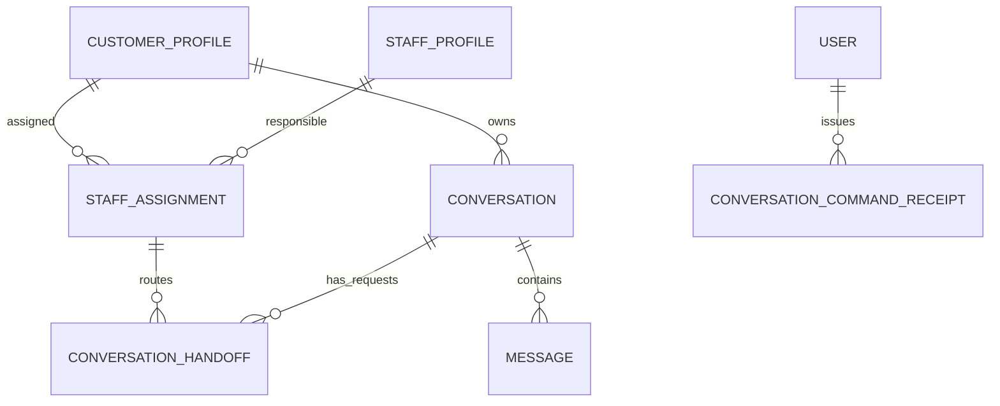
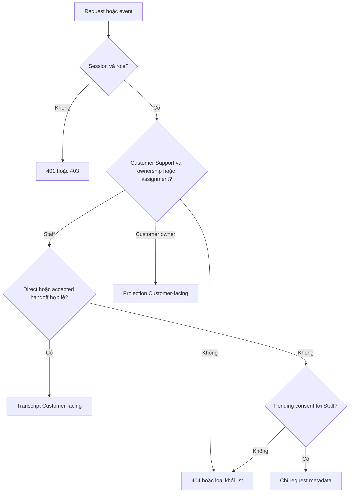
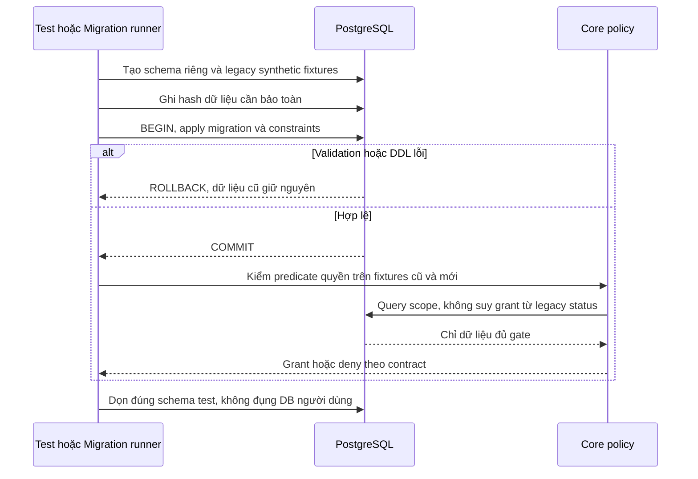

# I01 — Model, quyền và migration Inbox

Cập nhật 04/11/2026 · **Đã triển khai và kiểm chứng I01** · [Chỉ mục/contract chung](../03-inbox-contract.md) · [Nghiệp vụ](00-inbox-spec.md) · Tiếp: [I02](02-inbox-read-api.md).

## Data model và phạm vi ảnh hưởng

Bảng bên dưới mô tả tác động của phase, gồm cả ghi gián tiếp qua Core. Tên bảng thuộc schema `business` trừ nơi ghi rõ; cột còn đề xuất được đánh dấu **P**. Web không truy cập DB trực tiếp.

| Bảng/model | Cột hoặc dữ liệu liên quan | Thao tác của phase | Quan hệ/ràng buộc cần giữ | Mức ảnh hưởng và nơi bị tác động |
| --- | --- | --- | --- | --- |
| users + auth_sessions | users.id/role/status, auth_sessions.user_id/token_hash/expires_at/revoked_at | Đọc | AuthSession.user_id → User.id; session phải còn hạn, không bị thu hồi | Cao — mọi API dùng session; không trả token/hash trong DTO |
| staff_assignments + customer_profiles + staff_profiles | staff_id/customer_id/is_active/ended_at, assignment_version, user_id/full_name | Đọc | Assignment gắn đúng Customer/Staff; Inbox còn ràng buộc assignment id cụ thể | Cao — Customers, Policy Lookup, Ticket và Inbox cùng phụ thuộc phân công |
| conversations + conversation_handoffs | customer_id/channel_type/support_origin/direct_assignment_id/assigned_staff_id/status/control_version/subject, state/assignment_id/recipient_staff_id/shared_subject/shared_reason/accepted_at/revoked_at | Đọc | Direct đúng assignment lúc tạo hoặc handoff ACCEPTED còn grant; PENDING chỉ shared metadata, không AI subject/transcript | Cao — Inbox filter/deep link/REST/WS phải cùng gate; không suy grant từ status/assigned_staff_id |
| messages | conversation_id/sequence/audience/sender_type/sender_id/content/citations/created_at | Đọc | Unique (conversation_id,sequence); chỉ CUSTOMER_VISIBLE sau transcript gate; sequence bigint ra DTO dạng string | Cao — không lộ INTERNAL/LEGACY_REVIEW/tool_calls_metadata cho Customer/Staff transcript |
| conversations + conversation_handoffs | conversations.status/assigned_staff_id/control_version/support_origin/created_by_customer_id/direct_assignment_id; handoffs.state/consent_scope/consent_text_version/confirmed_by_customer_id/confirmed_at/accepted_by_staff_id/accepted_at | Create/request/Accept/revoke ghi | Composite FK conversation/customer và assignment/customer/recipient; partial unique một handoff PENDING/ACCEPTED; provenance/consent bất biến | Cao — quyền transcript chỉ sau Direct hợp lệ hoặc Accept, đổi assignment phải thu hồi grant |
| messages + conversations | messages.sequence/audience/client_message_id/internal_message_id/sender_type/sender_id/content; conversations.next_message_sequence/last_customer_facing_activity_at | Append ghi, không sửa/xóa nội dung cũ | Unique sequence và key theo conversation/sender; counter cấp dưới conversation lock | Cao — Accept tạo SYSTEM duy nhất, send/retry không trùng; send thường không tăng control_version |
| conversation_command_receipts | actor_id/operation/client_request_id/request_hash/resource_id/result_version | Thêm hoặc đọc để replay | Unique (actor_id,operation,client_request_id); resource_id do service kiểm theo operation | Cao — replay vẫn kiểm quyền; không dùng receipt chat như receipt Ticket |
| audit_logs | actor_id/action/target_type/target_id/outcome/request_id/metadata/created_at | Thêm khi mutation/cấp PDF theo service | actor_id → User.id; không sửa/xóa audit cũ; chỉ metadata allowlist | Cao — phải giữ bằng chứng đúng transaction nghiệp vụ; không lưu transcript/password/signed URL |

**Schema/migration:** I01 đã có migration thêm handoff/receipt và cột provenance/control/sequence/audience/keys, backfill legacy theo SQL hiện có; không chạy lại/sửa migration đã apply. SQL CHECK/partial unique bổ sung Prisma; legacy không tự grant.

**Nhất quán và hồi quy:** Reassignment khóa và revoke trong cùng transaction với đổi assignment; không xóa lịch sử. Kiểm migration legacy, capability và revoke/reassign cùng Staff bằng assignment mới.

## 1. Kết quả và phạm vi

Core phân biệt chat AI riêng, Direct và cuộc Customer cho phép chuyển/Staff Accept; cùng policy dùng cho REST và event. Không dựa vào assignedStaffId/status để suy quyền. Chuẩn bị message order/idempotency vừa đủ cho các phase sau.

Không thêm endpoint chat, UI, Agent runtime, Ticket workflow hoặc counts. Enum chat ba giá trị đã có; không làm lại migration xóa CLOSED hoặc sửa migration đã apply.

## 2. Vị trí triển khai


Đã tạo `conversations.module.ts`, `services/conversation-access.service.ts`, `services/conversation-command.service.ts`, `services/conversation-message.service.ts` và helper `services/conversation-revocation.ts` trong `apps/core/src/conversations/`. Chưa thêm controller/response DTO public; các phần đó thuộc I02/I03. Module chỉ export service nội bộ, không có endpoint chat.

| Vị trí từ root repo | Hiện trạng | Trách nhiệm trong phase | Mức ảnh hưởng | Phạm vi cần kiểm lại |
| --- | --- | --- | --- | --- |
| [apps/core/prisma/schema.prisma](<../../../../../apps/core/prisma/schema.prisma>) | Hiện có | Prisma models/relations/indexes I01 | Cao | Generated client, mọi writer Conversation/Message |
| [apps/core/prisma/migrations/](<../../../../../apps/core/prisma/migrations>) | Hiện có | SQL backfill/check/partial unique | Cao | DB cũ và clone mới, FK lịch sử |
| [apps/core/src/conversations/services/conversation-access.service.ts](<../../../../../apps/core/src/conversations/services/conversation-access.service.ts>) | Hiện có | Một gate cho metadata/transcript/send | Cao | REST Staff/Customer, realtime, future Copilot |
| [apps/core/src/conversations/services/conversation-command.service.ts](<../../../../../apps/core/src/conversations/services/conversation-command.service.ts>) | Hiện có | Lock, canonical hash, receipt/replay | Cao | Create/request/Accept/send |
| [apps/core/src/conversations/services/conversation-revocation.ts](<../../../../../apps/core/src/conversations/services/conversation-revocation.ts>) | Hiện có | Revoke theo assignment cụ thể | Cao | Operator reassignment, pending/accepted grant |
| [apps/core/src/accounts/services/account-management.service.ts](<../../../../../apps/core/src/accounts/services/account-management.service.ts>) | Hiện có | Assignment mutation gọi revoke | Cao | Account tool và toàn Inbox |
| [apps/core/src/database/database.service.ts](<../../../../../apps/core/src/database/database.service.ts>) | Hiện có | Readiness migration compatibility | Cao | Core startup và operator compatibility |
| [apps/core/src/admin/main.ts](<../../../../../apps/core/src/admin/main.ts>) | Hiện có | Compatibility đồng bộ migration mới | Cao | Kiểm caller và luồng hiện có mô tả trong hàng này |
| [apps/core/src/auth/services/auth.service.ts](<../../../../../apps/core/src/auth/services/auth.service.ts>) | Hiện có | Tái sử dụng me/authorizeWrite; không đưa nghiệp vụ chat vào auth | Cao | Kiểm caller và luồng hiện có mô tả trong hàng này |
| [apps/core/src/app.module.ts](<../../../../../apps/core/src/app.module.ts>) | Hiện có | Import ConversationsModule khi có service/controller cần dùng | Trung bình | Kiểm caller và luồng hiện có mô tả trong hàng này |

## 3. Schema đã triển khai

### 3.1. Conversation

| Field mới | Type/default | Ràng buộc |
| --- | --- | --- |
| supportOrigin | AI / DIRECT / LEGACY_UNKNOWN; nullable cho Copilot | Customer Support bắt buộc có; bất biến sau tạo. Legacy không tự thành Direct |
| createdByCustomerId | UUID nullable | Core lấy actor khi tạo mới; bằng customerId, không backfill actor giả |
| subject | varchar(180) nullable | AI subject chưa cho Staff đọc trước Accept |
| directAssignmentId | UUID nullable FK StaffAssignment | Chỉ DIRECT, lưu assignment cụ thể lúc tạo |
| controlVersion | int default 0 | Tăng khi request/Accept/reassignment; không tăng chỉ vì một tin mới |
| nextMessageSequence | bigint default 0 | Cấp sequence dưới khóa conversation |
| lastCustomerFacingActivityAt | timestamptz nullable | Chỉ từ CUSTOMER_VISIBLE, không tool/Copilot activity |

assignedStaffId là controller hiện tại, không là chứng cứ cấp quyền. Grant ràng buộc **assignment id còn active**: cùng Staff được gán lại ở assignment mới cũng không tự lấy lại grant cũ. linkedPolicyId không đổi khi mở policy; linkedContextConvId không cấp quyền Copilot.

### 3.2. ConversationHandoff — bảng mới

Lưu bền vững yêu cầu/chứng cứ chia sẻ/Accept, nhiều lần theo thời gian. Không dùng SupportTicket/aiSummary thay nó.

| Field | Ràng buộc |
| --- | --- |
| id, conversationId, customerId | UUID; composite FK bảo đảm cùng Customer/conversation |
| assignmentId, recipientStaffId | FK assignment; customer/staff khớp assignment đó |
| state | PENDING / ACCEPTED / REVOKED; state request, **không** thêm status chat |
| sharedSubject, sharedReason | 1–180 / 0–1000 ký tự; Customer nhập hoặc xác nhận rõ để chia sẻ |
| consentScope | ENTIRE_CUSTOMER_VISIBLE_CONVERSATION, giá trị cố định |
| consentTextVersion, confirmedByCustomerId, confirmedAt | Core chọn bản thông báo, actor ownership, thời gian server |
| acceptedByStaffId, acceptedAt | Cùng null trước Accept; sau Accept đúng recipientStaffId |
| revokedAt, revokeReason | Metadata thu hồi; không xóa chứng cứ/lịch sử |

Partial unique một handoff PENDING hoặc ACCEPTED chưa revoked cho mỗi conversation. Reassignment revoke record hiện hành trước request mới. Grant suy từ record ACCEPTED + assignment hiện hành; không boolean do client gửi.

Đề xuất consent gồm toàn bộ Customer-facing đã có và phát sinh khi Staff hỗ trợ trong cùng cuộc; UI nêu rõ. Không chia sẻ Copilot hoặc tự cấp tài liệu Private ngoài scope.

### 3.3. Message

Đã thêm `sequence bigint`, `audience CUSTOMER_VISIBLE / INTERNAL / LEGACY_REVIEW`, `clientMessageId UUID nullable` và `internalMessageId UUID nullable` cho trusted AI/SYSTEM writer (unique theo conversation). Unique `(conversationId,sequence)`; partial unique `(conversationId,senderId,clientMessageId)` khi sender/key non-null. AI/SYSTEM writer dùng receipt/internal operation id riêng, không giả senderId Customer.

Audience do trusted Core writer/channel quyết định, không từ body người dùng. SYSTEM chỉ CUSTOMER_VISIBLE khi được phép hiển thị cho Customer. toolCallsMetadata không vào transcript DTO; citations qua projection kiểm document/version/quyền riêng.

Legacy gán sequence ổn định `(createdAt,id)` theo từng cuộc, không sửa content/citations/tool metadata/timestamps/id. Customer Support cũ chưa có chứng cứ dùng LEGACY_REVIEW; Copilot INTERNAL. Không tự suy CUSTOMER_VISIBLE từ SenderType. Dữ liệu chưa review chưa hiện trong transcript, vẫn giữ DB để phân loại có bằng chứng. Phương án này đã áp dụng: dữ liệu cũ cần phân loại có bằng chứng trước khi hiện transcript. Provenance bất biến; việc review/backfill sau này cần migration/tool có audit riêng, chưa có API sửa origin.

### 3.4. ConversationCommandReceipt

Field: id, actorId, operation, clientRequestId, requestHash, resourceId, resultVersion, createdAt. Unique `(actorId,operation,clientRequestId)`. Operation allowlist CREATE_AI/CREATE_DIRECT/REQUEST_HANDOFF/ACCEPT_HANDOFF/SEND_MESSAGE. resourceId được service xác minh đúng loại; receipt id không là quyền.

Hash canonical DTO gồm expectedVersion/resource/content cần chống trùng. Chỉ lưu resource reference/hash/minimal result, không transcript/body/response Private nguyên khối. SEND_MESSAGE thêm unique clientMessageId tại Message. Bản đầu giữ receipt trong DB, **chưa TTL/xóa tự động**; retention chốt riêng. Replay phải reauthorize, không phát lại response đã cache khi mất quyền.

### 3.5. Index/constraints

- Conversation unique `(id,customerId)` cho composite FK; index `(customerId,status,lastCustomerFacingActivityAt,id)`.
- Handoff index `(recipientStaffId,assignmentId,state,confirmedAt,id)` và `(conversationId,state)`; FK/check bảo đảm assignment/customer/staff đúng nhau.
- Message index `(conversationId,audience,sequence)` cho before/after; không full-text search nội dung.
- DIRECT phải có creator/direct assignment hợp lệ lúc tạo; AI/LEGACY_UNKNOWN không directAssignmentId. Copilot không đi qua support endpoints.
- CHECK accepted fields/state/timestamps nhất quán, version/sequence không âm. SQL migration thể hiện partial unique nếu Prisma chưa biểu diễn đủ.
- Giữ FK linkedPolicy cùng Customer và constraints hiện có, không nới constraints chỉ để bỏ qua lỗi migration.

## 4. Policy dùng chung

Quan hệ đề xuất bổ sung, không thay ERD của các module Account/Policy:



Direct trỏ assignment lúc tạo; handoff lưu assignment từng lần chuyển. Receipt resource reference được service kiểm đúng operation; không vẽ FK giả từ một UUID đa loại sang mọi bảng.

Service trả capability `NONE`, `REQUEST_METADATA`, `TRANSCRIPT`, kèm canAccept/canSend. Predicate query và kiểm resource cùng quy tắc; không tải transcript rồi lọc/xóa sau paginate.

| Staff case | Capability | Accept/send |
| --- | --- | --- |
| AI riêng/Copilot/legacy thiếu chứng cứ | NONE | Không |
| Pending consent tới assignment hiện tại | REQUEST_METADATA | Accept có, send không |
| Handoff ACCEPTED bởi đúng Staff/assignment còn active | TRANSCRIPT | Send khi STAFF_ACTIVE/controller khớp |
| DIRECT với creator/assignment provenance hiện hành | TRANSCRIPT | Send khi STAFF_ACTIVE/controller khớp |
| Assignment hết hạn/user khóa/phiên mất | NONE | Không |
| Chỉ Ticket/notification/link/cursor/assignedStaffId | Không đổi capability | Không tự cấp |

Customer chỉ đọc CUSTOMER_SUPPORT ownership, projection đúng audience; không STAFF_COPILOT dù customerId trùng. Legacy chưa review trả trạng thái không khả dụng an toàn, không suy consent từ actor cũ.



## 5. Locks, reassignment và Agent fence

Chuẩn hóa writer: **users liên quan theo UUID tăng dần → CustomerProfile/assignment hiện hành → Conversation theo UUID tăng dần → handoff/message/receipt**. Account management hiện khóa users có thứ tự; review advisory locks cũ để không đảo thứ tự. Không khóa conversation rồi quay lại users. Auth/revocation đọc lại trong transaction, không từ cache ngoài transaction.

Assignment mutation cùng transaction: kết thúc assignment cũ → revoke handoff → tăng controlVersion → bỏ controller cuộc bị ảnh hưởng. STAFF_ACTIVE/PENDING về AI_ACTIVE; AI writer vẫn bị chặn nếu provenance/routing chưa hợp lệ. Direct cũ Customer vẫn đọc lịch sử nhưng không gửi Staff, không tự bật AI. Không xóa messages/receipts. Staff mới cần request/Accept mới hoặc Direct mới; không đổi origin cuộc AI.

AI append tương lai nhận expectedControlVersion, kiểm origin AI + status AI_ACTIVE + audience dưới cùng lock. Request/Accept/revoke tăng version làm output cũ bị từ chối. Đề xuất dừng AI ngay khi request commit. Không thêm public endpoint giả mạo AI; transport/Agent auth phải có kế hoạch riêng.

## 6. API trong phase

**Không thêm public endpoint I01.** Internal interface đã có:

| Interface | Input | Kết quả |
| --- | --- | --- |
| `access.staffScope(actorId,filter)` | Actor từ session | Predicate Prisma dùng trong tx trước group/cursor |
| `access.requireMetadata(tx,actorId,id)` | UUID | Safe projection hoặc 404 |
| `access.requireTranscript(tx,actorId,id)` | UUID | Grant hiện hành hoặc 404 |
| `commands.execute(tx,actorId,operation,key,payload,authorize,work)` | DTO validated, callback authorize bắt buộc | Canonical hash, reauthorize cả replay, receipt tối thiểu |
| `messages.send(actor,id,key,expectedVersion,text,authorize)` | Trusted actor + callback session bắt buộc | Append/receipt/audit/outbox atomic |
| `messages.appendAI(customerId,id,internalMessageId,expectedVersion,text,authorizeService)` | Trusted service callback bắt buộc, không public endpoint | Internal idempotency + control fence, không giả actor Customer |

Access/execute nhận tx; send/appendAI là transaction boundary và dùng các helper tx bên trong, không gọi lồng hai boundary. `commands.transaction` retry tối đa3 lần cho routing discovery race/serialization/deadlock; lỗi nghiệp vụ không retry. Không phát event ra socket trước commit; outbox chỉ ghi DB, worker I06 chưa có. Controller tương lai phải lấy actor từ session, không body.

## 7. Các bước migration

1. Kiểm enum/dependencies/legacy bằng số liệu tổng hợp, không log nội dung.
2. Migration additive mới: fields/tables/types/index/constraints. Legacy origin LEGACY_UNKNOWN; audience/order theo phương án review, không tạo handoff/receipt giả.
3. Backfill sequence/counter atomic, locks khi cần. Dừng writer chưa tương thích trong deploy local; không hứa zero downtime.
4. Kiểm grants bảng/type mới: Core/admin DML, viewer chỉ đọc, Agent không business DB.
5. Generate client/build, compatibility Core/operator; deploy Docker migrate; đối chiếu hash nội dung/link/time trước/sau.
6. Deploy lại không duplicate/pending. Migration fail rollback transaction; không reset DB/volume. Rollback app dùng bản tương thích, không drop cột/bảng có chứng cứ.

## 8. Test cases

Các ca dưới đây là **đặc tả kiểm thử**, không phải báo cáo kết quả. Kiểm từng lớp API/service/DB/browser đúng nhãn; mock UI không thay kiểm quyền Core hoặc E2E thật.

**Quy ước dữ liệu:** S-A/S-B là hai Staff synthetic; C-A/C-B là hai Customer synthetic khác nhau. Thay alias bằng UUID/token của fixture cô lập; các path HTTP dùng prefix /api/v1 nếu chưa ghi đầy đủ. Chỉ thay assignment, khóa account, inject lỗi hoặc migration trong harness/môi trường test, không trên tài khoản/dữ liệu đang sử dụng.

### I01-T01 — Predicate không cấp quyền từ status hoặc assignment đơn thuần

**Lớp kiểm thử:** Service + DB.
**Điều kiện và dữ liệu:** Schema test có AI origin/legacy STAFF_ACTIVE/Copilot và active assignment S-A→C-A.

**Các bước:**

1. Gọi staffScope/requireMetadata/requireTranscript cho từng cuộc.
2. Đổi status/controller của fixture nhưng không thêm consent/acceptance hợp lệ.
3. Gọi lại các policy.

**Kết quả mong đợi:** Không tự có grant từ cờ legacy/controller; Copilot/AI riêng không vào Staff Customer-facing scope.

### I01-T02 — Pending và accepted gắn đúng assignment

**Lớp kiểm thử:** Service + DB.
**Điều kiện và dữ liệu:** Pending handoff thuộc C-A, recipient S-A và assignmentId=a1.

**Các bước:**

1. Gọi metadata/transcript bằng S-A và S-B.
2. Accept bằng S-A trong harness.
3. Revoke a1, gán lại cùng S-A bằng a2 rồi đọc lại.

**Kết quả mong đợi:** Pending chỉ metadata; accepted mở lịch sử Customer-visible; a2 không hồi sinh grant gắn a1.

### I01-T03 — Provenance và constraints ở DB

**Lớp kiểm thử:** DB integration.
**Điều kiện và dữ liệu:** DB/schema riêng có Direct hợp lệ, AI và handoff fixture.

**Các bước:**

1. Thử đổi origin AI thành Direct.
2. Thử handoff trỏ assignment/Customer không khớp hoặc hai handoff hiện hành.
3. Thử chèn message audience/sequence vi phạm contract.

**Kết quả mong đợi:** DB từ chối dữ liệu sai, rollback transaction; không chỉ dựa validation FE/DTO.

### I01-T04 — Idempotency và rollback message

**Lớp kiểm thử:** Service + DB barrier.
**Điều kiện và dữ liệu:** Cuộc Direct hợp lệ; key K và expectedVersion hiện hành.

**Các bước:**

1. Gửi đồng thời hai lần cùng K/content.
2. Gửi hai key khác nhau.
3. Inject lỗi outbox sau append rồi đọc message/counter/receipt.

**Kết quả mong đợi:** Cùng key một message/receipt, hai key là hai intent; sequence unique; lỗi transaction không để message/counter/receipt/outbox nửa chừng.

### I01-T05 — Migration giữ dữ liệu và không backfill quyền

**Lớp kiểm thử:** Migration harness.
**Điều kiện và dữ liệu:** Schema riêng có legacy messages cùng timestamp, internal payload và Ticket/policy liên kết.

**Các bước:**

1. Ghi hash các field cần bảo toàn.
2. Apply migration rồi kiểm order/provenance/grant.
3. Inject failure và kiểm rollback trong schema riêng khác.

**Kết quả mong đợi:** Nội dung/time/link giữ nguyên, order ổn định, không tạo consent/grant giả; failure rollback DDL/data. Không chạy trên DB đang dùng.

**Suite tham khảo:** [conversation-permissions.test.cjs](../../../../../apps/core/test/conversation-permissions.test.cjs). Tên suite là vị trí tự động hóa, không phải chứng nhận các ca đã chạy.

**Dọn sau kiểm thử:** xóa đúng fixture/session/object/schema theo runId; phục hồi fault injection và đóng context/socket test. Không reset DB/credential, sửa bootstrap hoặc xóa volumes. Với PDF kiểm metadata/bytes/hash; với UI kiểm DOM/focus/network, không cần screenshot.

## 9. Điều kiện hoàn tất

- [x] Review audience legacy, pending AI, reassignment trước migration.
- [x] Schema/policy/index/constraint/compatibility và tests pass.
- [x] Không grant từ assignedStaffId/status hoặc backfill consent giả.
- [x] Cập nhật model/runtime docs; chưa đánh dấu API/UI Inbox xong.

**Checkpoint:** Bắt đầu I02 khi policy chứng minh deny-before-Accept ở query/service. Chưa có thao tác UI mới để manual test.


## 10. Ghi chú triển khai

Migration `202611040001_inbox_foundation` đã apply bằng Docker; deploy lại không pending. Thêm hai bảng business `conversation_handoffs`, `conversation_command_receipts`, tổng19 bảng ứng dụng/6 migrations. PostgreSQL constraints/triggers giữ provenance/consent bất biến, cùng Customer/assignment và một handoff hiện hành; grant/query không suy từ status/controller. Index/FK có map tên PostgreSQL giới hạn63 ký tự, Prisma migrate diff trả empty.


Lệnh chạy lại từ root, khi PostgreSQL Docker và migration đã sẵn sàng:

```powershell
node --test apps/core/test/conversation-model-migration.test.cjs
docker compose --profile tests build core-tests
docker compose --profile tests run --rm --no-deps core-tests
docker compose --profile tests run --rm --no-deps core-tests node --test test/http-foundation.test.cjs
```

Test profile dùng credential volumes readonly và fixture synthetic theo runId, tự dọn đúng ID; không seed bootstrap, không mở Core/Web trên host, không xuất credential. Không có script/file tạm hoặc `.local` mới. Core local qua gateway vẫn `http://localhost:8080`; không tạo file riêng ngoài repo hoặc credential mới. Đây chưa là public send API: giới hạn/normalization trong service chuẩn bị nền, I03/I05 còn phải làm HTTP/CSRF/rate limit/DTO/reconcile/UI đúng kế hoạch.

## Sequence diagram

Luồng chính và nhánh quyền/lỗi; test case ở trên chỉ rõ dữ liệu và điểm kiểm tương ứng.


